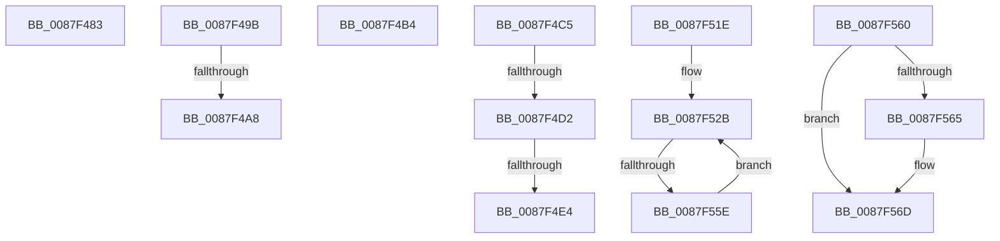

# sub_0087F483

- RVA: `0x0087F483`–`0x0087F580` (길이 `253` bytes)
- VA: `0x000000014087F483`
- 실행 섹션: `PAGE`
- PDB 이름 있음: `아니요`; PDB Function 태그: `아니요`
- unwind 정보 RVA: `0x0007C1F4`
- 디코드: `53`개 명령, `253/253` bytes 표시
- 미해석 바이트: `0` (있으면 어셈블리에 `.byte`로 보존)

> 이 문서는 커널 이미지의 기계어와 PDB 기호를 분석해 생성했습니다. 4번과 5번은 함수 원형과 자료형을 바이너리 사용 방식에서 추정한 C 해석이며 원본 소스 복구 결과는 아닙니다.

## 1. Dependencies

- 직접 호출 지점: **4**; 고유 호출 대상: **3**
- 직접 호출자로 확인된 함수: **0**
- RIP 상대 이미지 참조: **0**

### Outgoing calls
- `0x0087F501` → [PspSendJobNotification](../../text/49/PspSendJobNotification_function_0049EC28.md) (function, `0x0049EC28`)
- `0x0087F534` → [PspLockJobMemoryLimitsExclusive](../91/PspLockJobMemoryLimitsExclusive_function_00916990.md) (function, `0x00916990`)
- `0x0087F549` → [PspUnlockJobMemoryLimitsExclusive](PspUnlockJobMemoryLimitsExclusive_function_0087D390.md) (function, `0x0087D390`)
- `0x0087F576` → [PspUnlockJobMemoryLimitsExclusive](PspUnlockJobMemoryLimitsExclusive_function_0087D390.md) (function, `0x0087D390`)

### Direct callers
- 이 함수 시작 RVA로 연결되는 직접 call은 확인되지 않았습니다. 간접 호출은 완전히 역산할 수 없습니다.

### Static image references
- 디코드된 RIP-relative 메모리 참조가 없습니다.

## 2. Other-region calls and transfers

- 다른 실행 섹션으로 향하는 call: **1**
  - `0x0087F501` → [PspSendJobNotification](../../text/49/PspSendJobNotification_function_0049EC28.md) (`PAGE` → `.text`)
- call이 아닌 외부 분기/꼬리 이동: **9**
  - `0x0087F496` → [sub_0087F08B + 0x91](Unknown_function_0087F08B.md) (`tail-transfer`)
  - `0x0087F4A2` → [sub_0087F08B + 0x158](Unknown_function_0087F08B.md) (`tail-transfer`)
  - `0x0087F4AF` → [sub_0087F08B + 0x158](Unknown_function_0087F08B.md) (`tail-transfer`)
  - `0x0087F4C0` → [sub_0087F31F + 0x11E](Unknown_function_0087F31F.md) (`tail-transfer`)
  - `0x0087F4CC` → [sub_0087F31F + 0x12D](Unknown_function_0087F31F.md) (`tail-transfer`)
  - `0x0087F4DE` → [sub_0087F31F + 0x12D](Unknown_function_0087F31F.md) (`tail-transfer`)
  - `0x0087F519` → [sub_0087F31F + 0x12D](Unknown_function_0087F31F.md) (`tail-transfer`)
  - `0x0087F558` → [sub_0087F08B + 0x21D](Unknown_function_0087F08B.md) (`tail-transfer`)
  - `0x0087F57B` → [sub_0087F08B + 0x1DB](Unknown_function_0087F08B.md) (`tail-transfer`)

## 3. Assembly (complete function range)

```asm
0087F483  4D 8B E9                        mov r13, r9
0087F486  4C 89 4C 24 38                  mov qword ptr [rsp + 0x38], r9
0087F48B  45 33 C9                        xor r9d, r9d
0087F48E  4C 89 8C 24 A8 00 00 00         mov qword ptr [rsp + 0xa8], r9
0087F496  E9 81 FC FF FF                  jmp 0x14087f11c
0087F49B  4C 3B 87 C0 02 00 00            cmp r8, qword ptr [rdi + 0x2c0]
0087F4A2  0F 86 3B FD FF FF               jbe 0x14087f1e3
0087F4A8  4D 85 C9                        test r9, r9
0087F4AB  41 0F 4F CB                     cmovg ecx, r11d
0087F4AF  E9 2F FD FF FF                  jmp 0x14087f1e3
0087F4B4  4C 89 BF B8 04 00 00            mov qword ptr [rdi + 0x4b8], r15
0087F4BB  48 8B 4C 24 28                  mov rcx, qword ptr [rsp + 0x28]
0087F4C0  E9 78 FF FF FF                  jmp 0x14087f43d
0087F4C5  44 85 97 50 04 00 00            test dword ptr [rdi + 0x450], r10d
0087F4CC  0F 84 7A FF FF FF               je 0x14087f44c
0087F4D2  41 8B 84 24 F0 01 00 00         mov eax, dword ptr [r12 + 0x1f0]
0087F4DA  24 24                           and al, 0x24
0087F4DC  3C 04                           cmp al, 4
0087F4DE  0F 85 68 FF FF FF               jne 0x14087f44c
0087F4E4  F0 41 83 8C 24 F0 01 00 00 20   lock or dword ptr [r12 + 0x1f0], 0x20
0087F4EE  4D 8B 84 24 D0 01 00 00         mov r8, qword ptr [r12 + 0x1d0]
0087F4F6  41 B1 01                        mov r9b, 1
0087F4F9  BA 0A 00 00 00                  mov edx, 0xa
0087F4FE  48 8B CF                        mov rcx, rdi
0087F501  E8 22 F7 C1 FF                  call 0x14049ec28
0087F506  4C 8B 44 24 30                  mov r8, qword ptr [rsp + 0x30]
0087F50B  41 BA 00 02 00 00               mov r10d, 0x200
0087F511  4C 8B 8C 24 98 00 00 00         mov r9, qword ptr [rsp + 0x98]
0087F519  E9 2E FF FF FF                  jmp 0x14087f44c
0087F51E  48 8B 7C 24 28                  mov rdi, qword ptr [rsp + 0x28]
0087F523  4C 8B BC 24 98 00 00 00         mov r15, qword ptr [rsp + 0x98]
0087F52B  45 33 C0                        xor r8d, r8d
0087F52E  49 8B D6                        mov rdx, r14
0087F531  49 8B CD                        mov rcx, r13
0087F534  E8 57 74 09 00                  call 0x140916990
0087F539  4D 29 BD B8 04 00 00            sub qword ptr [r13 + 0x4b8], r15
0087F540  45 33 C0                        xor r8d, r8d
0087F543  49 8B D6                        mov rdx, r14
0087F546  49 8B CD                        mov rcx, r13
0087F549  E8 42 DE FF FF                  call 0x14087d390
0087F54E  4D 8B AD 18 05 00 00            mov r13, qword ptr [r13 + 0x518]
0087F555  4C 3B EF                        cmp r13, rdi
0087F558  0F 84 4A FD FF FF               je 0x14087f2a8
0087F55E  EB CB                           jmp 0x14087f52b
0087F560  40 84 F6                        test sil, sil
0087F563  74 08                           je 0x14087f56d
0087F565  48 89 7C 24 28                  mov qword ptr [rsp + 0x28], rdi
0087F56A  40 32 F6                        xor sil, sil
0087F56D  45 33 C0                        xor r8d, r8d
0087F570  49 8B D6                        mov rdx, r14
0087F573  48 8B CF                        mov rcx, rdi
0087F576  E8 15 DE FF FF                  call 0x14087d390
0087F57B  E9 E6 FC FF FF                  jmp 0x14087f266
```

## 4. C-style interpretation (structured pseudocode)

```c
__int64 __fastcall sub_0087F483(__int64 a1, __int64 a2, __int64 a3, __int64 a4)
{
    unsigned __int64 v_stack_p28;
    unsigned __int64 v_stack_p30;
    unsigned __int64 v_stack_p38;
    unsigned __int64 v_stack_p98;
    unsigned __int64 v_stack_pA8;

    v_stack_p38 = a4;
    a4 = 0;
    v_stack_pA8 = 0;
}
```

## 5. (Beta) C Style

```c
int64_t sub_0087F483(int64_t Arg1, int64_t Arg2, int64_t Arg3, int64_t Arg4)
{
    uint64_t v_stack_p28;
    uint64_t v_stack_p30;
    uint64_t v_stack_p38;
    uint64_t v_stack_p98;
    uint64_t v_stack_pA8;

    v_stack_p38 = Arg4;
    Arg4 = 0;
    v_stack_pA8 = 0;
}
```

## 6. Execution-region graph

[열기: 2D/3D 그래프와 함수 탐색 컨트롤 패널](../../../control-panel.html?section=page&rva=0x0087F483&view=graph)

- 2D 그래프는 위에서 아래로 흐르고, 3D 그래프는 빈 공간을 드래그해 회전합니다. Shift+드래그는 이동, 휠은 확대·축소, 함수 노드 선택은 대상 보고서 이동입니다.

### Static fallback


