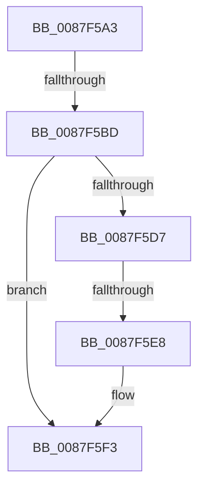

# sub_0087F5A3

- RVA: `0x0087F5A3`–`0x0087F611` (길이 `110` bytes)
- VA: `0x000000014087F5A3`
- 실행 섹션: `PAGE`
- PDB 이름 있음: `아니요`; PDB Function 태그: `아니요`
- unwind 정보 RVA: `0x0007C228`
- 디코드: `29`개 명령, `110/110` bytes 표시
- 미해석 바이트: `0` (있으면 어셈블리에 `.byte`로 보존)

> 이 문서는 커널 이미지의 기계어와 PDB 기호를 분석해 생성했습니다. 4번과 5번은 함수 원형과 자료형을 바이너리 사용 방식에서 추정한 C 해석이며 원본 소스 복구 결과는 아닙니다.

## 1. Dependencies

- 직접 호출 지점: **3**; 고유 호출 대상: **3**
- 직접 호출자로 확인된 함수: **0**
- RIP 상대 이미지 참조: **0**

### Outgoing calls
- `0x0087F5C0` → [MiLocateAddress](../../text/31/MiLocateAddress_function_003168D0.md) (function, `0x003168D0`)
- `0x0087F5DA` → [MiGetNextVad](../../text/29/MiGetNextVad_function_00297224.md) (function, `0x00297224`)
- `0x0087F5EE` → [MiUnlockVad](../../text/2A/MiUnlockVad_function_002A59C8.md) (function, `0x002A59C8`)

### Direct callers
- 이 함수 시작 RVA로 연결되는 직접 call은 확인되지 않았습니다. 간접 호출은 완전히 역산할 수 없습니다.

### Static image references
- 디코드된 RIP-relative 메모리 참조가 없습니다.

## 2. Other-region calls and transfers

- 다른 실행 섹션으로 향하는 call: **3**
  - `0x0087F5C0` → [MiLocateAddress](../../text/31/MiLocateAddress_function_003168D0.md) (`PAGE` → `.text`)
  - `0x0087F5DA` → [MiGetNextVad](../../text/29/MiGetNextVad_function_00297224.md) (`PAGE` → `.text`)
  - `0x0087F5EE` → [MiUnlockVad](../../text/2A/MiUnlockVad_function_002A59C8.md) (`PAGE` → `.text`)
- call이 아닌 외부 분기/꼬리 이동: **3**
  - `0x0087F5B7` → [sub_0087F646](Unknown_function_0087F646.md) (`tail-transfer`)
  - `0x0087F5E6` → [sub_0087F61E](Unknown_function_0087F61E.md) (`tail-transfer`)
  - `0x0087F60F` → [sub_0087F65A](Unknown_function_0087F65A.md) (`tail-transfer`)

## 3. Assembly (complete function range)

```asm
0087F5A3  48 89 74 24 40                  mov qword ptr [rsp + 0x40], rsi
0087F5A8  41 8B F1                        mov esi, r9d
0087F5AB  48 89 7C 24 48                  mov qword ptr [rsp + 0x48], rdi
0087F5B0  49 8B F8                        mov rdi, r8
0087F5B3  48 83 FA FF                     cmp rdx, -1
0087F5B7  0F 84 89 00 00 00               je 0x14087f646
0087F5BD  48 8B CA                        mov rcx, rdx
0087F5C0  E8 0B 73 A9 FF                  call 0x1403168d0
0087F5C5  4C 89 74 24 50                  mov qword ptr [rsp + 0x50], r14
0087F5CA  4C 8B D0                        mov r10, rax
0087F5CD  4C 89 7C 24 20                  mov qword ptr [rsp + 0x20], r15
0087F5D2  48 85 FF                        test rdi, rdi
0087F5D5  74 1C                           je 0x14087f5f3
0087F5D7  49 8B CA                        mov rcx, r10
0087F5DA  E8 45 7C A1 FF                  call 0x140297224
0087F5DF  4C 8B F0                        mov r14, rax
0087F5E2  48 83 FF 01                     cmp rdi, 1
0087F5E6  75 36                           jne 0x14087f61e
0087F5E8  49 8B D2                        mov rdx, r10
0087F5EB  48 8B CB                        mov rcx, rbx
0087F5EE  E8 D5 63 A2 FF                  call 0x1402a59c8
0087F5F3  4C 8B 7C 24 20                  mov r15, qword ptr [rsp + 0x20]
0087F5F8  85 F6                           test esi, esi
0087F5FA  48 8B 74 24 40                  mov rsi, qword ptr [rsp + 0x40]
0087F5FF  48 8B D5                        mov rdx, rbp
0087F602  4C 8B 74 24 50                  mov r14, qword ptr [rsp + 0x50]
0087F607  48 8B CB                        mov rcx, rbx
0087F60A  48 8B 7C 24 48                  mov rdi, qword ptr [rsp + 0x48]
0087F60F  75 49                           jne 0x14087f65a
```

## 4. C-style interpretation (structured pseudocode)

```c
__int64 __fastcall sub_0087F5A3(__int64 a1, __int64 a2, __int64 a3, int a4, __int64 a5, __int64 a6, __int64 a7, __int64 a8, __int64 a9, __int64 a10)
{
    __int64 result;
    unsigned __int64 v_stack_p20;
    unsigned __int64 v_stack_p40;
    unsigned __int64 v_stack_p48;
    unsigned __int64 v_stack_p50;

    v_stack_p40 = v_rsi;
    v_stack_p48 = v_rdi;
    result = MiLocateAddress(a2, a2, a3, a4);
    v_stack_p50 = v_r14;
    v_stack_p20 = v_r15;
    if (a3 == 0) goto loc_0087F5F3;
    result = MiGetNextVad(result, a2, a3, a4);
    result = MiUnlockVad(v_rbx, result, a3, a4);
loc_0087F5F3:
}
```

## 5. (Beta) C Style

```c
int64_t sub_0087F5A3(int64_t Arg1, int64_t Arg2, int64_t Arg3, int32_t Arg4, uint64_t Arg5, uint64_t Arg6, uint64_t Arg7, int64_t Arg8, int64_t Arg9, int64_t Arg10)
{
    int64_t result;
    uint64_t v_stack_p20;
    uint64_t v_stack_p40;
    uint64_t v_stack_p48;
    uint64_t v_stack_p50;

    v_stack_p40 = local_rsi;
    v_stack_p48 = local_rdi;
    result = MiLocateAddress(Arg2, Arg2, Arg3, Arg4);
    v_stack_p50 = local_r14;
    v_stack_p20 = local_r15;
    if (Arg3 == 0) goto loc_0087F5F3;
    result = MiGetNextVad(result, Arg2, Arg3, Arg4);
    result = MiUnlockVad(local_rbx, result, Arg3, Arg4);
loc_0087F5F3:
}
```

## 6. Execution-region graph

[열기: 2D/3D 그래프와 함수 탐색 컨트롤 패널](../../../control-panel.html?section=page&rva=0x0087F5A3&view=graph)

- 2D 그래프는 위에서 아래로 흐르고, 3D 그래프는 빈 공간을 드래그해 회전합니다. Shift+드래그는 이동, 휠은 확대·축소, 함수 노드 선택은 대상 보고서 이동입니다.

### Static fallback


