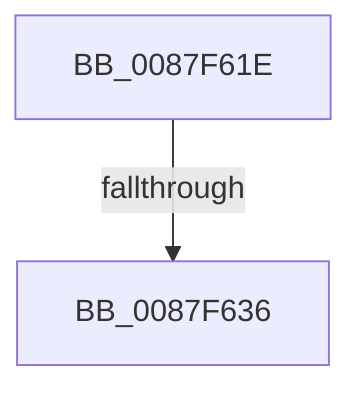

# sub_0087F61E

- RVA: `0x0087F61E`–`0x0087F646` (길이 `40` bytes)
- VA: `0x000000014087F61E`
- 실행 섹션: `PAGE`
- PDB 이름 있음: `아니요`; PDB Function 태그: `아니요`
- unwind 정보 RVA: `0x0007C25C`
- 디코드: `11`개 명령, `40/40` bytes 표시
- 미해석 바이트: `0` (있으면 어셈블리에 `.byte`로 보존)

> 이 문서는 커널 이미지의 기계어와 PDB 기호를 분석해 생성했습니다. 4번과 5번은 함수 원형과 자료형을 바이너리 사용 방식에서 추정한 C 해석이며 원본 소스 복구 결과는 아닙니다.

## 1. Dependencies

- 직접 호출 지점: **1**; 고유 호출 대상: **1**
- 직접 호출자로 확인된 함수: **0**
- RIP 상대 이미지 참조: **0**

### Outgoing calls
- `0x0087F639` → [KeAbPostRelease](../../text/2E/KeAbPostRelease_function_002E1600.md) (function, `0x002E1600`)

### Direct callers
- 이 함수 시작 RVA로 연결되는 직접 call은 확인되지 않았습니다. 간접 호출은 완전히 역산할 수 없습니다.

### Static image references
- 디코드된 RIP-relative 메모리 참조가 없습니다.

## 2. Other-region calls and transfers

- 다른 실행 섹션으로 향하는 call: **1**
  - `0x0087F639` → [KeAbPostRelease](../../text/2E/KeAbPostRelease_function_002E1600.md) (`PAGE` → `.text`)
- call이 아닌 외부 분기/꼬리 이동: **2**
  - `0x0087F634` → [sub_0087F650](Unknown_function_0087F650.md) (`tail-transfer`)
  - `0x0087F644` → [sub_0087F5A3 + 0x2F](Unknown_function_0087F5A3.md) (`tail-transfer`)

## 3. Assembly (complete function range)

```asm
0087F61E  4D 8D 7A 28                     lea r15, [r10 + 0x28]
0087F622  48 C7 C2 FF FF FF FF            mov rdx, 0xffffffffffffffff
0087F629  F0 49 0F C1 17                  lock xadd qword ptr [r15], rdx
0087F62E  80 E2 06                        and dl, 6
0087F631  80 FA 02                        cmp dl, 2
0087F634  74 1A                           je 0x14087f650
0087F636  49 8B CF                        mov rcx, r15
0087F639  E8 C2 1F A6 FF                  call 0x1402e1600
0087F63E  4D 8B D6                        mov r10, r14
0087F641  48 FF CF                        dec rdi
0087F644  EB 8C                           jmp 0x14087f5d2
```

## 4. C-style interpretation (structured pseudocode)

```c
__int64 __fastcall sub_0087F61E(void)
{
    __int64 result;
    __int64 v_rdi;

    a2 = (unsigned __int8)((-1) & (6));
    result = KeAbPostRelease(v_r10 + 40, a2, a3, a4);
    v_rdi = (v_rdi) - 1;
}
```

## 5. (Beta) C Style

```c
void sub_0087F61E(void)
{
    int64_t result;
    int64_t local_rdi;

    a2 = (uint8_t)((-1) & (6));
    result = KeAbPostRelease(local_r10 + 40, a2, a3, a4);
    local_rdi = (local_rdi) - 1;
}
```

## 6. Execution-region graph

[열기: 2D/3D 그래프와 함수 탐색 컨트롤 패널](../../../control-panel.html?section=page&rva=0x0087F61E&view=graph)

- 2D 그래프는 위에서 아래로 흐르고, 3D 그래프는 빈 공간을 드래그해 회전합니다. Shift+드래그는 이동, 휠은 확대·축소, 함수 노드 선택은 대상 보고서 이동입니다.

### Static fallback


