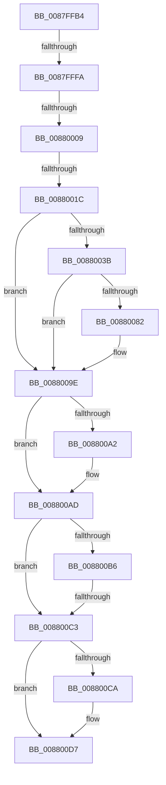

# sub_0087FFB4

- RVA: `0x0087FFB4`–`0x008800F2` (길이 `318` bytes)
- VA: `0x000000014087FFB4`
- 실행 섹션: `PAGE`
- PDB 이름 있음: `아니요`; PDB Function 태그: `아니요`
- unwind 정보 RVA: `0x0007C3E0`
- 디코드: `74`개 명령, `318/318` bytes 표시
- 미해석 바이트: `0` (있으면 어셈블리에 `.byte`로 보존)

> 이 문서는 커널 이미지의 기계어와 PDB 기호를 분석해 생성했습니다. 4번과 5번은 함수 원형과 자료형을 바이너리 사용 방식에서 추정한 C 해석이며 원본 소스 복구 결과는 아닙니다.

## 1. Dependencies

- 직접 호출 지점: **4**; 고유 호출 대상: **4**
- 직접 호출자로 확인된 함수: **0**
- RIP 상대 이미지 참조: **0**

### Outgoing calls
- `0x00880031` → [MiObtainReferencedVadEx](../../text/31/MiObtainReferencedVadEx_function_00316690.md) (function, `0x00316690`)
- `0x00880076` → [MiFreeVirtualMemory](../88/MiFreeVirtualMemory_function_00880268.md) (function, `0x00880268`)
- `0x008800A8` → [KiUnstackDetachProcess](../../text/21/KiUnstackDetachProcess_function_00217D30.md) (function, `0x00217D30`)
- `0x008800D2` → [ObfDereferenceObjectWithTag](../../text/2F/ObfDereferenceObjectWithTag_function_002F78E0.md) (function, `0x002F78E0`)

### Direct callers
- 이 함수 시작 RVA로 연결되는 직접 call은 확인되지 않았습니다. 간접 호출은 완전히 역산할 수 없습니다.

### Static image references
- 디코드된 RIP-relative 메모리 참조가 없습니다.

## 2. Other-region calls and transfers

- 다른 실행 섹션으로 향하는 call: **3**
  - `0x00880031` → [MiObtainReferencedVadEx](../../text/31/MiObtainReferencedVadEx_function_00316690.md) (`PAGE` → `.text`)
  - `0x008800A8` → [KiUnstackDetachProcess](../../text/21/KiUnstackDetachProcess_function_00217D30.md) (`PAGE` → `.text`)
  - `0x008800D2` → [ObfDereferenceObjectWithTag](../../text/2F/ObfDereferenceObjectWithTag_function_002F78E0.md) (`PAGE` → `.text`)
- call이 아닌 외부 분기/꼬리 이동: **4**
  - `0x0087FFF4` → [sub_0088018D + 0x1A](../88/Unknown_function_0088018D.md) (`tail-transfer`)
  - `0x00880003` → [sub_0088018D](../88/Unknown_function_0088018D.md) (`tail-transfer`)
  - `0x00880016` → [sub_00880151](../88/Unknown_function_00880151.md) (`tail-transfer`)
  - `0x008800BD` → [sub_00880246](../88/Unknown_function_00880246.md) (`tail-transfer`)

## 3. Assembly (complete function range)

```asm
0087FFB4  48 89 9C 24 48 01 00 00         mov qword ptr [rsp + 0x148], rbx
0087FFBC  41 8B DB                        mov ebx, r11d
0087FFBF  4C 89 AC 24 F8 00 00 00         mov qword ptr [rsp + 0xf8], r13
0087FFC7  4C 89 BC 24 F0 00 00 00         mov qword ptr [rsp + 0xf0], r15
0087FFCF  4D 8D 7E FF                     lea r15, [r14 - 1]
0087FFD3  4C 03 FF                        add r15, rdi
0087FFD6  4C 89 5D F7                     mov qword ptr [rbp - 9], r11
0087FFDA  49 81 CF FF 0F 00 00            or r15, 0xfff
0087FFE1  48 81 E7 00 F0 FF FF            and rdi, 0xfffffffffffff000
0087FFE8  4C 89 7D 97                     mov qword ptr [rbp - 0x69], r15
0087FFEC  48 89 7D 9F                     mov qword ptr [rbp - 0x61], rdi
0087FFF0  49 83 FA FF                     cmp r10, -1
0087FFF4  0F 85 AD 01 00 00               jne 0x1408801a7
0087FFFA  4C 8B EA                        mov r13, rdx
0087FFFD  F7 C6 FF 3F FF FF               test esi, 0xffff3fff
00880003  0F 85 84 01 00 00               jne 0x14088018d
00880009  41 8B C4                        mov eax, r12d
0088000C  25 00 00 00 0C                  and eax, 0xc000000
00880011  3D 00 00 00 0C                  cmp eax, 0xc000000
00880016  0F 84 35 01 00 00               je 0x140880151
0088001C  44 8B FE                        mov r15d, esi
0088001F  4C 8D 45 87                     lea r8, [rbp - 0x79]
00880023  41 C1 EF 0F                     shr r15d, 0xf
00880027  48 8B CF                        mov rcx, rdi
0088002A  41 83 E7 01                     and r15d, 1
0088002E  41 8B D7                        mov edx, r15d
00880031  E8 5A 66 A9 FF                  call 0x140316690
00880036  48 85 C0                        test rax, rax
00880039  74 63                           je 0x14088009e
0088003B  48 C7 44 24 50 00 00 00 00      mov qword ptr [rsp + 0x50], 0
00880044  48 8D 4D A7                     lea rcx, [rbp - 0x59]
00880048  48 89 4C 24 48                  mov qword ptr [rsp + 0x48], rcx
0088004D  4C 8D 4D 97                     lea r9, [rbp - 0x69]
00880051  0F B6 4D 77                     movzx ecx, byte ptr [rbp + 0x77]
00880055  4C 8D 45 9F                     lea r8, [rbp - 0x61]
00880059  88 4C 24 40                     mov byte ptr [rsp + 0x40], cl
0088005D  48 8B D0                        mov rdx, rax
00880060  44 89 7C 24 38                  mov dword ptr [rsp + 0x38], r15d
00880065  49 8B CD                        mov rcx, r13
00880068  44 89 64 24 30                  mov dword ptr [rsp + 0x30], r12d
0088006D  89 74 24 28                     mov dword ptr [rsp + 0x28], esi
00880071  4C 89 74 24 20                  mov qword ptr [rsp + 0x20], r14
00880076  E8 ED 01 00 00                  call 0x140880268
0088007B  89 45 87                        mov dword ptr [rbp - 0x79], eax
0088007E  85 C0                           test eax, eax
00880080  78 1C                           js 0x14088009e
00880082  48 8B 45 9F                     mov rax, qword ptr [rbp - 0x61]
00880086  48 8B 4D 97                     mov rcx, qword ptr [rbp - 0x69]
0088008A  48 8B 55 BF                     mov rdx, qword ptr [rbp - 0x41]
0088008E  48 2B C8                        sub rcx, rax
00880091  48 FF C1                        inc rcx
00880094  48 89 0A                        mov qword ptr [rdx], rcx
00880097  48 8B 4D C7                     mov rcx, qword ptr [rbp - 0x39]
0088009B  48 89 01                        mov qword ptr [rcx], rax
0088009E  85 DB                           test ebx, ebx
008800A0  74 0B                           je 0x1408800ad
008800A2  33 D2                           xor edx, edx
008800A4  48 8D 4D D7                     lea rcx, [rbp - 0x29]
008800A8  E8 83 7C 99 FF                  call 0x140217d30
008800AD  48 8B 5D A7                     mov rbx, qword ptr [rbp - 0x59]
008800B1  48 85 DB                        test rbx, rbx
008800B4  74 0D                           je 0x1408800c3
008800B6  48 8D 45 A7                     lea rax, [rbp - 0x59]
008800BA  48 3B D8                        cmp rbx, rax
008800BD  0F 85 83 01 00 00               jne 0x140880246
008800C3  48 83 7D CF FF                  cmp qword ptr [rbp - 0x31], -1
008800C8  74 0D                           je 0x1408800d7
008800CA  BA 4D 6D 56 6D                  mov edx, 0x6d566d4d
008800CF  49 8B CD                        mov rcx, r13
008800D2  E8 09 78 A7 FF                  call 0x1402f78e0
008800D7  8B 45 87                        mov eax, dword ptr [rbp - 0x79]
008800DA  4C 8B AC 24 F8 00 00 00         mov r13, qword ptr [rsp + 0xf8]
008800E2  48 8B 9C 24 48 01 00 00         mov rbx, qword ptr [rsp + 0x148]
008800EA  4C 8B BC 24 F0 00 00 00         mov r15, qword ptr [rsp + 0xf0]
```

## 4. C-style interpretation (structured pseudocode)

```c
__int64 __fastcall sub_0087FFB4(__int64 a1, __int64 a2, __int64 a3, __int64 a4, __int64 a5, __int64 a6, __int64 a7, __int64 a8, __int64 a9, __int64 a10, __int64 a11, __int64 a12, __int64 a13, __int64 a14, __int64 a15, __int64 a16, __int64 a17, __int64 a18, __int64 a19, __int64 a20, __int64 a21, __int64 a22, __int64 a23, __int64 a24, __int64 a25, __int64 a26, __int64 a27, __int64 a28, __int64 a29, __int64 a30, __int64 a31, __int64 a32, __int64 a33, __int64 a34, __int64 a35, __int64 a36, __int64 a37, __int64 a38, __int64 a39, __int64 a40, __int64 a41)
{
    __int64 result;
    __int64 v_r15;
    __int64 v_rdi;
    unsigned __int64 v_stack_p148;
    unsigned __int64 v_stack_p20;
    unsigned int v_stack_p28;
    unsigned int v_stack_p30;
    unsigned int v_stack_p38;
    unsigned __int8 v_stack_p40;
    unsigned __int64 v_stack_p48;
    unsigned __int64 v_stack_p50;
    unsigned __int64 v_stack_pF0;
    unsigned __int64 v_stack_pF8;

    v_stack_p148 = v_rbx;
    v_stack_pF8 = v_r13;
    v_stack_pF0 = v_r15;
    v_r15 = (v_r14 - 1) + (v_rdi);
    *(unsigned __int64 *)(v_rbp - 9) = v_r11;
    v_r15 = (v_r15) | (0xFFFULL);
    v_rdi = (v_rdi) & (0xFFFFFFFFFFFFF000ULL);
    *(unsigned __int64 *)(v_rbp - 105) = v_r15;
    *(unsigned __int64 *)(v_rbp - 97) = v_rdi;
    result = (unsigned int)(((unsigned int)((unsigned int)(v_r12))) & (0xC000000ULL));
    v_r15 = (unsigned int)(((unsigned int)((unsigned int)(v_rsi))) >> (15));
    v_r15 = (unsigned int)((v_r15) & (1));
    result = MiObtainReferencedVadEx(v_rdi, (unsigned int)((unsigned int)(v_r15)), v_rbp - 121, a4);
    if (result == 0) goto loc_0088009E;
    v_stack_p50 = 0;
    v_stack_p48 = v_rbp - 89;
    v_stack_p40 = (unsigned __int8)(*(unsigned __int8 *)(v_rbp + 119));
    v_stack_p38 = (unsigned int)(v_r15);
    v_stack_p30 = (unsigned int)(v_r12);
    v_stack_p28 = (unsigned int)(v_rsi);
    v_stack_p20 = v_r14;
    result = MiFreeVirtualMemory(a2, result, v_rbp - 97, v_rbp - 105);
    *(unsigned int *)(v_rbp - 121) = (unsigned int)(result);
    if (!(sign_flag)) {
        result = *(unsigned __int64 *)(v_rbp - 97);
        a1 = *(unsigned __int64 *)(v_rbp - 105);
        a2 = *(unsigned __int64 *)(v_rbp - 65);
        a1 = (a1) - (result);
        a1 = (a1) + 1;
        *(unsigned __int64 *)(a2) = a1;
        a1 = *(unsigned __int64 *)(v_rbp - 57);
        *(unsigned __int64 *)(a1) = result;
    }
    if ((unsigned int)((unsigned int)((unsigned int)(v_r11))) != 0) {
        a2 = 0;
        a1 = v_rbp - 41;
        result = KiUnstackDetachProcess(a1, a2, v_rbp - 97, v_rbp - 105);
    }
    if (*(unsigned __int64 *)(v_rbp - 89) == 0) goto loc_008800C3;
loc_008800C3:
    result = v_rbp - 89;
    if ((*(unsigned __int64 *)(v_rbp - 49)) != -1) {
        a2 = 0x6D566D4DULL;
        a1 = a2;
        result = ObfDereferenceObjectWithTag(a1, a2, v_rbp - 97, v_rbp - 105);
    }
    return (unsigned int)(*(unsigned int *)(v_rbp - 121));
}
```

## 5. (Beta) C Style

```c
int64_t sub_0087FFB4(int64_t Arg1, int64_t Arg2, int64_t Arg3, int64_t Arg4, uint64_t Arg5, uint64_t Arg6, uint64_t Arg7, uint64_t Arg8, uint64_t Arg9, uint64_t Arg10, uint64_t Arg11, uint64_t Arg12, uint64_t Arg13, uint64_t Arg14, uint64_t Arg15, uint64_t Arg16, uint64_t Arg17, uint64_t Arg18, uint64_t Arg19, uint64_t Arg20, uint64_t Arg21, uint64_t Arg22, uint64_t Arg23, uint64_t Arg24, uint64_t Arg25, uint64_t Arg26, uint64_t Arg27, uint64_t Arg28, uint64_t Arg29, int64_t Arg30, int64_t Arg31, uint64_t Arg32, uint64_t Arg33, uint64_t Arg34, uint64_t Arg35, uint64_t Arg36, uint64_t Arg37, uint64_t Arg38, uint64_t Arg39, uint64_t Arg40, int64_t Arg41)
{
    int64_t result;
    int64_t local_r15;
    int64_t local_rdi;
    uint64_t v_stack_p148;
    uint64_t v_stack_p20;
    uint32_t v_stack_p28;
    uint32_t v_stack_p30;
    uint32_t v_stack_p38;
    uint8_t v_stack_p40;
    uint64_t v_stack_p48;
    uint64_t v_stack_p50;
    uint64_t v_stack_pF0;
    uint64_t v_stack_pF8;

    v_stack_p148 = local_rbx;
    v_stack_pF8 = local_r13;
    v_stack_pF0 = local_r15;
    local_r15 = (local_r14 - 1) + (local_rdi);
    *(uint64_t *)(local_rbp - 0x9) = local_r11;
    local_r15 = (local_r15) | (0xFFFULL);
    local_rdi = (local_rdi) & (0xFFFFFFFFFFFFF000ULL);
    *(uint64_t *)(local_rbp - 0x69) = local_r15;
    *(uint64_t *)(local_rbp - 0x61) = local_rdi;
    result = (uint32_t)(((uint32_t)((uint32_t)(local_r12))) & (0xC000000ULL));
    local_r15 = (uint32_t)(((uint32_t)((uint32_t)(local_rsi))) >> (15));
    local_r15 = (uint32_t)((local_r15) & (1));
    result = MiObtainReferencedVadEx(local_rdi, (uint32_t)((uint32_t)(local_r15)), local_rbp - 121, Arg4);
    if (result == 0) goto loc_0088009E;
    v_stack_p50 = 0;
    v_stack_p48 = local_rbp - 89;
    v_stack_p40 = (uint8_t)(*(uint8_t *)(local_rbp + 0x77));
    v_stack_p38 = (uint32_t)(local_r15);
    v_stack_p30 = (uint32_t)(local_r12);
    v_stack_p28 = (uint32_t)(local_rsi);
    v_stack_p20 = local_r14;
    result = MiFreeVirtualMemory(Arg2, result, local_rbp - 97, local_rbp - 105);
    *(uint32_t *)(local_rbp - 0x79) = (uint32_t)(result);
    if (!(sign_flag)) {
        result = *(uint64_t *)(local_rbp - 0x61);
        Arg1 = *(uint64_t *)(local_rbp - 0x69);
        Arg2 = *(uint64_t *)(local_rbp - 0x41);
        Arg1 = (Arg1) - (result);
        Arg1 = (Arg1) + 1;
        *(uint64_t *)(Arg2) = Arg1;
        Arg1 = *(uint64_t *)(local_rbp - 0x39);
        *(uint64_t *)(Arg1) = result;
    }
    if ((uint32_t)((uint32_t)((uint32_t)(local_r11))) != 0) {
        Arg2 = 0;
        Arg1 = local_rbp - 41;
        result = KiUnstackDetachProcess(Arg1, Arg2, local_rbp - 97, local_rbp - 105);
    }
    if (*(uint64_t *)(local_rbp - 0x59) == 0) goto loc_008800C3;
loc_008800C3:
    result = local_rbp - 89;
    if ((*(uint64_t *)(local_rbp - 0x31)) != -1) {
        Arg2 = 0x6D566D4DULL;
        Arg1 = Arg2;
        result = ObfDereferenceObjectWithTag(Arg1, Arg2, local_rbp - 97, local_rbp - 105);
    }
    return (uint32_t)(*(uint32_t *)(local_rbp - 0x79));
}
```

## 6. Execution-region graph

[열기: 2D/3D 그래프와 함수 탐색 컨트롤 패널](../../../control-panel.html?section=page&rva=0x0087FFB4&view=graph)

- 2D 그래프는 위에서 아래로 흐르고, 3D 그래프는 빈 공간을 드래그해 회전합니다. Shift+드래그는 이동, 휠은 확대·축소, 함수 노드 선택은 대상 보고서 이동입니다.

### Static fallback


