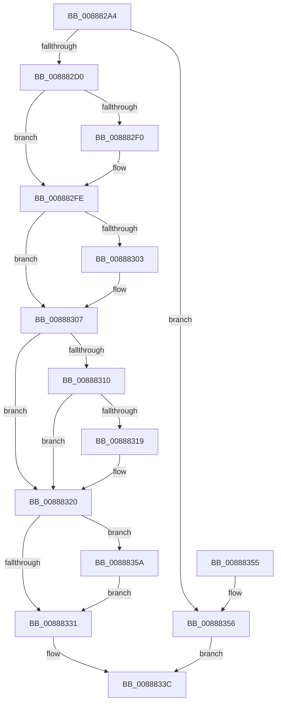

# AlpcDeleteBlobByHandle

- RVA: `0x008882A4`–`0x00888364` (길이 `192` bytes)
- VA: `0x00000001408882A4`
- 실행 섹션: `PAGE`
- PDB 이름 있음: `예`; PDB Function 태그: `아니요`
- unwind 정보 RVA: `0x0007CD9C`
- 디코드: `59`개 명령, `192/192` bytes 표시
- 미해석 바이트: `0` (있으면 어셈블리에 `.byte`로 보존)

> 이 문서는 커널 이미지의 기계어와 PDB 기호를 분석해 생성했습니다. 4번과 5번은 함수 원형과 자료형을 바이너리 사용 방식에서 추정한 C 해석이며 원본 소스 복구 결과는 아닙니다.

## 1. Dependencies

- 직접 호출 지점: **4**; 고유 호출 대상: **4**
- 직접 호출자로 확인된 함수: **3**
- RIP 상대 이미지 참조: **0**

### Outgoing calls
- `0x008882E0` → [KeAbPreAcquire](../../text/21/KeAbPreAcquire_function_00210230.md) (function, `0x00210230`)
- `0x008882F9` → [ExfAcquirePushLockExclusiveEx](../../text/20/ExfAcquirePushLockExclusiveEx_function_0020FC90.md) (function, `0x0020FC90`)
- `0x00888334` → [KeAbPostRelease](../../text/2E/KeAbPostRelease_function_002E1600.md) (function, `0x002E1600`)
- `0x0088835D` → [ExfTryToWakePushLock](../../text/26/ExfTryToWakePushLock_function_00265DD0.md) (function, `0x00265DD0`)

### Direct callers
- [AlpcReserveDestroyProcedure](AlpcReserveDestroyProcedure_function_00888230.md) at `0x00888270`
- [AlpcSectionDeleteProcedure](AlpcSectionDeleteProcedure_function_0088A200.md) at `0x0088A21D`
- [AlpcSectionDestroyProcedure](../A3/AlpcSectionDestroyProcedure_function_00A327D0.md) at `0x00A32808`

### Static image references
- 디코드된 RIP-relative 메모리 참조가 없습니다.

## 2. Other-region calls and transfers

- 다른 실행 섹션으로 향하는 call: **4**
  - `0x008882E0` → [KeAbPreAcquire](../../text/21/KeAbPreAcquire_function_00210230.md) (`PAGE` → `.text`)
  - `0x008882F9` → [ExfAcquirePushLockExclusiveEx](../../text/20/ExfAcquirePushLockExclusiveEx_function_0020FC90.md) (`PAGE` → `.text`)
  - `0x00888334` → [KeAbPostRelease](../../text/2E/KeAbPostRelease_function_002E1600.md) (`PAGE` → `.text`)
  - `0x0088835D` → [ExfTryToWakePushLock](../../text/26/ExfTryToWakePushLock_function_00265DD0.md) (`PAGE` → `.text`)
- 별도 외부 분기/꼬리 이동을 확인하지 못했습니다.

## 3. Assembly (complete function range)

```asm
008882A4  48 89 5C 24 08                  mov qword ptr [rsp + 8], rbx
008882A9  48 89 6C 24 10                  mov qword ptr [rsp + 0x10], rbp
008882AE  48 89 74 24 18                  mov qword ptr [rsp + 0x18], rsi
008882B3  57                              push rdi
008882B4  41 56                           push r14
008882B6  41 57                           push r15
008882B8  48 83 EC 20                     sub rsp, 0x20
008882BC  33 FF                           xor edi, edi
008882BE  4D 8B F8                        mov r15, r8
008882C1  4C 8B F2                        mov r14, rdx
008882C4  48 8B F1                        mov rsi, rcx
008882C7  48 85 C9                        test rcx, rcx
008882CA  0F 84 86 00 00 00               je 0x140888356
008882D0  48 8D 59 08                     lea rbx, [rcx + 8]
008882D4  45 33 C0                        xor r8d, r8d
008882D7  48 8B CB                        mov rcx, rbx
008882DA  33 D2                           xor edx, edx
008882DC  49 83 EE 10                     sub r14, 0x10
008882E0  E8 4B 7F 98 FF                  call 0x140210230
008882E5  F0 48 0F BA 2B 00               lock bts qword ptr [rbx], 0
008882EB  48 8B E8                        mov rbp, rax
008882EE  73 0E                           jae 0x1408882fe
008882F0  4C 8B C3                        mov r8, rbx
008882F3  48 8B D0                        mov rdx, rax
008882F6  48 8B CB                        mov rcx, rbx
008882F9  E8 92 79 98 FF                  call 0x14020fc90
008882FE  48 85 ED                        test rbp, rbp
00888301  74 04                           je 0x140888307
00888303  C6 45 0A 01                     mov byte ptr [rbp + 0xa], 1
00888307  41 8B C6                        mov eax, r14d
0088830A  48 3B 46 10                     cmp rax, qword ptr [rsi + 0x10]
0088830E  73 10                           jae 0x140888320
00888310  48 8B 0E                        mov rcx, qword ptr [rsi]
00888313  4C 39 3C C1                     cmp qword ptr [rcx + rax*8], r15
00888317  75 07                           jne 0x140888320
00888319  48 89 3C C1                     mov qword ptr [rcx + rax*8], rdi
0088831D  40 B7 01                        mov dil, 1
00888320  48 83 CA FF                     or rdx, 0xffffffffffffffff
00888324  F0 48 0F C1 13                  lock xadd qword ptr [rbx], rdx
00888329  80 E2 06                        and dl, 6
0088832C  80 FA 02                        cmp dl, 2
0088832F  74 29                           je 0x14088835a
00888331  48 8B CB                        mov rcx, rbx
00888334  E8 C7 92 A5 FF                  call 0x1402e1600
00888339  40 8A C7                        mov al, dil
0088833C  48 8B 5C 24 40                  mov rbx, qword ptr [rsp + 0x40]
00888341  48 8B 6C 24 48                  mov rbp, qword ptr [rsp + 0x48]
00888346  48 8B 74 24 50                  mov rsi, qword ptr [rsp + 0x50]
0088834B  48 83 C4 20                     add rsp, 0x20
0088834F  41 5F                           pop r15
00888351  41 5E                           pop r14
00888353  5F                              pop rdi
00888354  C3                              ret
00888355  CC                              int3
00888356  32 C0                           xor al, al
00888358  EB E2                           jmp 0x14088833c
0088835A  48 8B CB                        mov rcx, rbx
0088835D  E8 6E DA 9D FF                  call 0x140265dd0
00888362  EB CD                           jmp 0x140888331
```

## 4. C-style interpretation (structured pseudocode)

```c
__int64 __fastcall AlpcDeleteBlobByHandle(__int64 a1, __int64 a2, __int64 a3)
{
    __int64 result;
    __int64 v_r14;
    __int64 v_rdi;
    __int64 v_rsp;
    unsigned __int64 v_stack_p10;
    unsigned __int64 v_stack_p18;
    unsigned __int64 v_stack_p8;

    v_stack_p8 = v_rbx;
    v_stack_p10 = v_rbp;
    v_stack_p18 = v_rsi;
    v_rsp = (v_rsp) - (32);
    v_rdi = 0;
    if (a1 == 0) goto loc_00888356;
    a3 = 0;
    a2 = 0;
    v_r14 = (a2) - (16);
    result = KeAbPreAcquire(a1 + 8, a2, a3, a4);
    if (!(condition_is_above_or_equal)) {
        a3 = a1 + 8;
        a2 = result;
        a1 = a1 + 8;
        result = ExfAcquirePushLockExclusiveEx(a1, a2, a3, a4);
    }
    if (result != 0) {
        *(unsigned __int8 *)(result + 10) = 1;
    }
    if (((unsigned int)((unsigned int)(v_r14))) >= (*(unsigned __int64 *)(a1 + 16))) goto loc_00888320;
    if ((*(unsigned __int64 *)(*(unsigned __int64 *)(a1) + (unsigned int)((unsigned int)(v_r14)) * 8)) == a3) {
        *(unsigned __int64 *)(*(unsigned __int64 *)(a1) + (unsigned int)((unsigned int)(v_r14)) * 8) = 0;
        v_rdi = 1;
    }
    a2 = (a2) | (-1);
    a2 = (unsigned __int8)((a2) & (6));
    if (((unsigned __int8)(a2)) == 2) goto loc_0088835A;
loc_00888331:
    result = KeAbPostRelease(a1 + 8, a2, a3, a4);
loc_0088833C:
    v_rsp = (v_rsp) + (32);
    return (unsigned __int8)(v_rdi);
loc_00888356:
    result = 0;
    goto loc_0088833C;
loc_0088835A:
    result = ExfTryToWakePushLock(v_stack_p8, a2, a3, a4);
    goto loc_00888331;
}
```

## 5. (Beta) C Style

```c
int64_t AlpcDeleteBlobByHandle(void *Arg1, int64_t Arg2, int64_t Arg3)
{
    uint8_t *arg1 = (uint8_t *)Arg1;

    int64_t result;
    int64_t local_r14;
    int64_t local_rdi;
    int64_t local_rsp;
    uint64_t v_stack_p10;
    uint64_t v_stack_p18;
    uint64_t v_stack_p8;

    v_stack_p8 = local_rbx;
    v_stack_p10 = local_rbp;
    v_stack_p18 = local_rsi;
    local_rsp = (local_rsp) - (32);
    local_rdi = 0;
    if (Arg1 == NULL) goto loc_00888356;
    Arg3 = 0;
    Arg2 = 0;
    local_r14 = (Arg2) - (16);
    result = KeAbPreAcquire(Arg1 + 8, Arg2, Arg3, a4);
    if (!(condition_is_above_or_equal)) {
        Arg3 = Arg1 + 8;
        Arg2 = result;
        Arg1 = Arg1 + 8;
        result = ExfAcquirePushLockExclusiveEx(Arg1, Arg2, Arg3, a4);
    }
    if (result != 0) {
        *(uint8_t *)(result + 0xA) = 1;
    }
    if (((uint32_t)((uint32_t)(local_r14))) >= (*(uint64_t *)(arg1 + 0x10))) goto loc_00888320;
    if ((*(uint64_t *)(*(uint64_t *)(arg1) + (uint32_t)((uint32_t)(local_r14)) * 8)) == Arg3) {
        *(uint64_t *)(*(uint64_t *)(arg1) + (uint32_t)((uint32_t)(local_r14)) * 8) = 0;
        local_rdi = 1;
    }
    Arg2 = (Arg2) | (-1);
    Arg2 = (uint8_t)((Arg2) & (6));
    if (((uint8_t)(Arg2)) == 2) goto loc_0088835A;
loc_00888331:
    result = KeAbPostRelease(Arg1 + 8, Arg2, Arg3, a4);
loc_0088833C:
    local_rsp = (local_rsp) + (32);
    return (uint8_t)(local_rdi);
loc_00888356:
    result = 0;
    goto loc_0088833C;
loc_0088835A:
    result = ExfTryToWakePushLock(v_stack_p8, Arg2, Arg3, a4);
    goto loc_00888331;
}
```

### 관측된 메모리 오프셋

구조체 형식이 확인되지 않은 접근은 인자 기준의 오프셋으로만 기록했습니다.

| 기준 인자 | 오프셋 표현 | 폭 (bit) | 접근 |
|---|---:|---:|---|
| `Arg1` | `+ 0x0` | `64` | `R` |
| `Arg1` | `+ 0x10` | `64` | `R` |

## 6. Execution-region graph

[열기: 2D/3D 그래프와 함수 탐색 컨트롤 패널](../../../control-panel.html?section=page&rva=0x008882A4&view=graph)

- 2D 그래프는 위에서 아래로 흐르고, 3D 그래프는 빈 공간을 드래그해 회전합니다. Shift+드래그는 이동, 휠은 확대·축소, 함수 노드 선택은 대상 보고서 이동입니다.

### Static fallback


