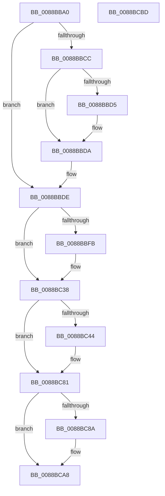

# AlpcMessageCleanupProcedure

- RVA: `0x0088BBA0`–`0x0088BCBE` (길이 `286` bytes)
- VA: `0x000000014088BBA0`
- 실행 섹션: `PAGE`
- PDB 이름 있음: `예`; PDB Function 태그: `아니요`
- unwind 정보 RVA: `0x0007D3C0`
- 디코드: `68`개 명령, `286/286` bytes 표시
- 미해석 바이트: `0` (있으면 어셈블리에 `.byte`로 보존)

> 이 문서는 커널 이미지의 기계어와 PDB 기호를 분석해 생성했습니다. 4번과 5번은 함수 원형과 자료형을 바이너리 사용 방식에서 추정한 C 해석이며 원본 소스 복구 결과는 아닙니다.

## 1. Dependencies

- 직접 호출 지점: **4**; 고유 호출 대상: **3**
- 직접 호출자로 확인된 함수: **5**
- RIP 상대 이미지 참조: **0**

### Outgoing calls
- `0x0088BBD5` → [ObfDereferenceObject](../../text/2F/ObfDereferenceObject_function_002F9350.md) (function, `0x002F9350`)
- `0x0088BBE5` → [AlpcpReleaseAttributes](AlpcpReleaseAttributes_function_0088D750.md) (function, `0x0088D750`)
- `0x0088BC2C` → [PspChargeProcessWakeCounter](PspChargeProcessWakeCounter_function_0088D2A0.md) (function, `0x0088D2A0`)
- `0x0088BC75` → [PspChargeProcessWakeCounter](PspChargeProcessWakeCounter_function_0088D2A0.md) (function, `0x0088D2A0`)

### Direct callers
- [sub_0088AF37](Unknown_function_0088AF37.md) at `0x0088AF5C`
- [sub_0088B593](Unknown_function_0088B593.md) at `0x0088B5AC`
- [sub_0088BA10](Unknown_function_0088BA10.md) at `0x0088BA3A`
- [sub_00897B6E](../89/Unknown_function_00897B6E.md) at `0x00897B98`
- [AlpcpProcessSynchronousRequest](../92/AlpcpProcessSynchronousRequest_function_00921FCC.md) at `0x0092232A`

### Static image references
- 디코드된 RIP-relative 메모리 참조가 없습니다.

## 2. Other-region calls and transfers

- 다른 실행 섹션으로 향하는 call: **1**
  - `0x0088BBD5` → [ObfDereferenceObject](../../text/2F/ObfDereferenceObject_function_002F9350.md) (`PAGE` → `.text`)
- 별도 외부 분기/꼬리 이동을 확인하지 못했습니다.

## 3. Assembly (complete function range)

```asm
0088BBA0  48 89 5C 24 08                  mov qword ptr [rsp + 8], rbx
0088BBA5  48 89 6C 24 10                  mov qword ptr [rsp + 0x10], rbp
0088BBAA  48 89 74 24 18                  mov qword ptr [rsp + 0x18], rsi
0088BBAF  57                              push rdi
0088BBB0  48 83 EC 40                     sub rsp, 0x40
0088BBB4  81 89 08 01 00 00 00 00 00 80   or dword ptr [rcx + 0x108], 0x80000000
0088BBBE  48 8B D9                        mov rbx, rcx
0088BBC1  48 8B 49 18                     mov rcx, qword ptr [rcx + 0x18]
0088BBC5  33 FF                           xor edi, edi
0088BBC7  48 85 C9                        test rcx, rcx
0088BBCA  74 12                           je 0x14088bbde
0088BBCC  F7 43 28 00 10 00 00            test dword ptr [rbx + 0x28], 0x1000
0088BBD3  74 05                           je 0x14088bbda
0088BBD5  E8 76 D7 A6 FF                  call 0x1402f9350
0088BBDA  48 89 7B 18                     mov qword ptr [rbx + 0x18], rdi
0088BBDE  48 8D 53 68                     lea rdx, [rbx + 0x68]
0088BBE2  48 8B CB                        mov rcx, rbx
0088BBE5  E8 66 1B 00 00                  call 0x14088d750
0088BBEA  48 8B 8B D0 00 00 00            mov rcx, qword ptr [rbx + 0xd0]
0088BBF1  BD 02 00 00 00                  mov ebp, 2
0088BBF6  48 85 C9                        test rcx, rcx
0088BBF9  74 3D                           je 0x14088bc38
0088BBFB  44 8B 8B 08 01 00 00            mov r9d, dword ptr [rbx + 0x108]
0088BC02  8B C1                           mov eax, ecx
0088BC04  83 E0 07                        and eax, 7
0088BC07  48 89 7C 24 30                  mov qword ptr [rsp + 0x30], rdi
0088BC0C  83 F8 07                        cmp eax, 7
0088BC0F  C6 44 24 28 01                  mov byte ptr [rsp + 0x28], 1
0088BC14  44 8B C7                        mov r8d, edi
0088BC17  C7 44 24 20 FF FF FF FF         mov dword ptr [rsp + 0x20], 0xffffffff
0088BC1F  8B D5                           mov edx, ebp
0088BC21  44 0F 45 C0                     cmovne r8d, eax
0088BC25  0F 45 D7                        cmovne edx, edi
0088BC28  48 83 E1 F8                     and rcx, 0xfffffffffffffff8
0088BC2C  E8 6F 16 00 00                  call 0x14088d2a0
0088BC31  48 89 BB D0 00 00 00            mov qword ptr [rbx + 0xd0], rdi
0088BC38  48 8B 8B D8 00 00 00            mov rcx, qword ptr [rbx + 0xd8]
0088BC3F  48 85 C9                        test rcx, rcx
0088BC42  74 3D                           je 0x14088bc81
0088BC44  44 8B 8B 08 01 00 00            mov r9d, dword ptr [rbx + 0x108]
0088BC4B  8B C1                           mov eax, ecx
0088BC4D  83 E0 07                        and eax, 7
0088BC50  48 89 7C 24 30                  mov qword ptr [rsp + 0x30], rdi
0088BC55  83 F8 07                        cmp eax, 7
0088BC58  C6 44 24 28 01                  mov byte ptr [rsp + 0x28], 1
0088BC5D  44 8B C7                        mov r8d, edi
0088BC60  C7 44 24 20 FF FF FF FF         mov dword ptr [rsp + 0x20], 0xffffffff
0088BC68  0F 45 EF                        cmovne ebp, edi
0088BC6B  44 0F 45 C0                     cmovne r8d, eax
0088BC6F  8B D5                           mov edx, ebp
0088BC71  48 83 E1 F8                     and rcx, 0xfffffffffffffff8
0088BC75  E8 26 16 00 00                  call 0x14088d2a0
0088BC7A  48 89 BB D8 00 00 00            mov qword ptr [rbx + 0xd8], rdi
0088BC81  48 8B 43 60                     mov rax, qword ptr [rbx + 0x60]
0088BC85  48 85 C0                        test rax, rax
0088BC88  74 1E                           je 0x14088bca8
0088BC8A  C7 83 F0 00 00 00 00 00 28 00   mov dword ptr [rbx + 0xf0], 0x280000
0088BC94  48 89 BB B8 00 00 00            mov qword ptr [rbx + 0xb8], rdi
0088BC9B  48 89 BB C0 00 00 00            mov qword ptr [rbx + 0xc0], rdi
0088BCA2  89 7B 28                        mov dword ptr [rbx + 0x28], edi
0088BCA5  87 78 28                        xchg dword ptr [rax + 0x28], edi
0088BCA8  48 8B 5C 24 50                  mov rbx, qword ptr [rsp + 0x50]
0088BCAD  48 8B 6C 24 58                  mov rbp, qword ptr [rsp + 0x58]
0088BCB2  48 8B 74 24 60                  mov rsi, qword ptr [rsp + 0x60]
0088BCB7  48 83 C4 40                     add rsp, 0x40
0088BCBB  5F                              pop rdi
0088BCBC  C3                              ret
0088BCBD  CC                              int3
```

## 4. C-style interpretation (structured pseudocode)

```c
__int64 __fastcall AlpcMessageCleanupProcedure(__int64 a1)
{
    __int64 result;
    __int64 v_rbp;
    __int64 v_rdi;
    __int64 v_rsp;
    unsigned __int64 v_stack_m18;
    unsigned __int8 v_stack_m20;
    unsigned int v_stack_m28;
    unsigned __int64 v_stack_p10;
    unsigned __int64 v_stack_p18;
    unsigned __int64 v_stack_p8;

    v_stack_p8 = v_rbx;
    v_stack_p10 = v_rbp;
    v_stack_p18 = v_rsi;
    v_rsp = (v_rsp) - (64);
    v_rdi = 0;
    if (*(unsigned __int64 *)(a1 + 24) == 0) goto loc_0088BBDE;
    if (((*(unsigned int *)(a1 + 40)) & (0x1000ULL)) != 0) {
        result = ObfDereferenceObject(*(unsigned __int64 *)(a1 + 24), a2, a3, a4);
    }
    *(unsigned __int64 *)(a1 + 24) = 0;
loc_0088BBDE:
    result = AlpcpReleaseAttributes(a1, a1 + 104, a3, a4);
    if (*(unsigned __int64 *)(a1 + 208) != 0) {
        a4 = *(unsigned int *)(a1 + 264);
        result = (unsigned int)(*(unsigned __int64 *)(a1 + 208));
        result = (unsigned int)((result) & (7));
        v_stack_m18 = 0;
        v_stack_m20 = 1;
        a3 = 0;
        v_stack_m28 = 0xFFFFFFFFULL;
        a2 = 2;
        if (((unsigned int)(result)) != 7) {
            a3 = (unsigned int)(result);
            a2 = 0;
        }
        a1 = (*(unsigned __int64 *)(a1 + 208)) & (-8);
        result = PspChargeProcessWakeCounter(a1, a2, a3, a4);
        *(unsigned __int64 *)(a1 + 208) = 0;
    }
    v_rbp = 2;
    if (*(unsigned __int64 *)(a1 + 216) != 0) {
        a4 = *(unsigned int *)(a1 + 264);
        result = (unsigned int)(*(unsigned __int64 *)(a1 + 216));
        result = (unsigned int)((result) & (7));
        v_stack_m18 = 0;
        v_stack_m20 = 1;
        a3 = 0;
        v_stack_m28 = 0xFFFFFFFFULL;
        v_rbp = 2;
        if (((unsigned int)(result)) != 7) {
            v_rbp = 0;
            a3 = (unsigned int)(result);
        }
        a2 = (unsigned int)(v_rbp);
        a1 = (*(unsigned __int64 *)(a1 + 216)) & (-8);
        result = PspChargeProcessWakeCounter(a1, a2, a3, a4);
        *(unsigned __int64 *)(a1 + 216) = 0;
    }
    if (*(unsigned __int64 *)(a1 + 96) != 0) {
        *(unsigned int *)(a1 + 240) = 0x280000ULL;
        *(unsigned __int64 *)(a1 + 184) = 0;
        *(unsigned __int64 *)(a1 + 192) = 0;
        *(unsigned int *)(a1 + 40) = 0;
    }
    v_rsp = (v_rsp) + (64);
    return *(unsigned __int64 *)(a1 + 96);
}
```

## 5. (Beta) C Style

```c
int64_t AlpcMessageCleanupProcedure(void *Arg1)
{
    uint8_t *arg1 = (uint8_t *)Arg1;

    int64_t result;
    int64_t local_rbp;
    int64_t local_rdi;
    int64_t local_rsp;
    uint64_t v_stack_m18;
    uint8_t v_stack_m20;
    uint32_t v_stack_m28;
    uint64_t v_stack_p10;
    uint64_t v_stack_p18;
    uint64_t v_stack_p8;

    v_stack_p8 = local_rbx;
    v_stack_p10 = local_rbp;
    v_stack_p18 = local_rsi;
    local_rsp = (local_rsp) - (64);
    local_rdi = 0;
    if (*(uint64_t *)(arg1 + 0x18) == 0) goto loc_0088BBDE;
    if (((*(uint32_t *)(arg1 + 0x28)) & (0x1000ULL)) != 0) {
        result = ObfDereferenceObject(*(uint64_t *)(arg1 + 0x18), a2, a3, a4);
    }
    *(uint64_t *)(arg1 + 0x18) = 0;
loc_0088BBDE:
    result = AlpcpReleaseAttributes(Arg1, Arg1 + 104, a3, a4);
    if (*(uint64_t *)(arg1 + 0xD0) != 0) {
        a4 = *(uint32_t *)(arg1 + 0x108);
        result = (uint32_t)(*(uint64_t *)(arg1 + 0xD0));
        result = (uint32_t)((result) & (7));
        v_stack_m18 = 0;
        v_stack_m20 = 1;
        a3 = 0;
        v_stack_m28 = 0xFFFFFFFFULL;
        a2 = 2;
        if (((uint32_t)(result)) != 7) {
            a3 = (uint32_t)(result);
            a2 = 0;
        }
        Arg1 = (*(uint64_t *)(arg1 + 0xD0)) & (-8);
        result = PspChargeProcessWakeCounter(Arg1, a2, a3, a4);
        *(uint64_t *)(arg1 + 0xD0) = 0;
    }
    local_rbp = 2;
    if (*(uint64_t *)(arg1 + 0xD8) != 0) {
        a4 = *(uint32_t *)(arg1 + 0x108);
        result = (uint32_t)(*(uint64_t *)(arg1 + 0xD8));
        result = (uint32_t)((result) & (7));
        v_stack_m18 = 0;
        v_stack_m20 = 1;
        a3 = 0;
        v_stack_m28 = 0xFFFFFFFFULL;
        local_rbp = 2;
        if (((uint32_t)(result)) != 7) {
            local_rbp = 0;
            a3 = (uint32_t)(result);
        }
        a2 = (uint32_t)(local_rbp);
        Arg1 = (*(uint64_t *)(arg1 + 0xD8)) & (-8);
        result = PspChargeProcessWakeCounter(Arg1, a2, a3, a4);
        *(uint64_t *)(arg1 + 0xD8) = 0;
    }
    if (*(uint64_t *)(arg1 + 0x60) != 0) {
        *(uint32_t *)(arg1 + 0xF0) = 0x280000ULL;
        *(uint64_t *)(arg1 + 0xB8) = 0;
        *(uint64_t *)(arg1 + 0xC0) = 0;
        *(uint32_t *)(arg1 + 0x28) = 0;
    }
    local_rsp = (local_rsp) + (64);
    return *(uint64_t *)(arg1 + 0x60);
}
```

### 관측된 메모리 오프셋

구조체 형식이 확인되지 않은 접근은 인자 기준의 오프셋으로만 기록했습니다.

| 기준 인자 | 오프셋 표현 | 폭 (bit) | 접근 |
|---|---:|---:|---|
| `Arg1` | `+ 0x18` | `64` | `R` |
| `Arg1` | `+ 0x18` | `64` | `W` |
| `Arg1` | `+ 0x28` | `32` | `R` |
| `Arg1` | `+ 0x28` | `32` | `W` |
| `Arg1` | `+ 0x60` | `64` | `R` |
| `Arg1` | `+ 0x68` | `64` | `R` |
| `Arg1` | `+ 0xB8` | `64` | `W` |
| `Arg1` | `+ 0xC0` | `64` | `W` |
| `Arg1` | `+ 0xD0` | `64` | `R` |
| `Arg1` | `+ 0xD0` | `64` | `W` |
| `Arg1` | `+ 0xD8` | `64` | `R` |
| `Arg1` | `+ 0xD8` | `64` | `W` |
| `Arg1` | `+ 0xF0` | `32` | `W` |
| `Arg1` | `+ 0x108` | `32` | `R` |
| `Arg1` | `+ 0x108` | `32` | `R/W` |

## 6. Execution-region graph

[열기: 2D/3D 그래프와 함수 탐색 컨트롤 패널](../../../control-panel.html?section=page&rva=0x0088BBA0&view=graph)

- 2D 그래프는 위에서 아래로 흐르고, 3D 그래프는 빈 공간을 드래그해 회전합니다. Shift+드래그는 이동, 휠은 확대·축소, 함수 노드 선택은 대상 보고서 이동입니다.

### Static fallback


