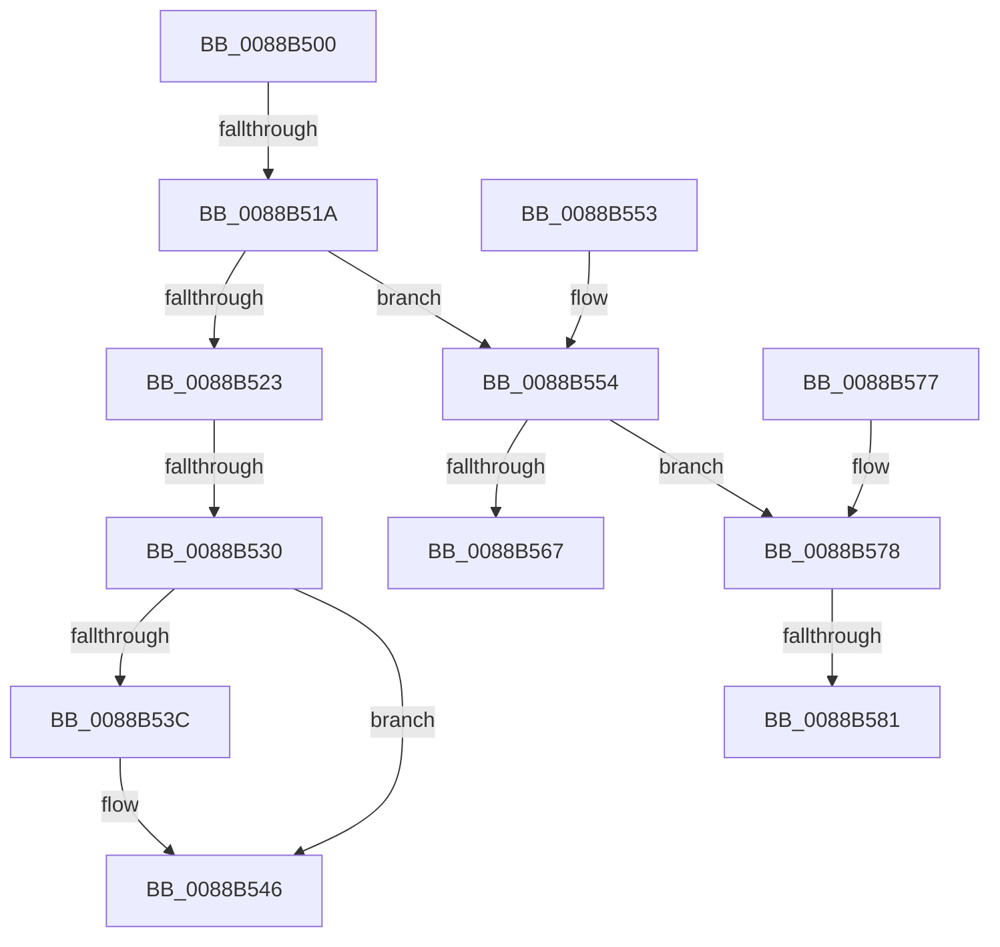

# AlpcMessageDestroyProcedure

- RVA: `0x0088B500`–`0x0088B593` (길이 `147` bytes)
- VA: `0x000000014088B500`
- 실행 섹션: `PAGE`
- PDB 이름 있음: `예`; PDB Function 태그: `아니요`
- unwind 정보 RVA: `0x0007D230`
- 디코드: `38`개 명령, `147/147` bytes 표시
- 미해석 바이트: `0` (있으면 어셈블리에 `.byte`로 보존)

> 이 문서는 커널 이미지의 기계어와 PDB 기호를 분석해 생성했습니다. 4번과 5번은 함수 원형과 자료형을 바이너리 사용 방식에서 추정한 C 해석이며 원본 소스 복구 결과는 아닙니다.

## 1. Dependencies

- 직접 호출 지점: **1**; 고유 호출 대상: **1**
- 직접 호출자로 확인된 함수: **4**
- RIP 상대 이미지 참조: **3**

### Outgoing calls
- `0x0088B541` → [ExFreePoolWithTag](../../poolcode/B8/ExFreePoolWithTag_function_00B82870.md) (function, `0x00B82870`)

### Direct callers
- [sub_0088AF37](Unknown_function_0088AF37.md) at `0x0088AF8A`
- [sub_0088B593](Unknown_function_0088B593.md) at `0x0088B5DE`
- [sub_0088BA74](Unknown_function_0088BA74.md) at `0x0088BA8D`
- [sub_00897BD2](../89/Unknown_function_00897BD2.md) at `0x00897BEB`

### Static image references
- `0x0088B50A` → RVA `0x00F100D0` (`.data`; read)
- `0x0088B585` → RVA `0x0088BBA0` (`AlpcMessageCleanupProcedure`; read)
- `0x0088B58C` → RVA `0x00001450` (`.rdata`; read)

## 2. Other-region calls and transfers

- 다른 실행 섹션으로 향하는 call: **1**
  - `0x0088B541` → [ExFreePoolWithTag](../../poolcode/B8/ExFreePoolWithTag_function_00B82870.md) (`PAGE` → `POOLCODE`)
- call이 아닌 외부 분기/꼬리 이동: **3**
  - `0x0088B514` → [sub_0088B6F6 + 0x1D](Unknown_function_0088B6F6.md) (`tail-transfer`)
  - `0x0088B52A` → [sub_0088B611](Unknown_function_0088B611.md) (`tail-transfer`)
  - `0x0088B57B` → [sub_0088B6F6 + 0x27](Unknown_function_0088B6F6.md) (`tail-transfer`)

## 3. Assembly (complete function range)

```asm
0088B500  48 89 5C 24 10                  mov qword ptr [rsp + 0x10], rbx
0088B505  57                              push rdi
0088B506  48 83 EC 30                     sub rsp, 0x30
0088B50A  83 3D BF 4B 68 00 00            cmp dword ptr [rip + 0x684bbf], 0
0088B511  48 8B D9                        mov rbx, rcx
0088B514  0F 85 F9 01 00 00               jne 0x14088b713
0088B51A  48 8B 7B 60                     mov rdi, qword ptr [rbx + 0x60]
0088B51E  48 85 FF                        test rdi, rdi
0088B521  75 31                           jne 0x14088b554
0088B523  48 8B 4B 30                     mov rcx, qword ptr [rbx + 0x30]
0088B527  48 85 C9                        test rcx, rcx
0088B52A  0F 85 E1 00 00 00               jne 0x14088b611
0088B530  48 8B 8B E0 00 00 00            mov rcx, qword ptr [rbx + 0xe0]
0088B537  48 85 C9                        test rcx, rcx
0088B53A  74 0A                           je 0x14088b546
0088B53C  BA 41 6C 45 42                  mov edx, 0x42456c41
0088B541  E8 2A 73 2F 00                  call 0x140b82870
0088B546  33 C0                           xor eax, eax
0088B548  48 8B 5C 24 48                  mov rbx, qword ptr [rsp + 0x48]
0088B54D  48 83 C4 30                     add rsp, 0x30
0088B551  5F                              pop rdi
0088B552  C3                              ret
0088B553  CC                              int3
0088B554  48 C7 C0 FF FF FF FF            mov rax, 0xffffffffffffffff
0088B55B  F0 48 0F C1 47 E8               lock xadd qword ptr [rdi - 0x18], rax
0088B561  48 83 E8 01                     sub rax, 1
0088B565  7E 11                           jle 0x14088b578
0088B567  48 8B 5C 24 48                  mov rbx, qword ptr [rsp + 0x48]
0088B56C  B8 01 00 00 C0                  mov eax, 0xc0000001
0088B571  48 83 C4 30                     add rsp, 0x30
0088B575  5F                              pop rdi
0088B576  C3                              ret
0088B577  CC                              int3
0088B578  48 85 C0                        test rax, rax
0088B57B  0F 85 9C 01 00 00               jne 0x14088b71d
0088B581  0F B6 47 E1                     movzx eax, byte ptr [rdi - 0x1f]
0088B585  48 8D 0D 14 06 00 00            lea rcx, [rip + 0x614]
0088B58C  48 8D 1D BD 5E 77 FF            lea rbx, [rip - 0x88a143]
```

## 4. C-style interpretation (structured pseudocode)

```c
__int64 __fastcall AlpcMessageDestroyProcedure(__int64 a1)
{
    __int64 result;
    __int64 v_rsp;
    unsigned __int64 v_stack_p10;
    unsigned __int64 v_stack_p48;

    v_stack_p10 = v_rbx;
    v_rsp = (v_rsp) - (48);
    if (*(unsigned __int64 *)(a1 + 96) != 0) goto loc_0088B554;
    if (*(unsigned __int64 *)(a1 + 224) != 0) {
        a2 = 0x42456C41ULL;
        result = ExFreePoolWithTag(*(unsigned __int64 *)(a1 + 224), a2, a3, a4);
    }
    result = 0;
    v_rsp = (v_rsp) + (48);
    return result;
loc_0088B554:
    result = (-1) - (1);
    if (condition_is_less_or_equal) goto loc_0088B578;
    v_rsp = (v_rsp) + (48);
    return (unsigned int)(0xC0000001ULL);
loc_0088B578:
    return *(unsigned __int8 *)(*(unsigned __int64 *)(a1 + 96) - 31);
}
```

## 5. (Beta) C Style

```c
int64_t AlpcMessageDestroyProcedure(void *Arg1)
{
    uint8_t *arg1 = (uint8_t *)Arg1;

    int64_t result;
    int64_t local_rsp;
    uint64_t v_stack_p10;
    uint64_t v_stack_p48;

    v_stack_p10 = local_rbx;
    local_rsp = (local_rsp) - (48);
    if (*(uint64_t *)(arg1 + 0x60) != 0) goto loc_0088B554;
    if (*(uint64_t *)(arg1 + 0xE0) != 0) {
        a2 = 0x42456C41ULL;
        result = ExFreePoolWithTag(*(uint64_t *)(arg1 + 0xE0), a2, a3, a4);
    }
    result = 0;
    local_rsp = (local_rsp) + (48);
    return result;
loc_0088B554:
    result = (-1) - (1);
    if (condition_is_less_or_equal) goto loc_0088B578;
    local_rsp = (local_rsp) + (48);
    return (uint32_t)(0xC0000001ULL);
loc_0088B578:
    return *(uint8_t *)(*(uint64_t *)(arg1 + 0x60) - 0x1F);
}
```

### 관측된 메모리 오프셋

구조체 형식이 확인되지 않은 접근은 인자 기준의 오프셋으로만 기록했습니다.

| 기준 인자 | 오프셋 표현 | 폭 (bit) | 접근 |
|---|---:|---:|---|
| `Arg1` | `+ 0x30` | `64` | `R` |
| `Arg1` | `+ 0x60` | `64` | `R` |
| `Arg1` | `+ 0xE0` | `64` | `R` |

## 6. Execution-region graph

[열기: 2D/3D 그래프와 함수 탐색 컨트롤 패널](../../../control-panel.html?section=page&rva=0x0088B500&view=graph)

- 2D 그래프는 위에서 아래로 흐르고, 3D 그래프는 빈 공간을 드래그해 회전합니다. Shift+드래그는 이동, 휠은 확대·축소, 함수 노드 선택은 대상 보고서 이동입니다.

### Static fallback


