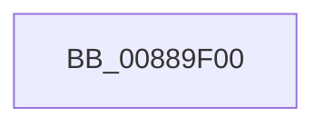

# AlpcReferenceBlobByHandle

- RVA: `0x00889F00`–`0x00889F1B` (길이 `27` bytes)
- VA: `0x0000000140889F00`
- 실행 섹션: `PAGE`
- PDB 이름 있음: `예`; PDB Function 태그: `아니요`
- unwind 정보 RVA: `0x0007D018`
- 디코드: `9`개 명령, `27/27` bytes 표시
- 미해석 바이트: `0` (있으면 어셈블리에 `.byte`로 보존)

> 이 문서는 커널 이미지의 기계어와 PDB 기호를 분석해 생성했습니다. 4번과 5번은 함수 원형과 자료형을 바이너리 사용 방식에서 추정한 C 해석이며 원본 소스 복구 결과는 아닙니다.

## 1. Dependencies

- 직접 호출 지점: **0**; 고유 호출 대상: **0**
- 직접 호출자로 확인된 함수: **10**
- RIP 상대 이미지 참조: **0**

### Outgoing calls
- 직접 디코드된 call 명령이 없습니다.

### Direct callers
- [NtAlpcRevokeSecurityContext](../74/NtAlpcRevokeSecurityContext_function_0074C400.md) at `0x0074C485`
- [NtAlpcDeletePortSection](NtAlpcDeletePortSection_function_00888420.md) at `0x0088849C`
- [NtAlpcCreateSectionView](NtAlpcCreateSectionView_function_00888640.md) at `0x00888775`
- [NtAlpcDeleteResourceReserve](NtAlpcDeleteResourceReserve_function_00888870.md) at `0x008888F8`
- [AlpcpCaptureViewAttribute](AlpcpCaptureViewAttribute_function_0088957C.md) at `0x0088968D`
- [AlpcpCaptureViewAttributeInternal](AlpcpCaptureViewAttributeInternal_function_00889C6C.md) at `0x00889D30`
- [NtAlpcDeleteSecurityContext](NtAlpcDeleteSecurityContext_function_00889E00.md) at `0x00889E7C`
- [AlpcpSendMessage](AlpcpSendMessage_function_0088BD40.md) at `0x0088C9E7`
- [sub_00895B6D](../89/Unknown_function_00895B6D.md) at `0x00895CBE`
- [NtAlpcImpersonateClientOfPort](../89/NtAlpcImpersonateClientOfPort_function_008961A0.md) at `0x00896607`

### Static image references
- 디코드된 RIP-relative 메모리 참조가 없습니다.

## 2. Other-region calls and transfers

- 다른 실행 섹션으로 향하는 call: **0**
- call이 아닌 외부 분기/꼬리 이동: **1**
  - `0x00889F15` → [sub_0088A025 + 0x1](Unknown_function_0088A025.md) (`tail-transfer`)

## 3. Assembly (complete function range)

```asm
00889F00  40 53                           push rbx
00889F02  56                              push rsi
00889F03  41 56                           push r14
00889F05  48 83 EC 30                     sub rsp, 0x30
00889F09  4D 8B F0                        mov r14, r8
00889F0C  48 8B F2                        mov rsi, rdx
00889F0F  48 8B D9                        mov rbx, rcx
00889F12  48 85 C9                        test rcx, rcx
00889F15  0F 84 0B 01 00 00               je 0x14088a026
```

## 4. C-style interpretation (structured pseudocode)

```c
void __fastcall AlpcReferenceBlobByHandle(__int64 a1, __int64 a2, __int64 a3)
{
    __int64 v_rsp;

    v_rsp = (v_rsp) - (48);
}
```

## 5. (Beta) C Style

```c
void AlpcReferenceBlobByHandle(int64_t Arg1, int64_t Arg2, int64_t Arg3)
{
    int64_t local_rsp;

    local_rsp = (local_rsp) - (48);
}
```

## 6. Execution-region graph

[열기: 2D/3D 그래프와 함수 탐색 컨트롤 패널](../../../control-panel.html?section=page&rva=0x00889F00&view=graph)

- 2D 그래프는 위에서 아래로 흐르고, 3D 그래프는 빈 공간을 드래그해 회전합니다. Shift+드래그는 이동, 휠은 확대·축소, 함수 노드 선택은 대상 보고서 이동입니다.

### Static fallback


