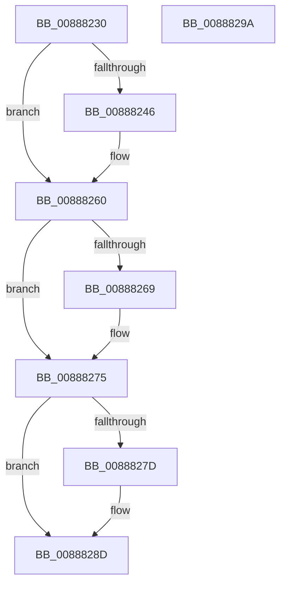

# AlpcReserveDestroyProcedure

- RVA: `0x00888230`–`0x0088829B` (길이 `107` bytes)
- VA: `0x0000000140888230`
- 실행 섹션: `PAGE`
- PDB 이름 있음: `예`; PDB Function 태그: `아니요`
- unwind 정보 RVA: `0x0005CAAC`
- 디코드: `32`개 명령, `107/107` bytes 표시
- 미해석 바이트: `0` (있으면 어셈블리에 `.byte`로 보존)

> 이 문서는 커널 이미지의 기계어와 PDB 기호를 분석해 생성했습니다. 4번과 5번은 함수 원형과 자료형을 바이너리 사용 방식에서 추정한 C 해석이며 원본 소스 복구 결과는 아닙니다.

## 1. Dependencies

- 직접 호출 지점: **5**; 고유 호출 대상: **5**
- 직접 호출자로 확인된 함수: **0**
- RIP 상대 이미지 참조: **0**

### Outgoing calls
- `0x00888249` → [AlpcpLockForCachedReferenceBlob](AlpcpLockForCachedReferenceBlob_function_0088A8B0.md) (function, `0x0088A8B0`)
- `0x0088825B` → [AlpcpUnlockMessage](../89/AlpcpUnlockMessage_function_00897AE0.md) (function, `0x00897AE0`)
- `0x00888270` → [AlpcDeleteBlobByHandle](AlpcDeleteBlobByHandle_function_008882A4.md) (function, `0x008882A4`)
- `0x00888280` → [AlpcpRemoveResourcePort](AlpcpRemoveResourcePort_function_0088836C.md) (function, `0x0088836C`)
- `0x00888288` → [ObfDereferenceObject](../../text/2F/ObfDereferenceObject_function_002F9350.md) (function, `0x002F9350`)

### Direct callers
- 이 함수 시작 RVA로 연결되는 직접 call은 확인되지 않았습니다. 간접 호출은 완전히 역산할 수 없습니다.

### Static image references
- 디코드된 RIP-relative 메모리 참조가 없습니다.

## 2. Other-region calls and transfers

- 다른 실행 섹션으로 향하는 call: **1**
  - `0x00888288` → [ObfDereferenceObject](../../text/2F/ObfDereferenceObject_function_002F9350.md) (`PAGE` → `.text`)
- 별도 외부 분기/꼬리 이동을 확인하지 못했습니다.

## 3. Assembly (complete function range)

```asm
00888230  48 89 5C 24 08                  mov qword ptr [rsp + 8], rbx
00888235  57                              push rdi
00888236  48 83 EC 20                     sub rsp, 0x20
0088823A  48 8B 79 18                     mov rdi, qword ptr [rcx + 0x18]
0088823E  48 8B D9                        mov rbx, rcx
00888241  48 85 FF                        test rdi, rdi
00888244  74 1A                           je 0x140888260
00888246  48 8B CF                        mov rcx, rdi
00888249  E8 62 26 00 00                  call 0x14088a8b0
0088824E  48 83 67 60 00                  and qword ptr [rdi + 0x60], 0
00888253  48 8B CF                        mov rcx, rdi
00888256  48 83 63 18 00                  and qword ptr [rbx + 0x18], 0
0088825B  E8 80 F8 00 00                  call 0x140897ae0
00888260  48 8B 4B 08                     mov rcx, qword ptr [rbx + 8]
00888264  48 85 C9                        test rcx, rcx
00888267  74 0C                           je 0x140888275
00888269  48 8B 53 10                     mov rdx, qword ptr [rbx + 0x10]
0088826D  4C 8B C3                        mov r8, rbx
00888270  E8 2F 00 00 00                  call 0x1408882a4
00888275  48 8B 0B                        mov rcx, qword ptr [rbx]
00888278  48 85 C9                        test rcx, rcx
0088827B  74 10                           je 0x14088828d
0088827D  48 8B D3                        mov rdx, rbx
00888280  E8 E7 00 00 00                  call 0x14088836c
00888285  48 8B 0B                        mov rcx, qword ptr [rbx]
00888288  E8 C3 10 A7 FF                  call 0x1402f9350
0088828D  48 8B 5C 24 30                  mov rbx, qword ptr [rsp + 0x30]
00888292  33 C0                           xor eax, eax
00888294  48 83 C4 20                     add rsp, 0x20
00888298  5F                              pop rdi
00888299  C3                              ret
0088829A  CC                              int3
```

## 4. C-style interpretation (structured pseudocode)

```c
__int64 __fastcall AlpcReserveDestroyProcedure(__int64 a1)
{
    __int64 result;
    __int64 v_rsp;
    unsigned __int64 v_stack_p8;

    v_stack_p8 = v_rbx;
    v_rsp = (v_rsp) - (32);
    if (*(unsigned __int64 *)(a1 + 24) != 0) {
        a1 = *(unsigned __int64 *)(a1 + 24);
        result = AlpcpLockForCachedReferenceBlob(a1, a2, a3, a4);
        a1 = *(unsigned __int64 *)(a1 + 24);
        result = AlpcpUnlockMessage(a1, a2, a3, a4);
    }
    if (*(unsigned __int64 *)(a1 + 8) != 0) {
        a2 = *(unsigned __int64 *)(a1 + 16);
        a3 = a1;
        result = AlpcDeleteBlobByHandle(*(unsigned __int64 *)(a1 + 8), a2, a3, a4);
    }
    if (*(unsigned __int64 *)(a1) != 0) {
        a2 = a1;
        result = AlpcpRemoveResourcePort(*(unsigned __int64 *)(a1), a2, a3, a4);
        a1 = *(unsigned __int64 *)(a1);
        result = ObfDereferenceObject(a1, a2, a3, a4);
    }
    result = 0;
    v_rsp = (v_rsp) + (32);
    return result;
}
```

## 5. (Beta) C Style

```c
int64_t AlpcReserveDestroyProcedure(void *Arg1)
{
    uint8_t *arg1 = (uint8_t *)Arg1;

    int64_t result;
    int64_t local_rsp;
    uint64_t v_stack_p8;

    v_stack_p8 = local_rbx;
    local_rsp = (local_rsp) - (32);
    if (*(uint64_t *)(arg1 + 0x18) != 0) {
        Arg1 = *(uint64_t *)(arg1 + 0x18);
        result = AlpcpLockForCachedReferenceBlob(Arg1, a2, a3, a4);
        Arg1 = *(uint64_t *)(arg1 + 0x18);
        result = AlpcpUnlockMessage(Arg1, a2, a3, a4);
    }
    if (*(uint64_t *)(arg1 + 0x8) != 0) {
        a2 = *(uint64_t *)(arg1 + 0x10);
        a3 = Arg1;
        result = AlpcDeleteBlobByHandle(*(uint64_t *)(arg1 + 0x8), a2, a3, a4);
    }
    if (*(uint64_t *)(arg1) != 0) {
        a2 = Arg1;
        result = AlpcpRemoveResourcePort(*(uint64_t *)(arg1), a2, a3, a4);
        Arg1 = *(uint64_t *)(arg1);
        result = ObfDereferenceObject(Arg1, a2, a3, a4);
    }
    result = 0;
    local_rsp = (local_rsp) + (32);
    return result;
}
```

### 관측된 메모리 오프셋

구조체 형식이 확인되지 않은 접근은 인자 기준의 오프셋으로만 기록했습니다.

| 기준 인자 | 오프셋 표현 | 폭 (bit) | 접근 |
|---|---:|---:|---|
| `Arg1` | `+ 0x0` | `64` | `R` |
| `Arg1` | `+ 0x8` | `64` | `R` |
| `Arg1` | `+ 0x10` | `64` | `R` |
| `Arg1` | `+ 0x18` | `64` | `R` |
| `Arg1` | `+ 0x18` | `64` | `R/W` |

## 6. Execution-region graph

[열기: 2D/3D 그래프와 함수 탐색 컨트롤 패널](../../../control-panel.html?section=page&rva=0x00888230&view=graph)

- 2D 그래프는 위에서 아래로 흐르고, 3D 그래프는 빈 공간을 드래그해 회전합니다. Shift+드래그는 이동, 휠은 확대·축소, 함수 노드 선택은 대상 보고서 이동입니다.

### Static fallback


