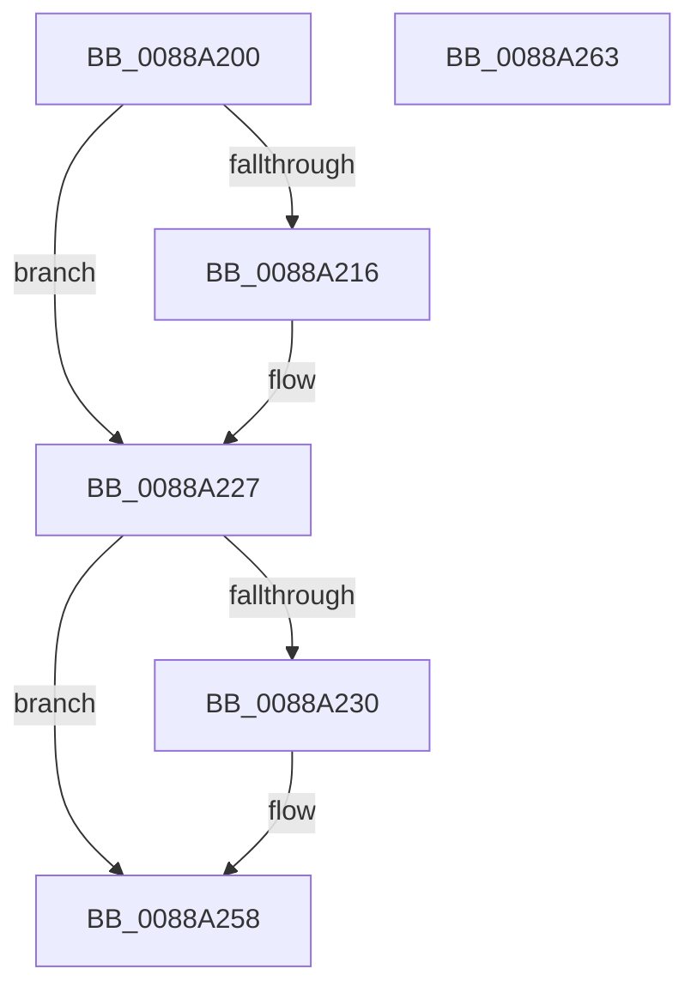

# AlpcSectionDeleteProcedure

- RVA: `0x0088A200`–`0x0088A264` (길이 `100` bytes)
- VA: `0x000000014088A200`
- 실행 섹션: `PAGE`
- PDB 이름 있음: `예`; PDB Function 태그: `아니요`
- unwind 정보 RVA: `0x0005CAAC`
- 디코드: `29`개 명령, `100/100` bytes 표시
- 미해석 바이트: `0` (있으면 어셈블리에 `.byte`로 보존)

> 이 문서는 커널 이미지의 기계어와 PDB 기호를 분석해 생성했습니다. 4번과 5번은 함수 원형과 자료형을 바이너리 사용 방식에서 추정한 C 해석이며 원본 소스 복구 결과는 아닙니다.

## 1. Dependencies

- 직접 호출 지점: **5**; 고유 호출 대상: **5**
- 직접 호출자로 확인된 함수: **1**
- RIP 상대 이미지 참조: **0**

### Outgoing calls
- `0x0088A21D` → [AlpcDeleteBlobByHandle](AlpcDeleteBlobByHandle_function_008882A4.md) (function, `0x008882A4`)
- `0x0088A233` → [AlpcpLockForCachedReferenceBlob](AlpcpLockForCachedReferenceBlob_function_0088A8B0.md) (function, `0x0088A8B0`)
- `0x0088A23E` → [AlpcpRemoveResourcePort](AlpcpRemoveResourcePort_function_0088836C.md) (function, `0x0088836C`)
- `0x0088A24B` → [AlpcpUnlockBlob](AlpcpUnlockBlob_function_0088B990.md) (function, `0x0088B990`)
- `0x0088A253` → [ObfDereferenceObject](../../text/2F/ObfDereferenceObject_function_002F9350.md) (function, `0x002F9350`)

### Direct callers
- [AlpcpDeleteBlob](AlpcpDeleteBlob_function_0088A11C.md) at `0x0088A1A6`

### Static image references
- 디코드된 RIP-relative 메모리 참조가 없습니다.

## 2. Other-region calls and transfers

- 다른 실행 섹션으로 향하는 call: **1**
  - `0x0088A253` → [ObfDereferenceObject](../../text/2F/ObfDereferenceObject_function_002F9350.md) (`PAGE` → `.text`)
- 별도 외부 분기/꼬리 이동을 확인하지 못했습니다.

## 3. Assembly (complete function range)

```asm
0088A200  48 89 5C 24 08                  mov qword ptr [rsp + 8], rbx
0088A205  57                              push rdi
0088A206  48 83 EC 20                     sub rsp, 0x20
0088A20A  48 8B D9                        mov rbx, rcx
0088A20D  48 8B 49 10                     mov rcx, qword ptr [rcx + 0x10]
0088A211  48 85 C9                        test rcx, rcx
0088A214  74 11                           je 0x14088a227
0088A216  48 8B 53 18                     mov rdx, qword ptr [rbx + 0x18]
0088A21A  4C 8B C3                        mov r8, rbx
0088A21D  E8 82 E0 FF FF                  call 0x1408882a4
0088A222  48 83 63 10 00                  and qword ptr [rbx + 0x10], 0
0088A227  48 8B 7B 28                     mov rdi, qword ptr [rbx + 0x28]
0088A22B  48 85 FF                        test rdi, rdi
0088A22E  74 28                           je 0x14088a258
0088A230  48 8B CB                        mov rcx, rbx
0088A233  E8 78 06 00 00                  call 0x14088a8b0
0088A238  48 8B D3                        mov rdx, rbx
0088A23B  48 8B CF                        mov rcx, rdi
0088A23E  E8 29 E1 FF FF                  call 0x14088836c
0088A243  48 83 63 28 00                  and qword ptr [rbx + 0x28], 0
0088A248  48 8B CB                        mov rcx, rbx
0088A24B  E8 40 17 00 00                  call 0x14088b990
0088A250  48 8B CF                        mov rcx, rdi
0088A253  E8 F8 F0 A6 FF                  call 0x1402f9350
0088A258  48 8B 5C 24 30                  mov rbx, qword ptr [rsp + 0x30]
0088A25D  48 83 C4 20                     add rsp, 0x20
0088A261  5F                              pop rdi
0088A262  C3                              ret
0088A263  CC                              int3
```

## 4. C-style interpretation (structured pseudocode)

```c
__int64 __fastcall AlpcSectionDeleteProcedure(__int64 a1)
{
    __int64 result;
    __int64 v_rsp;
    unsigned __int64 v_stack_p8;

    v_stack_p8 = v_rbx;
    v_rsp = (v_rsp) - (32);
    if (*(unsigned __int64 *)(a1 + 16) != 0) {
        a2 = *(unsigned __int64 *)(a1 + 24);
        a3 = a1;
        result = AlpcDeleteBlobByHandle(*(unsigned __int64 *)(a1 + 16), a2, a3, a4);
    }
    if (*(unsigned __int64 *)(a1 + 40) != 0) {
        a1 = a1;
        result = AlpcpLockForCachedReferenceBlob(a1, a2, a3, a4);
        a2 = a1;
        a1 = *(unsigned __int64 *)(a1 + 40);
        result = AlpcpRemoveResourcePort(a1, a2, a3, a4);
        a1 = a1;
        result = AlpcpUnlockBlob(a1, a2, a3, a4);
        a1 = *(unsigned __int64 *)(a1 + 40);
        result = ObfDereferenceObject(a1, a2, a3, a4);
    }
    v_rsp = (v_rsp) + (32);
    return result;
}
```

## 5. (Beta) C Style

```c
int64_t AlpcSectionDeleteProcedure(void *Arg1)
{
    uint8_t *arg1 = (uint8_t *)Arg1;

    int64_t result;
    int64_t local_rsp;
    uint64_t v_stack_p8;

    v_stack_p8 = local_rbx;
    local_rsp = (local_rsp) - (32);
    if (*(uint64_t *)(arg1 + 0x10) != 0) {
        a2 = *(uint64_t *)(arg1 + 0x18);
        a3 = Arg1;
        result = AlpcDeleteBlobByHandle(*(uint64_t *)(arg1 + 0x10), a2, a3, a4);
    }
    if (*(uint64_t *)(arg1 + 0x28) != 0) {
        Arg1 = Arg1;
        result = AlpcpLockForCachedReferenceBlob(Arg1, a2, a3, a4);
        a2 = Arg1;
        Arg1 = *(uint64_t *)(arg1 + 0x28);
        result = AlpcpRemoveResourcePort(Arg1, a2, a3, a4);
        Arg1 = Arg1;
        result = AlpcpUnlockBlob(Arg1, a2, a3, a4);
        Arg1 = *(uint64_t *)(arg1 + 0x28);
        result = ObfDereferenceObject(Arg1, a2, a3, a4);
    }
    local_rsp = (local_rsp) + (32);
    return result;
}
```

### 관측된 메모리 오프셋

구조체 형식이 확인되지 않은 접근은 인자 기준의 오프셋으로만 기록했습니다.

| 기준 인자 | 오프셋 표현 | 폭 (bit) | 접근 |
|---|---:|---:|---|
| `Arg1` | `+ 0x10` | `64` | `R` |
| `Arg1` | `+ 0x10` | `64` | `R/W` |
| `Arg1` | `+ 0x18` | `64` | `R` |
| `Arg1` | `+ 0x28` | `64` | `R` |
| `Arg1` | `+ 0x28` | `64` | `R/W` |

## 6. Execution-region graph

[열기: 2D/3D 그래프와 함수 탐색 컨트롤 패널](../../../control-panel.html?section=page&rva=0x0088A200&view=graph)

- 2D 그래프는 위에서 아래로 흐르고, 3D 그래프는 빈 공간을 드래그해 회전합니다. Shift+드래그는 이동, 휠은 확대·축소, 함수 노드 선택은 대상 보고서 이동입니다.

### Static fallback


