# AlpcSecurityDestroyProcedure

- RVA: `0x0088B330`–`0x0088B4F1` (길이 `449` bytes)
- VA: `0x000000014088B330`
- 실행 섹션: `PAGE`
- PDB 이름 있음: `예`; PDB Function 태그: `아니요`
- unwind 정보 RVA: `0x0007D214`
- 디코드: `123`개 명령, `449/449` bytes 표시
- 미해석 바이트: `0` (있으면 어셈블리에 `.byte`로 보존)

> 이 문서는 커널 이미지의 기계어와 PDB 기호를 분석해 생성했습니다. 4번과 5번은 함수 원형과 자료형을 바이너리 사용 방식에서 추정한 C 해석이며 원본 소스 복구 결과는 아닙니다.

## 1. Dependencies

- 직접 호출 지점: **12**; 고유 호출 대상: **7**
- 직접 호출자로 확인된 함수: **4**
- RIP 상대 이미지 참조: **0**

### Outgoing calls
- `0x0088B36B` → [KeAbPreAcquire](../../text/21/KeAbPreAcquire_function_00210230.md) (function, `0x00210230`)
- `0x0088B384` → [ExfAcquirePushLockExclusiveEx](../../text/20/ExfAcquirePushLockExclusiveEx_function_0020FC90.md) (function, `0x0020FC90`)
- `0x0088B3BE` → [KeAbPostRelease](../../text/2E/KeAbPostRelease_function_002E1600.md) (function, `0x002E1600`)
- `0x0088B3E3` → [KeAbPreAcquire](../../text/21/KeAbPreAcquire_function_00210230.md) (function, `0x00210230`)
- `0x0088B3FD` → [ExfAcquirePushLockExclusiveEx](../../text/20/ExfAcquirePushLockExclusiveEx_function_0020FC90.md) (function, `0x0020FC90`)
- `0x0088B44D` → [KeAbPostRelease](../../text/2E/KeAbPostRelease_function_002E1600.md) (function, `0x002E1600`)
- `0x0088B456` → [ObfDereferenceObject](../../text/2F/ObfDereferenceObject_function_002F9350.md) (function, `0x002F9350`)
- `0x0088B479` → [ObfDereferenceObjectWithTag](../../text/2F/ObfDereferenceObjectWithTag_function_002F78E0.md) (function, `0x002F78E0`)
- `0x0088B4AF` → [ObfDereferenceObjectWithTag](../../text/2F/ObfDereferenceObjectWithTag_function_002F78E0.md) (function, `0x002F78E0`)
- `0x0088B4D0` → [PsReturnProcessPagedPoolQuota](../../text/2A/PsReturnProcessPagedPoolQuota_function_002A6860.md) (function, `0x002A6860`)
- `0x0088B4DA` → [ExfTryToWakePushLock](../../text/26/ExfTryToWakePushLock_function_00265DD0.md) (function, `0x00265DD0`)
- `0x0088B4E7` → [ExfTryToWakePushLock](../../text/26/ExfTryToWakePushLock_function_00265DD0.md) (function, `0x00265DD0`)

### Direct callers
- [sub_0088AF37](Unknown_function_0088AF37.md) at `0x0088AF80`
- [sub_0088B593](Unknown_function_0088B593.md) at `0x0088B5D4`
- [sub_0088BA74](Unknown_function_0088BA74.md) at `0x0088BA83`
- [sub_00897BD2](../89/Unknown_function_00897BD2.md) at `0x00897BE1`

### Static image references
- 디코드된 RIP-relative 메모리 참조가 없습니다.

## 2. Other-region calls and transfers

- 다른 실행 섹션으로 향하는 call: **12**
  - `0x0088B36B` → [KeAbPreAcquire](../../text/21/KeAbPreAcquire_function_00210230.md) (`PAGE` → `.text`)
  - `0x0088B384` → [ExfAcquirePushLockExclusiveEx](../../text/20/ExfAcquirePushLockExclusiveEx_function_0020FC90.md) (`PAGE` → `.text`)
  - `0x0088B3BE` → [KeAbPostRelease](../../text/2E/KeAbPostRelease_function_002E1600.md) (`PAGE` → `.text`)
  - `0x0088B3E3` → [KeAbPreAcquire](../../text/21/KeAbPreAcquire_function_00210230.md) (`PAGE` → `.text`)
  - `0x0088B3FD` → [ExfAcquirePushLockExclusiveEx](../../text/20/ExfAcquirePushLockExclusiveEx_function_0020FC90.md) (`PAGE` → `.text`)
  - `0x0088B44D` → [KeAbPostRelease](../../text/2E/KeAbPostRelease_function_002E1600.md) (`PAGE` → `.text`)
  - `0x0088B456` → [ObfDereferenceObject](../../text/2F/ObfDereferenceObject_function_002F9350.md) (`PAGE` → `.text`)
  - `0x0088B479` → [ObfDereferenceObjectWithTag](../../text/2F/ObfDereferenceObjectWithTag_function_002F78E0.md) (`PAGE` → `.text`)
  - `0x0088B4AF` → [ObfDereferenceObjectWithTag](../../text/2F/ObfDereferenceObjectWithTag_function_002F78E0.md) (`PAGE` → `.text`)
  - `0x0088B4D0` → [PsReturnProcessPagedPoolQuota](../../text/2A/PsReturnProcessPagedPoolQuota_function_002A6860.md) (`PAGE` → `.text`)
  - `0x0088B4DA` → [ExfTryToWakePushLock](../../text/26/ExfTryToWakePushLock_function_00265DD0.md) (`PAGE` → `.text`)
  - `0x0088B4E7` → [ExfTryToWakePushLock](../../text/26/ExfTryToWakePushLock_function_00265DD0.md) (`PAGE` → `.text`)
- 별도 외부 분기/꼬리 이동을 확인하지 못했습니다.

## 3. Assembly (complete function range)

```asm
0088B330  48 89 5C 24 08                  mov qword ptr [rsp + 8], rbx
0088B335  48 89 6C 24 10                  mov qword ptr [rsp + 0x10], rbp
0088B33A  48 89 74 24 18                  mov qword ptr [rsp + 0x18], rsi
0088B33F  57                              push rdi
0088B340  41 56                           push r14
0088B342  41 57                           push r15
0088B344  48 83 EC 20                     sub rsp, 0x20
0088B348  4C 8B 31                        mov r14, qword ptr [rcx]
0088B34B  48 83 CB FF                     or rbx, 0xffffffffffffffff
0088B34F  48 8B F9                        mov rdi, rcx
0088B352  4D 85 F6                        test r14, r14
0088B355  74 6C                           je 0x14088b3c3
0088B357  4C 8B 79 08                     mov r15, qword ptr [rcx + 8]
0088B35B  49 8D 76 08                     lea rsi, [r14 + 8]
0088B35F  48 8B CE                        mov rcx, rsi
0088B362  45 33 C0                        xor r8d, r8d
0088B365  33 D2                           xor edx, edx
0088B367  49 83 EF 10                     sub r15, 0x10
0088B36B  E8 C0 4E 98 FF                  call 0x140210230
0088B370  F0 48 0F BA 2E 00               lock bts qword ptr [rsi], 0
0088B376  48 8B E8                        mov rbp, rax
0088B379  73 0E                           jae 0x14088b389
0088B37B  4C 8B C6                        mov r8, rsi
0088B37E  48 8B D0                        mov rdx, rax
0088B381  48 8B CE                        mov rcx, rsi
0088B384  E8 07 49 98 FF                  call 0x14020fc90
0088B389  48 85 ED                        test rbp, rbp
0088B38C  74 04                           je 0x14088b392
0088B38E  C6 45 0A 01                     mov byte ptr [rbp + 0xa], 1
0088B392  41 8B C7                        mov eax, r15d
0088B395  49 3B 46 10                     cmp rax, qword ptr [r14 + 0x10]
0088B399  73 0E                           jae 0x14088b3a9
0088B39B  49 8B 0E                        mov rcx, qword ptr [r14]
0088B39E  48 39 3C C1                     cmp qword ptr [rcx + rax*8], rdi
0088B3A2  75 05                           jne 0x14088b3a9
0088B3A4  48 83 24 C1 00                  and qword ptr [rcx + rax*8], 0
0088B3A9  48 8B C3                        mov rax, rbx
0088B3AC  F0 48 0F C1 06                  lock xadd qword ptr [rsi], rax
0088B3B1  24 06                           and al, 6
0088B3B3  3C 02                           cmp al, 2
0088B3B5  0F 84 29 01 00 00               je 0x14088b4e4
0088B3BB  48 8B CE                        mov rcx, rsi
0088B3BE  E8 3D 62 A5 FF                  call 0x1402e1600
0088B3C3  48 8B 6F 18                     mov rbp, qword ptr [rdi + 0x18]
0088B3C7  48 85 ED                        test rbp, rbp
0088B3CA  0F 84 8B 00 00 00               je 0x14088b45b
0088B3D0  48 81 C5 48 01 00 00            add rbp, 0x148
0088B3D7  48 8D 77 D0                     lea rsi, [rdi - 0x30]
0088B3DB  48 8B CD                        mov rcx, rbp
0088B3DE  45 33 C0                        xor r8d, r8d
0088B3E1  33 D2                           xor edx, edx
0088B3E3  E8 48 4E 98 FF                  call 0x140210230
0088B3E8  F0 48 0F BA 6D 00 00            lock bts qword ptr [rbp], 0
0088B3EF  4C 8B F0                        mov r14, rax
0088B3F2  73 0E                           jae 0x14088b402
0088B3F4  4C 8B C5                        mov r8, rbp
0088B3F7  48 8B D0                        mov rdx, rax
0088B3FA  48 8B CD                        mov rcx, rbp
0088B3FD  E8 8E 48 98 FF                  call 0x14020fc90
0088B402  4D 85 F6                        test r14, r14
0088B405  74 05                           je 0x14088b40c
0088B407  41 C6 46 0A 01                  mov byte ptr [r14 + 0xa], 1
0088B40C  48 8B 06                        mov rax, qword ptr [rsi]
0088B40F  48 3B C6                        cmp rax, rsi
0088B412  74 24                           je 0x14088b438
0088B414  48 39 70 08                     cmp qword ptr [rax + 8], rsi
0088B418  75 09                           jne 0x14088b423
0088B41A  48 8B 4E 08                     mov rcx, qword ptr [rsi + 8]
0088B41E  48 39 31                        cmp qword ptr [rcx], rsi
0088B421  74 07                           je 0x14088b42a
0088B423  B9 03 00 00 00                  mov ecx, 3
0088B428  CD 29                           int 0x29
0088B42A  48 89 01                        mov qword ptr [rcx], rax
0088B42D  48 89 48 08                     mov qword ptr [rax + 8], rcx
0088B431  48 89 76 08                     mov qword ptr [rsi + 8], rsi
0088B435  48 89 36                        mov qword ptr [rsi], rsi
0088B438  F0 48 0F C1 5D 00               lock xadd qword ptr [rbp], rbx
0088B43E  80 E3 06                        and bl, 6
0088B441  80 FB 02                        cmp bl, 2
0088B444  0F 84 8D 00 00 00               je 0x14088b4d7
0088B44A  48 8B CD                        mov rcx, rbp
0088B44D  E8 AE 61 A5 FF                  call 0x1402e1600
0088B452  48 8B 4F 18                     mov rcx, qword ptr [rdi + 0x18]
0088B456  E8 F5 DE A6 FF                  call 0x1402f9350
0088B45B  48 83 7F 10 00                  cmp qword ptr [rdi + 0x10], 0
0088B460  74 52                           je 0x14088b4b4
0088B462  48 8B 4F 30                     mov rcx, qword ptr [rdi + 0x30]
0088B466  83 B9 C0 00 00 00 01            cmp dword ptr [rcx + 0xc0], 1
0088B46D  74 05                           je 0x14088b474
0088B46F  48 85 C9                        test rcx, rcx
0088B472  74 0A                           je 0x14088b47e
0088B474  BA 53 65 43 63                  mov edx, 0x63436553
0088B479  E8 62 C4 A6 FF                  call 0x1402f78e0
0088B47E  48 8B 4F 10                     mov rcx, qword ptr [rdi + 0x10]
0088B482  48 85 C9                        test rcx, rcx
0088B485  74 1F                           je 0x14088b4a6
0088B487  48 8B 81 98 05 00 00            mov rax, qword ptr [rcx + 0x598]
0088B48E  BA A0 00 00 00                  mov edx, 0xa0
0088B493  48 03 C2                        add rax, rdx
0088B496  48 3D 00 10 00 00               cmp rax, 0x1000
0088B49C  73 32                           jae 0x14088b4d0
0088B49E  F0 48 01 91 98 05 00 00         lock add qword ptr [rcx + 0x598], rdx
0088B4A6  48 8B 4F 10                     mov rcx, qword ptr [rdi + 0x10]
0088B4AA  BA 41 6C 70 63                  mov edx, 0x63706c41
0088B4AF  E8 2C C4 A6 FF                  call 0x1402f78e0
0088B4B4  48 8B 5C 24 40                  mov rbx, qword ptr [rsp + 0x40]
0088B4B9  33 C0                           xor eax, eax
0088B4BB  48 8B 6C 24 48                  mov rbp, qword ptr [rsp + 0x48]
0088B4C0  48 8B 74 24 50                  mov rsi, qword ptr [rsp + 0x50]
0088B4C5  48 83 C4 20                     add rsp, 0x20
0088B4C9  41 5F                           pop r15
0088B4CB  41 5E                           pop r14
0088B4CD  5F                              pop rdi
0088B4CE  C3                              ret
0088B4CF  CC                              int3
0088B4D0  E8 8B B3 A1 FF                  call 0x1402a6860
0088B4D5  EB CF                           jmp 0x14088b4a6
0088B4D7  48 8B CD                        mov rcx, rbp
0088B4DA  E8 F1 A8 9D FF                  call 0x140265dd0
0088B4DF  E9 66 FF FF FF                  jmp 0x14088b44a
0088B4E4  48 8B CE                        mov rcx, rsi
0088B4E7  E8 E4 A8 9D FF                  call 0x140265dd0
0088B4EC  E9 CA FE FF FF                  jmp 0x14088b3bb
```

## 4. C-style interpretation (structured pseudocode)

```c
__int64 __fastcall AlpcSecurityDestroyProcedure(__int64 a1, int a2, int a3)
{
    __int64 result;
    __int64 v_r15;
    __int64 v_rbp;
    __int64 v_rbx;
    __int64 v_rsp;
    unsigned __int64 v_stack_p10;
    unsigned __int64 v_stack_p18;
    unsigned __int64 v_stack_p8;

    v_stack_p8 = v_rbx;
    v_stack_p10 = v_rbp;
    v_stack_p18 = v_rsi;
    v_rsp = (v_rsp) - (32);
    v_rbx = (v_rbx) | (-1);
    if (*(unsigned __int64 *)(a1) == 0) goto loc_0088B3C3;
    a3 = 0;
    a2 = 0;
    v_r15 = (*(unsigned __int64 *)(a1 + 8)) - (16);
    result = KeAbPreAcquire(*(unsigned __int64 *)(a1) + 8, a2, a3, a4);
    if (!(condition_is_above_or_equal)) {
        a3 = *(unsigned __int64 *)(a1) + 8;
        a2 = result;
        a1 = *(unsigned __int64 *)(a1) + 8;
        result = ExfAcquirePushLockExclusiveEx(a1, a2, a3, a4);
    }
    if (result != 0) {
        *(unsigned __int8 *)(result + 10) = 1;
    }
    if (((unsigned int)((unsigned int)(v_r15))) >= (*(unsigned __int64 *)(*(unsigned __int64 *)(a1) + 16))) goto loc_0088B3A9;
    if ((*(unsigned __int64 *)(*(unsigned __int64 *)(*(unsigned __int64 *)(a1)) + (unsigned int)((unsigned int)(v_r15)) * 8)) == a1) {
    }
    result = (unsigned __int8)((v_rbx) & (6));
    if (((unsigned __int8)(result)) == 2) goto loc_0088B4E4;
loc_0088B3BB:
    result = KeAbPostRelease(*(unsigned __int64 *)(a1) + 8, a2, a3, a4);
loc_0088B3C3:
    if (*(unsigned __int64 *)(a1 + 24) == 0) goto loc_0088B45B;
    v_rbp = (*(unsigned __int64 *)(a1 + 24)) + (328);
    a3 = 0;
    a2 = 0;
    result = KeAbPreAcquire(v_rbp, a2, a3, a4);
    if (!(condition_is_above_or_equal)) {
        a3 = v_rbp;
        a2 = result;
        a1 = v_rbp;
        result = ExfAcquirePushLockExclusiveEx(a1, a2, a3, a4);
    }
    if (result != 0) {
        *(unsigned __int8 *)(result + 10) = 1;
    }
    if ((*(unsigned __int64 *)(a1 - 48)) == (a1 - 48)) goto loc_0088B438;
    if ((*(unsigned __int64 *)(*(unsigned __int64 *)(a1 - 48) + 8)) != (a1 - 48)) goto loc_0088B423;
    if ((*(unsigned __int64 *)(*(unsigned __int64 *)(a1 - 48 + 8))) != (a1 - 48)) {
        a1 = 3;
    }
    *(unsigned __int64 *)(a1) = *(unsigned __int64 *)(a1 - 48);
    *(unsigned __int64 *)(*(unsigned __int64 *)(a1 - 48) + 8) = a1;
    *(unsigned __int64 *)(a1 - 48 + 8) = a1 - 48;
    *(unsigned __int64 *)(a1 - 48) = a1 - 48;
loc_0088B438:
    v_rbx = (unsigned __int8)((v_rbx) & (6));
    if (((unsigned __int8)(v_rbx)) == 2) goto loc_0088B4D7;
loc_0088B44A:
    result = KeAbPostRelease(v_rbp, a2, a3, a4);
    result = ObfDereferenceObject(*(unsigned __int64 *)(a1 + 24), a2, a3, a4);
loc_0088B45B:
    if ((*(unsigned __int64 *)(a1 + 16)) == 0) goto loc_0088B4B4;
    if ((*(unsigned int *)(*(unsigned __int64 *)(a1 + 48) + 192)) == 1) goto loc_0088B474;
    if (*(unsigned __int64 *)(a1 + 48) != 0) {
        a2 = 0x63436553ULL;
        result = ObfDereferenceObjectWithTag(*(unsigned __int64 *)(a1 + 48), a2, a3, a4);
    }
    if (*(unsigned __int64 *)(a1 + 16) == 0) goto loc_0088B4A6;
    result = (*(unsigned __int64 *)(*(unsigned __int64 *)(a1 + 16) + 1432)) + (160);
    if (result >= 0x1000ULL) goto loc_0088B4D0;
loc_0088B4A6:
    result = ObfDereferenceObjectWithTag(*(unsigned __int64 *)(a1 + 16), (unsigned int)(0x63706C41ULL), a3, a4);
loc_0088B4B4:
    result = 0;
    v_rsp = (v_rsp) + (32);
    return result;
loc_0088B4D0:
    result = PsReturnProcessPagedPoolQuota(*(unsigned __int64 *)(a1 + 16), (unsigned int)(0x63706C41ULL), a3, a4);
    goto loc_0088B4A6;
loc_0088B4D7:
    result = ExfTryToWakePushLock(v_stack_p10, (unsigned int)(0x63706C41ULL), a3, a4);
    goto loc_0088B44A;
loc_0088B4E4:
    result = ExfTryToWakePushLock(v_stack_p18, (unsigned int)(0x63706C41ULL), a3, a4);
    goto loc_0088B3BB;
}
```

## 5. (Beta) C Style

```c
int64_t AlpcSecurityDestroyProcedure(void *Arg1, int32_t Arg2, int32_t Arg3)
{
    uint8_t *arg1 = (uint8_t *)Arg1;

    int64_t result;
    int64_t local_r15;
    int64_t local_rbp;
    int64_t local_rbx;
    int64_t local_rsp;
    uint64_t v_stack_p10;
    uint64_t v_stack_p18;
    uint64_t v_stack_p8;

    v_stack_p8 = local_rbx;
    v_stack_p10 = local_rbp;
    v_stack_p18 = local_rsi;
    local_rsp = (local_rsp) - (32);
    local_rbx = (local_rbx) | (-1);
    if (*(uint64_t *)(arg1) == 0) goto loc_0088B3C3;
    Arg3 = 0;
    Arg2 = 0;
    local_r15 = (*(uint64_t *)(arg1 + 0x8)) - (16);
    result = KeAbPreAcquire(*(uint64_t *)(arg1) + 8, Arg2, Arg3, a4);
    if (!(condition_is_above_or_equal)) {
        Arg3 = *(uint64_t *)(arg1) + 8;
        Arg2 = result;
        Arg1 = *(uint64_t *)(arg1) + 8;
        result = ExfAcquirePushLockExclusiveEx(Arg1, Arg2, Arg3, a4);
    }
    if (result != 0) {
        *(uint8_t *)(result + 0xA) = 1;
    }
    if (((uint32_t)((uint32_t)(local_r15))) >= (*(uint64_t *)(*(uint64_t *)(arg1) + 0x10))) goto loc_0088B3A9;
    if ((*(uint64_t *)(*(uint64_t *)(*(uint64_t *)(arg1)) + (uint32_t)((uint32_t)(local_r15)) * 8)) == Arg1) {
    }
    result = (uint8_t)((local_rbx) & (6));
    if (((uint8_t)(result)) == 2) goto loc_0088B4E4;
loc_0088B3BB:
    result = KeAbPostRelease(*(uint64_t *)(arg1) + 8, Arg2, Arg3, a4);
loc_0088B3C3:
    if (*(uint64_t *)(arg1 + 0x18) == 0) goto loc_0088B45B;
    local_rbp = (*(uint64_t *)(arg1 + 0x18)) + (328);
    Arg3 = 0;
    Arg2 = 0;
    result = KeAbPreAcquire(local_rbp, Arg2, Arg3, a4);
    if (!(condition_is_above_or_equal)) {
        Arg3 = local_rbp;
        Arg2 = result;
        Arg1 = local_rbp;
        result = ExfAcquirePushLockExclusiveEx(Arg1, Arg2, Arg3, a4);
    }
    if (result != 0) {
        *(uint8_t *)(result + 0xA) = 1;
    }
    if ((*(uint64_t *)(arg1 - 0x30)) == (Arg1 - 48)) goto loc_0088B438;
    if ((*(uint64_t *)(*(uint64_t *)(arg1 - 0x30) + 0x8)) != (Arg1 - 48)) goto loc_0088B423;
    if ((*(uint64_t *)(*(uint64_t *)(arg1 - 0x30 + 0x8))) != (Arg1 - 48)) {
        Arg1 = 3;
    }
    *(uint64_t *)(arg1) = *(uint64_t *)(arg1 - 0x30);
    *(void **)(*(uint64_t *)(arg1 - 0x30) + 0x8) = Arg1;
    *(void **)(arg1 - 0x30 + 0x8) = Arg1 - 48;
    *(void **)(arg1 - 0x30) = Arg1 - 48;
loc_0088B438:
    local_rbx = (uint8_t)((local_rbx) & (6));
    if (((uint8_t)(local_rbx)) == 2) goto loc_0088B4D7;
loc_0088B44A:
    result = KeAbPostRelease(local_rbp, Arg2, Arg3, a4);
    result = ObfDereferenceObject(*(uint64_t *)(arg1 + 0x18), Arg2, Arg3, a4);
loc_0088B45B:
    if ((*(uint64_t *)(arg1 + 0x10)) == 0) goto loc_0088B4B4;
    if ((*(uint32_t *)(*(uint64_t *)(arg1 + 0x30) + 0xC0)) == 1) goto loc_0088B474;
    if (*(uint64_t *)(arg1 + 0x30) != 0) {
        Arg2 = 0x63436553ULL;
        result = ObfDereferenceObjectWithTag(*(uint64_t *)(arg1 + 0x30), Arg2, Arg3, a4);
    }
    if (*(uint64_t *)(arg1 + 0x10) == 0) goto loc_0088B4A6;
    result = (*(uint64_t *)(*(uint64_t *)(arg1 + 0x10) + 0x598)) + (160);
    if (result >= 0x1000ULL) goto loc_0088B4D0;
loc_0088B4A6:
    result = ObfDereferenceObjectWithTag(*(uint64_t *)(arg1 + 0x10), (uint32_t)(0x63706C41ULL), Arg3, a4);
loc_0088B4B4:
    result = 0;
    local_rsp = (local_rsp) + (32);
    return result;
loc_0088B4D0:
    result = PsReturnProcessPagedPoolQuota(*(uint64_t *)(arg1 + 0x10), (uint32_t)(0x63706C41ULL), Arg3, a4);
    goto loc_0088B4A6;
loc_0088B4D7:
    result = ExfTryToWakePushLock(v_stack_p10, (uint32_t)(0x63706C41ULL), Arg3, a4);
    goto loc_0088B44A;
loc_0088B4E4:
    result = ExfTryToWakePushLock(v_stack_p18, (uint32_t)(0x63706C41ULL), Arg3, a4);
    goto loc_0088B3BB;
}
```

### 관측된 메모리 오프셋

구조체 형식이 확인되지 않은 접근은 인자 기준의 오프셋으로만 기록했습니다.

| 기준 인자 | 오프셋 표현 | 폭 (bit) | 접근 |
|---|---:|---:|---|
| `Arg1` | `- 0x30` | `64` | `R` |
| `Arg1` | `+ 0x0` | `64` | `R` |
| `Arg1` | `+ 0x0` | `64` | `W` |
| `Arg1` | `+ 0x8` | `64` | `R` |
| `Arg1` | `+ 0x8` | `64` | `W` |
| `Arg1` | `+ 0x10` | `64` | `R` |
| `Arg1` | `+ 0x18` | `64` | `R` |
| `Arg1` | `+ 0x30` | `64` | `R` |

## 6. Execution-region graph

[열기: 2D/3D 그래프와 함수 탐색 컨트롤 패널](../../../control-panel.html?section=page&rva=0x0088B330&view=graph)

- 2D 그래프는 위에서 아래로 흐르고, 3D 그래프는 빈 공간을 드래그해 회전합니다. Shift+드래그는 이동, 휠은 확대·축소, 함수 노드 선택은 대상 보고서 이동입니다.

### Static fallback

```mermaid
flowchart TD
  bb_0088B330[BB_0088B330]
  bb_0088B357[BB_0088B357]
  bb_0088B37B[BB_0088B37B]
  bb_0088B389[BB_0088B389]
  bb_0088B38E[BB_0088B38E]
  bb_0088B392[BB_0088B392]
  bb_0088B39B[BB_0088B39B]
  bb_0088B3A4[BB_0088B3A4]
  bb_0088B3A9[BB_0088B3A9]
  bb_0088B3BB[BB_0088B3BB]
  bb_0088B3C3[BB_0088B3C3]
  bb_0088B3D0[BB_0088B3D0]
  bb_0088B3F4[BB_0088B3F4]
  bb_0088B402[BB_0088B402]
  bb_0088B407[BB_0088B407]
  bb_0088B40C[BB_0088B40C]
  bb_0088B414[BB_0088B414]
  bb_0088B41A[BB_0088B41A]
  bb_0088B423[BB_0088B423]
  bb_0088B42A[BB_0088B42A]
  bb_0088B438[BB_0088B438]
  bb_0088B44A[BB_0088B44A]
  bb_0088B45B[BB_0088B45B]
  bb_0088B462[BB_0088B462]
  bb_0088B46F[BB_0088B46F]
  bb_0088B474[BB_0088B474]
  bb_0088B47E[BB_0088B47E]
  bb_0088B487[BB_0088B487]
  bb_0088B49E[BB_0088B49E]
  bb_0088B4A6[BB_0088B4A6]
  bb_0088B4B4[BB_0088B4B4]
  bb_0088B4CF[BB_0088B4CF]
  bb_0088B4D0[BB_0088B4D0]
  bb_0088B4D7[BB_0088B4D7]
  bb_0088B4E4[BB_0088B4E4]
  bb_0088B330 -->|branch| bb_0088B3C3
  bb_0088B330 -->|fallthrough| bb_0088B357
  bb_0088B357 -->|branch| bb_0088B389
  bb_0088B357 -->|fallthrough| bb_0088B37B
  bb_0088B37B -->|flow| bb_0088B389
  bb_0088B389 -->|branch| bb_0088B392
  bb_0088B389 -->|fallthrough| bb_0088B38E
  bb_0088B38E -->|flow| bb_0088B392
  bb_0088B392 -->|branch| bb_0088B3A9
  bb_0088B392 -->|fallthrough| bb_0088B39B
  bb_0088B39B -->|branch| bb_0088B3A9
  bb_0088B39B -->|fallthrough| bb_0088B3A4
  bb_0088B3A4 -->|flow| bb_0088B3A9
  bb_0088B3A9 -->|branch| bb_0088B4E4
  bb_0088B3A9 -->|fallthrough| bb_0088B3BB
  bb_0088B3BB -->|flow| bb_0088B3C3
  bb_0088B3C3 -->|branch| bb_0088B45B
  bb_0088B3C3 -->|fallthrough| bb_0088B3D0
  bb_0088B3D0 -->|branch| bb_0088B402
  bb_0088B3D0 -->|fallthrough| bb_0088B3F4
  bb_0088B3F4 -->|flow| bb_0088B402
  bb_0088B402 -->|branch| bb_0088B40C
  bb_0088B402 -->|fallthrough| bb_0088B407
  bb_0088B407 -->|flow| bb_0088B40C
  bb_0088B40C -->|branch| bb_0088B438
  bb_0088B40C -->|fallthrough| bb_0088B414
  bb_0088B414 -->|branch| bb_0088B423
  bb_0088B414 -->|fallthrough| bb_0088B41A
  bb_0088B41A -->|branch| bb_0088B42A
  bb_0088B41A -->|fallthrough| bb_0088B423
  bb_0088B423 -->|flow| bb_0088B42A
  bb_0088B42A -->|flow| bb_0088B438
  bb_0088B438 -->|branch| bb_0088B4D7
  bb_0088B438 -->|fallthrough| bb_0088B44A
  bb_0088B44A -->|flow| bb_0088B45B
  bb_0088B45B -->|branch| bb_0088B4B4
  bb_0088B45B -->|fallthrough| bb_0088B462
  bb_0088B462 -->|branch| bb_0088B474
  bb_0088B462 -->|fallthrough| bb_0088B46F
  bb_0088B46F -->|branch| bb_0088B47E
  bb_0088B46F -->|fallthrough| bb_0088B474
  bb_0088B474 -->|flow| bb_0088B47E
  bb_0088B47E -->|branch| bb_0088B4A6
  bb_0088B47E -->|fallthrough| bb_0088B487
  bb_0088B487 -->|branch| bb_0088B4D0
  bb_0088B487 -->|fallthrough| bb_0088B49E
  bb_0088B49E -->|flow| bb_0088B4A6
  bb_0088B4A6 -->|flow| bb_0088B4B4
  bb_0088B4CF -->|flow| bb_0088B4D0
  bb_0088B4D0 -->|branch| bb_0088B4A6
  bb_0088B4D7 -->|branch| bb_0088B44A
  bb_0088B4E4 -->|branch| bb_0088B3BB
```


