# AlpcViewDestroyProcedure

- RVA: `0x0088B080`–`0x0088B31C` (길이 `668` bytes)
- VA: `0x000000014088B080`
- 실행 섹션: `PAGE`
- PDB 이름 있음: `예`; PDB Function 태그: `아니요`
- unwind 정보 RVA: `0x0007D1F0`
- 디코드: `183`개 명령, `668/668` bytes 표시
- 미해석 바이트: `0` (있으면 어셈블리에 `.byte`로 보존)

> 이 문서는 커널 이미지의 기계어와 PDB 기호를 분석해 생성했습니다. 4번과 5번은 함수 원형과 자료형을 바이너리 사용 방식에서 추정한 C 해석이며 원본 소스 복구 결과는 아닙니다.

## 1. Dependencies

- 직접 호출 지점: **21**; 고유 호출 대상: **16**
- 직접 호출자로 확인된 함수: **4**
- RIP 상대 이미지 참조: **1**

### Outgoing calls
- `0x0088B0DE` → [AlpcpLockForCachedReferenceBlob](AlpcpLockForCachedReferenceBlob_function_0088A8B0.md) (function, `0x0088A8B0`)
- `0x0088B122` → [AlpcpRestoreWriteAccess](AlpcpRestoreWriteAccess_function_00889990.md) (function, `0x00889990`)
- `0x0088B12A` → [AlpcpUnlockBlob](AlpcpUnlockBlob_function_0088B990.md) (function, `0x0088B990`)
- `0x0088B146` → [KeAbPreAcquire](../../text/21/KeAbPreAcquire_function_00210230.md) (function, `0x00210230`)
- `0x0088B15F` → [ExfAcquirePushLockExclusiveEx](../../text/20/ExfAcquirePushLockExclusiveEx_function_0020FC90.md) (function, `0x0020FC90`)
- `0x0088B1B3` → [KeAbPostRelease](../../text/2E/KeAbPostRelease_function_002E1600.md) (function, `0x002E1600`)
- `0x0088B1BC` → [ObfDereferenceObject](../../text/2F/ObfDereferenceObject_function_002F9350.md) (function, `0x002F9350`)
- `0x0088B1DF` → [KiStackAttachProcess](../../text/21/KiStackAttachProcess_function_00216820.md) (function, `0x00216820`)
- `0x0088B1ED` → [MmUnsecureVirtualMemory](MmUnsecureVirtualMemory_function_0088A2A0.md) (function, `0x0088A2A0`)
- `0x0088B1FF` → [MiUnmapViewOfSection](MiUnmapViewOfSection_function_0088A4C4.md) (function, `0x0088A4C4`)
- `0x0088B210` → [KiUnstackDetachProcess](../../text/21/KiUnstackDetachProcess_function_00217D30.md) (function, `0x00217D30`)
- `0x0088B222` → [AlpcpDereferenceBlobEx](AlpcpDereferenceBlobEx_function_0088AF00.md) (function, `0x0088AF00`)
- `0x0088B230` → [AlpcpDereferenceBlobEx](AlpcpDereferenceBlobEx_function_0088AF00.md) (function, `0x0088AF00`)
- `0x0088B249` → [KeAbPreAcquire](../../text/21/KeAbPreAcquire_function_00210230.md) (function, `0x00210230`)
- `0x0088B263` → [ExfAcquirePushLockExclusiveEx](../../text/20/ExfAcquirePushLockExclusiveEx_function_0020FC90.md) (function, `0x0020FC90`)
- `0x0088B29F` → [KeAbPostRelease](../../text/2E/KeAbPostRelease_function_002E1600.md) (function, `0x002E1600`)
- `0x0088B2AC` → [ObfDereferenceObjectWithTag](../../text/2F/ObfDereferenceObjectWithTag_function_002F78E0.md) (function, `0x002F78E0`)
- `0x0088B2BB` → [_security_check_cookie](../../text/6A/_security_check_cookie_function_006AC640.md) (function, `0x006AC640`)
- `0x0088B2F7` → [MiRemoveFromSystemSpace](../../text/29/MiRemoveFromSystemSpace_function_002962FC.md) (function, `0x002962FC`)
- `0x0088B308` → [ExfTryToWakePushLock](../../text/26/ExfTryToWakePushLock_function_00265DD0.md) (function, `0x00265DD0`)
- `0x0088B315` → [ExfTryToWakePushLock](../../text/26/ExfTryToWakePushLock_function_00265DD0.md) (function, `0x00265DD0`)

### Direct callers
- [sub_0088AFE4](Unknown_function_0088AFE4.md) at `0x0088AFF3`
- [sub_0088B688](Unknown_function_0088B688.md) at `0x0088B697`
- [sub_0088BAE7](Unknown_function_0088BAE7.md) at `0x0088BAF6`
- [sub_00897C45](../89/Unknown_function_00897C45.md) at `0x00897C54`

### Static image references
- `0x0088B098` → RVA `0x00E0A740` (`.data`; read)

## 2. Other-region calls and transfers

- 다른 실행 섹션으로 향하는 call: **14**
  - `0x0088B146` → [KeAbPreAcquire](../../text/21/KeAbPreAcquire_function_00210230.md) (`PAGE` → `.text`)
  - `0x0088B15F` → [ExfAcquirePushLockExclusiveEx](../../text/20/ExfAcquirePushLockExclusiveEx_function_0020FC90.md) (`PAGE` → `.text`)
  - `0x0088B1B3` → [KeAbPostRelease](../../text/2E/KeAbPostRelease_function_002E1600.md) (`PAGE` → `.text`)
  - `0x0088B1BC` → [ObfDereferenceObject](../../text/2F/ObfDereferenceObject_function_002F9350.md) (`PAGE` → `.text`)
  - `0x0088B1DF` → [KiStackAttachProcess](../../text/21/KiStackAttachProcess_function_00216820.md) (`PAGE` → `.text`)
  - `0x0088B210` → [KiUnstackDetachProcess](../../text/21/KiUnstackDetachProcess_function_00217D30.md) (`PAGE` → `.text`)
  - `0x0088B249` → [KeAbPreAcquire](../../text/21/KeAbPreAcquire_function_00210230.md) (`PAGE` → `.text`)
  - `0x0088B263` → [ExfAcquirePushLockExclusiveEx](../../text/20/ExfAcquirePushLockExclusiveEx_function_0020FC90.md) (`PAGE` → `.text`)
  - `0x0088B29F` → [KeAbPostRelease](../../text/2E/KeAbPostRelease_function_002E1600.md) (`PAGE` → `.text`)
  - `0x0088B2AC` → [ObfDereferenceObjectWithTag](../../text/2F/ObfDereferenceObjectWithTag_function_002F78E0.md) (`PAGE` → `.text`)
  - `0x0088B2BB` → [_security_check_cookie](../../text/6A/_security_check_cookie_function_006AC640.md) (`PAGE` → `.text`)
  - `0x0088B2F7` → [MiRemoveFromSystemSpace](../../text/29/MiRemoveFromSystemSpace_function_002962FC.md) (`PAGE` → `.text`)
  - `0x0088B308` → [ExfTryToWakePushLock](../../text/26/ExfTryToWakePushLock_function_00265DD0.md) (`PAGE` → `.text`)
  - `0x0088B315` → [ExfTryToWakePushLock](../../text/26/ExfTryToWakePushLock_function_00265DD0.md) (`PAGE` → `.text`)
- 별도 외부 분기/꼬리 이동을 확인하지 못했습니다.

## 3. Assembly (complete function range)

```asm
0088B080  48 89 5C 24 10                  mov qword ptr [rsp + 0x10], rbx
0088B085  48 89 6C 24 18                  mov qword ptr [rsp + 0x18], rbp
0088B08A  48 89 74 24 20                  mov qword ptr [rsp + 0x20], rsi
0088B08F  57                              push rdi
0088B090  41 56                           push r14
0088B092  41 57                           push r15
0088B094  48 83 EC 60                     sub rsp, 0x60
0088B098  48 8B 05 A1 F6 57 00            mov rax, qword ptr [rip + 0x57f6a1]
0088B09F  48 33 C4                        xor rax, rsp
0088B0A2  48 89 44 24 50                  mov qword ptr [rsp + 0x50], rax
0088B0A7  0F 57 C0                        xorps xmm0, xmm0
0088B0AA  33 ED                           xor ebp, ebp
0088B0AC  0F 11 44 24 20                  movups xmmword ptr [rsp + 0x20], xmm0
0088B0B1  48 8B F9                        mov rdi, rcx
0088B0B4  0F 11 44 24 30                  movups xmmword ptr [rsp + 0x30], xmm0
0088B0B9  0F 11 44 24 40                  movups xmmword ptr [rsp + 0x40], xmm0
0088B0BE  65 48 8B 04 25 88 01 00 00      mov rax, qword ptr gs:[0x188]
0088B0C7  48 8B 59 10                     mov rbx, qword ptr [rcx + 0x10]
0088B0CB  4C 8B B8 B8 00 00 00            mov r15, qword ptr [rax + 0xb8]
0088B0D2  48 85 DB                        test rbx, rbx
0088B0D5  0F 84 D6 01 00 00               je 0x14088b2b1
0088B0DB  48 8B CB                        mov rcx, rbx
0088B0DE  E8 CD F7 FF FF                  call 0x14088a8b0
0088B0E3  48 8B 4F 08                     mov rcx, qword ptr [rdi + 8]
0088B0E7  48 8B 07                        mov rax, qword ptr [rdi]
0088B0EA  48 89 01                        mov qword ptr [rcx], rax
0088B0ED  48 8B 0F                        mov rcx, qword ptr [rdi]
0088B0F0  48 8B 47 08                     mov rax, qword ptr [rdi + 8]
0088B0F4  48 89 41 08                     mov qword ptr [rcx + 8], rax
0088B0F8  8B 4B 34                        mov ecx, dword ptr [rbx + 0x34]
0088B0FB  FF C9                           dec ecx
0088B0FD  89 4B 34                        mov dword ptr [rbx + 0x34], ecx
0088B100  8B 47 48                        mov eax, dword ptr [rdi + 0x48]
0088B103  A8 04                           test al, 4
0088B105  75 20                           jne 0x14088b127
0088B107  8B 43 30                        mov eax, dword ptr [rbx + 0x30]
0088B10A  A8 01                           test al, 1
0088B10C  74 19                           je 0x14088b127
0088B10E  48 21 6B 50                     and qword ptr [rbx + 0x50], rbp
0088B112  48 8B 6B 48                     mov rbp, qword ptr [rbx + 0x48]
0088B116  48 85 ED                        test rbp, rbp
0088B119  0F 84 BC 01 00 00               je 0x14088b2db
0088B11F  48 8B CD                        mov rcx, rbp
0088B122  E8 69 E8 FF FF                  call 0x140889990
0088B127  48 8B CB                        mov rcx, rbx
0088B12A  E8 61 08 00 00                  call 0x14088b990
0088B12F  48 8B 77 18                     mov rsi, qword ptr [rdi + 0x18]
0088B133  48 8D 5F D0                     lea rbx, [rdi - 0x30]
0088B137  48 81 C6 48 01 00 00            add rsi, 0x148
0088B13E  45 33 C0                        xor r8d, r8d
0088B141  48 8B CE                        mov rcx, rsi
0088B144  33 D2                           xor edx, edx
0088B146  E8 E5 50 98 FF                  call 0x140210230
0088B14B  F0 48 0F BA 2E 00               lock bts qword ptr [rsi], 0
0088B151  4C 8B F0                        mov r14, rax
0088B154  73 0E                           jae 0x14088b164
0088B156  4C 8B C6                        mov r8, rsi
0088B159  48 8B D0                        mov rdx, rax
0088B15C  48 8B CE                        mov rcx, rsi
0088B15F  E8 2C 4B 98 FF                  call 0x14020fc90
0088B164  4D 85 F6                        test r14, r14
0088B167  74 05                           je 0x14088b16e
0088B169  41 C6 46 0A 01                  mov byte ptr [r14 + 0xa], 1
0088B16E  48 8B 03                        mov rax, qword ptr [rbx]
0088B171  48 3B C3                        cmp rax, rbx
0088B174  74 24                           je 0x14088b19a
0088B176  48 39 58 08                     cmp qword ptr [rax + 8], rbx
0088B17A  75 09                           jne 0x14088b185
0088B17C  48 8B 4B 08                     mov rcx, qword ptr [rbx + 8]
0088B180  48 39 19                        cmp qword ptr [rcx], rbx
0088B183  74 07                           je 0x14088b18c
0088B185  B9 03 00 00 00                  mov ecx, 3
0088B18A  CD 29                           int 0x29
0088B18C  48 89 01                        mov qword ptr [rcx], rax
0088B18F  48 89 48 08                     mov qword ptr [rax + 8], rcx
0088B193  48 89 5B 08                     mov qword ptr [rbx + 8], rbx
0088B197  48 89 1B                        mov qword ptr [rbx], rbx
0088B19A  48 83 CB FF                     or rbx, 0xffffffffffffffff
0088B19E  48 8B C3                        mov rax, rbx
0088B1A1  F0 48 0F C1 06                  lock xadd qword ptr [rsi], rax
0088B1A6  24 06                           and al, 6
0088B1A8  3C 02                           cmp al, 2
0088B1AA  0F 84 55 01 00 00               je 0x14088b305
0088B1B0  48 8B CE                        mov rcx, rsi
0088B1B3  E8 48 64 A5 FF                  call 0x1402e1600
0088B1B8  48 8B 4F 18                     mov rcx, qword ptr [rdi + 0x18]
0088B1BC  E8 8F E1 A6 FF                  call 0x1402f9350
0088B1C1  8B 47 48                        mov eax, dword ptr [rdi + 0x48]
0088B1C4  A8 08                           test al, 8
0088B1C6  0F 85 22 01 00 00               jne 0x14088b2ee
0088B1CC  48 8D 77 20                     lea rsi, [rdi + 0x20]
0088B1D0  48 8B 0E                        mov rcx, qword ptr [rsi]
0088B1D3  4C 3B F9                        cmp r15, rcx
0088B1D6  74 0C                           je 0x14088b1e4
0088B1D8  4C 8D 44 24 20                  lea r8, [rsp + 0x20]
0088B1DD  33 D2                           xor edx, edx
0088B1DF  E8 3C B6 98 FF                  call 0x140216820
0088B1E4  48 8B 4F 38                     mov rcx, qword ptr [rdi + 0x38]
0088B1E8  48 85 C9                        test rcx, rcx
0088B1EB  74 05                           je 0x14088b1f2
0088B1ED  E8 AE F0 FF FF                  call 0x14088a2a0
0088B1F2  48 8B 57 28                     mov rdx, qword ptr [rdi + 0x28]
0088B1F6  45 33 C9                        xor r9d, r9d
0088B1F9  48 8B 0E                        mov rcx, qword ptr [rsi]
0088B1FC  45 33 C0                        xor r8d, r8d
0088B1FF  E8 C0 F2 FF FF                  call 0x14088a4c4
0088B204  4C 3B 3E                        cmp r15, qword ptr [rsi]
0088B207  74 0C                           je 0x14088b215
0088B209  33 D2                           xor edx, edx
0088B20B  48 8D 4C 24 20                  lea rcx, [rsp + 0x20]
0088B210  E8 1B CB 98 FF                  call 0x140217d30
0088B215  48 85 ED                        test rbp, rbp
0088B218  74 0D                           je 0x14088b227
0088B21A  BA 01 00 00 00                  mov edx, 1
0088B21F  48 8B CD                        mov rcx, rbp
0088B222  E8 D9 FC FF FF                  call 0x14088af00
0088B227  48 8B 4F 10                     mov rcx, qword ptr [rdi + 0x10]
0088B22B  BA 01 00 00 00                  mov edx, 1
0088B230  E8 CB FC FF FF                  call 0x14088af00
0088B235  48 8B 2E                        mov rbp, qword ptr [rsi]
0088B238  41 BF 80 05 00 00               mov r15d, 0x580
0088B23E  49 03 EF                        add rbp, r15
0088B241  45 33 C0                        xor r8d, r8d
0088B244  48 8B CD                        mov rcx, rbp
0088B247  33 D2                           xor edx, edx
0088B249  E8 E2 4F 98 FF                  call 0x140210230
0088B24E  F0 48 0F BA 6D 00 00            lock bts qword ptr [rbp], 0
0088B255  4C 8B F0                        mov r14, rax
0088B258  73 0E                           jae 0x14088b268
0088B25A  4C 8B C5                        mov r8, rbp
0088B25D  48 8B D0                        mov rdx, rax
0088B260  48 8B CD                        mov rcx, rbp
0088B263  E8 28 4A 98 FF                  call 0x14020fc90
0088B268  4D 85 F6                        test r14, r14
0088B26B  74 05                           je 0x14088b272
0088B26D  41 C6 46 0A 01                  mov byte ptr [r14 + 0xa], 1
0088B272  48 8B 4F 58                     mov rcx, qword ptr [rdi + 0x58]
0088B276  48 8B 47 50                     mov rax, qword ptr [rdi + 0x50]
0088B27A  48 89 01                        mov qword ptr [rcx], rax
0088B27D  48 8B 4F 50                     mov rcx, qword ptr [rdi + 0x50]
0088B281  48 8B 47 58                     mov rax, qword ptr [rdi + 0x58]
0088B285  48 89 41 08                     mov qword ptr [rcx + 8], rax
0088B289  48 8B 3E                        mov rdi, qword ptr [rsi]
0088B28C  49 03 FF                        add rdi, r15
0088B28F  F0 48 0F C1 1F                  lock xadd qword ptr [rdi], rbx
0088B294  80 E3 06                        and bl, 6
0088B297  80 FB 02                        cmp bl, 2
0088B29A  74 76                           je 0x14088b312
0088B29C  48 8B CF                        mov rcx, rdi
0088B29F  E8 5C 63 A5 FF                  call 0x1402e1600
0088B2A4  48 8B 0E                        mov rcx, qword ptr [rsi]
0088B2A7  BA 41 6C 70 63                  mov edx, 0x63706c41
0088B2AC  E8 2F C6 A6 FF                  call 0x1402f78e0
0088B2B1  33 C0                           xor eax, eax
0088B2B3  48 8B 4C 24 50                  mov rcx, qword ptr [rsp + 0x50]
0088B2B8  48 33 CC                        xor rcx, rsp
0088B2BB  E8 80 13 E2 FF                  call 0x1406ac640
0088B2C0  4C 8D 5C 24 60                  lea r11, [rsp + 0x60]
0088B2C5  49 8B 5B 28                     mov rbx, qword ptr [r11 + 0x28]
0088B2C9  49 8B 6B 30                     mov rbp, qword ptr [r11 + 0x30]
0088B2CD  49 8B 73 38                     mov rsi, qword ptr [r11 + 0x38]
0088B2D1  49 8B E3                        mov rsp, r11
0088B2D4  41 5F                           pop r15
0088B2D6  41 5E                           pop r14
0088B2D8  5F                              pop rdi
0088B2D9  C3                              ret
0088B2DA  CC                              int3
0088B2DB  85 C9                           test ecx, ecx
0088B2DD  0F 85 44 FE FF FF               jne 0x14088b127
0088B2E3  83 E0 FE                        and eax, 0xfffffffe
0088B2E6  89 43 30                        mov dword ptr [rbx + 0x30], eax
0088B2E9  E9 39 FE FF FF                  jmp 0x14088b127
0088B2EE  48 8B 4F 28                     mov rcx, qword ptr [rdi + 0x28]
0088B2F2  BA 01 00 00 00                  mov edx, 1
0088B2F7  E8 00 B0 A0 FF                  call 0x1402962fc
0088B2FC  48 8D 77 20                     lea rsi, [rdi + 0x20]
0088B300  E9 10 FF FF FF                  jmp 0x14088b215
0088B305  48 8B CE                        mov rcx, rsi
0088B308  E8 C3 AA 9D FF                  call 0x140265dd0
0088B30D  E9 9E FE FF FF                  jmp 0x14088b1b0
0088B312  48 8B CF                        mov rcx, rdi
0088B315  E8 B6 AA 9D FF                  call 0x140265dd0
0088B31A  EB 80                           jmp 0x14088b29c
```

## 4. C-style interpretation (structured pseudocode)

```c
__int64 __fastcall AlpcViewDestroyProcedure(__int64 a1, int a2, int a3, int a4)
{
    __int64 result;
    __int64 v_rbp;
    __int64 v_rbx;
    __int64 v_rdi;
    __int64 v_rsi;
    __int64 v_rsp;
    unsigned __int64 v_stack_m18;
    unsigned __int64 v_stack_m28;
    unsigned __int64 v_stack_m38;
    unsigned __int64 v_stack_m48;
    unsigned __int64 v_stack_m58;
    unsigned __int64 v_stack_p10;
    unsigned __int64 v_stack_p18;
    unsigned __int64 v_stack_p20;

    v_stack_p10 = v_rbx;
    v_stack_p18 = v_rbp;
    v_stack_p20 = v_rsi;
    v_rsp = (v_rsp) - (96);
    result = (*(unsigned __int64 *)(v_rip + 5764769)) ^ (v_rsp);
    v_stack_m28 = result;
    v_rbp = 0;
    v_stack_m58 = v_xmm0;
    v_stack_m48 = v_xmm0;
    v_stack_m38 = v_xmm0;
    if (*(unsigned __int64 *)(a1 + 16) == 0) goto loc_0088B2B1;
    result = AlpcpLockForCachedReferenceBlob(*(unsigned __int64 *)(a1 + 16), a2, a3, a4);
    *(unsigned __int64 *)(*(unsigned __int64 *)(a1 + 8)) = *(unsigned __int64 *)(a1);
    *(unsigned __int64 *)(*(unsigned __int64 *)(a1) + 8) = *(unsigned __int64 *)(a1 + 8);
    a1 = (unsigned int)(((unsigned int)(*(unsigned int *)(*(unsigned __int64 *)(a1 + 16) + 52))) - 1);
    *(unsigned int *)(*(unsigned __int64 *)(a1 + 16) + 52) = (unsigned int)(a1);
    if ((((unsigned __int8)((unsigned int)(*(unsigned int *)(a1 + 72)))) & (4)) != 0) goto loc_0088B127;
    if ((((unsigned __int8)((unsigned int)(*(unsigned int *)(*(unsigned __int64 *)(a1 + 16) + 48)))) & (1)) == 0) goto loc_0088B127;
    if (*(unsigned __int64 *)(*(unsigned __int64 *)(a1 + 16) + 72) == 0) goto loc_0088B2DB;
    result = AlpcpRestoreWriteAccess(*(unsigned __int64 *)(*(unsigned __int64 *)(a1 + 16) + 72), a2, a3, a4);
loc_0088B127:
    result = AlpcpUnlockBlob(*(unsigned __int64 *)(a1 + 16), a2, a3, a4);
    v_rsi = (*(unsigned __int64 *)(a1 + 24)) + (328);
    a3 = 0;
    a2 = 0;
    result = KeAbPreAcquire(v_rsi, a2, a3, a4);
    if (!(condition_is_above_or_equal)) {
        a3 = v_rsi;
        a2 = result;
        a1 = v_rsi;
        result = ExfAcquirePushLockExclusiveEx(a1, a2, a3, a4);
    }
    if (result != 0) {
        *(unsigned __int8 *)(result + 10) = 1;
    }
    if ((*(unsigned __int64 *)(a1 - 48)) == (a1 - 48)) goto loc_0088B19A;
    if ((*(unsigned __int64 *)(*(unsigned __int64 *)(a1 - 48) + 8)) != (a1 - 48)) goto loc_0088B185;
    if ((*(unsigned __int64 *)(*(unsigned __int64 *)(a1 - 48 + 8))) != (a1 - 48)) {
        a1 = 3;
    }
    *(unsigned __int64 *)(a1) = *(unsigned __int64 *)(a1 - 48);
    *(unsigned __int64 *)(*(unsigned __int64 *)(a1 - 48) + 8) = a1;
    *(unsigned __int64 *)(a1 - 48 + 8) = a1 - 48;
    *(unsigned __int64 *)(a1 - 48) = a1 - 48;
loc_0088B19A:
    v_rbx = (a1 - 48) | (-1);
    result = (unsigned __int8)((v_rbx) & (6));
    if (((unsigned __int8)(result)) == 2) goto loc_0088B305;
loc_0088B1B0:
    result = KeAbPostRelease(v_rsi, a2, a3, a4);
    result = ObfDereferenceObject(*(unsigned __int64 *)(a1 + 24), a2, a3, a4);
    if ((((unsigned __int8)((unsigned int)(*(unsigned int *)(a1 + 72)))) & (8)) != 0) goto loc_0088B2EE;
    result = (unsigned int)(*(unsigned int *)(a1 + 72));
    if ((*(unsigned __int64 *)(*(unsigned __int64 *)(gs_base + (0 + 392)) + 184)) != (*(unsigned __int64 *)(a1 + 32))) {
        a3 = v_stack_m58;
        a2 = 0;
        result = KiStackAttachProcess(*(unsigned __int64 *)(a1 + 32), a2, a3, a4);
    }
    if (*(unsigned __int64 *)(a1 + 56) != 0) {
        result = MmUnsecureVirtualMemory(*(unsigned __int64 *)(a1 + 56), a2, a3, a4);
    }
    a4 = 0;
    a3 = 0;
    result = MiUnmapViewOfSection(*(unsigned __int64 *)(a1 + 32), *(unsigned __int64 *)(a1 + 40), a3, a4);
    if ((*(unsigned __int64 *)(*(unsigned __int64 *)(gs_base + (0 + 392)) + 184)) != (*(unsigned __int64 *)(a1 + 32))) {
        a2 = 0;
        a1 = v_stack_m58;
        result = KiUnstackDetachProcess(a1, a2, a3, a4);
    }
    if (*(unsigned __int64 *)(*(unsigned __int64 *)(a1 + 16) + 72) != 0) {
        a2 = 1;
        a1 = *(unsigned __int64 *)(*(unsigned __int64 *)(a1 + 16) + 72);
        result = AlpcpDereferenceBlobEx(a1, a2, a3, a4);
    }
    result = AlpcpDereferenceBlobEx(*(unsigned __int64 *)(a1 + 16), 1, a3, a4);
    v_rbp = (*(unsigned __int64 *)(a1 + 32)) + ((unsigned int)(0x580ULL));
    a3 = 0;
    a2 = 0;
    result = KeAbPreAcquire(v_rbp, a2, a3, a4);
    if (!(condition_is_above_or_equal)) {
        a3 = v_rbp;
        a2 = result;
        a1 = v_rbp;
        result = ExfAcquirePushLockExclusiveEx(a1, a2, a3, a4);
    }
    if (result != 0) {
        *(unsigned __int8 *)(result + 10) = 1;
    }
    *(unsigned __int64 *)(*(unsigned __int64 *)(a1 + 88)) = *(unsigned __int64 *)(a1 + 80);
    *(unsigned __int64 *)(*(unsigned __int64 *)(a1 + 80) + 8) = *(unsigned __int64 *)(a1 + 88);
    v_rdi = (*(unsigned __int64 *)(a1 + 32)) + ((unsigned int)(0x580ULL));
    v_rbx = (unsigned __int8)((v_rbx) & (6));
    if (((unsigned __int8)(v_rbx)) == 2) goto loc_0088B312;
loc_0088B29C:
    result = KeAbPostRelease(v_rdi, a2, a3, a4);
    result = ObfDereferenceObjectWithTag(*(unsigned __int64 *)(a1 + 32), (unsigned int)(0x63706C41ULL), a3, a4);
loc_0088B2B1:
    result = 0;
    a1 = (v_stack_m28) ^ (v_rsp);
    result = _security_check_cookie(a1, (unsigned int)(0x63706C41ULL), a3, a4);
    return result;
loc_0088B2DB:
    if ((unsigned int)(a1) != 0) goto loc_0088B127;
    result = (unsigned int)((result) & (0xFFFFFFFEULL));
    *(unsigned int *)(*(unsigned __int64 *)(v_stack_m18 + 40) + 48) = (unsigned int)(result);
    goto loc_0088B127;
loc_0088B2EE:
    result = MiRemoveFromSystemSpace(*(unsigned __int64 *)(v_rdi + 40), 1, a3, a4);
    goto loc_0088B215;
loc_0088B305:
    result = ExfTryToWakePushLock(v_rdi + 32, 1, a3, a4);
    goto loc_0088B1B0;
loc_0088B312:
    result = ExfTryToWakePushLock(v_rdi, 1, a3, a4);
    goto loc_0088B29C;
}
```

## 5. (Beta) C Style

```c
int64_t AlpcViewDestroyProcedure(void *Arg1, int32_t Arg2, int32_t Arg3, int32_t Arg4)
{
    uint8_t *arg1 = (uint8_t *)Arg1;

    int64_t result;
    int64_t local_rbp;
    int64_t local_rbx;
    int64_t local_rdi;
    int64_t local_rsi;
    int64_t local_rsp;
    uint64_t v_stack_m18;
    uint64_t v_stack_m28;
    uint64_t v_stack_m38;
    uint64_t v_stack_m48;
    uint64_t v_stack_m58;
    uint64_t v_stack_p10;
    uint64_t v_stack_p18;
    uint64_t v_stack_p20;

    v_stack_p10 = local_rbx;
    v_stack_p18 = local_rbp;
    v_stack_p20 = local_rsi;
    local_rsp = (local_rsp) - (96);
    result = (*(uint64_t *)(v_rip + 0x57F6A1)) ^ (local_rsp);
    v_stack_m28 = result;
    local_rbp = 0;
    v_stack_m58 = v_xmm0;
    v_stack_m48 = v_xmm0;
    v_stack_m38 = v_xmm0;
    if (*(uint64_t *)(arg1 + 0x10) == 0) goto loc_0088B2B1;
    result = AlpcpLockForCachedReferenceBlob(*(uint64_t *)(arg1 + 0x10), Arg2, Arg3, Arg4);
    *(uint64_t *)(*(uint64_t *)(arg1 + 0x8)) = *(uint64_t *)(arg1);
    *(uint64_t *)(*(uint64_t *)(arg1) + 0x8) = *(uint64_t *)(arg1 + 0x8);
    Arg1 = (uint32_t)(((uint32_t)(*(uint32_t *)(*(uint64_t *)(arg1 + 0x10) + 0x34))) - 1);
    *(uint32_t *)(*(uint64_t *)(arg1 + 0x10) + 0x34) = (uint32_t)(Arg1);
    if ((((uint8_t)((uint32_t)(*(uint32_t *)(arg1 + 0x48)))) & (4)) != 0) goto loc_0088B127;
    if ((((uint8_t)((uint32_t)(*(uint32_t *)(*(uint64_t *)(arg1 + 0x10) + 0x30)))) & (1)) == 0) goto loc_0088B127;
    if (*(uint64_t *)(*(uint64_t *)(arg1 + 0x10) + 0x48) == 0) goto loc_0088B2DB;
    result = AlpcpRestoreWriteAccess(*(uint64_t *)(*(uint64_t *)(arg1 + 0x10) + 0x48), Arg2, Arg3, Arg4);
loc_0088B127:
    result = AlpcpUnlockBlob(*(uint64_t *)(arg1 + 0x10), Arg2, Arg3, Arg4);
    local_rsi = (*(uint64_t *)(arg1 + 0x18)) + (328);
    Arg3 = 0;
    Arg2 = 0;
    result = KeAbPreAcquire(local_rsi, Arg2, Arg3, Arg4);
    if (!(condition_is_above_or_equal)) {
        Arg3 = local_rsi;
        Arg2 = result;
        Arg1 = local_rsi;
        result = ExfAcquirePushLockExclusiveEx(Arg1, Arg2, Arg3, Arg4);
    }
    if (result != 0) {
        *(uint8_t *)(result + 0xA) = 1;
    }
    if ((*(uint64_t *)(arg1 - 0x30)) == (Arg1 - 48)) goto loc_0088B19A;
    if ((*(uint64_t *)(*(uint64_t *)(arg1 - 0x30) + 0x8)) != (Arg1 - 48)) goto loc_0088B185;
    if ((*(uint64_t *)(*(uint64_t *)(arg1 - 0x30 + 0x8))) != (Arg1 - 48)) {
        Arg1 = 3;
    }
    *(uint64_t *)(arg1) = *(uint64_t *)(arg1 - 0x30);
    *(void **)(*(uint64_t *)(arg1 - 0x30) + 0x8) = Arg1;
    *(void **)(arg1 - 0x30 + 0x8) = Arg1 - 48;
    *(void **)(arg1 - 0x30) = Arg1 - 48;
loc_0088B19A:
    local_rbx = (Arg1 - 48) | (-1);
    result = (uint8_t)((local_rbx) & (6));
    if (((uint8_t)(result)) == 2) goto loc_0088B305;
loc_0088B1B0:
    result = KeAbPostRelease(local_rsi, Arg2, Arg3, Arg4);
    result = ObfDereferenceObject(*(uint64_t *)(arg1 + 0x18), Arg2, Arg3, Arg4);
    if ((((uint8_t)((uint32_t)(*(uint32_t *)(arg1 + 0x48)))) & (8)) != 0) goto loc_0088B2EE;
    result = (uint32_t)(*(uint32_t *)(arg1 + 0x48));
    if ((*(uint64_t *)(*(uint64_t *)(gs_base + (0 + 0x188)) + 0xB8)) != (*(uint64_t *)(arg1 + 0x20))) {
        Arg3 = v_stack_m58;
        Arg2 = 0;
        result = KiStackAttachProcess(*(uint64_t *)(arg1 + 0x20), Arg2, Arg3, Arg4);
    }
    if (*(uint64_t *)(arg1 + 0x38) != 0) {
        result = MmUnsecureVirtualMemory(*(uint64_t *)(arg1 + 0x38), Arg2, Arg3, Arg4);
    }
    Arg4 = 0;
    Arg3 = 0;
    result = MiUnmapViewOfSection(*(uint64_t *)(arg1 + 0x20), *(uint64_t *)(arg1 + 0x28), Arg3, Arg4);
    if ((*(uint64_t *)(*(uint64_t *)(gs_base + (0 + 0x188)) + 0xB8)) != (*(uint64_t *)(arg1 + 0x20))) {
        Arg2 = 0;
        Arg1 = v_stack_m58;
        result = KiUnstackDetachProcess(Arg1, Arg2, Arg3, Arg4);
    }
    if (*(uint64_t *)(*(uint64_t *)(arg1 + 0x10) + 0x48) != 0) {
        Arg2 = 1;
        Arg1 = *(uint64_t *)(*(uint64_t *)(arg1 + 0x10) + 0x48);
        result = AlpcpDereferenceBlobEx(Arg1, Arg2, Arg3, Arg4);
    }
    result = AlpcpDereferenceBlobEx(*(uint64_t *)(arg1 + 0x10), 1, Arg3, Arg4);
    local_rbp = (*(uint64_t *)(arg1 + 0x20)) + ((uint32_t)(0x580ULL));
    Arg3 = 0;
    Arg2 = 0;
    result = KeAbPreAcquire(local_rbp, Arg2, Arg3, Arg4);
    if (!(condition_is_above_or_equal)) {
        Arg3 = local_rbp;
        Arg2 = result;
        Arg1 = local_rbp;
        result = ExfAcquirePushLockExclusiveEx(Arg1, Arg2, Arg3, Arg4);
    }
    if (result != 0) {
        *(uint8_t *)(result + 0xA) = 1;
    }
    *(uint64_t *)(*(uint64_t *)(arg1 + 0x58)) = *(uint64_t *)(arg1 + 0x50);
    *(uint64_t *)(*(uint64_t *)(arg1 + 0x50) + 0x8) = *(uint64_t *)(arg1 + 0x58);
    local_rdi = (*(uint64_t *)(arg1 + 0x20)) + ((uint32_t)(0x580ULL));
    local_rbx = (uint8_t)((local_rbx) & (6));
    if (((uint8_t)(local_rbx)) == 2) goto loc_0088B312;
loc_0088B29C:
    result = KeAbPostRelease(local_rdi, Arg2, Arg3, Arg4);
    result = ObfDereferenceObjectWithTag(*(uint64_t *)(arg1 + 0x20), (uint32_t)(0x63706C41ULL), Arg3, Arg4);
loc_0088B2B1:
    result = 0;
    Arg1 = (v_stack_m28) ^ (local_rsp);
    result = _security_check_cookie(Arg1, (uint32_t)(0x63706C41ULL), Arg3, Arg4);
    return result;
loc_0088B2DB:
    if ((uint32_t)(Arg1) != 0) goto loc_0088B127;
    result = (uint32_t)((result) & (0xFFFFFFFEULL));
    *(uint32_t *)(*(uint64_t *)(v_stack_m18 + 0x28) + 0x30) = (uint32_t)(result);
    goto loc_0088B127;
loc_0088B2EE:
    result = MiRemoveFromSystemSpace(*(uint64_t *)(local_rdi + 0x28), 1, Arg3, Arg4);
    goto loc_0088B215;
loc_0088B305:
    result = ExfTryToWakePushLock(local_rdi + 32, 1, Arg3, Arg4);
    goto loc_0088B1B0;
loc_0088B312:
    result = ExfTryToWakePushLock(local_rdi, 1, Arg3, Arg4);
    goto loc_0088B29C;
}
```

### 관측된 메모리 오프셋

구조체 형식이 확인되지 않은 접근은 인자 기준의 오프셋으로만 기록했습니다.

| 기준 인자 | 오프셋 표현 | 폭 (bit) | 접근 |
|---|---:|---:|---|
| `Arg1` | `- 0x30` | `64` | `R` |
| `Arg1` | `+ 0x0` | `64` | `R` |
| `Arg1` | `+ 0x0` | `64` | `W` |
| `Arg1` | `+ 0x8` | `64` | `R` |
| `Arg1` | `+ 0x8` | `64` | `W` |
| `Arg1` | `+ 0x10` | `64` | `R` |
| `Arg1` | `+ 0x18` | `64` | `R` |
| `Arg1` | `+ 0x20` | `64` | `R` |
| `Arg1` | `+ 0x28` | `64` | `R` |
| `Arg1` | `+ 0x38` | `64` | `R` |
| `Arg1` | `+ 0x48` | `32` | `R` |
| `Arg1` | `+ 0x50` | `64` | `R` |
| `Arg1` | `+ 0x58` | `64` | `R` |

## 6. Execution-region graph

[열기: 2D/3D 그래프와 함수 탐색 컨트롤 패널](../../../control-panel.html?section=page&rva=0x0088B080&view=graph)

- 2D 그래프는 위에서 아래로 흐르고, 3D 그래프는 빈 공간을 드래그해 회전합니다. Shift+드래그는 이동, 휠은 확대·축소, 함수 노드 선택은 대상 보고서 이동입니다.

### Static fallback

```mermaid
flowchart TD
  bb_0088B080[BB_0088B080]
  bb_0088B0DB[BB_0088B0DB]
  bb_0088B107[BB_0088B107]
  bb_0088B10E[BB_0088B10E]
  bb_0088B11F[BB_0088B11F]
  bb_0088B127[BB_0088B127]
  bb_0088B156[BB_0088B156]
  bb_0088B164[BB_0088B164]
  bb_0088B169[BB_0088B169]
  bb_0088B16E[BB_0088B16E]
  bb_0088B176[BB_0088B176]
  bb_0088B17C[BB_0088B17C]
  bb_0088B185[BB_0088B185]
  bb_0088B18C[BB_0088B18C]
  bb_0088B19A[BB_0088B19A]
  bb_0088B1B0[BB_0088B1B0]
  bb_0088B1CC[BB_0088B1CC]
  bb_0088B1D8[BB_0088B1D8]
  bb_0088B1E4[BB_0088B1E4]
  bb_0088B1ED[BB_0088B1ED]
  bb_0088B1F2[BB_0088B1F2]
  bb_0088B209[BB_0088B209]
  bb_0088B215[BB_0088B215]
  bb_0088B21A[BB_0088B21A]
  bb_0088B227[BB_0088B227]
  bb_0088B25A[BB_0088B25A]
  bb_0088B268[BB_0088B268]
  bb_0088B26D[BB_0088B26D]
  bb_0088B272[BB_0088B272]
  bb_0088B29C[BB_0088B29C]
  bb_0088B2B1[BB_0088B2B1]
  bb_0088B2DA[BB_0088B2DA]
  bb_0088B2DB[BB_0088B2DB]
  bb_0088B2E3[BB_0088B2E3]
  bb_0088B2EE[BB_0088B2EE]
  bb_0088B305[BB_0088B305]
  bb_0088B312[BB_0088B312]
  bb_0088B080 -->|branch| bb_0088B2B1
  bb_0088B080 -->|fallthrough| bb_0088B0DB
  bb_0088B0DB -->|branch| bb_0088B127
  bb_0088B0DB -->|fallthrough| bb_0088B107
  bb_0088B107 -->|branch| bb_0088B127
  bb_0088B107 -->|fallthrough| bb_0088B10E
  bb_0088B10E -->|branch| bb_0088B2DB
  bb_0088B10E -->|fallthrough| bb_0088B11F
  bb_0088B11F -->|flow| bb_0088B127
  bb_0088B127 -->|branch| bb_0088B164
  bb_0088B127 -->|fallthrough| bb_0088B156
  bb_0088B156 -->|flow| bb_0088B164
  bb_0088B164 -->|branch| bb_0088B16E
  bb_0088B164 -->|fallthrough| bb_0088B169
  bb_0088B169 -->|flow| bb_0088B16E
  bb_0088B16E -->|branch| bb_0088B19A
  bb_0088B16E -->|fallthrough| bb_0088B176
  bb_0088B176 -->|branch| bb_0088B185
  bb_0088B176 -->|fallthrough| bb_0088B17C
  bb_0088B17C -->|branch| bb_0088B18C
  bb_0088B17C -->|fallthrough| bb_0088B185
  bb_0088B185 -->|flow| bb_0088B18C
  bb_0088B18C -->|flow| bb_0088B19A
  bb_0088B19A -->|branch| bb_0088B305
  bb_0088B19A -->|fallthrough| bb_0088B1B0
  bb_0088B1B0 -->|branch| bb_0088B2EE
  bb_0088B1B0 -->|fallthrough| bb_0088B1CC
  bb_0088B1CC -->|branch| bb_0088B1E4
  bb_0088B1CC -->|fallthrough| bb_0088B1D8
  bb_0088B1D8 -->|flow| bb_0088B1E4
  bb_0088B1E4 -->|branch| bb_0088B1F2
  bb_0088B1E4 -->|fallthrough| bb_0088B1ED
  bb_0088B1ED -->|flow| bb_0088B1F2
  bb_0088B1F2 -->|branch| bb_0088B215
  bb_0088B1F2 -->|fallthrough| bb_0088B209
  bb_0088B209 -->|flow| bb_0088B215
  bb_0088B215 -->|branch| bb_0088B227
  bb_0088B215 -->|fallthrough| bb_0088B21A
  bb_0088B21A -->|flow| bb_0088B227
  bb_0088B227 -->|branch| bb_0088B268
  bb_0088B227 -->|fallthrough| bb_0088B25A
  bb_0088B25A -->|flow| bb_0088B268
  bb_0088B268 -->|branch| bb_0088B272
  bb_0088B268 -->|fallthrough| bb_0088B26D
  bb_0088B26D -->|flow| bb_0088B272
  bb_0088B272 -->|branch| bb_0088B312
  bb_0088B272 -->|fallthrough| bb_0088B29C
  bb_0088B29C -->|flow| bb_0088B2B1
  bb_0088B2DA -->|flow| bb_0088B2DB
  bb_0088B2DB -->|branch| bb_0088B127
  bb_0088B2DB -->|fallthrough| bb_0088B2E3
  bb_0088B2E3 -->|branch| bb_0088B127
  bb_0088B2EE -->|branch| bb_0088B215
  bb_0088B305 -->|branch| bb_0088B1B0
  bb_0088B312 -->|branch| bb_0088B29C
```


