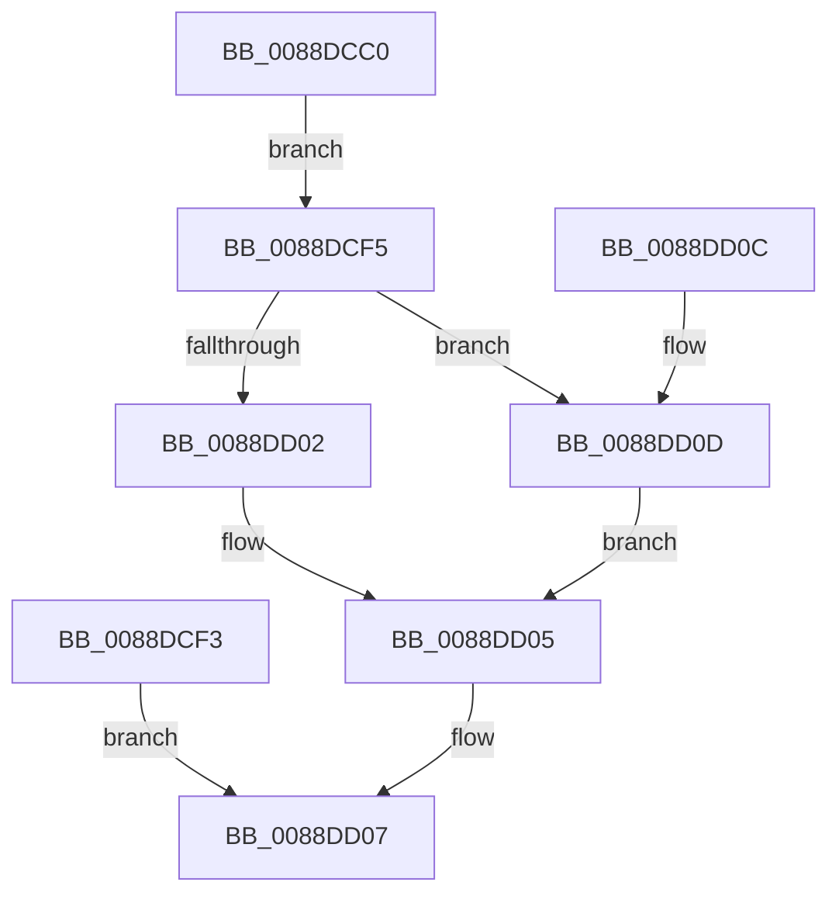

# AlpcpCaptureContextAttribute

- RVA: `0x0088DCC0`–`0x0088DD13` (길이 `83` bytes)
- VA: `0x000000014088DCC0`
- 실행 섹션: `PAGE`
- PDB 이름 있음: `예`; PDB Function 태그: `아니요`
- unwind 정보 RVA: `0x0007D4DC`
- 디코드: `24`개 명령, `83/83` bytes 표시
- 미해석 바이트: `0` (있으면 어셈블리에 `.byte`로 보존)

> 이 문서는 커널 이미지의 기계어와 PDB 기호를 분석해 생성했습니다. 4번과 5번은 함수 원형과 자료형을 바이너리 사용 방식에서 추정한 C 해석이며 원본 소스 복구 결과는 아닙니다.

## 1. Dependencies

- 직접 호출 지점: **0**; 고유 호출 대상: **0**
- 직접 호출자로 확인된 함수: **1**
- RIP 상대 이미지 참조: **0**

### Outgoing calls
- 직접 디코드된 call 명령이 없습니다.

### Direct callers
- [AlpcpCaptureAttributes](AlpcpCaptureAttributes_function_0088CD20.md) at `0x0088CDFE`

### Static image references
- 디코드된 RIP-relative 메모리 참조가 없습니다.

## 2. Other-region calls and transfers

- 다른 실행 섹션으로 향하는 call: **0**
- 별도 외부 분기/꼬리 이동을 확인하지 못했습니다.

## 3. Assembly (complete function range)

```asm
0088DCC0  48 83 EC 18                     sub rsp, 0x18
0088DCC4  4C 8B D1                        mov r10, rcx
0088DCC7  41 8B 80 08 01 00 00            mov eax, dword ptr [r8 + 0x108]
0088DCCE  89 42 14                        mov dword ptr [rdx + 0x14], eax
0088DCD1  41 8B 80 10 01 00 00            mov eax, dword ptr [r8 + 0x110]
0088DCD8  89 42 18                        mov dword ptr [rdx + 0x18], eax
0088DCDB  C7 42 10 00 00 00 00            mov dword ptr [rdx + 0x10], 0
0088DCE2  48 8B 41 38                     mov rax, qword ptr [rcx + 0x38]
0088DCE6  48 89 02                        mov qword ptr [rdx], rax
0088DCE9  48 8B 4A 08                     mov rcx, qword ptr [rdx + 8]
0088DCED  48 89 0C 24                     mov qword ptr [rsp], rcx
0088DCF1  EB 02                           jmp 0x14088dcf5
0088DCF3  EB 12                           jmp 0x14088dd07
0088DCF5  41 8B 82 A0 01 00 00            mov eax, dword ptr [r10 + 0x1a0]
0088DCFC  24 06                           and al, 6
0088DCFE  3C 04                           cmp al, 4
0088DD00  75 0B                           jne 0x14088dd0d
0088DD02  49 89 09                        mov qword ptr [r9], rcx
0088DD05  33 C0                           xor eax, eax
0088DD07  48 83 C4 18                     add rsp, 0x18
0088DD0B  C3                              ret
0088DD0C  CC                              int3
0088DD0D  49 89 49 08                     mov qword ptr [r9 + 8], rcx
0088DD11  EB F2                           jmp 0x14088dd05
```

## 4. C-style interpretation (structured pseudocode)

```c
__int64 __fastcall AlpcpCaptureContextAttribute(__int64 a1, __int64 a2, __int64 a3, __int64 a4)
{
    __int64 result;
    __int64 v_rsp;
    unsigned __int64 v_stack_m18;

    v_rsp = (v_rsp) - (24);
    *(unsigned int *)(a2 + 20) = (unsigned int)((unsigned int)(*(unsigned int *)(a3 + 264)));
    *(unsigned int *)(a2 + 24) = (unsigned int)((unsigned int)(*(unsigned int *)(a3 + 272)));
    *(unsigned int *)(a2 + 16) = 0;
    *(unsigned __int64 *)(a2) = *(unsigned __int64 *)(a1 + 56);
    v_stack_m18 = *(unsigned __int64 *)(a2 + 8);
    goto loc_0088DCF5;
loc_0088DCF5:
    result = (unsigned __int8)(((unsigned int)(*(unsigned int *)(a1 + 416))) & (6));
    if (((unsigned __int8)(result)) != 4) goto loc_0088DD0D;
    *(unsigned __int64 *)(a4) = *(unsigned __int64 *)(a2 + 8);
loc_0088DD05:
    result = 0;
loc_0088DD07:
    v_rsp = (v_rsp) + (24);
    return result;
loc_0088DD0D:
    *(unsigned __int64 *)(a4 + 8) = *(unsigned __int64 *)(a2 + 8);
    goto loc_0088DD05;
}
```

## 5. (Beta) C Style

```c
int64_t AlpcpCaptureContextAttribute(void *Arg1, void *Arg2, void *Arg3, void *Arg4)
{
    uint8_t *arg1 = (uint8_t *)Arg1;
    uint8_t *arg2 = (uint8_t *)Arg2;
    uint8_t *arg3 = (uint8_t *)Arg3;
    uint8_t *arg4 = (uint8_t *)Arg4;

    int64_t result;
    int64_t local_rsp;
    uint64_t v_stack_m18;

    local_rsp = (local_rsp) - (24);
    *(uint32_t *)(arg2 + 0x14) = (uint32_t)((uint32_t)(*(uint32_t *)(arg3 + 0x108)));
    *(uint32_t *)(arg2 + 0x18) = (uint32_t)((uint32_t)(*(uint32_t *)(arg3 + 0x110)));
    *(uint32_t *)(arg2 + 0x10) = 0;
    *(uint64_t *)(arg2) = *(uint64_t *)(arg1 + 0x38);
    v_stack_m18 = *(uint64_t *)(arg2 + 0x8);
    goto loc_0088DCF5;
loc_0088DCF5:
    result = (uint8_t)(((uint32_t)(*(uint32_t *)(arg1 + 0x1A0))) & (6));
    if (((uint8_t)(result)) != 4) goto loc_0088DD0D;
    *(uint64_t *)(arg4) = *(uint64_t *)(arg2 + 0x8);
loc_0088DD05:
    result = 0;
loc_0088DD07:
    local_rsp = (local_rsp) + (24);
    return result;
loc_0088DD0D:
    *(uint64_t *)(arg4 + 0x8) = *(uint64_t *)(arg2 + 0x8);
    goto loc_0088DD05;
}
```

### 관측된 메모리 오프셋

구조체 형식이 확인되지 않은 접근은 인자 기준의 오프셋으로만 기록했습니다.

| 기준 인자 | 오프셋 표현 | 폭 (bit) | 접근 |
|---|---:|---:|---|
| `Arg1` | `+ 0x38` | `64` | `R` |
| `Arg1` | `+ 0x1A0` | `32` | `R` |
| `Arg2` | `+ 0x0` | `64` | `W` |
| `Arg2` | `+ 0x8` | `64` | `R` |
| `Arg2` | `+ 0x10` | `32` | `W` |
| `Arg2` | `+ 0x14` | `32` | `W` |
| `Arg2` | `+ 0x18` | `32` | `W` |
| `Arg3` | `+ 0x108` | `32` | `R` |
| `Arg3` | `+ 0x110` | `32` | `R` |
| `Arg4` | `+ 0x0` | `64` | `W` |
| `Arg4` | `+ 0x8` | `64` | `W` |

## 6. Execution-region graph

[열기: 2D/3D 그래프와 함수 탐색 컨트롤 패널](../../../control-panel.html?section=page&rva=0x0088DCC0&view=graph)

- 2D 그래프는 위에서 아래로 흐르고, 3D 그래프는 빈 공간을 드래그해 회전합니다. Shift+드래그는 이동, 휠은 확대·축소, 함수 노드 선택은 대상 보고서 이동입니다.

### Static fallback


