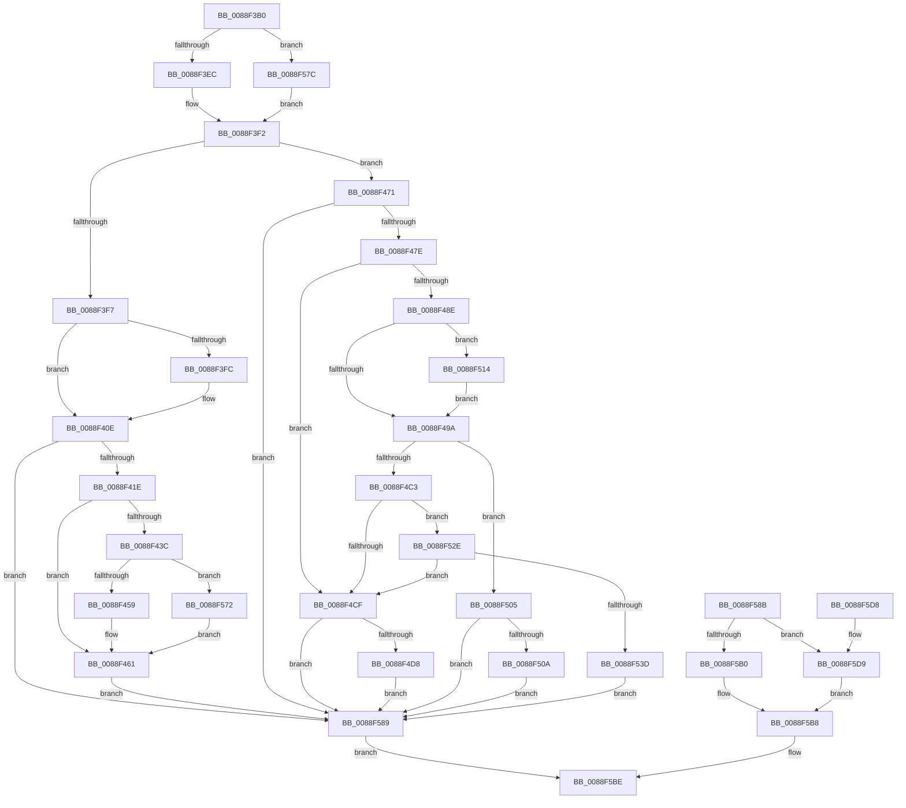

# AlpcpCaptureMessageDataSafe

- RVA: `0x0088F3B0`–`0x0088F5F7` (길이 `583` bytes)
- VA: `0x000000014088F3B0`
- 실행 섹션: `PAGE`
- PDB 이름 있음: `예`; PDB Function 태그: `아니요`
- unwind 정보 RVA: `0x0007D59C`
- 디코드: `131`개 명령, `583/583` bytes 표시
- 미해석 바이트: `0` (있으면 어셈블리에 `.byte`로 보존)

> 이 문서는 커널 이미지의 기계어와 PDB 기호를 분석해 생성했습니다. 4번과 5번은 함수 원형과 자료형을 바이너리 사용 방식에서 추정한 C 해석이며 원본 소스 복구 결과는 아닙니다.

## 1. Dependencies

- 직접 호출 지점: **14**; 고유 호출 대상: **8**
- 직접 호출자로 확인된 함수: **2**
- RIP 상대 이미지 참조: **0**

### Outgoing calls
- `0x0088F409` → [memcpy](../../text/6C/memcpy_function_006C6840.md) (function, `0x006C6840`)
- `0x0088F423` → [ExFreePoolWithTag](../../poolcode/B8/ExFreePoolWithTag_function_00B82870.md) (function, `0x00B82870`)
- `0x0088F4AE` → [ExAllocatePool2](../../poolcode/B8/ExAllocatePool2_function_00B820F0.md) (function, `0x00B820F0`)
- `0x0088F4E5` → [memcpy](../../text/6C/memcpy_function_006C6840.md) (function, `0x006C6840`)
- `0x0088F4FB` → [memcpy](../../text/6C/memcpy_function_006C6840.md) (function, `0x006C6840`)
- `0x0088F50D` → [AlpcpReleasePagedPoolQuota](../92/AlpcpReleasePagedPoolQuota_function_00922EE8.md) (function, `0x00922EE8`)
- `0x0088F519` → [ExFreePoolWithTag](../../poolcode/B8/ExFreePoolWithTag_function_00B82870.md) (function, `0x00B82870`)
- `0x0088F534` → [AlpcpChargePagedPoolQuota](../92/AlpcpChargePagedPoolQuota_function_00922EA4.md) (function, `0x00922EA4`)
- `0x0088F549` → [ExFreePoolWithTag](../../poolcode/B8/ExFreePoolWithTag_function_00B82870.md) (function, `0x00B82870`)
- `0x0088F56B` → [AlpcpReleasePagedPoolQuota](../92/AlpcpReleasePagedPoolQuota_function_00922EE8.md) (function, `0x00922EE8`)
- `0x0088F572` → [PsReturnProcessPagedPoolQuota](../../text/2A/PsReturnProcessPagedPoolQuota_function_002A6860.md) (function, `0x002A6860`)
- `0x0088F593` → [AlpcpAvailableBufferSize](../89/AlpcpAvailableBufferSize_function_00895390.md) (function, `0x00895390`)
- `0x0088F5B8` → [memset](../../text/6C/memset_function_006C6C40.md) (function, `0x006C6C40`)
- `0x0088F5DC` → [memset](../../text/6C/memset_function_006C6C40.md) (function, `0x006C6C40`)

### Direct callers
- [sub_0088D871](Unknown_function_0088D871.md) at `0x0088DA76`
- [sub_0088E1DC](Unknown_function_0088E1DC.md) at `0x0088E358`
- [sub_0088E1DC](Unknown_function_0088E1DC.md) at `0x0088E41F`
- [sub_0088E1DC](Unknown_function_0088E1DC.md) at `0x0088E5E5`

### Static image references
- 디코드된 RIP-relative 메모리 참조가 없습니다.

## 2. Other-region calls and transfers

- 다른 실행 섹션으로 향하는 call: **10**
  - `0x0088F409` → [memcpy](../../text/6C/memcpy_function_006C6840.md) (`PAGE` → `.text`)
  - `0x0088F423` → [ExFreePoolWithTag](../../poolcode/B8/ExFreePoolWithTag_function_00B82870.md) (`PAGE` → `POOLCODE`)
  - `0x0088F4AE` → [ExAllocatePool2](../../poolcode/B8/ExAllocatePool2_function_00B820F0.md) (`PAGE` → `POOLCODE`)
  - `0x0088F4E5` → [memcpy](../../text/6C/memcpy_function_006C6840.md) (`PAGE` → `.text`)
  - `0x0088F4FB` → [memcpy](../../text/6C/memcpy_function_006C6840.md) (`PAGE` → `.text`)
  - `0x0088F519` → [ExFreePoolWithTag](../../poolcode/B8/ExFreePoolWithTag_function_00B82870.md) (`PAGE` → `POOLCODE`)
  - `0x0088F549` → [ExFreePoolWithTag](../../poolcode/B8/ExFreePoolWithTag_function_00B82870.md) (`PAGE` → `POOLCODE`)
  - `0x0088F572` → [PsReturnProcessPagedPoolQuota](../../text/2A/PsReturnProcessPagedPoolQuota_function_002A6860.md) (`PAGE` → `.text`)
  - `0x0088F5B8` → [memset](../../text/6C/memset_function_006C6C40.md) (`PAGE` → `.text`)
  - `0x0088F5DC` → [memset](../../text/6C/memset_function_006C6C40.md) (`PAGE` → `.text`)
- 별도 외부 분기/꼬리 이동을 확인하지 못했습니다.

## 3. Assembly (complete function range)

```asm
0088F3B0  48 89 5C 24 10                  mov qword ptr [rsp + 0x10], rbx
0088F3B5  48 89 74 24 18                  mov qword ptr [rsp + 0x18], rsi
0088F3BA  48 89 7C 24 20                  mov qword ptr [rsp + 0x20], rdi
0088F3BF  48 89 4C 24 08                  mov qword ptr [rsp + 8], rcx
0088F3C4  41 54                           push r12
0088F3C6  41 56                           push r14
0088F3C8  41 57                           push r15
0088F3CA  48 83 EC 20                     sub rsp, 0x20
0088F3CE  48 8B D9                        mov rbx, rcx
0088F3D1  48 8B B1 B0 00 00 00            mov rsi, qword ptr [rcx + 0xb0]
0088F3D8  0F B7 B9 F0 00 00 00            movzx edi, word ptr [rcx + 0xf0]
0088F3DF  4C 8B 71 60                     mov r14, qword ptr [rcx + 0x60]
0088F3E3  4D 85 F6                        test r14, r14
0088F3E6  0F 85 90 01 00 00               jne 0x14088f57c
0088F3EC  41 BE 00 02 00 00               mov r14d, 0x200
0088F3F2  49 3B FE                        cmp rdi, r14
0088F3F5  77 7A                           ja 0x14088f471
0088F3F7  48 85 F6                        test rsi, rsi
0088F3FA  74 12                           je 0x14088f40e
0088F3FC  48 81 C1 18 01 00 00            add rcx, 0x118
0088F403  4C 8B C7                        mov r8, rdi
0088F406  48 8B D6                        mov rdx, rsi
0088F409  E8 32 74 E3 FF                  call 0x1406c6840
0088F40E  48 8B 8B E0 00 00 00            mov rcx, qword ptr [rbx + 0xe0]
0088F415  48 85 C9                        test rcx, rcx
0088F418  0F 84 6B 01 00 00               je 0x14088f589
0088F41E  BA 41 6C 45 42                  mov edx, 0x42456c41
0088F423  E8 48 34 2F 00                  call 0x140b82870
0088F428  48 C7 83 E0 00 00 00 00 00 00 00  mov qword ptr [rbx + 0xe0], 0
0088F433  48 8B 4B 30                     mov rcx, qword ptr [rbx + 0x30]
0088F437  48 85 C9                        test rcx, rcx
0088F43A  74 25                           je 0x14088f461
0088F43C  48 8B 93 E8 00 00 00            mov rdx, qword ptr [rbx + 0xe8]
0088F443  48 8B 81 98 05 00 00            mov rax, qword ptr [rcx + 0x598]
0088F44A  48 03 C2                        add rax, rdx
0088F44D  48 3D 00 10 00 00               cmp rax, 0x1000
0088F453  0F 83 19 01 00 00               jae 0x14088f572
0088F459  F0 48 01 91 98 05 00 00         lock add qword ptr [rcx + 0x598], rdx
0088F461  48 C7 83 E8 00 00 00 00 00 00 00  mov qword ptr [rbx + 0xe8], 0
0088F46C  E9 18 01 00 00                  jmp 0x14088f589
0088F471  48 81 FF D7 FF 00 00            cmp rdi, 0xffd7
0088F478  0F 87 0B 01 00 00               ja 0x14088f589
0088F47E  4C 8B A1 E8 00 00 00            mov r12, qword ptr [rcx + 0xe8]
0088F485  4B 8D 04 34                     lea rax, [r12 + r14]
0088F489  48 3B F8                        cmp rdi, rax
0088F48C  76 41                           jbe 0x14088f4cf
0088F48E  48 8B 89 E0 00 00 00            mov rcx, qword ptr [rcx + 0xe0]
0088F495  48 85 C9                        test rcx, rcx
0088F498  75 7A                           jne 0x14088f514
0088F49A  4C 8B FF                        mov r15, rdi
0088F49D  4D 2B FE                        sub r15, r14
0088F4A0  41 B8 41 6C 45 42               mov r8d, 0x42456c41
0088F4A6  49 8B D7                        mov rdx, r15
0088F4A9  B9 00 01 00 00                  mov ecx, 0x100
0088F4AE  E8 3D 2C 2F 00                  call 0x140b820f0
0088F4B3  48 89 83 E0 00 00 00            mov qword ptr [rbx + 0xe0], rax
0088F4BA  48 8B 4B 30                     mov rcx, qword ptr [rbx + 0x30]
0088F4BE  48 85 C0                        test rax, rax
0088F4C1  74 42                           je 0x14088f505
0088F4C3  4C 89 BB E8 00 00 00            mov qword ptr [rbx + 0xe8], r15
0088F4CA  48 85 C9                        test rcx, rcx
0088F4CD  75 5F                           jne 0x14088f52e
0088F4CF  48 85 F6                        test rsi, rsi
0088F4D2  0F 84 B1 00 00 00               je 0x14088f589
0088F4D8  48 8D 8B 18 01 00 00            lea rcx, [rbx + 0x118]
0088F4DF  4D 8B C6                        mov r8, r14
0088F4E2  48 8B D6                        mov rdx, rsi
0088F4E5  E8 56 73 E3 FF                  call 0x1406c6840
0088F4EA  49 2B FE                        sub rdi, r14
0088F4ED  49 8D 14 36                     lea rdx, [r14 + rsi]
0088F4F1  4C 8B C7                        mov r8, rdi
0088F4F4  48 8B 8B E0 00 00 00            mov rcx, qword ptr [rbx + 0xe0]
0088F4FB  E8 40 73 E3 FF                  call 0x1406c6840
0088F500  E9 84 00 00 00                  jmp 0x14088f589
0088F505  48 85 C9                        test rcx, rcx
0088F508  74 7F                           je 0x14088f589
0088F50A  49 8B D4                        mov rdx, r12
0088F50D  E8 D6 39 09 00                  call 0x140922ee8
0088F512  EB 75                           jmp 0x14088f589
0088F514  BA 41 6C 45 42                  mov edx, 0x42456c41
0088F519  E8 52 33 2F 00                  call 0x140b82870
0088F51E  48 C7 83 E8 00 00 00 00 00 00 00  mov qword ptr [rbx + 0xe8], 0
0088F529  E9 6C FF FF FF                  jmp 0x14088f49a
0088F52E  4D 2B FC                        sub r15, r12
0088F531  49 8B D7                        mov rdx, r15
0088F534  E8 6B 39 09 00                  call 0x140922ea4
0088F539  85 C0                           test eax, eax
0088F53B  79 92                           jns 0x14088f4cf
0088F53D  BA 41 6C 45 42                  mov edx, 0x42456c41
0088F542  48 8B 8B E0 00 00 00            mov rcx, qword ptr [rbx + 0xe0]
0088F549  E8 22 33 2F 00                  call 0x140b82870
0088F54E  48 C7 83 E0 00 00 00 00 00 00 00  mov qword ptr [rbx + 0xe0], 0
0088F559  48 C7 83 E8 00 00 00 00 00 00 00  mov qword ptr [rbx + 0xe8], 0
0088F564  49 8B D4                        mov rdx, r12
0088F567  48 8B 4B 30                     mov rcx, qword ptr [rbx + 0x30]
0088F56B  E8 78 39 09 00                  call 0x140922ee8
0088F570  EB 17                           jmp 0x14088f589
0088F572  E8 E9 72 A1 FF                  call 0x1402a6860
0088F577  E9 E5 FE FF FF                  jmp 0x14088f461
0088F57C  4D 8B 76 20                     mov r14, qword ptr [r14 + 0x20]
0088F580  49 83 EE 28                     sub r14, 0x28
0088F584  E9 69 FE FF FF                  jmp 0x14088f3f2
0088F589  EB 33                           jmp 0x14088f5be
0088F58B  48 8B 5C 24 40                  mov rbx, qword ptr [rsp + 0x40]
0088F590  48 8B CB                        mov rcx, rbx
0088F593  E8 F8 5D 00 00                  call 0x140895390
0088F598  48 8B F8                        mov rdi, rax
0088F59B  0F B7 8B F0 00 00 00            movzx ecx, word ptr [rbx + 0xf0]
0088F5A2  33 D2                           xor edx, edx
0088F5A4  48 3B C8                        cmp rcx, rax
0088F5A7  48 8D 8B 18 01 00 00            lea rcx, [rbx + 0x118]
0088F5AE  77 29                           ja 0x14088f5d9
0088F5B0  44 0F B7 83 F0 00 00 00         movzx r8d, word ptr [rbx + 0xf0]
0088F5B8  E8 83 76 E3 FF                  call 0x1406c6c40
0088F5BD  90                              nop
0088F5BE  48 8B 5C 24 48                  mov rbx, qword ptr [rsp + 0x48]
0088F5C3  48 8B 74 24 50                  mov rsi, qword ptr [rsp + 0x50]
0088F5C8  48 8B 7C 24 58                  mov rdi, qword ptr [rsp + 0x58]
0088F5CD  48 83 C4 20                     add rsp, 0x20
0088F5D1  41 5F                           pop r15
0088F5D3  41 5E                           pop r14
0088F5D5  41 5C                           pop r12
0088F5D7  C3                              ret
0088F5D8  CC                              int3
0088F5D9  4C 8B C7                        mov r8, rdi
0088F5DC  E8 5F 76 E3 FF                  call 0x1406c6c40
0088F5E1  44 0F B7 83 F0 00 00 00         movzx r8d, word ptr [rbx + 0xf0]
0088F5E9  4C 2B C7                        sub r8, rdi
0088F5EC  33 D2                           xor edx, edx
0088F5EE  48 8B 8B E0 00 00 00            mov rcx, qword ptr [rbx + 0xe0]
0088F5F5  EB C1                           jmp 0x14088f5b8
```

## 4. C-style interpretation (structured pseudocode)

```c
__int64 __fastcall AlpcpCaptureMessageDataSafe(__int64 a1)
{
    __int64 result;
    __int64 v_r14;
    __int64 v_r15;
    __int64 v_rdi;
    __int64 v_rsp;
    unsigned __int64 v_stack_p10;
    unsigned __int64 v_stack_p18;
    unsigned __int64 v_stack_p20;
    unsigned __int64 v_stack_p8;

    v_stack_p10 = v_rbx;
    v_stack_p18 = v_rsi;
    v_stack_p20 = v_rdi;
    v_stack_p8 = a1;
    v_rsp = (v_rsp) - (32);
    if (*(unsigned __int64 *)(a1 + 96) != 0) goto loc_0088F57C;
loc_0088F3F2:
    if ((*(unsigned __int16 *)(a1 + 240)) > 512) goto loc_0088F471;
    if (*(unsigned __int64 *)(a1 + 176) != 0) {
        a1 = (a1) + (280);
        a3 = *(unsigned __int16 *)(a1 + 240);
        a2 = *(unsigned __int64 *)(a1 + 176);
        result = memcpy(a1, a2, a3, a4);
    }
    if (*(unsigned __int64 *)(a1 + 224) == 0) goto loc_0088F589;
    result = ExFreePoolWithTag(*(unsigned __int64 *)(a1 + 224), (unsigned int)(0x42456C41ULL), a3, a4);
    *(unsigned __int64 *)(a1 + 224) = 0;
    if (*(unsigned __int64 *)(a1 + 48) == 0) goto loc_0088F461;
    result = (*(unsigned __int64 *)(*(unsigned __int64 *)(a1 + 48) + 1432)) + (*(unsigned __int64 *)(a1 + 232));
    if (result >= 0x1000ULL) goto loc_0088F572;
loc_0088F461:
    *(unsigned __int64 *)(a1 + 232) = 0;
    goto loc_0088F589;
loc_0088F471:
    if ((*(unsigned __int16 *)(a1 + 240)) > 0xFFD7ULL) goto loc_0088F589;
    if ((*(unsigned __int16 *)(a1 + 240)) <= (*(unsigned __int64 *)(*(unsigned __int64 *)(a1 + 48) + 232) + 512 * 1)) goto loc_0088F4CF;
    if (*(unsigned __int64 *)(*(unsigned __int64 *)(a1 + 48) + 224) != 0) goto loc_0088F514;
loc_0088F49A:
    v_r15 = (*(unsigned __int16 *)(a1 + 240)) - (512);
    result = ExAllocatePool2(256, v_r15, (unsigned int)(0x42456C41ULL), a4);
    *(unsigned __int64 *)(a1 + 224) = result;
    if (result == 0) goto loc_0088F505;
    *(unsigned __int64 *)(a1 + 232) = v_r15;
    if (*(unsigned __int64 *)(a1 + 48) != 0) goto loc_0088F52E;
loc_0088F4CF:
    if (*(unsigned __int64 *)(a1 + 176) == 0) goto loc_0088F589;
    result = memcpy(a1 + 280, *(unsigned __int64 *)(a1 + 176), 512, a4);
    v_rdi = (*(unsigned __int16 *)(a1 + 240)) - (512);
    result = memcpy(*(unsigned __int64 *)(a1 + 224), 512 + *(unsigned __int64 *)(a1 + 176) * 1, v_rdi, a4);
    goto loc_0088F589;
loc_0088F505:
    if (*(unsigned __int64 *)(a1 + 224) == 0) goto loc_0088F589;
    result = AlpcpReleasePagedPoolQuota(*(unsigned __int64 *)(a1 + 224), *(unsigned __int64 *)(*(unsigned __int64 *)(a1 + 48) + 232), v_rdi, a4);
    goto loc_0088F589;
loc_0088F514:
    result = ExFreePoolWithTag(*(unsigned __int64 *)(a1 + 224), (unsigned int)(0x42456C41ULL), v_rdi, a4);
    *(unsigned __int64 *)(a1 + 232) = 0;
    goto loc_0088F49A;
loc_0088F52E:
    v_r15 = (v_r15) - (*(unsigned __int64 *)(*(unsigned __int64 *)(a1 + 48) + 232));
    result = AlpcpChargePagedPoolQuota(*(unsigned __int64 *)(a1 + 224), v_r15, v_rdi, a4);
    if (!sign_flag) goto loc_0088F4CF;
    result = ExFreePoolWithTag(*(unsigned __int64 *)(a1 + 224), (unsigned int)(0x42456C41ULL), v_rdi, a4);
    *(unsigned __int64 *)(a1 + 224) = 0;
    *(unsigned __int64 *)(a1 + 232) = 0;
    result = AlpcpReleasePagedPoolQuota(*(unsigned __int64 *)(a1 + 48), *(unsigned __int64 *)(*(unsigned __int64 *)(a1 + 48) + 232), v_rdi, a4);
    goto loc_0088F589;
loc_0088F572:
    result = PsReturnProcessPagedPoolQuota(*(unsigned __int64 *)(a1 + 48), *(unsigned __int64 *)(*(unsigned __int64 *)(a1 + 48) + 232), v_rdi, a4);
    goto loc_0088F461;
loc_0088F57C:
    v_r14 = (*(unsigned __int64 *)(512 + 32)) - (40);
    goto loc_0088F3F2;
loc_0088F589:
    goto loc_0088F5BE;
loc_0088F5BE:
    v_rsp = (v_rsp) + (32);
    return result;
}
```

## 5. (Beta) C Style

```c
int64_t AlpcpCaptureMessageDataSafe(void *Arg1)
{
    uint8_t *arg1 = (uint8_t *)Arg1;

    int64_t result;
    int64_t local_r14;
    int64_t local_r15;
    int64_t local_rdi;
    int64_t local_rsp;
    uint64_t v_stack_p10;
    uint64_t v_stack_p18;
    uint64_t v_stack_p20;
    uint64_t v_stack_p8;

    v_stack_p10 = local_rbx;
    v_stack_p18 = local_rsi;
    v_stack_p20 = local_rdi;
    v_stack_p8 = Arg1;
    local_rsp = (local_rsp) - (32);
    if (*(uint64_t *)(arg1 + 0x60) != 0) goto loc_0088F57C;
loc_0088F3F2:
    if ((*(uint16_t *)(arg1 + 0xF0)) > 512) goto loc_0088F471;
    if (*(uint64_t *)(arg1 + 0xB0) != 0) {
        Arg1 = (Arg1) + (280);
        a3 = *(uint16_t *)(arg1 + 0xF0);
        a2 = *(uint64_t *)(arg1 + 0xB0);
        result = memcpy(Arg1, a2, a3, a4);
    }
    if (*(uint64_t *)(arg1 + 0xE0) == 0) goto loc_0088F589;
    result = ExFreePoolWithTag(*(uint64_t *)(arg1 + 0xE0), (uint32_t)(0x42456C41ULL), a3, a4);
    *(uint64_t *)(arg1 + 0xE0) = 0;
    if (*(uint64_t *)(arg1 + 0x30) == 0) goto loc_0088F461;
    result = (*(uint64_t *)(*(uint64_t *)(arg1 + 0x30) + 0x598)) + (*(uint64_t *)(arg1 + 0xE8));
    if (result >= 0x1000ULL) goto loc_0088F572;
loc_0088F461:
    *(uint64_t *)(arg1 + 0xE8) = 0;
    goto loc_0088F589;
loc_0088F471:
    if ((*(uint16_t *)(arg1 + 0xF0)) > 0xFFD7ULL) goto loc_0088F589;
    if ((*(uint16_t *)(arg1 + 0xF0)) <= (*(uint64_t *)(*(uint64_t *)(arg1 + 0x30) + 0xE8) + 512 * 1)) goto loc_0088F4CF;
    if (*(uint64_t *)(*(uint64_t *)(arg1 + 0x30) + 0xE0) != 0) goto loc_0088F514;
loc_0088F49A:
    local_r15 = (*(uint16_t *)(arg1 + 0xF0)) - (512);
    result = ExAllocatePool2(256, local_r15, (uint32_t)(0x42456C41ULL), a4);
    *(uint64_t *)(arg1 + 0xE0) = result;
    if (result == 0) goto loc_0088F505;
    *(uint64_t *)(arg1 + 0xE8) = local_r15;
    if (*(uint64_t *)(arg1 + 0x30) != 0) goto loc_0088F52E;
loc_0088F4CF:
    if (*(uint64_t *)(arg1 + 0xB0) == 0) goto loc_0088F589;
    result = memcpy(Arg1 + 280, *(uint64_t *)(arg1 + 0xB0), 512, a4);
    local_rdi = (*(uint16_t *)(arg1 + 0xF0)) - (512);
    result = memcpy(*(uint64_t *)(arg1 + 0xE0), 512 + *(uint64_t *)(arg1 + 0xB0) * 1, local_rdi, a4);
    goto loc_0088F589;
loc_0088F505:
    if (*(uint64_t *)(arg1 + 0xE0) == 0) goto loc_0088F589;
    result = AlpcpReleasePagedPoolQuota(*(uint64_t *)(arg1 + 0xE0), *(uint64_t *)(*(uint64_t *)(arg1 + 0x30) + 0xE8), local_rdi, a4);
    goto loc_0088F589;
loc_0088F514:
    result = ExFreePoolWithTag(*(uint64_t *)(arg1 + 0xE0), (uint32_t)(0x42456C41ULL), local_rdi, a4);
    *(uint64_t *)(arg1 + 0xE8) = 0;
    goto loc_0088F49A;
loc_0088F52E:
    local_r15 = (local_r15) - (*(uint64_t *)(*(uint64_t *)(arg1 + 0x30) + 0xE8));
    result = AlpcpChargePagedPoolQuota(*(uint64_t *)(arg1 + 0xE0), local_r15, local_rdi, a4);
    if (!sign_flag) goto loc_0088F4CF;
    result = ExFreePoolWithTag(*(uint64_t *)(arg1 + 0xE0), (uint32_t)(0x42456C41ULL), local_rdi, a4);
    *(uint64_t *)(arg1 + 0xE0) = 0;
    *(uint64_t *)(arg1 + 0xE8) = 0;
    result = AlpcpReleasePagedPoolQuota(*(uint64_t *)(arg1 + 0x30), *(uint64_t *)(*(uint64_t *)(arg1 + 0x30) + 0xE8), local_rdi, a4);
    goto loc_0088F589;
loc_0088F572:
    result = PsReturnProcessPagedPoolQuota(*(uint64_t *)(arg1 + 0x30), *(uint64_t *)(*(uint64_t *)(arg1 + 0x30) + 0xE8), local_rdi, a4);
    goto loc_0088F461;
loc_0088F57C:
    local_r14 = (*(uint64_t *)(512 + 0x20)) - (40);
    goto loc_0088F3F2;
loc_0088F589:
    goto loc_0088F5BE;
loc_0088F5BE:
    local_rsp = (local_rsp) + (32);
    return result;
}
```

### 관측된 메모리 오프셋

구조체 형식이 확인되지 않은 접근은 인자 기준의 오프셋으로만 기록했습니다.

| 기준 인자 | 오프셋 표현 | 폭 (bit) | 접근 |
|---|---:|---:|---|
| `Arg1` | `+ 0x30` | `64` | `R` |
| `Arg1` | `+ 0x60` | `64` | `R` |
| `Arg1` | `+ 0xB0` | `64` | `R` |
| `Arg1` | `+ 0xE0` | `64` | `R` |
| `Arg1` | `+ 0xE0` | `64` | `W` |
| `Arg1` | `+ 0xE8` | `64` | `R` |
| `Arg1` | `+ 0xE8` | `64` | `W` |
| `Arg1` | `+ 0xF0` | `16` | `R` |
| `Arg1` | `+ 0x118` | `64` | `R` |

## 6. Execution-region graph

[열기: 2D/3D 그래프와 함수 탐색 컨트롤 패널](../../../control-panel.html?section=page&rva=0x0088F3B0&view=graph)

- 2D 그래프는 위에서 아래로 흐르고, 3D 그래프는 빈 공간을 드래그해 회전합니다. Shift+드래그는 이동, 휠은 확대·축소, 함수 노드 선택은 대상 보고서 이동입니다.

### Static fallback


