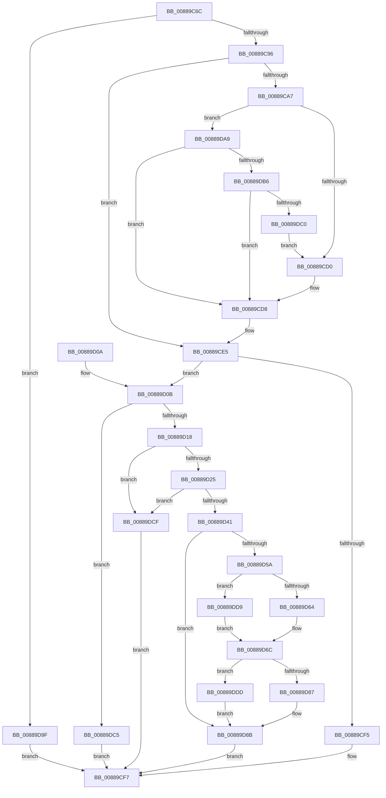

# AlpcpCaptureViewAttributeInternal

- RVA: `0x00889C6C`–`0x00889DEC` (길이 `384` bytes)
- VA: `0x0000000140889C6C`
- 실행 섹션: `PAGE`
- PDB 이름 있음: `예`; PDB Function 태그: `아니요`
- unwind 정보 RVA: `0x0007CFEC`
- 디코드: `100`개 명령, `384/384` bytes 표시
- 미해석 바이트: `0` (있으면 어셈블리에 `.byte`로 보존)

> 이 문서는 커널 이미지의 기계어와 PDB 기호를 분석해 생성했습니다. 4번과 5번은 함수 원형과 자료형을 바이너리 사용 방식에서 추정한 C 해석이며 원본 소스 복구 결과는 아닙니다.

## 1. Dependencies

- 직접 호출 지점: **9**; 고유 호출 대상: **7**
- 직접 호출자로 확인된 함수: **1**
- RIP 상대 이미지 참조: **1**

### Outgoing calls
- `0x00889CB3` → [AlpcpLockForCachedReferenceBlob](AlpcpLockForCachedReferenceBlob_function_0088A8B0.md) (function, `0x0088A8B0`)
- `0x00889CBF` → [AlpcpUnlockBlob](AlpcpUnlockBlob_function_0088B990.md) (function, `0x0088B990`)
- `0x00889CD3` → [AlpcpDeleteView](AlpcpDeleteView_function_0088A26C.md) (function, `0x0088A26C`)
- `0x00889CE0` → [AlpcpDereferenceBlobEx](AlpcpDereferenceBlobEx_function_0088AF00.md) (function, `0x0088AF00`)
- `0x00889D30` → [AlpcReferenceBlobByHandle](AlpcReferenceBlobByHandle_function_00889F00.md) (function, `0x00889F00`)
- `0x00889D4F` → [AlpcpLocateSectionView](AlpcpLocateSectionView_function_00889754.md) (function, `0x00889754`)
- `0x00889D7C` → [AlpcpPrepareViewForDelivery](AlpcpPrepareViewForDelivery_function_00889A44.md) (function, `0x00889A44`)
- `0x00889D93` → [AlpcpDereferenceBlobEx](AlpcpDereferenceBlobEx_function_0088AF00.md) (function, `0x0088AF00`)
- `0x00889DE5` → [AlpcpDereferenceBlobEx](AlpcpDereferenceBlobEx_function_0088AF00.md) (function, `0x0088AF00`)

### Direct callers
- [AlpcpCaptureViewAttribute32](../A6/AlpcpCaptureViewAttribute32_function_00A61E68.md) at `0x00A61EA5`

### Static image references
- `0x00889D29` → RVA `0x000014A0` (`.rdata`; read)

## 2. Other-region calls and transfers

- 다른 실행 섹션으로 향하는 call: **0**
- 별도 외부 분기/꼬리 이동을 확인하지 못했습니다.

## 3. Assembly (complete function range)

```asm
00889C6C  48 89 5C 24 08                  mov qword ptr [rsp + 8], rbx
00889C71  48 89 6C 24 18                  mov qword ptr [rsp + 0x18], rbp
00889C76  56                              push rsi
00889C77  57                              push rdi
00889C78  41 56                           push r14
00889C7A  48 83 EC 20                     sub rsp, 0x20
00889C7E  F7 02 FF FF F8 FF               test dword ptr [rdx], 0xfff8ffff
00889C84  4D 8B F1                        mov r14, r9
00889C87  49 8B F8                        mov rdi, r8
00889C8A  48 8B F2                        mov rsi, rdx
00889C8D  48 8B E9                        mov rbp, rcx
00889C90  0F 85 09 01 00 00               jne 0x140889d9f
00889C96  49 8B 98 90 00 00 00            mov rbx, qword ptr [r8 + 0x90]
00889C9D  48 89 5C 24 48                  mov qword ptr [rsp + 0x48], rbx
00889CA2  48 85 DB                        test rbx, rbx
00889CA5  74 3E                           je 0x140889ce5
00889CA7  49 83 A0 90 00 00 00 00         and qword ptr [r8 + 0x90], 0
00889CAF  48 8B 4B 10                     mov rcx, qword ptr [rbx + 0x10]
00889CB3  E8 F8 0B 00 00                  call 0x14088a8b0
00889CB8  FF 4B 4C                        dec dword ptr [rbx + 0x4c]
00889CBB  48 8B 4B 10                     mov rcx, qword ptr [rbx + 0x10]
00889CBF  E8 CC 1C 00 00                  call 0x14088b990
00889CC4  F7 06 00 00 01 00               test dword ptr [rsi], 0x10000
00889CCA  0F 84 D9 00 00 00               je 0x140889da9
00889CD0  48 8B CB                        mov rcx, rbx
00889CD3  E8 94 05 00 00                  call 0x14088a26c
00889CD8  BA 01 00 00 00                  mov edx, 1
00889CDD  48 8B CB                        mov rcx, rbx
00889CE0  E8 1B 12 00 00                  call 0x14088af00
00889CE5  81 67 28 FF 3F FF FF            and dword ptr [rdi + 0x28], 0xffff3fff
00889CEC  48 8B 56 08                     mov rdx, qword ptr [rsi + 8]
00889CF0  48 85 D2                        test rdx, rdx
00889CF3  75 16                           jne 0x140889d0b
00889CF5  33 C0                           xor eax, eax
00889CF7  48 8B 5C 24 40                  mov rbx, qword ptr [rsp + 0x40]
00889CFC  48 8B 6C 24 50                  mov rbp, qword ptr [rsp + 0x50]
00889D01  48 83 C4 20                     add rsp, 0x20
00889D05  41 5E                           pop r14
00889D07  5F                              pop rdi
00889D08  5E                              pop rsi
00889D09  C3                              ret
00889D0A  CC                              int3
00889D0B  48 8B 7E 10                     mov rdi, qword ptr [rsi + 0x10]
00889D0F  48 85 FF                        test rdi, rdi
00889D12  0F 84 AD 00 00 00               je 0x140889dc5
00889D18  48 8B 4D 10                     mov rcx, qword ptr [rbp + 0x10]
00889D1C  48 85 C9                        test rcx, rcx
00889D1F  0F 84 AA 00 00 00               je 0x140889dcf
00889D25  48 83 C1 28                     add rcx, 0x28
00889D29  4C 8D 05 70 77 77 FF            lea r8, [rip - 0x888890]
00889D30  E8 CB 01 00 00                  call 0x140889f00
00889D35  48 8B D8                        mov rbx, rax
00889D38  48 85 C0                        test rax, rax
00889D3B  0F 84 8E 00 00 00               je 0x140889dcf
00889D41  4C 8D 4C 24 48                  lea r9, [rsp + 0x48]
00889D46  4C 8B C7                        mov r8, rdi
00889D49  48 8B D5                        mov rdx, rbp
00889D4C  48 8B C8                        mov rcx, rax
00889D4F  E8 00 FA FF FF                  call 0x140889754
00889D54  8B E8                           mov ebp, eax
00889D56  85 C0                           test eax, eax
00889D58  78 31                           js 0x140889d8b
00889D5A  44 8B 06                        mov r8d, dword ptr [rsi]
00889D5D  41 0F BA E0 12                  bt r8d, 0x12
00889D62  73 75                           jae 0x140889dd9
00889D64  8B 53 30                        mov edx, dword ptr [rbx + 0x30]
00889D67  D1 EA                           shr edx, 1
00889D69  80 E2 01                        and dl, 1
00889D6C  48 8B 7C 24 48                  mov rdi, qword ptr [rsp + 0x48]
00889D71  41 C1 E8 11                     shr r8d, 0x11
00889D75  48 8B CF                        mov rcx, rdi
00889D78  41 80 E0 01                     and r8b, 1
00889D7C  E8 C3 FC FF FF                  call 0x140889a44
00889D81  8B E8                           mov ebp, eax
00889D83  85 C0                           test eax, eax
00889D85  78 56                           js 0x140889ddd
00889D87  49 89 7E 28                     mov qword ptr [r14 + 0x28], rdi
00889D8B  BA 01 00 00 00                  mov edx, 1
00889D90  48 8B CB                        mov rcx, rbx
00889D93  E8 68 11 00 00                  call 0x14088af00
00889D98  8B C5                           mov eax, ebp
00889D9A  E9 58 FF FF FF                  jmp 0x140889cf7
00889D9F  B8 0D 00 00 C0                  mov eax, 0xc000000d
00889DA4  E9 4E FF FF FF                  jmp 0x140889cf7
00889DA9  8B 47 28                        mov eax, dword ptr [rdi + 0x28]
00889DAC  0F BA E0 0F                     bt eax, 0xf
00889DB0  0F 83 22 FF FF FF               jae 0x140889cd8
00889DB6  0F BA E0 0E                     bt eax, 0xe
00889DBA  0F 82 18 FF FF FF               jb 0x140889cd8
00889DC0  E9 0B FF FF FF                  jmp 0x140889cd0
00889DC5  B8 41 01 00 C0                  mov eax, 0xc0000141
00889DCA  E9 28 FF FF FF                  jmp 0x140889cf7
00889DCF  B8 08 00 00 C0                  mov eax, 0xc0000008
00889DD4  E9 1E FF FF FF                  jmp 0x140889cf7
00889DD9  32 D2                           xor dl, dl
00889DDB  EB 8F                           jmp 0x140889d6c
00889DDD  BA 01 00 00 00                  mov edx, 1
00889DE2  48 8B CF                        mov rcx, rdi
00889DE5  E8 16 11 00 00                  call 0x14088af00
00889DEA  EB 9F                           jmp 0x140889d8b
```

## 4. C-style interpretation (structured pseudocode)

```c
__int64 __fastcall AlpcpCaptureViewAttributeInternal(__int64 a1, __int64 a2, __int64 a3, __int64 a4)
{
    __int64 result;
    __int64 v_rsp;
    unsigned __int64 v_stack_p10;
    unsigned __int64 v_stack_p18;
    unsigned __int64 v_stack_p48;
    unsigned __int64 v_stack_p8;

    v_stack_p8 = v_rbx;
    v_stack_p18 = v_rbp;
    v_rsp = (v_rsp) - (32);
    if (((*(unsigned int *)(a2)) & (0xFFF8FFFFULL)) != 0) goto loc_00889D9F;
    v_stack_p10 = *(unsigned __int64 *)(a3 + 144);
    if (*(unsigned __int64 *)(a3 + 144) == 0) goto loc_00889CE5;
    result = AlpcpLockForCachedReferenceBlob(*(unsigned __int64 *)(*(unsigned __int64 *)(a3 + 144) + 16), a2, a3, a4);
    result = AlpcpUnlockBlob(*(unsigned __int64 *)(*(unsigned __int64 *)(a3 + 144) + 16), a2, a3, a4);
    if (((*(unsigned int *)(a2)) & (0x10000ULL)) == 0) goto loc_00889DA9;
loc_00889CD0:
    result = AlpcpDeleteView(*(unsigned __int64 *)(a3 + 144), a2, a3, a4);
loc_00889CD8:
    result = AlpcpDereferenceBlobEx(*(unsigned __int64 *)(a3 + 144), 1, a3, a4);
loc_00889CE5:
    if (*(unsigned __int64 *)(a2 + 8) != 0) goto loc_00889D0B;
    result = 0;
loc_00889CF7:
    v_rsp = (v_rsp) + (32);
    return result;
loc_00889D0B:
    if (*(unsigned __int64 *)(a2 + 16) == 0) goto loc_00889DC5;
    if (*(unsigned __int64 *)(v_stack_p18 + 16) == 0) goto loc_00889DCF;
    a1 = (*(unsigned __int64 *)(v_stack_p18 + 16)) + (40);
    result = AlpcReferenceBlobByHandle(a1, *(unsigned __int64 *)(a2 + 8), v_rip - 8947856, a4);
    if (result == 0) goto loc_00889DCF;
    result = AlpcpLocateSectionView(result, v_stack_p18, *(unsigned __int64 *)(a2 + 16), v_stack_p48);
    if (sign_flag) goto loc_00889D8B;
    if (condition_is_above_or_equal) goto loc_00889DD9;
    a2 = (unsigned int)(((unsigned int)(*(unsigned int *)(result + 48))) >> (1));
    a2 = (unsigned __int8)((a2) & (1));
loc_00889D6C:
    a3 = (unsigned int)(((unsigned int)(*(unsigned int *)(a2))) >> (17));
    a3 = (unsigned __int8)((a3) & (1));
    result = AlpcpPrepareViewForDelivery(v_stack_p48, a2, a3, v_stack_p48);
    if (sign_flag) goto loc_00889DDD;
    *(unsigned __int64 *)(a4 + 40) = v_stack_p48;
loc_00889D8B:
    result = AlpcpDereferenceBlobEx(result, 1, a3, v_stack_p48);
    goto loc_00889CF7;
loc_00889D9F:
    goto loc_00889CF7;
loc_00889DA9:
    if (condition_is_above_or_equal) goto loc_00889CD8;
    if (condition_is_below) goto loc_00889CD8;
    goto loc_00889CD0;
loc_00889DC5:
    goto loc_00889CF7;
loc_00889DCF:
    goto loc_00889CF7;
loc_00889DD9:
    a2 = 0;
    goto loc_00889D6C;
loc_00889DDD:
    result = AlpcpDereferenceBlobEx(v_stack_p48, 1, a3, v_stack_p48);
    goto loc_00889D8B;
}
```

## 5. (Beta) C Style

```c
int64_t AlpcpCaptureViewAttributeInternal(void *Arg1, void *Arg2, void *Arg3, void *Arg4)
{
    uint8_t *arg1 = (uint8_t *)Arg1;
    uint8_t *arg2 = (uint8_t *)Arg2;
    uint8_t *arg3 = (uint8_t *)Arg3;
    uint8_t *arg4 = (uint8_t *)Arg4;

    int64_t result;
    int64_t local_rsp;
    uint64_t v_stack_p10;
    uint64_t v_stack_p18;
    uint64_t v_stack_p48;
    uint64_t v_stack_p8;

    v_stack_p8 = local_rbx;
    v_stack_p18 = local_rbp;
    local_rsp = (local_rsp) - (32);
    if (((*(uint32_t *)(arg2)) & (0xFFF8FFFFULL)) != 0) goto loc_00889D9F;
    v_stack_p10 = *(uint64_t *)(arg3 + 0x90);
    if (*(uint64_t *)(arg3 + 0x90) == 0) goto loc_00889CE5;
    result = AlpcpLockForCachedReferenceBlob(*(uint64_t *)(*(uint64_t *)(arg3 + 0x90) + 0x10), Arg2, Arg3, Arg4);
    result = AlpcpUnlockBlob(*(uint64_t *)(*(uint64_t *)(arg3 + 0x90) + 0x10), Arg2, Arg3, Arg4);
    if (((*(uint32_t *)(arg2)) & (0x10000ULL)) == 0) goto loc_00889DA9;
loc_00889CD0:
    result = AlpcpDeleteView(*(uint64_t *)(arg3 + 0x90), Arg2, Arg3, Arg4);
loc_00889CD8:
    result = AlpcpDereferenceBlobEx(*(uint64_t *)(arg3 + 0x90), 1, Arg3, Arg4);
loc_00889CE5:
    if (*(uint64_t *)(arg2 + 0x8) != 0) goto loc_00889D0B;
    result = 0;
loc_00889CF7:
    local_rsp = (local_rsp) + (32);
    return result;
loc_00889D0B:
    if (*(uint64_t *)(arg2 + 0x10) == 0) goto loc_00889DC5;
    if (*(uint64_t *)(v_stack_p18 + 0x10) == 0) goto loc_00889DCF;
    Arg1 = (*(uint64_t *)(v_stack_p18 + 0x10)) + (40);
    result = AlpcReferenceBlobByHandle(Arg1, *(uint64_t *)(arg2 + 0x8), v_rip - 8947856, Arg4);
    if (result == 0) goto loc_00889DCF;
    result = AlpcpLocateSectionView(result, v_stack_p18, *(uint64_t *)(arg2 + 0x10), v_stack_p48);
    if (sign_flag) goto loc_00889D8B;
    if (condition_is_above_or_equal) goto loc_00889DD9;
    Arg2 = (uint32_t)(((uint32_t)(*(uint32_t *)(result + 0x30))) >> (1));
    Arg2 = (uint8_t)((Arg2) & (1));
loc_00889D6C:
    Arg3 = (uint32_t)(((uint32_t)(*(uint32_t *)(arg2))) >> (17));
    Arg3 = (uint8_t)((Arg3) & (1));
    result = AlpcpPrepareViewForDelivery(v_stack_p48, Arg2, Arg3, v_stack_p48);
    if (sign_flag) goto loc_00889DDD;
    *(uint64_t *)(arg4 + 0x28) = v_stack_p48;
loc_00889D8B:
    result = AlpcpDereferenceBlobEx(result, 1, Arg3, v_stack_p48);
    goto loc_00889CF7;
loc_00889D9F:
    goto loc_00889CF7;
loc_00889DA9:
    if (condition_is_above_or_equal) goto loc_00889CD8;
    if (condition_is_below) goto loc_00889CD8;
    goto loc_00889CD0;
loc_00889DC5:
    goto loc_00889CF7;
loc_00889DCF:
    goto loc_00889CF7;
loc_00889DD9:
    Arg2 = 0;
    goto loc_00889D6C;
loc_00889DDD:
    result = AlpcpDereferenceBlobEx(v_stack_p48, 1, Arg3, v_stack_p48);
    goto loc_00889D8B;
}
```

### 관측된 메모리 오프셋

구조체 형식이 확인되지 않은 접근은 인자 기준의 오프셋으로만 기록했습니다.

| 기준 인자 | 오프셋 표현 | 폭 (bit) | 접근 |
|---|---:|---:|---|
| `Arg1` | `+ 0x10` | `64` | `R` |
| `Arg2` | `+ 0x0` | `32` | `R` |
| `Arg2` | `+ 0x8` | `64` | `R` |
| `Arg2` | `+ 0x10` | `64` | `R` |
| `Arg3` | `+ 0x28` | `32` | `R` |
| `Arg3` | `+ 0x28` | `32` | `R/W` |
| `Arg3` | `+ 0x90` | `64` | `R` |
| `Arg3` | `+ 0x90` | `64` | `R/W` |
| `Arg4` | `+ 0x28` | `64` | `W` |

## 6. Execution-region graph

[열기: 2D/3D 그래프와 함수 탐색 컨트롤 패널](../../../control-panel.html?section=page&rva=0x00889C6C&view=graph)

- 2D 그래프는 위에서 아래로 흐르고, 3D 그래프는 빈 공간을 드래그해 회전합니다. Shift+드래그는 이동, 휠은 확대·축소, 함수 노드 선택은 대상 보고서 이동입니다.

### Static fallback


