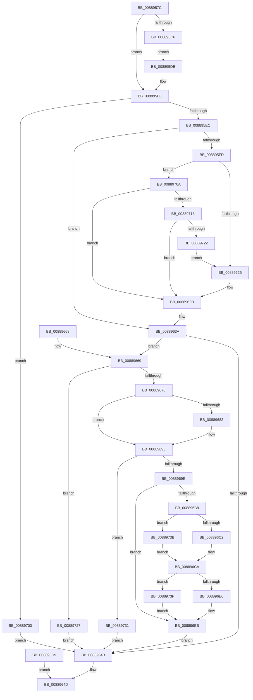

# AlpcpCaptureViewAttribute

- RVA: `0x0088957C`–`0x0088974E` (길이 `466` bytes)
- VA: `0x000000014088957C`
- 실행 섹션: `PAGE`
- PDB 이름 있음: `예`; PDB Function 태그: `아니요`
- unwind 정보 RVA: `0x0007CF14`
- 디코드: `121`개 명령, `466/466` bytes 표시
- 미해석 바이트: `0` (있으면 어셈블리에 `.byte`로 보존)

> 이 문서는 커널 이미지의 기계어와 PDB 기호를 분석해 생성했습니다. 4번과 5번은 함수 원형과 자료형을 바이너리 사용 방식에서 추정한 C 해석이며 원본 소스 복구 결과는 아닙니다.

## 1. Dependencies

- 직접 호출 지점: **9**; 고유 호출 대상: **7**
- 직접 호출자로 확인된 함수: **1**
- RIP 상대 이미지 참조: **1**

### Outgoing calls
- `0x00889608` → [AlpcpLockForCachedReferenceBlob](AlpcpLockForCachedReferenceBlob_function_0088A8B0.md) (function, `0x0088A8B0`)
- `0x00889614` → [AlpcpUnlockBlob](AlpcpUnlockBlob_function_0088B990.md) (function, `0x0088B990`)
- `0x00889628` → [AlpcpDeleteView](AlpcpDeleteView_function_0088A26C.md) (function, `0x0088A26C`)
- `0x00889635` → [AlpcpDereferenceBlobEx](AlpcpDereferenceBlobEx_function_0088AF00.md) (function, `0x0088AF00`)
- `0x0088968D` → [AlpcReferenceBlobByHandle](AlpcReferenceBlobByHandle_function_00889F00.md) (function, `0x00889F00`)
- `0x008896AC` → [AlpcpLocateSectionView](AlpcpLocateSectionView_function_00889754.md) (function, `0x00889754`)
- `0x008896DA` → [AlpcpPrepareViewForDelivery](AlpcpPrepareViewForDelivery_function_00889A44.md) (function, `0x00889A44`)
- `0x008896F3` → [AlpcpDereferenceBlobEx](AlpcpDereferenceBlobEx_function_0088AF00.md) (function, `0x0088AF00`)
- `0x00889747` → [AlpcpDereferenceBlobEx](AlpcpDereferenceBlobEx_function_0088AF00.md) (function, `0x0088AF00`)

### Direct callers
- [AlpcpCaptureAttributes](AlpcpCaptureAttributes_function_0088CD20.md) at `0x0088D0AA`

### Static image references
- `0x00889686` → RVA `0x000014A0` (`.rdata`; read)

## 2. Other-region calls and transfers

- 다른 실행 섹션으로 향하는 call: **0**
- 별도 외부 분기/꼬리 이동을 확인하지 못했습니다.

## 3. Assembly (complete function range)

```asm
0088957C  4C 8B DC                        mov r11, rsp
0088957F  49 89 5B 08                     mov qword ptr [r11 + 8], rbx
00889583  49 89 73 10                     mov qword ptr [r11 + 0x10], rsi
00889587  49 89 7B 18                     mov qword ptr [r11 + 0x18], rdi
0088958B  41 54                           push r12
0088958D  41 55                           push r13
0088958F  41 57                           push r15
00889591  48 83 EC 50                     sub rsp, 0x50
00889595  4D 8B E1                        mov r12, r9
00889598  4D 8B F8                        mov r15, r8
0088959B  48 8B FA                        mov rdi, rdx
0088959E  4C 8B E9                        mov r13, rcx
008895A1  33 C0                           xor eax, eax
008895A3  0F 57 C0                        xorps xmm0, xmm0
008895A6  0F 11 44 24 28                  movups xmmword ptr [rsp + 0x28], xmm0
008895AB  49 89 43 D0                     mov qword ptr [r11 - 0x30], rax
008895AF  89 44 24 40                     mov dword ptr [rsp + 0x40], eax
008895B3  65 48 8B 04 25 88 01 00 00      mov rax, qword ptr gs:[0x188]
008895BC  33 DB                           xor ebx, ebx
008895BE  38 98 32 02 00 00               cmp byte ptr [rax + 0x232], bl
008895C4  74 1A                           je 0x1408895e0
008895C6  0F 10 02                        movups xmm0, xmmword ptr [rdx]
008895C9  0F 11 44 24 28                  movups xmmword ptr [rsp + 0x28], xmm0
008895CE  0F 10 4A 10                     movups xmm1, xmmword ptr [rdx + 0x10]
008895D2  0F 11 4C 24 38                  movups xmmword ptr [rsp + 0x38], xmm1
008895D7  EB 02                           jmp 0x1408895db
008895D9  EB 72                           jmp 0x14088964d
008895DB  48 8D 7C 24 28                  lea rdi, [rsp + 0x28]
008895E0  F7 07 FF FF F8 FF               test dword ptr [rdi], 0xfff8ffff
008895E6  0F 85 14 01 00 00               jne 0x140889700
008895EC  49 8B B0 90 00 00 00            mov rsi, qword ptr [r8 + 0x90]
008895F3  48 89 74 24 20                  mov qword ptr [rsp + 0x20], rsi
008895F8  48 85 F6                        test rsi, rsi
008895FB  74 3D                           je 0x14088963a
008895FD  49 89 98 90 00 00 00            mov qword ptr [r8 + 0x90], rbx
00889604  48 8B 4E 10                     mov rcx, qword ptr [rsi + 0x10]
00889608  E8 A3 12 00 00                  call 0x14088a8b0
0088960D  FF 4E 4C                        dec dword ptr [rsi + 0x4c]
00889610  48 8B 4E 10                     mov rcx, qword ptr [rsi + 0x10]
00889614  E8 77 23 00 00                  call 0x14088b990
00889619  F7 07 00 00 01 00               test dword ptr [rdi], 0x10000
0088961F  0F 84 E5 00 00 00               je 0x14088970a
00889625  48 8B CE                        mov rcx, rsi
00889628  E8 3F 0C 00 00                  call 0x14088a26c
0088962D  BA 01 00 00 00                  mov edx, 1
00889632  48 8B CE                        mov rcx, rsi
00889635  E8 C6 18 00 00                  call 0x14088af00
0088963A  41 81 67 28 FF 3F FF FF         and dword ptr [r15 + 0x28], 0xffff3fff
00889642  48 8B 57 08                     mov rdx, qword ptr [rdi + 8]
00889646  48 85 D2                        test rdx, rdx
00889649  75 1E                           jne 0x140889669
0088964B  8B C3                           mov eax, ebx
0088964D  4C 8D 5C 24 50                  lea r11, [rsp + 0x50]
00889652  49 8B 5B 20                     mov rbx, qword ptr [r11 + 0x20]
00889656  49 8B 73 28                     mov rsi, qword ptr [r11 + 0x28]
0088965A  49 8B 7B 30                     mov rdi, qword ptr [r11 + 0x30]
0088965E  49 8B E3                        mov rsp, r11
00889661  41 5F                           pop r15
00889663  41 5D                           pop r13
00889665  41 5C                           pop r12
00889667  C3                              ret
00889668  CC                              int3
00889669  4C 8B 7F 10                     mov r15, qword ptr [rdi + 0x10]
0088966D  4D 85 FF                        test r15, r15
00889670  0F 84 B1 00 00 00               je 0x140889727
00889676  48 8B F3                        mov rsi, rbx
00889679  49 8B 4D 10                     mov rcx, qword ptr [r13 + 0x10]
0088967D  48 85 C9                        test rcx, rcx
00889680  74 13                           je 0x140889695
00889682  48 83 C1 28                     add rcx, 0x28
00889686  4C 8D 05 13 7E 77 FF            lea r8, [rip - 0x8881ed]
0088968D  E8 6E 08 00 00                  call 0x140889f00
00889692  48 8B F0                        mov rsi, rax
00889695  48 85 F6                        test rsi, rsi
00889698  0F 84 93 00 00 00               je 0x140889731
0088969E  4C 8D 4C 24 20                  lea r9, [rsp + 0x20]
008896A3  4D 8B C7                        mov r8, r15
008896A6  49 8B D5                        mov rdx, r13
008896A9  48 8B CE                        mov rcx, rsi
008896AC  E8 A3 00 00 00                  call 0x140889754
008896B1  44 8B F8                        mov r15d, eax
008896B4  85 C0                           test eax, eax
008896B6  78 33                           js 0x1408896eb
008896B8  44 8B 07                        mov r8d, dword ptr [rdi]
008896BB  41 0F BA E0 12                  bt r8d, 0x12
008896C0  73 79                           jae 0x14088973b
008896C2  8B 56 30                        mov edx, dword ptr [rsi + 0x30]
008896C5  D1 EA                           shr edx, 1
008896C7  80 E2 01                        and dl, 1
008896CA  41 C1 E8 11                     shr r8d, 0x11
008896CE  41 80 E0 01                     and r8b, 1
008896D2  48 8B 7C 24 20                  mov rdi, qword ptr [rsp + 0x20]
008896D7  48 8B CF                        mov rcx, rdi
008896DA  E8 65 03 00 00                  call 0x140889a44
008896DF  44 8B F8                        mov r15d, eax
008896E2  85 C0                           test eax, eax
008896E4  78 59                           js 0x14088973f
008896E6  49 89 7C 24 28                  mov qword ptr [r12 + 0x28], rdi
008896EB  BA 01 00 00 00                  mov edx, 1
008896F0  48 8B CE                        mov rcx, rsi
008896F3  E8 08 18 00 00                  call 0x14088af00
008896F8  41 8B DF                        mov ebx, r15d
008896FB  E9 4B FF FF FF                  jmp 0x14088964b
00889700  BB 0D 00 00 C0                  mov ebx, 0xc000000d
00889705  E9 41 FF FF FF                  jmp 0x14088964b
0088970A  41 8B 47 28                     mov eax, dword ptr [r15 + 0x28]
0088970E  0F BA E0 0F                     bt eax, 0xf
00889712  0F 83 15 FF FF FF               jae 0x14088962d
00889718  0F BA E0 0E                     bt eax, 0xe
0088971C  0F 82 0B FF FF FF               jb 0x14088962d
00889722  E9 FE FE FF FF                  jmp 0x140889625
00889727  BB 41 01 00 C0                  mov ebx, 0xc0000141
0088972C  E9 1A FF FF FF                  jmp 0x14088964b
00889731  BB 08 00 00 C0                  mov ebx, 0xc0000008
00889736  E9 10 FF FF FF                  jmp 0x14088964b
0088973B  8A D3                           mov dl, bl
0088973D  EB 8B                           jmp 0x1408896ca
0088973F  BA 01 00 00 00                  mov edx, 1
00889744  48 8B CF                        mov rcx, rdi
00889747  E8 B4 17 00 00                  call 0x14088af00
0088974C  EB 9D                           jmp 0x1408896eb
```

## 4. C-style interpretation (structured pseudocode)

```c
__int64 __fastcall AlpcpCaptureViewAttribute(__int64 a1, __int64 a2, __int64 a3, __int64 a4)
{
    __int64 result;
    __int64 v_rbx;
    __int64 v_rsi;
    __int64 v_rsp;
    unsigned __int64 v_stack_m18;
    unsigned int v_stack_m28;
    unsigned __int64 v_stack_m30;
    unsigned __int64 v_stack_m40;
    unsigned __int64 v_stack_m48;

    *(unsigned __int64 *)(v_rsp + 8) = v_rbx;
    *(unsigned __int64 *)(v_rsp + 16) = v_rsi;
    *(unsigned __int64 *)(v_rsp + 24) = v_rdi;
    v_rsp = (v_rsp) - (80);
    result = 0;
    v_stack_m40 = v_xmm0;
    *(unsigned __int64 *)(v_rsp - 48) = 0;
    v_stack_m28 = 0;
    v_rbx = 0;
    if ((*(unsigned __int8 *)(*(unsigned __int64 *)(gs_base + (0 + 392)) + 562)) == 0) goto loc_008895E0;
    v_stack_m40 = v_xmm0;
    v_stack_m30 = v_xmm1;
    goto loc_008895DB;
loc_008895DB:
loc_008895E0:
    if (((*(unsigned int *)(v_stack_m40)) & (0xFFF8FFFFULL)) != 0) goto loc_00889700;
    v_stack_m48 = *(unsigned __int64 *)(a3 + 144);
    if (*(unsigned __int64 *)(a3 + 144) == 0) goto loc_0088963A;
    *(unsigned __int64 *)(a3 + 144) = 0;
    result = AlpcpLockForCachedReferenceBlob(*(unsigned __int64 *)(*(unsigned __int64 *)(a3 + 144) + 16), a2, a3, a4);
    result = AlpcpUnlockBlob(*(unsigned __int64 *)(*(unsigned __int64 *)(a3 + 144) + 16), a2, a3, a4);
    if (((*(unsigned int *)(v_stack_m40)) & (0x10000ULL)) == 0) goto loc_0088970A;
loc_00889625:
    result = AlpcpDeleteView(*(unsigned __int64 *)(a3 + 144), a2, a3, a4);
loc_0088962D:
    result = AlpcpDereferenceBlobEx(*(unsigned __int64 *)(a3 + 144), 1, a3, a4);
loc_0088963A:
    if (*(unsigned __int64 *)(v_stack_m40 + 8) != 0) goto loc_00889669;
loc_0088964B:
loc_0088964D:
    return 0;
loc_00889669:
    if (*(unsigned __int64 *)(*(unsigned __int64 *)(v_stack_m18 + 48) + 16) == 0) goto loc_00889727;
    result = 0;
    v_rsi = *(unsigned __int64 *)(v_stack_m18 + 32);
    if (*(unsigned __int64 *)(a1 + 16) != 0) {
        a1 = (*(unsigned __int64 *)(a1 + 16)) + (40);
        a3 = v_rip - 8946157;
        result = AlpcReferenceBlobByHandle(a1, *(unsigned __int64 *)(v_stack_m40 + 8), a3, a4);
        v_rsi = result;
    }
    if (v_rsi == 0) goto loc_00889731;
    result = AlpcpLocateSectionView(v_rsi, a1, *(unsigned __int64 *)(*(unsigned __int64 *)(v_stack_m18 + 48) + 16), v_stack_m30);
    if (sign_flag) goto loc_008896EB;
    if (condition_is_above_or_equal) goto loc_0088973B;
    a2 = (unsigned int)(((unsigned int)(*(unsigned int *)(v_rsi + 48))) >> (1));
    a2 = (unsigned __int8)((a2) & (1));
loc_008896CA:
    a3 = (unsigned int)(((unsigned int)(*(unsigned int *)(*(unsigned __int64 *)(v_stack_m18 + 48)))) >> (17));
    a3 = (unsigned __int8)((a3) & (1));
    result = AlpcpPrepareViewForDelivery(v_stack_m30, a2, a3, v_stack_m30);
    if (sign_flag) goto loc_0088973F;
    *(unsigned __int64 *)(a4 + 40) = v_stack_m30;
loc_008896EB:
    result = AlpcpDereferenceBlobEx(v_rsi, 1, a3, v_stack_m30);
    goto loc_0088964B;
loc_00889700:
    goto loc_0088964B;
loc_0088970A:
    if (condition_is_above_or_equal) goto loc_0088962D;
    if (condition_is_below) goto loc_0088962D;
    goto loc_00889625;
loc_00889727:
    goto loc_0088964B;
loc_00889731:
    goto loc_0088964B;
loc_0088973B:
    goto loc_008896CA;
loc_0088973F:
    result = AlpcpDereferenceBlobEx(v_stack_m30, 1, a3, v_stack_m30);
    goto loc_008896EB;
}
```

## 5. (Beta) C Style

```c
int64_t AlpcpCaptureViewAttribute(void *Arg1, void *Arg2, void *Arg3, void *Arg4)
{
    uint8_t *arg1 = (uint8_t *)Arg1;
    uint8_t *arg2 = (uint8_t *)Arg2;
    uint8_t *arg3 = (uint8_t *)Arg3;
    uint8_t *arg4 = (uint8_t *)Arg4;

    int64_t result;
    int64_t local_rbx;
    int64_t local_rsi;
    int64_t local_rsp;
    uint64_t v_stack_m18;
    uint32_t v_stack_m28;
    uint64_t v_stack_m30;
    uint64_t v_stack_m40;
    uint64_t v_stack_m48;

    *(uint64_t *)(local_rsp + 0x8) = local_rbx;
    *(uint64_t *)(local_rsp + 0x10) = local_rsi;
    *(uint64_t *)(local_rsp + 0x18) = local_rdi;
    local_rsp = (local_rsp) - (80);
    result = 0;
    v_stack_m40 = v_xmm0;
    *(uint64_t *)(local_rsp - 0x30) = 0;
    v_stack_m28 = 0;
    local_rbx = 0;
    if ((*(uint8_t *)(*(uint64_t *)(gs_base + (0 + 0x188)) + 0x232)) == 0) goto loc_008895E0;
    v_stack_m40 = v_xmm0;
    v_stack_m30 = v_xmm1;
    goto loc_008895DB;
loc_008895DB:
loc_008895E0:
    if (((*(uint32_t *)(v_stack_m40)) & (0xFFF8FFFFULL)) != 0) goto loc_00889700;
    v_stack_m48 = *(uint64_t *)(arg3 + 0x90);
    if (*(uint64_t *)(arg3 + 0x90) == 0) goto loc_0088963A;
    *(uint64_t *)(arg3 + 0x90) = 0;
    result = AlpcpLockForCachedReferenceBlob(*(uint64_t *)(*(uint64_t *)(arg3 + 0x90) + 0x10), Arg2, Arg3, Arg4);
    result = AlpcpUnlockBlob(*(uint64_t *)(*(uint64_t *)(arg3 + 0x90) + 0x10), Arg2, Arg3, Arg4);
    if (((*(uint32_t *)(v_stack_m40)) & (0x10000ULL)) == 0) goto loc_0088970A;
loc_00889625:
    result = AlpcpDeleteView(*(uint64_t *)(arg3 + 0x90), Arg2, Arg3, Arg4);
loc_0088962D:
    result = AlpcpDereferenceBlobEx(*(uint64_t *)(arg3 + 0x90), 1, Arg3, Arg4);
loc_0088963A:
    if (*(uint64_t *)(v_stack_m40 + 0x8) != 0) goto loc_00889669;
loc_0088964B:
loc_0088964D:
    return 0;
loc_00889669:
    if (*(uint64_t *)(*(uint64_t *)(v_stack_m18 + 0x30) + 0x10) == 0) goto loc_00889727;
    result = 0;
    local_rsi = *(uint64_t *)(v_stack_m18 + 0x20);
    if (*(uint64_t *)(arg1 + 0x10) != 0) {
        Arg1 = (*(uint64_t *)(arg1 + 0x10)) + (40);
        Arg3 = v_rip - 8946157;
        result = AlpcReferenceBlobByHandle(Arg1, *(uint64_t *)(v_stack_m40 + 0x8), Arg3, Arg4);
        local_rsi = result;
    }
    if (local_rsi == 0) goto loc_00889731;
    result = AlpcpLocateSectionView(local_rsi, Arg1, *(uint64_t *)(*(uint64_t *)(v_stack_m18 + 0x30) + 0x10), v_stack_m30);
    if (sign_flag) goto loc_008896EB;
    if (condition_is_above_or_equal) goto loc_0088973B;
    Arg2 = (uint32_t)(((uint32_t)(*(uint32_t *)(local_rsi + 0x30))) >> (1));
    Arg2 = (uint8_t)((Arg2) & (1));
loc_008896CA:
    Arg3 = (uint32_t)(((uint32_t)(*(uint32_t *)(*(uint64_t *)(v_stack_m18 + 0x30)))) >> (17));
    Arg3 = (uint8_t)((Arg3) & (1));
    result = AlpcpPrepareViewForDelivery(v_stack_m30, Arg2, Arg3, v_stack_m30);
    if (sign_flag) goto loc_0088973F;
    *(uint64_t *)(arg4 + 0x28) = v_stack_m30;
loc_008896EB:
    result = AlpcpDereferenceBlobEx(local_rsi, 1, Arg3, v_stack_m30);
    goto loc_0088964B;
loc_00889700:
    goto loc_0088964B;
loc_0088970A:
    if (condition_is_above_or_equal) goto loc_0088962D;
    if (condition_is_below) goto loc_0088962D;
    goto loc_00889625;
loc_00889727:
    goto loc_0088964B;
loc_00889731:
    goto loc_0088964B;
loc_0088973B:
    goto loc_008896CA;
loc_0088973F:
    result = AlpcpDereferenceBlobEx(v_stack_m30, 1, Arg3, v_stack_m30);
    goto loc_008896EB;
}
```

### 관측된 메모리 오프셋

구조체 형식이 확인되지 않은 접근은 인자 기준의 오프셋으로만 기록했습니다.

| 기준 인자 | 오프셋 표현 | 폭 (bit) | 접근 |
|---|---:|---:|---|
| `Arg1` | `+ 0x10` | `64` | `R` |
| `Arg2` | `+ 0x0` | `128` | `R` |
| `Arg2` | `+ 0x10` | `128` | `R` |
| `Arg3` | `+ 0x28` | `32` | `R` |
| `Arg3` | `+ 0x28` | `32` | `R/W` |
| `Arg3` | `+ 0x90` | `64` | `R` |
| `Arg3` | `+ 0x90` | `64` | `W` |
| `Arg4` | `+ 0x28` | `64` | `W` |

## 6. Execution-region graph

[열기: 2D/3D 그래프와 함수 탐색 컨트롤 패널](../../../control-panel.html?section=page&rva=0x0088957C&view=graph)

- 2D 그래프는 위에서 아래로 흐르고, 3D 그래프는 빈 공간을 드래그해 회전합니다. Shift+드래그는 이동, 휠은 확대·축소, 함수 노드 선택은 대상 보고서 이동입니다.

### Static fallback


