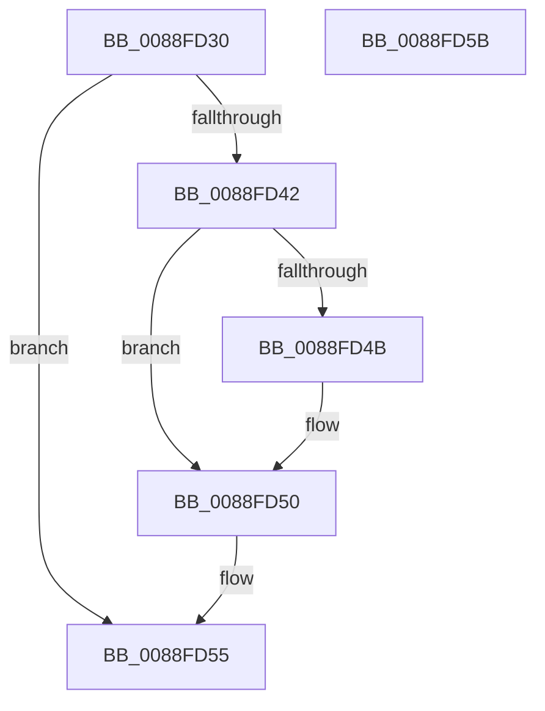

# AlpcpClearOwnerPortMessage

- RVA: `0x0088FD30`–`0x0088FD5C` (길이 `44` bytes)
- VA: `0x000000014088FD30`
- 실행 섹션: `PAGE`
- PDB 이름 있음: `예`; PDB Function 태그: `아니요`
- unwind 정보 RVA: `0x0005CF00`
- 디코드: `14`개 명령, `44/44` bytes 표시
- 미해석 바이트: `0` (있으면 어셈블리에 `.byte`로 보존)

> 이 문서는 커널 이미지의 기계어와 PDB 기호를 분석해 생성했습니다. 4번과 5번은 함수 원형과 자료형을 바이너리 사용 방식에서 추정한 C 해석이며 원본 소스 복구 결과는 아닙니다.

## 1. Dependencies

- 직접 호출 지점: **1**; 고유 호출 대상: **1**
- 직접 호출자로 확인된 함수: **4**
- RIP 상대 이미지 참조: **0**

### Outgoing calls
- `0x0088FD4B` → [ObfDereferenceObject](../../text/2F/ObfDereferenceObject_function_002F9350.md) (function, `0x002F9350`)

### Direct callers
- [AlpcpDispatchReplyToPort](AlpcpDispatchReplyToPort_function_0088F880.md) at `0x0088FA9B`
- [AlpcpCancelMessage](../89/AlpcpCancelMessage_function_00894120.md) at `0x00894371`
- [AlpcpReplyLegacySynchronousRequest](../9F/AlpcpReplyLegacySynchronousRequest_function_009F5CF0.md) at `0x009F6151`
- [sub_00B22892](../B2/Unknown_function_00B22892.md) at `0x00B22B04`

### Static image references
- 디코드된 RIP-relative 메모리 참조가 없습니다.

## 2. Other-region calls and transfers

- 다른 실행 섹션으로 향하는 call: **1**
  - `0x0088FD4B` → [ObfDereferenceObject](../../text/2F/ObfDereferenceObject_function_002F9350.md) (`PAGE` → `.text`)
- 별도 외부 분기/꼬리 이동을 확인하지 못했습니다.

## 3. Assembly (complete function range)

```asm
0088FD30  40 53                           push rbx
0088FD32  48 83 EC 20                     sub rsp, 0x20
0088FD36  48 8B D9                        mov rbx, rcx
0088FD39  48 8B 49 18                     mov rcx, qword ptr [rcx + 0x18]
0088FD3D  48 85 C9                        test rcx, rcx
0088FD40  74 13                           je 0x14088fd55
0088FD42  F7 43 28 00 10 00 00            test dword ptr [rbx + 0x28], 0x1000
0088FD49  74 05                           je 0x14088fd50
0088FD4B  E8 00 96 A6 FF                  call 0x1402f9350
0088FD50  48 83 63 18 00                  and qword ptr [rbx + 0x18], 0
0088FD55  48 83 C4 20                     add rsp, 0x20
0088FD59  5B                              pop rbx
0088FD5A  C3                              ret
0088FD5B  CC                              int3
```

## 4. C-style interpretation (structured pseudocode)

```c
__int64 __fastcall AlpcpClearOwnerPortMessage(__int64 a1)
{
    __int64 result;
    __int64 v_rsp;

    v_rsp = (v_rsp) - (32);
    if (*(unsigned __int64 *)(a1 + 24) == 0) goto loc_0088FD55;
    if (((*(unsigned int *)(a1 + 40)) & (0x1000ULL)) != 0) {
        result = ObfDereferenceObject(*(unsigned __int64 *)(a1 + 24), a2, a3, a4);
    }
loc_0088FD55:
    v_rsp = (v_rsp) + (32);
    return result;
}
```

## 5. (Beta) C Style

```c
int64_t AlpcpClearOwnerPortMessage(void *Arg1)
{
    uint8_t *arg1 = (uint8_t *)Arg1;

    int64_t result;
    int64_t local_rsp;

    local_rsp = (local_rsp) - (32);
    if (*(uint64_t *)(arg1 + 0x18) == 0) goto loc_0088FD55;
    if (((*(uint32_t *)(arg1 + 0x28)) & (0x1000ULL)) != 0) {
        result = ObfDereferenceObject(*(uint64_t *)(arg1 + 0x18), a2, a3, a4);
    }
loc_0088FD55:
    local_rsp = (local_rsp) + (32);
    return result;
}
```

### 관측된 메모리 오프셋

구조체 형식이 확인되지 않은 접근은 인자 기준의 오프셋으로만 기록했습니다.

| 기준 인자 | 오프셋 표현 | 폭 (bit) | 접근 |
|---|---:|---:|---|
| `Arg1` | `+ 0x18` | `64` | `R` |
| `Arg1` | `+ 0x18` | `64` | `R/W` |
| `Arg1` | `+ 0x28` | `32` | `R` |

## 6. Execution-region graph

[열기: 2D/3D 그래프와 함수 탐색 컨트롤 패널](../../../control-panel.html?section=page&rva=0x0088FD30&view=graph)

- 2D 그래프는 위에서 아래로 흐르고, 3D 그래프는 빈 공간을 드래그해 회전합니다. Shift+드래그는 이동, 휠은 확대·축소, 함수 노드 선택은 대상 보고서 이동입니다.

### Static fallback


