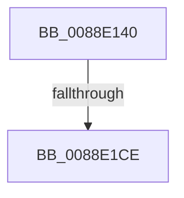

# AlpcpCompleteDispatchMessage

- RVA: `0x0088E140`–`0x0088E1DC` (길이 `156` bytes)
- VA: `0x000000014088E140`
- 실행 섹션: `PAGE`
- PDB 이름 있음: `예`; PDB Function 태그: `예`
- unwind 정보 RVA: `0x0007D52C`
- 디코드: `39`개 명령, `156/156` bytes 표시
- 미해석 바이트: `0` (있으면 어셈블리에 `.byte`로 보존)

> 이 문서는 커널 이미지의 기계어와 PDB 기호를 분석해 생성했습니다. 4번과 5번은 함수 원형과 자료형을 바이너리 사용 방식에서 추정한 C 해석이며 원본 소스 복구 결과는 아닙니다.

## 1. Dependencies

- 직접 호출 지점: **0**; 고유 호출 대상: **0**
- 직접 호출자로 확인된 함수: **4**
- RIP 상대 이미지 참조: **0**

### Outgoing calls
- 직접 디코드된 call 명령이 없습니다.

### Direct callers
- [AlpcpDispatchNewMessage](AlpcpDispatchNewMessage_function_0088DD20.md) at `0x0088E003`
- [AlpcpDispatchReplyToPort](AlpcpDispatchReplyToPort_function_0088F880.md) at `0x0088FB6F`
- [AlpcpDispatchConnectionRequest](../92/AlpcpDispatchConnectionRequest_function_0092353C.md) at `0x009236EB`
- [AlpcpDispatchCloseMessage](../92/AlpcpDispatchCloseMessage_function_00923FBC.md) at `0x009240DC`

### Static image references
- 디코드된 RIP-relative 메모리 참조가 없습니다.

## 2. Other-region calls and transfers

- 다른 실행 섹션으로 향하는 call: **0**
- call이 아닌 외부 분기/꼬리 이동: **1**
  - `0x0088E1C8` → [sub_0088EC66](Unknown_function_0088EC66.md) (`tail-transfer`)

## 3. Assembly (complete function range)

```asm
0088E140  40 55                           push rbp
0088E142  56                              push rsi
0088E143  41 54                           push r12
0088E145  41 55                           push r13
0088E147  41 56                           push r14
0088E149  41 57                           push r15
0088E14B  48 81 EC B8 00 00 00            sub rsp, 0xb8
0088E152  44 8B 41 30                     mov r8d, dword ptr [rcx + 0x30]
0088E156  BE 00 00 00 00                  mov esi, 0
0088E15B  48 8B 41 10                     mov rax, qword ptr [rcx + 0x10]
0088E15F  45 8B F8                        mov r15d, r8d
0088E162  48 8B 69 20                     mov rbp, qword ptr [rcx + 0x20]
0088E166  41 81 E7 00 00 02 00            and r15d, 0x20000
0088E16D  4C 8B 71 08                     mov r14, qword ptr [rcx + 8]
0088E171  4C 8B E9                        mov r13, rcx
0088E174  48 89 84 24 80 00 00 00         mov qword ptr [rsp + 0x80], rax
0088E17C  41 8B C0                        mov eax, r8d
0088E17F  83 E0 04                        and eax, 4
0088E182  44 89 7C 24 50                  mov dword ptr [rsp + 0x50], r15d
0088E187  89 84 24 00 01 00 00            mov dword ptr [rsp + 0x100], eax
0088E18E  41 8B C0                        mov eax, r8d
0088E191  25 00 00 40 00                  and eax, 0x400000
0088E196  89 44 24 6C                     mov dword ptr [rsp + 0x6c], eax
0088E19A  8B C6                           mov eax, esi
0088E19C  0F 95 C0                        setne al
0088E19F  41 81 E0 00 00 80 00            and r8d, 0x800000
0088E1A6  89 44 24 78                     mov dword ptr [rsp + 0x78], eax
0088E1AA  48 8B 01                        mov rax, qword ptr [rcx]
0088E1AD  8B 88 00 01 00 00               mov ecx, dword ptr [rax + 0x100]
0088E1B3  8B D1                           mov edx, ecx
0088E1B5  C1 EA 15                        shr edx, 0x15
0088E1B8  8D 46 02                        lea eax, [rsi + 2]
0088E1BB  83 E2 01                        and edx, 1
0088E1BE  0F BA E1 16                     bt ecx, 0x16
0088E1C2  0F 42 D0                        cmovb edx, eax
0088E1C5  45 85 FF                        test r15d, r15d
0088E1C8  0F 84 98 0A 00 00               je 0x14088ec66
0088E1CE  41 BC 01 00 00 00               mov r12d, 1
0088E1D4  41 F7 46 28 00 02 00 00         test dword ptr [r14 + 0x28], 0x200
```

## 4. C-style interpretation (structured pseudocode)

```c
__int64 __fastcall AlpcpCompleteDispatchMessage(__int64 a1)
{
    __int64 result;
    __int64 v_r15;
    __int64 v_rsp;
    unsigned __int64 v_stack_m68;
    unsigned int v_stack_m70;
    unsigned int v_stack_m7C;
    unsigned int v_stack_m98;
    unsigned int v_stack_p18;

    v_rsp = (v_rsp) - (184);
    v_r15 = (unsigned int)(((unsigned int)((unsigned int)((unsigned int)(*(unsigned int *)(a1 + 48))))) & (0x20000ULL));
    v_stack_m68 = *(unsigned __int64 *)(a1 + 16);
    result = (unsigned int)(((unsigned int)((unsigned int)((unsigned int)(*(unsigned int *)(a1 + 48))))) & (4));
    v_stack_m98 = (unsigned int)(v_r15);
    v_stack_p18 = (unsigned int)(result);
    result = (unsigned int)(((unsigned int)((unsigned int)((unsigned int)(*(unsigned int *)(a1 + 48))))) & (0x400000ULL));
    v_stack_m7C = (unsigned int)(result);
    result = (condition_is_not_equal) ? 1 : 0;
    a3 = (unsigned int)(((unsigned int)(*(unsigned int *)(a1 + 48))) & (0x800000ULL));
    v_stack_m70 = (unsigned int)(result);
    a2 = (unsigned int)(((unsigned int)((unsigned int)((unsigned int)(*(unsigned int *)(*(unsigned __int64 *)(a1) + 256))))) >> (21));
    a2 = (unsigned int)((a2) & (1));
    if (condition_is_below) { a2 = (unsigned int)(0 + 2); }
    return 0 + 2;
}
```

## 5. (Beta) C Style

```c
int64_t AlpcpCompleteDispatchMessage(void *Arg1)
{
    uint8_t *arg1 = (uint8_t *)Arg1;

    int64_t result;
    int64_t local_r15;
    int64_t local_rsp;
    uint64_t v_stack_m68;
    uint32_t v_stack_m70;
    uint32_t v_stack_m7C;
    uint32_t v_stack_m98;
    uint32_t v_stack_p18;

    local_rsp = (local_rsp) - (184);
    local_r15 = (uint32_t)(((uint32_t)((uint32_t)((uint32_t)(*(uint32_t *)(arg1 + 0x30))))) & (0x20000ULL));
    v_stack_m68 = *(uint64_t *)(arg1 + 0x10);
    result = (uint32_t)(((uint32_t)((uint32_t)((uint32_t)(*(uint32_t *)(arg1 + 0x30))))) & (4));
    v_stack_m98 = (uint32_t)(local_r15);
    v_stack_p18 = (uint32_t)(result);
    result = (uint32_t)(((uint32_t)((uint32_t)((uint32_t)(*(uint32_t *)(arg1 + 0x30))))) & (0x400000ULL));
    v_stack_m7C = (uint32_t)(result);
    result = (condition_is_not_equal) ? 1 : 0;
    a3 = (uint32_t)(((uint32_t)(*(uint32_t *)(arg1 + 0x30))) & (0x800000ULL));
    v_stack_m70 = (uint32_t)(result);
    a2 = (uint32_t)(((uint32_t)((uint32_t)((uint32_t)(*(uint32_t *)(*(uint64_t *)(arg1) + 0x100))))) >> (21));
    a2 = (uint32_t)((a2) & (1));
    if (condition_is_below) { a2 = (uint32_t)(0 + 2); }
    return 0 + 2;
}
```

### 관측된 메모리 오프셋

구조체 형식이 확인되지 않은 접근은 인자 기준의 오프셋으로만 기록했습니다.

| 기준 인자 | 오프셋 표현 | 폭 (bit) | 접근 |
|---|---:|---:|---|
| `Arg1` | `+ 0x0` | `64` | `R` |
| `Arg1` | `+ 0x8` | `64` | `R` |
| `Arg1` | `+ 0x10` | `64` | `R` |
| `Arg1` | `+ 0x20` | `64` | `R` |
| `Arg1` | `+ 0x30` | `32` | `R` |

## 6. Execution-region graph

[열기: 2D/3D 그래프와 함수 탐색 컨트롤 패널](../../../control-panel.html?section=page&rva=0x0088E140&view=graph)

- 2D 그래프는 위에서 아래로 흐르고, 3D 그래프는 빈 공간을 드래그해 회전합니다. Shift+드래그는 이동, 휠은 확대·축소, 함수 노드 선택은 대상 보고서 이동입니다.

### Static fallback


