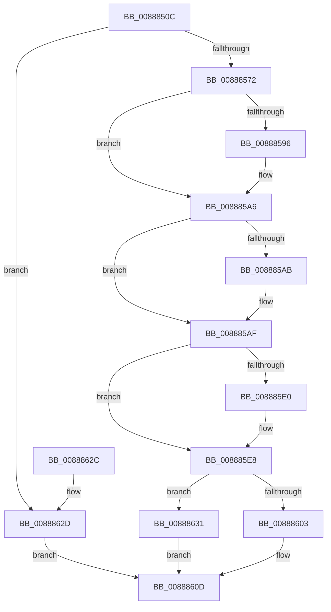

# AlpcpCreateSectionView

- RVA: `0x0088850C`–`0x00888635` (길이 `297` bytes)
- VA: `0x000000014088850C`
- 실행 섹션: `PAGE`
- PDB 이름 있음: `예`; PDB Function 태그: `아니요`
- unwind 정보 RVA: `0x0007CDCC`
- 디코드: `86`개 명령, `297/297` bytes 표시
- 미해석 바이트: `0` (있으면 어셈블리에 `.byte`로 보존)

> 이 문서는 커널 이미지의 기계어와 PDB 기호를 분석해 생성했습니다. 4번과 5번은 함수 원형과 자료형을 바이너리 사용 방식에서 추정한 C 해석이며 원본 소스 복구 결과는 아닙니다.

## 1. Dependencies

- 직접 호출 지점: **11**; 고유 호출 대상: **9**
- 직접 호출자로 확인된 함수: **2**
- RIP 상대 이미지 참조: **0**

### Outgoing calls
- `0x00888548` → [AlpcpLockForCachedReferenceBlob](AlpcpLockForCachedReferenceBlob_function_0088A8B0.md) (function, `0x0088A8B0`)
- `0x0088855B` → [AlpcpCreateRegion](../89/AlpcpCreateRegion_function_008933B0.md) (function, `0x008933B0`)
- `0x00888565` → [AlpcpUnlockBlob](AlpcpUnlockBlob_function_0088B990.md) (function, `0x0088B990`)
- `0x00888581` → [KeAbPreAcquire](../../text/21/KeAbPreAcquire_function_00210230.md) (function, `0x00210230`)
- `0x008885A1` → [ExfAcquirePushLockSharedEx](../../text/21/ExfAcquirePushLockSharedEx_function_0021044C.md) (function, `0x0021044C`)
- `0x008885B7` → [AlpcpLockForCachedReferenceBlob](AlpcpLockForCachedReferenceBlob_function_0088A8B0.md) (function, `0x0088A8B0`)
- `0x008885C7` → [AlpcpCreateView](AlpcpCreateView_function_0088A9B8.md) (function, `0x0088A9B8`)
- `0x008885D1` → [AlpcpUnlockBlob](AlpcpUnlockBlob_function_0088B990.md) (function, `0x0088B990`)
- `0x008885E3` → [ExfReleasePushLockShared](../../text/26/ExfReleasePushLockShared_function_00263440.md) (function, `0x00263440`)
- `0x008885EB` → [KeAbPostRelease](../../text/2E/KeAbPostRelease_function_002E1600.md) (function, `0x002E1600`)
- `0x008885FA` → [AlpcpDereferenceBlobEx](AlpcpDereferenceBlobEx_function_0088AF00.md) (function, `0x0088AF00`)

### Direct callers
- [NtAlpcCreateSectionView](NtAlpcCreateSectionView_function_00888640.md) at `0x008887A6`
- [AlpcpMapLegacyPortView](../92/AlpcpMapLegacyPortView_function_00921588.md) at `0x009216B6`

### Static image references
- 디코드된 RIP-relative 메모리 참조가 없습니다.

## 2. Other-region calls and transfers

- 다른 실행 섹션으로 향하는 call: **4**
  - `0x00888581` → [KeAbPreAcquire](../../text/21/KeAbPreAcquire_function_00210230.md) (`PAGE` → `.text`)
  - `0x008885A1` → [ExfAcquirePushLockSharedEx](../../text/21/ExfAcquirePushLockSharedEx_function_0021044C.md) (`PAGE` → `.text`)
  - `0x008885E3` → [ExfReleasePushLockShared](../../text/26/ExfReleasePushLockShared_function_00263440.md) (`PAGE` → `.text`)
  - `0x008885EB` → [KeAbPostRelease](../../text/2E/KeAbPostRelease_function_002E1600.md) (`PAGE` → `.text`)
- 별도 외부 분기/꼬리 이동을 확인하지 못했습니다.

## 3. Assembly (complete function range)

```asm
0088850C  48 8B C4                        mov rax, rsp
0088850F  48 89 58 08                     mov qword ptr [rax + 8], rbx
00888513  48 89 68 10                     mov qword ptr [rax + 0x10], rbp
00888517  48 89 70 18                     mov qword ptr [rax + 0x18], rsi
0088851B  48 89 78 20                     mov qword ptr [rax + 0x20], rdi
0088851F  41 54                           push r12
00888521  41 56                           push r14
00888523  41 57                           push r15
00888525  48 83 EC 30                     sub rsp, 0x30
00888529  4C 8B 74 24 70                  mov r14, qword ptr [rsp + 0x70]
0088852E  45 33 FF                        xor r15d, r15d
00888531  49 8B D9                        mov rbx, r9
00888534  4C 89 78 D8                     mov qword ptr [rax - 0x28], r15
00888538  49 8B F8                        mov rdi, r8
0088853B  4C 89 78 E0                     mov qword ptr [rax - 0x20], r15
0088853F  48 8B EA                        mov rbp, rdx
00888542  48 8B F1                        mov rsi, rcx
00888545  4D 89 3E                        mov qword ptr [r14], r15
00888548  E8 63 23 00 00                  call 0x14088a8b0
0088854D  4C 8D 4C 24 20                  lea r9, [rsp + 0x20]
00888552  4C 8B C3                        mov r8, rbx
00888555  48 8B D7                        mov rdx, rdi
00888558  48 8B CE                        mov rcx, rsi
0088855B  E8 50 AE 00 00                  call 0x1408933b0
00888560  48 8B CE                        mov rcx, rsi
00888563  8B D8                           mov ebx, eax
00888565  E8 26 34 00 00                  call 0x14088b990
0088856A  85 DB                           test ebx, ebx
0088856C  0F 88 BB 00 00 00               js 0x14088862d
00888572  48 8D BD 60 01 00 00            lea rdi, [rbp + 0x160]
00888579  45 33 C0                        xor r8d, r8d
0088857C  48 8B CF                        mov rcx, rdi
0088857F  33 D2                           xor edx, edx
00888581  E8 AA 7C 98 FF                  call 0x140210230
00888586  48 8B D8                        mov rbx, rax
00888589  45 8D 67 11                     lea r12d, [r15 + 0x11]
0088858D  33 C0                           xor eax, eax
0088858F  F0 4C 0F B1 27                  lock cmpxchg qword ptr [rdi], r12
00888594  74 10                           je 0x1408885a6
00888596  4C 8B CF                        mov r9, rdi
00888599  4C 8B C3                        mov r8, rbx
0088859C  33 D2                           xor edx, edx
0088859E  48 8B CF                        mov rcx, rdi
008885A1  E8 A6 7E 98 FF                  call 0x14021044c
008885A6  48 85 DB                        test rbx, rbx
008885A9  74 04                           je 0x1408885af
008885AB  C6 43 0A 01                     mov byte ptr [rbx + 0xa], 1
008885AF  48 8B 5C 24 20                  mov rbx, qword ptr [rsp + 0x20]
008885B4  48 8B CB                        mov rcx, rbx
008885B7  E8 F4 22 00 00                  call 0x14088a8b0
008885BC  4C 8D 44 24 28                  lea r8, [rsp + 0x28]
008885C1  48 8B D5                        mov rdx, rbp
008885C4  48 8B CB                        mov rcx, rbx
008885C7  E8 EC 23 00 00                  call 0x14088a9b8
008885CC  48 8B CB                        mov rcx, rbx
008885CF  8B F0                           mov esi, eax
008885D1  E8 BA 33 00 00                  call 0x14088b990
008885D6  49 8B C4                        mov rax, r12
008885D9  F0 4C 0F B1 3F                  lock cmpxchg qword ptr [rdi], r15
008885DE  74 08                           je 0x1408885e8
008885E0  48 8B CF                        mov rcx, rdi
008885E3  E8 58 AE 9D FF                  call 0x140263440
008885E8  48 8B CF                        mov rcx, rdi
008885EB  E8 10 90 A5 FF                  call 0x1402e1600
008885F0  48 8B 4C 24 20                  mov rcx, qword ptr [rsp + 0x20]
008885F5  BA 01 00 00 00                  mov edx, 1
008885FA  E8 01 29 00 00                  call 0x14088af00
008885FF  85 F6                           test esi, esi
00888601  78 2E                           js 0x140888631
00888603  48 8B 44 24 28                  mov rax, qword ptr [rsp + 0x28]
00888608  49 89 06                        mov qword ptr [r14], rax
0088860B  33 C0                           xor eax, eax
0088860D  48 8B 5C 24 50                  mov rbx, qword ptr [rsp + 0x50]
00888612  48 8B 6C 24 58                  mov rbp, qword ptr [rsp + 0x58]
00888617  48 8B 74 24 60                  mov rsi, qword ptr [rsp + 0x60]
0088861C  48 8B 7C 24 68                  mov rdi, qword ptr [rsp + 0x68]
00888621  48 83 C4 30                     add rsp, 0x30
00888625  41 5F                           pop r15
00888627  41 5E                           pop r14
00888629  41 5C                           pop r12
0088862B  C3                              ret
0088862C  CC                              int3
0088862D  8B C3                           mov eax, ebx
0088862F  EB DC                           jmp 0x14088860d
00888631  8B C6                           mov eax, esi
00888633  EB D8                           jmp 0x14088860d
```

## 4. C-style interpretation (structured pseudocode)

```c
__int64 __fastcall AlpcpCreateSectionView(__int64 a1, __int64 a2, __int64 a3, __int64 a4, __int64 a5)
{
    __int64 result;
    __int64 v_r15;
    __int64 v_rsp;
    unsigned __int64 v_stack_m20;
    unsigned __int64 v_stack_m28;
    unsigned __int64 v_stack_p10;
    unsigned __int64 v_stack_p18;
    unsigned __int64 v_stack_p20;
    unsigned __int64 v_stack_p8;

    *(unsigned __int64 *)(v_rsp + 8) = v_rbx;
    *(unsigned __int64 *)(v_rsp + 16) = v_rbp;
    *(unsigned __int64 *)(v_rsp + 24) = v_rsi;
    *(unsigned __int64 *)(v_rsp + 32) = v_rdi;
    v_rsp = (v_rsp) - (48);
    v_r15 = 0;
    *(unsigned __int64 *)(v_rsp - 40) = 0;
    *(unsigned __int64 *)(v_rsp - 32) = 0;
    *(unsigned __int64 *)(a5) = 0;
    result = AlpcpLockForCachedReferenceBlob(a1, a2, a3, a4);
    result = AlpcpCreateRegion(a1, a3, a4, v_stack_m28);
    result = AlpcpUnlockBlob(a1, a3, a4, v_stack_m28);
    if (sign_flag) goto loc_0088862D;
    a3 = 0;
    a2 = 0;
    result = KeAbPreAcquire(a2 + 352, a2, a3, v_stack_m28);
    result = 0;
    if (!(condition_is_equal)) {
        a4 = a2 + 352;
        a3 = 0;
        a2 = 0;
        a1 = a2 + 352;
        result = ExfAcquirePushLockSharedEx(a1, a2, a3, a4);
    }
    if (result != 0) {
        *(unsigned __int8 *)(result + 10) = 1;
    }
    result = AlpcpLockForCachedReferenceBlob(v_stack_m28, a2, a3, a4);
    result = AlpcpCreateView(v_stack_m28, 0, v_stack_m20, a4);
    result = AlpcpUnlockBlob(v_stack_m28, 0, v_stack_m20, a4);
    result = v_r15 + 17;
    if (result != 0) {
        a1 = a2 + 352;
        result = ExfReleasePushLockShared(a1, 0, v_stack_m20, a4);
    }
    result = KeAbPostRelease(a2 + 352, 0, v_stack_m20, a4);
    result = AlpcpDereferenceBlobEx(v_stack_m28, 1, v_stack_m20, a4);
    if (sign_flag) goto loc_00888631;
    *(unsigned __int64 *)(a5) = v_stack_m20;
    result = 0;
loc_0088860D:
    v_rsp = (v_rsp) + (48);
    return result;
loc_0088862D:
    goto loc_0088860D;
loc_00888631:
    goto loc_0088860D;
}
```

## 5. (Beta) C Style

```c
int64_t AlpcpCreateSectionView(int64_t Arg1, void *Arg2, int64_t Arg3, int64_t Arg4, void *Arg5)
{
    uint8_t *arg2 = (uint8_t *)Arg2;
    uint8_t *arg5 = (uint8_t *)Arg5;

    int64_t result;
    int64_t local_r15;
    int64_t local_rsp;
    uint64_t v_stack_m20;
    uint64_t v_stack_m28;
    uint64_t v_stack_p10;
    uint64_t v_stack_p18;
    uint64_t v_stack_p20;
    uint64_t v_stack_p8;

    *(uint64_t *)(local_rsp + 0x8) = local_rbx;
    *(uint64_t *)(local_rsp + 0x10) = local_rbp;
    *(uint64_t *)(local_rsp + 0x18) = local_rsi;
    *(uint64_t *)(local_rsp + 0x20) = local_rdi;
    local_rsp = (local_rsp) - (48);
    local_r15 = 0;
    *(uint64_t *)(local_rsp - 0x28) = 0;
    *(uint64_t *)(local_rsp - 0x20) = 0;
    *(uint64_t *)(arg5) = 0;
    result = AlpcpLockForCachedReferenceBlob(Arg1, Arg2, Arg3, Arg4);
    result = AlpcpCreateRegion(Arg1, Arg3, Arg4, v_stack_m28);
    result = AlpcpUnlockBlob(Arg1, Arg3, Arg4, v_stack_m28);
    if (sign_flag) goto loc_0088862D;
    Arg3 = 0;
    Arg2 = 0;
    result = KeAbPreAcquire(Arg2 + 352, Arg2, Arg3, v_stack_m28);
    result = 0;
    if (!(condition_is_equal)) {
        Arg4 = Arg2 + 352;
        Arg3 = 0;
        Arg2 = 0;
        Arg1 = Arg2 + 352;
        result = ExfAcquirePushLockSharedEx(Arg1, Arg2, Arg3, Arg4);
    }
    if (result != 0) {
        *(uint8_t *)(result + 0xA) = 1;
    }
    result = AlpcpLockForCachedReferenceBlob(v_stack_m28, Arg2, Arg3, Arg4);
    result = AlpcpCreateView(v_stack_m28, 0, v_stack_m20, Arg4);
    result = AlpcpUnlockBlob(v_stack_m28, 0, v_stack_m20, Arg4);
    result = local_r15 + 17;
    if (result != 0) {
        Arg1 = Arg2 + 352;
        result = ExfReleasePushLockShared(Arg1, 0, v_stack_m20, Arg4);
    }
    result = KeAbPostRelease(Arg2 + 352, 0, v_stack_m20, Arg4);
    result = AlpcpDereferenceBlobEx(v_stack_m28, 1, v_stack_m20, Arg4);
    if (sign_flag) goto loc_00888631;
    *(uint64_t *)(arg5) = v_stack_m20;
    result = 0;
loc_0088860D:
    local_rsp = (local_rsp) + (48);
    return result;
loc_0088862D:
    goto loc_0088860D;
loc_00888631:
    goto loc_0088860D;
}
```

### 관측된 메모리 오프셋

구조체 형식이 확인되지 않은 접근은 인자 기준의 오프셋으로만 기록했습니다.

| 기준 인자 | 오프셋 표현 | 폭 (bit) | 접근 |
|---|---:|---:|---|
| `Arg2` | `+ 0x0` | `64` | `R` |
| `Arg2` | `+ 0x160` | `64` | `R` |
| `Arg5` | `+ 0x0` | `64` | `W` |

## 6. Execution-region graph

[열기: 2D/3D 그래프와 함수 탐색 컨트롤 패널](../../../control-panel.html?section=page&rva=0x0088850C&view=graph)

- 2D 그래프는 위에서 아래로 흐르고, 3D 그래프는 빈 공간을 드래그해 회전합니다. Shift+드래그는 이동, 휠은 확대·축소, 함수 노드 선택은 대상 보고서 이동입니다.

### Static fallback


