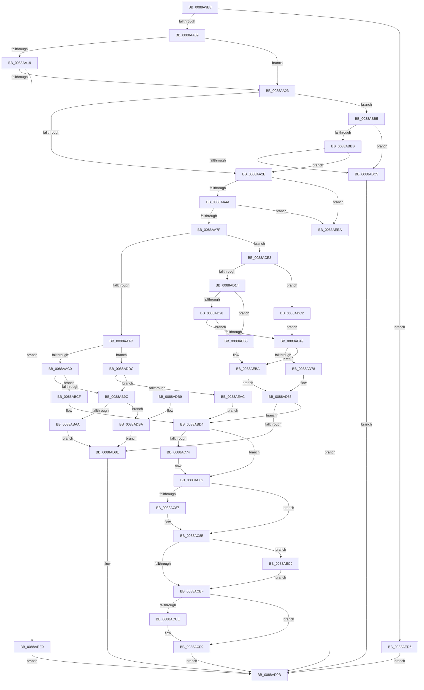

# AlpcpCreateView

- RVA: `0x0088A9B8`–`0x0088AEF4` (길이 `1,340` bytes)
- VA: `0x000000014088A9B8`
- 실행 섹션: `PAGE`
- PDB 이름 있음: `예`; PDB Function 태그: `아니요`
- unwind 정보 RVA: `0x0007D158`
- 디코드: `308`개 명령, `1,340/1,340` bytes 표시
- 미해석 바이트: `0` (있으면 어셈블리에 `.byte`로 보존)

> 이 문서는 커널 이미지의 기계어와 PDB 기호를 분석해 생성했습니다. 4번과 5번은 함수 원형과 자료형을 바이너리 사용 방식에서 추정한 C 해석이며 원본 소스 복구 결과는 아닙니다.

## 1. Dependencies

- 직접 호출 지점: **24**; 고유 호출 대상: **18**
- 직접 호출자로 확인된 함수: **2**
- RIP 상대 이미지 참조: **2**

### Outgoing calls
- `0x0088A9F5` → [AlpcpLockForCachedReferenceBlob](AlpcpLockForCachedReferenceBlob_function_0088A8B0.md) (function, `0x0088A8B0`)
- `0x0088AA3C` → [ExAllocatePool2](../../poolcode/B8/ExAllocatePool2_function_00B820F0.md) (function, `0x00B820F0`)
- `0x0088AA88` → [memset](../../text/6C/memset_function_006C6C40.md) (function, `0x006C6C40`)
- `0x0088AACC` → [MiSectionControlArea](../../text/29/MiSectionControlArea_function_00294CB0.md) (function, `0x00294CB0`)
- `0x0088AAE1` → [memset](../../text/6C/memset_function_006C6C40.md) (function, `0x006C6C40`)
- `0x0088AB91` → [MiMapViewOfSection](../89/MiMapViewOfSection_function_00898F10.md) (function, `0x00898F10`)
- `0x0088ABD7` → [AlpcpReferenceBlob](../89/AlpcpReferenceBlob_function_00890110.md) (function, `0x00890110`)
- `0x0088AC0C` → [ObfReferenceObjectWithTag](../../text/21/ObfReferenceObjectWithTag_function_00210710.md) (function, `0x00210710`)
- `0x0088AC18` → [ObfReferenceObject](../../text/20/ObfReferenceObject_function_0020FA20.md) (function, `0x0020FA20`)
- `0x0088AC24` → [AlpcpReferenceBlob](../89/AlpcpReferenceBlob_function_00890110.md) (function, `0x00890110`)
- `0x0088AC50` → [AlpcpInsertResourcePort](AlpcpInsertResourcePort_function_008898DC.md) (function, `0x008898DC`)
- `0x0088AC64` → [KeAbPreAcquire](../../text/21/KeAbPreAcquire_function_00210230.md) (function, `0x00210230`)
- `0x0088AC7D` → [ExfAcquirePushLockExclusiveEx](../../text/20/ExfAcquirePushLockExclusiveEx_function_0020FC90.md) (function, `0x0020FC90`)
- `0x0088ACC2` → [KeAbPostRelease](../../text/2E/KeAbPostRelease_function_002E1600.md) (function, `0x002E1600`)
- `0x0088ACF9` → [MiSectionControlArea](../../text/29/MiSectionControlArea_function_00294CB0.md) (function, `0x00294CB0`)
- `0x0088AD06` → [MiCheckPurgeAndUpMapCount](../../text/41/MiCheckPurgeAndUpMapCount_function_004186B0.md) (function, `0x004186B0`)
- `0x0088AD69` → [MiInsertInSystemSpace](../../text/3B/MiInsertInSystemSpace_function_003B2F5C.md) (function, `0x003B2F5C`)
- `0x0088AD96` → [AlpcpDereferenceBlobEx](AlpcpDereferenceBlobEx_function_0088AF00.md) (function, `0x0088AF00`)
- `0x0088AD9E` → [AlpcpUnlockBlob](AlpcpUnlockBlob_function_0088B990.md) (function, `0x0088B990`)
- `0x0088ADEB` → [MiSectionControlArea](../../text/29/MiSectionControlArea_function_00294CB0.md) (function, `0x00294CB0`)
- `0x0088ADFF` → [memset](../../text/6C/memset_function_006C6C40.md) (function, `0x006C6C40`)
- `0x0088AE9D` → [MiMapViewOfSection](../89/MiMapViewOfSection_function_00898F10.md) (function, `0x00898F10`)
- `0x0088AEBF` → [MiDereferenceControlArea](../../text/47/MiDereferenceControlArea_function_00479A20.md) (function, `0x00479A20`)
- `0x0088AECC` → [ExfTryToWakePushLock](../../text/26/ExfTryToWakePushLock_function_00265DD0.md) (function, `0x00265DD0`)

### Direct callers
- [AlpcpCreateSectionView](AlpcpCreateSectionView_function_0088850C.md) at `0x008885C7`
- [AlpcpExposeViewAttributeInSenderContext](AlpcpExposeViewAttributeInSenderContext_function_0088F600.md) at `0x0088F6DD`
- [AlpcpExposeViewAttributeInSenderContext](AlpcpExposeViewAttributeInSenderContext_function_0088F600.md) at `0x0088F763`
- [AlpcpExposeViewAttributeInSenderContext](AlpcpExposeViewAttributeInSenderContext_function_0088F600.md) at `0x0088F780`

### Static image references
- `0x0088ABAA` → RVA `0x00E302A8` (`.data`; read/write)
- `0x0088ADBA` → RVA `0x00E302AC` (`.data`; read/write)

## 2. Other-region calls and transfers

- 다른 실행 섹션으로 향하는 call: **16**
  - `0x0088AA3C` → [ExAllocatePool2](../../poolcode/B8/ExAllocatePool2_function_00B820F0.md) (`PAGE` → `POOLCODE`)
  - `0x0088AA88` → [memset](../../text/6C/memset_function_006C6C40.md) (`PAGE` → `.text`)
  - `0x0088AACC` → [MiSectionControlArea](../../text/29/MiSectionControlArea_function_00294CB0.md) (`PAGE` → `.text`)
  - `0x0088AAE1` → [memset](../../text/6C/memset_function_006C6C40.md) (`PAGE` → `.text`)
  - `0x0088AC0C` → [ObfReferenceObjectWithTag](../../text/21/ObfReferenceObjectWithTag_function_00210710.md) (`PAGE` → `.text`)
  - `0x0088AC18` → [ObfReferenceObject](../../text/20/ObfReferenceObject_function_0020FA20.md) (`PAGE` → `.text`)
  - `0x0088AC64` → [KeAbPreAcquire](../../text/21/KeAbPreAcquire_function_00210230.md) (`PAGE` → `.text`)
  - `0x0088AC7D` → [ExfAcquirePushLockExclusiveEx](../../text/20/ExfAcquirePushLockExclusiveEx_function_0020FC90.md) (`PAGE` → `.text`)
  - `0x0088ACC2` → [KeAbPostRelease](../../text/2E/KeAbPostRelease_function_002E1600.md) (`PAGE` → `.text`)
  - `0x0088ACF9` → [MiSectionControlArea](../../text/29/MiSectionControlArea_function_00294CB0.md) (`PAGE` → `.text`)
  - `0x0088AD06` → [MiCheckPurgeAndUpMapCount](../../text/41/MiCheckPurgeAndUpMapCount_function_004186B0.md) (`PAGE` → `.text`)
  - `0x0088AD69` → [MiInsertInSystemSpace](../../text/3B/MiInsertInSystemSpace_function_003B2F5C.md) (`PAGE` → `.text`)
  - `0x0088ADEB` → [MiSectionControlArea](../../text/29/MiSectionControlArea_function_00294CB0.md) (`PAGE` → `.text`)
  - `0x0088ADFF` → [memset](../../text/6C/memset_function_006C6C40.md) (`PAGE` → `.text`)
  - `0x0088AEBF` → [MiDereferenceControlArea](../../text/47/MiDereferenceControlArea_function_00479A20.md) (`PAGE` → `.text`)
  - `0x0088AECC` → [ExfTryToWakePushLock](../../text/26/ExfTryToWakePushLock_function_00265DD0.md) (`PAGE` → `.text`)
- 별도 외부 분기/꼬리 이동을 확인하지 못했습니다.

## 3. Assembly (complete function range)

```asm
0088A9B8  4C 89 44 24 18                  mov qword ptr [rsp + 0x18], r8
0088A9BD  55                              push rbp
0088A9BE  53                              push rbx
0088A9BF  56                              push rsi
0088A9C0  57                              push rdi
0088A9C1  41 54                           push r12
0088A9C3  41 55                           push r13
0088A9C5  41 56                           push r14
0088A9C7  41 57                           push r15
0088A9C9  48 8D 6C 24 A8                  lea rbp, [rsp - 0x58]
0088A9CE  48 81 EC 58 01 00 00            sub rsp, 0x158
0088A9D5  4C 8B 61 10                     mov r12, qword ptr [rcx + 0x10]
0088A9D9  33 DB                           xor ebx, ebx
0088A9DB  48 8B F1                        mov rsi, rcx
0088A9DE  48 89 9D B8 00 00 00            mov qword ptr [rbp + 0xb8], rbx
0088A9E5  49 8B CC                        mov rcx, r12
0088A9E8  48 89 9D A8 00 00 00            mov qword ptr [rbp + 0xa8], rbx
0088A9EF  4C 8B EA                        mov r13, rdx
0088A9F2  49 89 18                        mov qword ptr [r8], rbx
0088A9F5  E8 B6 FE FF FF                  call 0x14088a8b0
0088A9FA  41 8B 85 A0 01 00 00            mov eax, dword ptr [r13 + 0x1a0]
0088AA01  A8 20                           test al, 0x20
0088AA03  0F 85 CD 04 00 00               jne 0x14088aed6
0088AA09  49 8B 85 30 01 00 00            mov rax, qword ptr [r13 + 0x130]
0088AA10  4D 8B 7D 18                     mov r15, qword ptr [r13 + 0x18]
0088AA14  48 85 C0                        test rax, rax
0088AA17  74 0A                           je 0x14088aa23
0088AA19  48 3B 46 28                     cmp rax, qword ptr [rsi + 0x28]
0088AA1D  0F 82 BD 04 00 00               jb 0x14088aee0
0088AA23  8B 46 30                        mov eax, dword ptr [rsi + 0x30]
0088AA26  A8 01                           test al, 1
0088AA28  0F 85 87 01 00 00               jne 0x14088abb5
0088AA2E  BA 90 00 00 00                  mov edx, 0x90
0088AA33  41 B8 41 6C 56 69               mov r8d, 0x69566c41
0088AA39  8D 4A 70                        lea ecx, [rdx + 0x70]
0088AA3C  E8 AF 76 2F 00                  call 0x140b820f0
0088AA41  48 85 C0                        test rax, rax
0088AA44  0F 84 A0 04 00 00               je 0x14088aeea
0088AA4A  66 C7 40 10 00 06               mov word ptr [rax + 0x10], 0x600
0088AA50  4C 8D 70 30                     lea r14, [rax + 0x30]
0088AA54  89 58 12                        mov dword ptr [rax + 0x12], ebx
0088AA57  66 89 58 16                     mov word ptr [rax + 0x16], bx
0088AA5B  48 89 58 28                     mov qword ptr [rax + 0x28], rbx
0088AA5F  48 89 58 20                     mov qword ptr [rax + 0x20], rbx
0088AA63  48 89 40 08                     mov qword ptr [rax + 8], rax
0088AA67  48 89 00                        mov qword ptr [rax], rax
0088AA6A  80 60 10 FD                     and byte ptr [rax + 0x10], 0xfd
0088AA6E  48 C7 40 18 01 00 00 00         mov qword ptr [rax + 0x18], 1
0088AA76  4D 85 F6                        test r14, r14
0088AA79  0F 84 6B 04 00 00               je 0x14088aeea
0088AA7F  33 D2                           xor edx, edx
0088AA81  49 8B CE                        mov rcx, r14
0088AA84  44 8D 42 60                     lea r8d, [rdx + 0x60]
0088AA88  E8 B3 C1 E3 FF                  call 0x1406c6c40
0088AA8D  41 F7 85 00 01 00 00 00 00 10 00  test dword ptr [r13 + 0x100], 0x100000
0088AA98  48 8B 46 18                     mov rax, qword ptr [rsi + 0x18]
0088AA9C  48 8B 7E 28                     mov rdi, qword ptr [rsi + 0x28]
0088AAA0  48 89 85 A8 00 00 00            mov qword ptr [rbp + 0xa8], rax
0088AAA7  0F 85 36 02 00 00               jne 0x14088ace3
0088AAAD  41 8B 44 24 30                  mov eax, dword ptr [r12 + 0x30]
0088AAB2  89 9D A0 00 00 00               mov dword ptr [rbp + 0xa0], ebx
0088AAB8  A8 02                           test al, 2
0088AABA  0F 84 1C 03 00 00               je 0x14088addc
0088AAC0  49 8B 04 24                     mov rax, qword ptr [r12]
0088AAC4  48 8B C8                        mov rcx, rax
0088AAC7  48 89 44 24 40                  mov qword ptr [rsp + 0x40], rax
0088AACC  E8 DF A1 A0 FF                  call 0x140294cb0
0088AAD1  33 D2                           xor edx, edx
0088AAD3  48 8D 4C 24 50                  lea rcx, [rsp + 0x50]
0088AAD8  41 B8 80 00 00 00               mov r8d, 0x80
0088AADE  48 8B D8                        mov rbx, rax
0088AAE1  E8 5A C1 E3 FF                  call 0x1406c6c40
0088AAE6  65 48 8B 04 25 88 01 00 00      mov rax, qword ptr gs:[0x188]
0088AAEF  4C 8D 85 B8 00 00 00            lea r8, [rbp + 0xb8]
0088AAF6  C7 44 24 30 01 00 00 00         mov dword ptr [rsp + 0x30], 1
0088AAFE  48 8D 54 24 50                  lea rdx, [rsp + 0x50]
0088AB03  48 8B 88 B8 00 00 00            mov rcx, qword ptr [rax + 0xb8]
0088AB0A  48 89 4D B0                     mov qword ptr [rbp - 0x50], rcx
0088AB0E  4C 89 7D A8                     mov qword ptr [rbp - 0x58], r15
0088AB12  65 48 8B 04 25 88 01 00 00      mov rax, qword ptr gs:[0x188]
0088AB1B  8A 88 32 02 00 00               mov cl, byte ptr [rax + 0x232]
0088AB21  33 C0                           xor eax, eax
0088AB23  89 45 84                        mov dword ptr [rbp - 0x7c], eax
0088AB26  89 44 24 78                     mov dword ptr [rsp + 0x78], eax
0088AB2A  89 45 90                        mov dword ptr [rbp - 0x70], eax
0088AB2D  88 4D 89                        mov byte ptr [rbp - 0x77], cl
0088AB30  48 B9 FF FF FE FF FF 7F 00 00   movabs rcx, 0x7ffffffeffff
0088AB3A  C7 44 24 7C 04 00 00 00         mov dword ptr [rsp + 0x7c], 4
0088AB42  48 89 7C 24 68                  mov qword ptr [rsp + 0x68], rdi
0088AB47  8B 43 38                        mov eax, dword ptr [rbx + 0x38]
0088AB4A  49 8B 87 68 03 00 00            mov rax, qword ptr [r15 + 0x368]
0088AB51  48 FF C8                        dec rax
0088AB54  48 C7 44 24 60 00 00 01 00      mov qword ptr [rsp + 0x60], 0x10000
0088AB5D  48 3B C1                        cmp rax, rcx
0088AB60  48 0F 43 C1                     cmovae rax, rcx
0088AB64  B9 02 00 00 00                  mov ecx, 2
0088AB69  48 89 44 24 58                  mov qword ptr [rsp + 0x58], rax
0088AB6E  45 33 C9                        xor r9d, r9d
0088AB71  89 4C 24 28                     mov dword ptr [rsp + 0x28], ecx
0088AB75  49 8D 46 38                     lea rax, [r14 + 0x38]
0088AB79  48 89 45 98                     mov qword ptr [rbp - 0x68], rax
0088AB7D  48 8D 85 A8 00 00 00            lea rax, [rbp + 0xa8]
0088AB84  89 4D 94                        mov dword ptr [rbp - 0x6c], ecx
0088AB87  48 8B 4C 24 40                  mov rcx, qword ptr [rsp + 0x40]
0088AB8C  48 89 44 24 20                  mov qword ptr [rsp + 0x20], rax
0088AB91  E8 7A E3 00 00                  call 0x140898f10
0088AB96  8B D8                           mov ebx, eax
0088AB98  85 C0                           test eax, eax
0088AB9A  79 33                           jns 0x14088abcf
0088AB9C  48 83 BD B8 00 00 00 00         cmp qword ptr [rbp + 0xb8], 0
0088ABA4  0F 85 10 02 00 00               jne 0x14088adba
0088ABAA  FF 05 F8 56 5A 00               inc dword ptr [rip + 0x5a56f8]
0088ABB0  E9 D9 01 00 00                  jmp 0x14088ad8e
0088ABB5  83 7E 34 02                     cmp dword ptr [rsi + 0x34], 2
0088ABB9  73 0A                           jae 0x14088abc5
0088ABBB  48 39 5E 50                     cmp qword ptr [rsi + 0x50], rbx
0088ABBF  0F 84 69 FE FF FF               je 0x14088aa2e
0088ABC5  BB 22 00 00 C0                  mov ebx, 0xc0000022
0088ABCA  E9 CC 01 00 00                  jmp 0x14088ad9b
0088ABCF  48 8B 7C 24 68                  mov rdi, qword ptr [rsp + 0x68]
0088ABD4  49 8B CE                        mov rcx, r14
0088ABD7  E8 34 55 00 00                  call 0x140890110
0088ABDC  48 8B 85 B8 00 00 00            mov rax, qword ptr [rbp + 0xb8]
0088ABE3  BA 41 6C 70 63                  mov edx, 0x63706c41
0088ABE8  8B 8D A0 00 00 00               mov ecx, dword ptr [rbp + 0xa0]
0088ABEE  C1 E1 03                        shl ecx, 3
0088ABF1  49 89 46 28                     mov qword ptr [r14 + 0x28], rax
0088ABF5  41 8B 46 48                     mov eax, dword ptr [r14 + 0x48]
0088ABF9  83 E0 F7                        and eax, 0xfffffff7
0088ABFC  49 89 7E 30                     mov qword ptr [r14 + 0x30], rdi
0088AC00  0B C8                           or ecx, eax
0088AC02  83 C9 01                        or ecx, 1
0088AC05  41 89 4E 48                     mov dword ptr [r14 + 0x48], ecx
0088AC09  49 8B CF                        mov rcx, r15
0088AC0C  E8 FF 5A 98 FF                  call 0x140210710
0088AC11  49 8B CD                        mov rcx, r13
0088AC14  4D 89 7E 20                     mov qword ptr [r14 + 0x20], r15
0088AC18  E8 03 4E 98 FF                  call 0x14020fa20
0088AC1D  48 8B CE                        mov rcx, rsi
0088AC20  4D 89 6E 18                     mov qword ptr [r14 + 0x18], r13
0088AC24  E8 E7 54 00 00                  call 0x140890110
0088AC29  49 89 76 10                     mov qword ptr [r14 + 0x10], rsi
0088AC2D  48 8D 4E 38                     lea rcx, [rsi + 0x38]
0088AC31  48 8B 41 08                     mov rax, qword ptr [rcx + 8]
0088AC35  49 8B D6                        mov rdx, r14
0088AC38  49 89 0E                        mov qword ptr [r14], rcx
0088AC3B  49 89 46 08                     mov qword ptr [r14 + 8], rax
0088AC3F  48 8B 41 08                     mov rax, qword ptr [rcx + 8]
0088AC43  4C 89 30                        mov qword ptr [rax], r14
0088AC46  4C 89 71 08                     mov qword ptr [rcx + 8], r14
0088AC4A  49 8B CD                        mov rcx, r13
0088AC4D  FF 46 34                        inc dword ptr [rsi + 0x34]
0088AC50  E8 87 EC FF FF                  call 0x1408898dc
0088AC55  49 8D 9F 80 05 00 00            lea rbx, [r15 + 0x580]
0088AC5C  45 33 C0                        xor r8d, r8d
0088AC5F  48 8B CB                        mov rcx, rbx
0088AC62  33 D2                           xor edx, edx
0088AC64  E8 C7 55 98 FF                  call 0x140210230
0088AC69  F0 48 0F BA 2B 00               lock bts qword ptr [rbx], 0
0088AC6F  48 8B F8                        mov rdi, rax
0088AC72  73 0E                           jae 0x14088ac82
0088AC74  4C 8B C3                        mov r8, rbx
0088AC77  48 8B D0                        mov rdx, rax
0088AC7A  48 8B CB                        mov rcx, rbx
0088AC7D  E8 0E 50 98 FF                  call 0x14020fc90
0088AC82  48 85 FF                        test rdi, rdi
0088AC85  74 04                           je 0x14088ac8b
0088AC87  C6 47 0A 01                     mov byte ptr [rdi + 0xa], 1
0088AC8B  49 8D 8F 88 05 00 00            lea rcx, [r15 + 0x588]
0088AC92  48 8B 41 08                     mov rax, qword ptr [rcx + 8]
0088AC96  49 8D 56 50                     lea rdx, [r14 + 0x50]
0088AC9A  48 89 42 08                     mov qword ptr [rdx + 8], rax
0088AC9E  48 89 0A                        mov qword ptr [rdx], rcx
0088ACA1  48 8B 41 08                     mov rax, qword ptr [rcx + 8]
0088ACA5  48 89 10                        mov qword ptr [rax], rdx
0088ACA8  48 83 C8 FF                     or rax, 0xffffffffffffffff
0088ACAC  48 89 51 08                     mov qword ptr [rcx + 8], rdx
0088ACB0  F0 48 0F C1 03                  lock xadd qword ptr [rbx], rax
0088ACB5  24 06                           and al, 6
0088ACB7  3C 02                           cmp al, 2
0088ACB9  0F 84 0A 02 00 00               je 0x14088aec9
0088ACBF  48 8B CB                        mov rcx, rbx
0088ACC2  E8 39 69 A5 FF                  call 0x1402e1600
0088ACC7  8B 46 30                        mov eax, dword ptr [rsi + 0x30]
0088ACCA  A8 01                           test al, 1
0088ACCC  74 04                           je 0x14088acd2
0088ACCE  4C 89 76 50                     mov qword ptr [rsi + 0x50], r14
0088ACD2  48 8B 85 B0 00 00 00            mov rax, qword ptr [rbp + 0xb0]
0088ACD9  33 DB                           xor ebx, ebx
0088ACDB  4C 89 30                        mov qword ptr [rax], r14
0088ACDE  E9 B8 00 00 00                  jmp 0x14088ad9b
0088ACE3  48 89 5C 24 48                  mov qword ptr [rsp + 0x48], rbx
0088ACE8  49 8B 1C 24                     mov rbx, qword ptr [r12]
0088ACEC  48 8B CB                        mov rcx, rbx
0088ACEF  C7 85 A0 00 00 00 01 00 00 00   mov dword ptr [rbp + 0xa0], 1
0088ACF9  E8 B2 9F A0 FF                  call 0x140294cb0
0088ACFE  48 8B C8                        mov rcx, rax
0088AD01  48 89 44 24 40                  mov qword ptr [rsp + 0x40], rax
0088AD06  E8 A5 D9 B8 FF                  call 0x1404186b0
0088AD0B  48 85 FF                        test rdi, rdi
0088AD0E  0F 84 AE 00 00 00               je 0x14088adc2
0088AD14  0F B7 85 A8 00 00 00            movzx eax, word ptr [rbp + 0xa8]
0088AD1B  48 8D 0C 38                     lea rcx, [rax + rdi]
0088AD1F  48 3B C8                        cmp rcx, rax
0088AD22  0F 82 8D 01 00 00               jb 0x14088aeb5
0088AD28  81 A5 A8 00 00 00 00 00 FF FF   and dword ptr [rbp + 0xa8], 0xffff0000
0088AD32  48 8B F9                        mov rdi, rcx
0088AD35  48 8B 43 30                     mov rax, qword ptr [rbx + 0x30]
0088AD39  48 2B 85 A8 00 00 00            sub rax, qword ptr [rbp + 0xa8]
0088AD40  48 3B C8                        cmp rcx, rax
0088AD43  0F 87 6C 01 00 00               ja 0x14088aeb5
0088AD49  48 8D 44 24 48                  lea rax, [rsp + 0x48]
0088AD4E  45 33 C9                        xor r9d, r9d
0088AD51  48 89 44 24 28                  mov qword ptr [rsp + 0x28], rax
0088AD56  4C 8D 85 A8 00 00 00            lea r8, [rbp + 0xa8]
0088AD5D  48 83 64 24 20 00               and qword ptr [rsp + 0x20], 0
0088AD63  48 8B D3                        mov rdx, rbx
0088AD66  48 8B CF                        mov rcx, rdi
0088AD69  E8 EE 81 B2 FF                  call 0x1403b2f5c
0088AD6E  8B D8                           mov ebx, eax
0088AD70  85 C0                           test eax, eax
0088AD72  0F 88 42 01 00 00               js 0x14088aeba
0088AD78  48 8B 44 24 48                  mov rax, qword ptr [rsp + 0x48]
0088AD7D  33 DB                           xor ebx, ebx
0088AD7F  48 89 85 B8 00 00 00            mov qword ptr [rbp + 0xb8], rax
0088AD86  85 DB                           test ebx, ebx
0088AD88  0F 89 46 FE FF FF               jns 0x14088abd4
0088AD8E  BA 01 00 00 00                  mov edx, 1
0088AD93  49 8B CE                        mov rcx, r14
0088AD96  E8 65 01 00 00                  call 0x14088af00
0088AD9B  49 8B CC                        mov rcx, r12
0088AD9E  E8 ED 0B 00 00                  call 0x14088b990
0088ADA3  8B C3                           mov eax, ebx
0088ADA5  48 81 C4 58 01 00 00            add rsp, 0x158
0088ADAC  41 5F                           pop r15
0088ADAE  41 5E                           pop r14
0088ADB0  41 5D                           pop r13
0088ADB2  41 5C                           pop r12
0088ADB4  5F                              pop rdi
0088ADB5  5E                              pop rsi
0088ADB6  5B                              pop rbx
0088ADB7  5D                              pop rbp
0088ADB8  C3                              ret
0088ADB9  CC                              int3
0088ADBA  FF 05 EC 54 5A 00               inc dword ptr [rip + 0x5a54ec]
0088ADC0  EB CC                           jmp 0x14088ad8e
0088ADC2  81 A5 A8 00 00 00 00 00 FF FF   and dword ptr [rbp + 0xa8], 0xffff0000
0088ADCC  48 8B 7B 30                     mov rdi, qword ptr [rbx + 0x30]
0088ADD0  48 2B BD A8 00 00 00            sub rdi, qword ptr [rbp + 0xa8]
0088ADD7  E9 6D FF FF FF                  jmp 0x14088ad49
0088ADDC  48 8B 46 10                     mov rax, qword ptr [rsi + 0x10]
0088ADE0  48 8B 00                        mov rax, qword ptr [rax]
0088ADE3  48 8B C8                        mov rcx, rax
0088ADE6  48 89 44 24 40                  mov qword ptr [rsp + 0x40], rax
0088ADEB  E8 C0 9E A0 FF                  call 0x140294cb0
0088ADF0  33 D2                           xor edx, edx
0088ADF2  48 8D 4D D0                     lea rcx, [rbp - 0x30]
0088ADF6  41 B8 80 00 00 00               mov r8d, 0x80
0088ADFC  48 8B D8                        mov rbx, rax
0088ADFF  E8 3C BE E3 FF                  call 0x1406c6c40
0088AE04  65 48 8B 04 25 88 01 00 00      mov rax, qword ptr gs:[0x188]
0088AE0D  4C 8D 85 B8 00 00 00            lea r8, [rbp + 0xb8]
0088AE14  C7 44 24 30 01 00 00 00         mov dword ptr [rsp + 0x30], 1
0088AE1C  48 8D 55 D0                     lea rdx, [rbp - 0x30]
0088AE20  C7 44 24 28 02 00 00 00         mov dword ptr [rsp + 0x28], 2
0088AE28  48 8B 88 B8 00 00 00            mov rcx, qword ptr [rax + 0xb8]
0088AE2F  48 89 4D 30                     mov qword ptr [rbp + 0x30], rcx
0088AE33  4C 89 7D 28                     mov qword ptr [rbp + 0x28], r15
0088AE37  65 48 8B 04 25 88 01 00 00      mov rax, qword ptr gs:[0x188]
0088AE40  8A 88 32 02 00 00               mov cl, byte ptr [rax + 0x232]
0088AE46  33 C0                           xor eax, eax
0088AE48  89 45 04                        mov dword ptr [rbp + 4], eax
0088AE4B  89 45 F8                        mov dword ptr [rbp - 8], eax
0088AE4E  89 45 10                        mov dword ptr [rbp + 0x10], eax
0088AE51  88 4D 09                        mov byte ptr [rbp + 9], cl
0088AE54  48 B9 FF FF FE FF FF 7F 00 00   movabs rcx, 0x7ffffffeffff
0088AE5E  C7 45 FC 04 00 00 00            mov dword ptr [rbp - 4], 4
0088AE65  48 89 7D E8                     mov qword ptr [rbp - 0x18], rdi
0088AE69  8B 43 38                        mov eax, dword ptr [rbx + 0x38]
0088AE6C  49 8B 87 68 03 00 00            mov rax, qword ptr [r15 + 0x368]
0088AE73  48 FF C8                        dec rax
0088AE76  48 C7 45 E0 00 00 01 00         mov qword ptr [rbp - 0x20], 0x10000
0088AE7E  48 3B C1                        cmp rax, rcx
0088AE81  48 0F 43 C1                     cmovae rax, rcx
0088AE85  48 8B 4C 24 40                  mov rcx, qword ptr [rsp + 0x40]
0088AE8A  48 89 45 D8                     mov qword ptr [rbp - 0x28], rax
0088AE8E  45 33 C9                        xor r9d, r9d
0088AE91  48 8D 85 A8 00 00 00            lea rax, [rbp + 0xa8]
0088AE98  48 89 44 24 20                  mov qword ptr [rsp + 0x20], rax
0088AE9D  E8 6E E0 00 00                  call 0x140898f10
0088AEA2  8B D8                           mov ebx, eax
0088AEA4  85 C0                           test eax, eax
0088AEA6  0F 88 F0 FC FF FF               js 0x14088ab9c
0088AEAC  48 8B 7D E8                     mov rdi, qword ptr [rbp - 0x18]
0088AEB0  E9 1F FD FF FF                  jmp 0x14088abd4
0088AEB5  BB 1F 00 00 C0                  mov ebx, 0xc000001f
0088AEBA  48 8B 4C 24 40                  mov rcx, qword ptr [rsp + 0x40]
0088AEBF  E8 5C EB BE FF                  call 0x140479a20
0088AEC4  E9 BD FE FF FF                  jmp 0x14088ad86
0088AEC9  48 8B CB                        mov rcx, rbx
0088AECC  E8 FF AE 9D FF                  call 0x140265dd0
0088AED1  E9 E9 FD FF FF                  jmp 0x14088acbf
0088AED6  BB 37 00 00 C0                  mov ebx, 0xc0000037
0088AEDB  E9 BB FE FF FF                  jmp 0x14088ad9b
0088AEE0  BB 44 00 00 C0                  mov ebx, 0xc0000044
0088AEE5  E9 B1 FE FF FF                  jmp 0x14088ad9b
0088AEEA  BB 9A 00 00 C0                  mov ebx, 0xc000009a
0088AEEF  E9 A7 FE FF FF                  jmp 0x14088ad9b
```

## 4. C-style interpretation (structured pseudocode)

```c
__int64 __fastcall AlpcpCreateView(__int64 a1, __int64 a2, __int64 a3, int a4)
{
    __int64 result;
    __int64 v_rbx;
    __int64 v_rdi;
    __int64 v_rsp;
    unsigned __int64 v_stack_m100;
    unsigned int v_stack_m104;
    unsigned int v_stack_m108;
    unsigned __int8 v_stack_m10F;
    unsigned int v_stack_m114;
    unsigned int v_stack_m11C;
    unsigned int v_stack_m120;
    unsigned __int64 v_stack_m130;
    unsigned __int64 v_stack_m138;
    unsigned __int64 v_stack_m140;
    unsigned __int64 v_stack_m148;
    unsigned __int64 v_stack_m150;
    unsigned __int64 v_stack_m158;
    unsigned int v_stack_m168;
    unsigned int v_stack_m170;
    unsigned __int64 v_stack_m178;
    unsigned __int64 v_stack_m68;
    unsigned __int64 v_stack_m70;
    unsigned int v_stack_m88;
    unsigned __int8 v_stack_m8F;
    unsigned int v_stack_m94;
    unsigned __int64 v_stack_m98;
    unsigned int v_stack_m9C;
    unsigned int v_stack_mA0;
    unsigned __int64 v_stack_mB0;
    unsigned __int64 v_stack_mB8;
    unsigned __int64 v_stack_mC0;
    unsigned __int64 v_stack_mC8;
    unsigned __int64 v_stack_mE8;
    unsigned __int64 v_stack_mF0;
    unsigned __int64 v_stack_p10;
    unsigned __int64 v_stack_p18;
    unsigned __int64 v_stack_p20;
    unsigned int v_stack_p28;
    unsigned int v_stack_p30;
    unsigned __int64 v_stack_p40;
    unsigned int v_stack_p8;

    v_stack_p18 = a3;
    v_rsp = (v_rsp) - (344);
    v_rbx = 0;
    v_stack_p20 = 0;
    v_stack_p10 = 0;
    *(unsigned __int64 *)(a3) = 0;
    result = AlpcpLockForCachedReferenceBlob(*(unsigned __int64 *)(a1 + 16), a2, a3, a4);
    if ((((unsigned __int8)((unsigned int)(*(unsigned int *)(a2 + 416)))) & (32)) != 0) goto loc_0088AED6;
    if (*(unsigned __int64 *)(a2 + 304) == 0) goto loc_0088AA23;
    if ((*(unsigned __int64 *)(a2 + 304)) < (*(unsigned __int64 *)(a1 + 40))) goto loc_0088AEE0;
loc_0088AA23:
    if ((((unsigned __int8)((unsigned int)(*(unsigned int *)(a1 + 48)))) & (1)) != 0) goto loc_0088ABB5;
loc_0088AA2E:
    result = ExAllocatePool2(144 + 112, 144, (unsigned int)(0x69566C41ULL), a4);
    if (result == 0) goto loc_0088AEEA;
    *(unsigned __int16 *)(result + 16) = 0x600ULL;
    *(unsigned int *)(result + 18) = 0;
    *(unsigned __int16 *)(result + 22) = 0;
    *(unsigned __int64 *)(result + 40) = 0;
    *(unsigned __int64 *)(result + 32) = 0;
    *(unsigned __int64 *)(result + 8) = result;
    *(unsigned __int64 *)(result) = result;
    *(unsigned __int64 *)(result + 24) = 1;
    if (result + 48 == 0) goto loc_0088AEEA;
    a2 = 0;
    result = memset(result + 48, a2, a2 + 96, a4);
    v_stack_p10 = *(unsigned __int64 *)(a1 + 24);
    if (((*(unsigned int *)(a2 + 256)) & (0x100000ULL)) != 0) goto loc_0088ACE3;
    v_stack_p8 = 0;
    if ((((unsigned __int8)((unsigned int)(*(unsigned int *)(*(unsigned __int64 *)(a1 + 16) + 48)))) & (2)) == 0) goto loc_0088ADDC;
    v_stack_m158 = *(unsigned __int64 *)(*(unsigned __int64 *)(a1 + 16));
    result = MiSectionControlArea(*(unsigned __int64 *)(*(unsigned __int64 *)(a1 + 16)), a2, a2 + 96, a4);
    a2 = 0;
    result = memset(v_stack_m148, a2, 128, a4);
    v_stack_m168 = 1;
    v_stack_mE8 = *(unsigned __int64 *)(*(unsigned __int64 *)(gs_base + (0 + 392)) + 184);
    v_stack_mF0 = *(unsigned __int64 *)(a2 + 24);
    result = 0;
    v_stack_m114 = 0;
    v_stack_m120 = 0;
    v_stack_m108 = 0;
    v_stack_m10F = (unsigned __int8)(*(unsigned __int8 *)(*(unsigned __int64 *)(gs_base + (0 + 392)) + 562));
    v_stack_m11C = 4;
    v_stack_m130 = *(unsigned __int64 *)(a1 + 40);
    result = (*(unsigned __int64 *)(*(unsigned __int64 *)(a2 + 24) + 872)) - 1;
    v_stack_m138 = 0x10000ULL;
    if (result >= (*(unsigned __int8 *)(*(unsigned __int64 *)(gs_base + (0 + 392)) + 562))) { result = *(unsigned __int8 *)(*(unsigned __int64 *)(gs_base + (0 + 392)) + 562); }
    v_stack_m140 = result;
    a4 = 0;
    v_stack_m170 = 2;
    v_stack_m100 = result + 48 + 56;
    v_stack_m104 = 2;
    v_stack_m178 = v_stack_p10;
    result = MiMapViewOfSection(v_stack_m158, v_stack_m148, v_stack_p20, a4);
    if (!sign_flag) goto loc_0088ABCF;
loc_0088AB9C:
    if (v_stack_p20 != 0) goto loc_0088ADBA;
    goto loc_0088AD8E;
loc_0088ABB5:
    if ((*(unsigned int *)(a1 + 52)) >= 2) goto loc_0088ABC5;
    if ((*(unsigned __int64 *)(a1 + 80)) == ((unsigned int)((unsigned int)(result)))) goto loc_0088AA2E;
loc_0088ABC5:
    goto loc_0088AD9B;
loc_0088ABCF:
loc_0088ABD4:
    result = AlpcpReferenceBlob(result + 48, v_stack_m148, v_stack_p20, a4);
    a1 = (unsigned int)(((unsigned int)(v_stack_p8)) << (3));
    *(unsigned __int64 *)(result + 48 + 40) = v_stack_p20;
    result = (unsigned int)(((unsigned int)(*(unsigned int *)(result + 48 + 72))) & (0xFFFFFFF7ULL));
    *(unsigned __int64 *)(result + 48 + 48) = v_stack_m130;
    a1 = (unsigned int)((a1) | ((unsigned int)(result)));
    a1 = (unsigned int)((a1) | (1));
    *(unsigned int *)(result + 48 + 72) = (unsigned int)(a1);
    result = ObfReferenceObjectWithTag(*(unsigned __int64 *)(a2 + 24), (unsigned int)(0x63706C41ULL), v_stack_p20, a4);
    *(unsigned __int64 *)(result + 48 + 32) = *(unsigned __int64 *)(a2 + 24);
    result = ObfReferenceObject(0, (unsigned int)(0x63706C41ULL), v_stack_p20, a4);
    *(unsigned __int64 *)(result + 48 + 24) = 0;
    result = AlpcpReferenceBlob(a1, (unsigned int)(0x63706C41ULL), v_stack_p20, a4);
    *(unsigned __int64 *)(result + 48 + 16) = a1;
    *(unsigned __int64 *)(result + 48) = a1 + 56;
    *(unsigned __int64 *)(result + 48 + 8) = *(unsigned __int64 *)(a1 + 56 + 8);
    *(unsigned __int64 *)(*(unsigned __int64 *)(a1 + 56 + 8)) = result + 48;
    *(unsigned __int64 *)(a1 + 56 + 8) = result + 48;
    result = AlpcpInsertResourcePort(0, result + 48, v_stack_p20, a4);
    a3 = 0;
    a2 = 0;
    result = KeAbPreAcquire(*(unsigned __int64 *)(a2 + 24) + 1408, a2, a3, a4);
    if (!(condition_is_above_or_equal)) {
        a3 = *(unsigned __int64 *)(a2 + 24) + 1408;
        a2 = result;
        a1 = *(unsigned __int64 *)(a2 + 24) + 1408;
        result = ExfAcquirePushLockExclusiveEx(a1, a2, a3, a4);
    }
    if (result != 0) {
        *(unsigned __int8 *)(result + 10) = 1;
    }
    *(unsigned __int64 *)(result + 48 + 80 + 8) = *(unsigned __int64 *)(*(unsigned __int64 *)(a2 + 24) + 1416 + 8);
    *(unsigned __int64 *)(result + 48 + 80) = *(unsigned __int64 *)(a2 + 24) + 1416;
    *(unsigned __int64 *)(*(unsigned __int64 *)(*(unsigned __int64 *)(a2 + 24) + 1416 + 8)) = result + 48 + 80;
    result = (*(unsigned __int64 *)(*(unsigned __int64 *)(a2 + 24) + 1416 + 8)) | (-1);
    *(unsigned __int64 *)(*(unsigned __int64 *)(a2 + 24) + 1416 + 8) = result + 48 + 80;
    result = (unsigned __int8)((result) & (6));
    if (((unsigned __int8)(result)) == 2) goto loc_0088AEC9;
loc_0088ACBF:
    result = KeAbPostRelease(*(unsigned __int64 *)(a2 + 24) + 1408, result + 48 + 80, a3, a4);
    if ((((unsigned __int8)((unsigned int)(*(unsigned int *)(a1 + 48)))) & (1)) != 0) {
        *(unsigned __int64 *)(a1 + 80) = result + 48;
    }
    v_rbx = 0;
    *(unsigned __int64 *)(v_stack_p18) = result + 48;
    goto loc_0088AD9B;
loc_0088ACE3:
    v_stack_m150 = 0;
    v_stack_p8 = 1;
    result = MiSectionControlArea(*(unsigned __int64 *)(*(unsigned __int64 *)(a1 + 16)), result + 48 + 80, a3, a4);
    v_stack_m158 = result;
    result = MiCheckPurgeAndUpMapCount(result, result + 48 + 80, a3, a4);
    if (result == 0) goto loc_0088ADC2;
    if ((v_stack_p10 + result * 1) < v_stack_p10) goto loc_0088AEB5;
    result = (*(unsigned __int64 *)(*(unsigned __int64 *)(*(unsigned __int64 *)(a1 + 16)) + 48)) - (v_stack_p10);
    if ((v_stack_p10 + result * 1) > result) goto loc_0088AEB5;
loc_0088AD49:
    a4 = 0;
    v_stack_m170 = v_stack_m150;
    result = MiInsertInSystemSpace(v_stack_p10 + result * 1, *(unsigned __int64 *)(*(unsigned __int64 *)(a1 + 16)), v_stack_p10, a4);
    if (sign_flag) goto loc_0088AEBA;
    v_rbx = 0;
    v_stack_p20 = v_stack_m150;
loc_0088AD86:
    if (!sign_flag) goto loc_0088ABD4;
loc_0088AD8E:
    result = AlpcpDereferenceBlobEx(result + 48, 1, v_stack_p10, a4);
loc_0088AD9B:
    result = AlpcpUnlockBlob(*(unsigned __int64 *)(a1 + 16), 1, v_stack_p10, a4);
    v_rsp = (v_rsp) + (344);
    return 0;
loc_0088ADBA:
    goto loc_0088AD8E;
loc_0088ADC2:
    v_rdi = (*(unsigned __int64 *)(v_rbx + 48)) - (v_stack_p10);
    goto loc_0088AD49;
loc_0088ADDC:
    v_stack_p40 = *(unsigned __int64 *)(*(unsigned __int64 *)(a1 + 16));
    result = MiSectionControlArea(*(unsigned __int64 *)(*(unsigned __int64 *)(a1 + 16)), 1, v_stack_p10, a4);
    a2 = 0;
    result = memset(v_stack_mC8, a2, 128, a4);
    v_stack_p30 = 1;
    v_stack_p28 = 2;
    v_stack_m68 = *(unsigned __int64 *)(*(unsigned __int64 *)(gs_base + (0 + 392)) + 184);
    v_stack_m70 = *(unsigned __int64 *)(a2 + 24);
    result = 0;
    v_stack_m94 = 0;
    v_stack_mA0 = 0;
    v_stack_m88 = 0;
    v_stack_m8F = (unsigned __int8)(*(unsigned __int8 *)(*(unsigned __int64 *)(gs_base + (0 + 392)) + 562));
    v_stack_m9C = 4;
    v_stack_mB0 = v_rdi;
    result = (*(unsigned __int64 *)(*(unsigned __int64 *)(a2 + 24) + 872)) - 1;
    v_stack_mB8 = 0x10000ULL;
    if (result >= (*(unsigned __int8 *)(*(unsigned __int64 *)(gs_base + (0 + 392)) + 562))) { result = *(unsigned __int8 *)(*(unsigned __int64 *)(gs_base + (0 + 392)) + 562); }
    v_stack_mC0 = result;
    a4 = 0;
    v_stack_p20 = v_stack_p10;
    result = MiMapViewOfSection(v_stack_p40, v_stack_mC8, v_stack_p20, a4);
    if (sign_flag) goto loc_0088AB9C;
    goto loc_0088ABD4;
loc_0088AEB5:
loc_0088AEBA:
    result = MiDereferenceControlArea(v_stack_p40, v_stack_mC8, v_stack_p20, a4);
    goto loc_0088AD86;
loc_0088AEC9:
    result = ExfTryToWakePushLock((unsigned int)(0xC000001FULL), v_stack_mC8, v_stack_p20, a4);
    goto loc_0088ACBF;
loc_0088AED6:
    goto loc_0088AD9B;
loc_0088AEE0:
    goto loc_0088AD9B;
loc_0088AEEA:
    goto loc_0088AD9B;
}
```

## 5. (Beta) C Style

```c
int64_t AlpcpCreateView(void *Arg1, void *Arg2, void *Arg3, int32_t Arg4)
{
    uint8_t *arg1 = (uint8_t *)Arg1;
    uint8_t *arg2 = (uint8_t *)Arg2;
    uint8_t *arg3 = (uint8_t *)Arg3;

    int64_t result;
    int64_t local_rbx;
    int64_t local_rdi;
    int64_t local_rsp;
    uint64_t v_stack_m100;
    uint32_t v_stack_m104;
    uint32_t v_stack_m108;
    uint8_t v_stack_m10F;
    uint32_t v_stack_m114;
    uint32_t v_stack_m11C;
    uint32_t v_stack_m120;
    uint64_t v_stack_m130;
    uint64_t v_stack_m138;
    uint64_t v_stack_m140;
    uint64_t v_stack_m148;
    uint64_t v_stack_m150;
    uint64_t v_stack_m158;
    uint32_t v_stack_m168;
    uint32_t v_stack_m170;
    uint64_t v_stack_m178;
    uint64_t v_stack_m68;
    uint64_t v_stack_m70;
    uint32_t v_stack_m88;
    uint8_t v_stack_m8F;
    uint32_t v_stack_m94;
    uint64_t v_stack_m98;
    uint32_t v_stack_m9C;
    uint32_t v_stack_mA0;
    uint64_t v_stack_mB0;
    uint64_t v_stack_mB8;
    uint64_t v_stack_mC0;
    uint64_t v_stack_mC8;
    uint64_t v_stack_mE8;
    uint64_t v_stack_mF0;
    uint64_t v_stack_p10;
    uint64_t v_stack_p18;
    uint64_t v_stack_p20;
    uint32_t v_stack_p28;
    uint32_t v_stack_p30;
    uint64_t v_stack_p40;
    uint32_t v_stack_p8;

    v_stack_p18 = Arg3;
    local_rsp = (local_rsp) - (344);
    local_rbx = 0;
    v_stack_p20 = 0;
    v_stack_p10 = 0;
    *(uint64_t *)(arg3) = 0;
    result = AlpcpLockForCachedReferenceBlob(*(uint64_t *)(arg1 + 0x10), Arg2, Arg3, Arg4);
    if ((((uint8_t)((uint32_t)(*(uint32_t *)(arg2 + 0x1A0)))) & (32)) != 0) goto loc_0088AED6;
    if (*(uint64_t *)(arg2 + 0x130) == 0) goto loc_0088AA23;
    if ((*(uint64_t *)(arg2 + 0x130)) < (*(uint64_t *)(arg1 + 0x28))) goto loc_0088AEE0;
loc_0088AA23:
    if ((((uint8_t)((uint32_t)(*(uint32_t *)(arg1 + 0x30)))) & (1)) != 0) goto loc_0088ABB5;
loc_0088AA2E:
    result = ExAllocatePool2(144 + 112, 144, (uint32_t)(0x69566C41ULL), Arg4);
    if (result == 0) goto loc_0088AEEA;
    *(uint16_t *)(result + 0x10) = 0x600ULL;
    *(uint32_t *)(result + 0x12) = 0;
    *(uint16_t *)(result + 0x16) = 0;
    *(uint64_t *)(result + 0x28) = 0;
    *(uint64_t *)(result + 0x20) = 0;
    *(uint64_t *)(result + 0x8) = result;
    *(uint64_t *)(result) = result;
    *(uint64_t *)(result + 0x18) = 1;
    if (result + 48 == 0) goto loc_0088AEEA;
    Arg2 = 0;
    result = memset(result + 48, Arg2, Arg2 + 96, Arg4);
    v_stack_p10 = *(uint64_t *)(arg1 + 0x18);
    if (((*(uint32_t *)(arg2 + 0x100)) & (0x100000ULL)) != 0) goto loc_0088ACE3;
    v_stack_p8 = 0;
    if ((((uint8_t)((uint32_t)(*(uint32_t *)(*(uint64_t *)(arg1 + 0x10) + 0x30)))) & (2)) == 0) goto loc_0088ADDC;
    v_stack_m158 = *(uint64_t *)(*(uint64_t *)(arg1 + 0x10));
    result = MiSectionControlArea(*(uint64_t *)(*(uint64_t *)(arg1 + 0x10)), Arg2, Arg2 + 96, Arg4);
    Arg2 = 0;
    result = memset(v_stack_m148, Arg2, 128, Arg4);
    v_stack_m168 = 1;
    v_stack_mE8 = *(uint64_t *)(*(uint64_t *)(gs_base + (0 + 0x188)) + 0xB8);
    v_stack_mF0 = *(uint64_t *)(arg2 + 0x18);
    result = 0;
    v_stack_m114 = 0;
    v_stack_m120 = 0;
    v_stack_m108 = 0;
    v_stack_m10F = (uint8_t)(*(uint8_t *)(*(uint64_t *)(gs_base + (0 + 0x188)) + 0x232));
    v_stack_m11C = 4;
    v_stack_m130 = *(uint64_t *)(arg1 + 0x28);
    result = (*(uint64_t *)(*(uint64_t *)(arg2 + 0x18) + 0x368)) - 1;
    v_stack_m138 = 0x10000ULL;
    if (result >= (*(uint8_t *)(*(uint64_t *)(gs_base + (0 + 0x188)) + 0x232))) { result = *(uint8_t *)(*(uint64_t *)(gs_base + (0 + 0x188)) + 0x232); }
    v_stack_m140 = result;
    Arg4 = 0;
    v_stack_m170 = 2;
    v_stack_m100 = result + 48 + 56;
    v_stack_m104 = 2;
    v_stack_m178 = v_stack_p10;
    result = MiMapViewOfSection(v_stack_m158, v_stack_m148, v_stack_p20, Arg4);
    if (!sign_flag) goto loc_0088ABCF;
loc_0088AB9C:
    if (v_stack_p20 != 0) goto loc_0088ADBA;
    goto loc_0088AD8E;
loc_0088ABB5:
    if ((*(uint32_t *)(arg1 + 0x34)) >= 2) goto loc_0088ABC5;
    if ((*(uint64_t *)(arg1 + 0x50)) == ((uint32_t)((uint32_t)(result)))) goto loc_0088AA2E;
loc_0088ABC5:
    goto loc_0088AD9B;
loc_0088ABCF:
loc_0088ABD4:
    result = AlpcpReferenceBlob(result + 48, v_stack_m148, v_stack_p20, Arg4);
    Arg1 = (uint32_t)(((uint32_t)(v_stack_p8)) << (3));
    *(uint64_t *)(result + 0x30 + 0x28) = v_stack_p20;
    result = (uint32_t)(((uint32_t)(*(uint32_t *)(result + 0x30 + 0x48))) & (0xFFFFFFF7ULL));
    *(uint64_t *)(result + 0x30 + 0x30) = v_stack_m130;
    Arg1 = (uint32_t)((Arg1) | ((uint32_t)(result)));
    Arg1 = (uint32_t)((Arg1) | (1));
    *(uint32_t *)(result + 0x30 + 0x48) = (uint32_t)(Arg1);
    result = ObfReferenceObjectWithTag(*(uint64_t *)(arg2 + 0x18), (uint32_t)(0x63706C41ULL), v_stack_p20, Arg4);
    *(uint64_t *)(result + 0x30 + 0x20) = *(uint64_t *)(arg2 + 0x18);
    result = ObfReferenceObject(0, (uint32_t)(0x63706C41ULL), v_stack_p20, Arg4);
    *(uint64_t *)(result + 0x30 + 0x18) = 0;
    result = AlpcpReferenceBlob(Arg1, (uint32_t)(0x63706C41ULL), v_stack_p20, Arg4);
    *(void **)(result + 0x30 + 0x10) = Arg1;
    *(void **)(result + 0x30) = Arg1 + 56;
    *(uint64_t *)(result + 0x30 + 0x8) = *(uint64_t *)(arg1 + 0x38 + 0x8);
    *(uint64_t *)(*(uint64_t *)(arg1 + 0x38 + 0x8)) = result + 48;
    *(uint64_t *)(arg1 + 0x38 + 0x8) = result + 48;
    result = AlpcpInsertResourcePort(0, result + 48, v_stack_p20, Arg4);
    Arg3 = 0;
    Arg2 = 0;
    result = KeAbPreAcquire(*(uint64_t *)(arg2 + 0x18) + 1408, Arg2, Arg3, Arg4);
    if (!(condition_is_above_or_equal)) {
        Arg3 = *(uint64_t *)(arg2 + 0x18) + 1408;
        Arg2 = result;
        Arg1 = *(uint64_t *)(arg2 + 0x18) + 1408;
        result = ExfAcquirePushLockExclusiveEx(Arg1, Arg2, Arg3, Arg4);
    }
    if (result != 0) {
        *(uint8_t *)(result + 0xA) = 1;
    }
    *(uint64_t *)(result + 0x30 + 0x50 + 0x8) = *(uint64_t *)(*(uint64_t *)(arg2 + 0x18) + 0x588 + 0x8);
    *(uint64_t *)(result + 0x30 + 0x50) = *(uint64_t *)(arg2 + 0x18) + 1416;
    *(uint64_t *)(*(uint64_t *)(*(uint64_t *)(arg2 + 0x18) + 0x588 + 0x8)) = result + 48 + 80;
    result = (*(uint64_t *)(*(uint64_t *)(arg2 + 0x18) + 0x588 + 0x8)) | (-1);
    *(uint64_t *)(*(uint64_t *)(arg2 + 0x18) + 0x588 + 0x8) = result + 48 + 80;
    result = (uint8_t)((result) & (6));
    if (((uint8_t)(result)) == 2) goto loc_0088AEC9;
loc_0088ACBF:
    result = KeAbPostRelease(*(uint64_t *)(arg2 + 0x18) + 1408, result + 48 + 80, Arg3, Arg4);
    if ((((uint8_t)((uint32_t)(*(uint32_t *)(arg1 + 0x30)))) & (1)) != 0) {
        *(uint64_t *)(arg1 + 0x50) = result + 48;
    }
    local_rbx = 0;
    *(uint64_t *)(v_stack_p18) = result + 48;
    goto loc_0088AD9B;
loc_0088ACE3:
    v_stack_m150 = 0;
    v_stack_p8 = 1;
    result = MiSectionControlArea(*(uint64_t *)(*(uint64_t *)(arg1 + 0x10)), result + 48 + 80, Arg3, Arg4);
    v_stack_m158 = result;
    result = MiCheckPurgeAndUpMapCount(result, result + 48 + 80, Arg3, Arg4);
    if (result == 0) goto loc_0088ADC2;
    if ((v_stack_p10 + result * 1) < v_stack_p10) goto loc_0088AEB5;
    result = (*(uint64_t *)(*(uint64_t *)(*(uint64_t *)(arg1 + 0x10)) + 0x30)) - (v_stack_p10);
    if ((v_stack_p10 + result * 1) > result) goto loc_0088AEB5;
loc_0088AD49:
    Arg4 = 0;
    v_stack_m170 = v_stack_m150;
    result = MiInsertInSystemSpace(v_stack_p10 + result * 1, *(uint64_t *)(*(uint64_t *)(arg1 + 0x10)), v_stack_p10, Arg4);
    if (sign_flag) goto loc_0088AEBA;
    local_rbx = 0;
    v_stack_p20 = v_stack_m150;
loc_0088AD86:
    if (!sign_flag) goto loc_0088ABD4;
loc_0088AD8E:
    result = AlpcpDereferenceBlobEx(result + 48, 1, v_stack_p10, Arg4);
loc_0088AD9B:
    result = AlpcpUnlockBlob(*(uint64_t *)(arg1 + 0x10), 1, v_stack_p10, Arg4);
    local_rsp = (local_rsp) + (344);
    return 0;
loc_0088ADBA:
    goto loc_0088AD8E;
loc_0088ADC2:
    local_rdi = (*(uint64_t *)(local_rbx + 0x30)) - (v_stack_p10);
    goto loc_0088AD49;
loc_0088ADDC:
    v_stack_p40 = *(uint64_t *)(*(uint64_t *)(arg1 + 0x10));
    result = MiSectionControlArea(*(uint64_t *)(*(uint64_t *)(arg1 + 0x10)), 1, v_stack_p10, Arg4);
    Arg2 = 0;
    result = memset(v_stack_mC8, Arg2, 128, Arg4);
    v_stack_p30 = 1;
    v_stack_p28 = 2;
    v_stack_m68 = *(uint64_t *)(*(uint64_t *)(gs_base + (0 + 0x188)) + 0xB8);
    v_stack_m70 = *(uint64_t *)(arg2 + 0x18);
    result = 0;
    v_stack_m94 = 0;
    v_stack_mA0 = 0;
    v_stack_m88 = 0;
    v_stack_m8F = (uint8_t)(*(uint8_t *)(*(uint64_t *)(gs_base + (0 + 0x188)) + 0x232));
    v_stack_m9C = 4;
    v_stack_mB0 = local_rdi;
    result = (*(uint64_t *)(*(uint64_t *)(arg2 + 0x18) + 0x368)) - 1;
    v_stack_mB8 = 0x10000ULL;
    if (result >= (*(uint8_t *)(*(uint64_t *)(gs_base + (0 + 0x188)) + 0x232))) { result = *(uint8_t *)(*(uint64_t *)(gs_base + (0 + 0x188)) + 0x232); }
    v_stack_mC0 = result;
    Arg4 = 0;
    v_stack_p20 = v_stack_p10;
    result = MiMapViewOfSection(v_stack_p40, v_stack_mC8, v_stack_p20, Arg4);
    if (sign_flag) goto loc_0088AB9C;
    goto loc_0088ABD4;
loc_0088AEB5:
loc_0088AEBA:
    result = MiDereferenceControlArea(v_stack_p40, v_stack_mC8, v_stack_p20, Arg4);
    goto loc_0088AD86;
loc_0088AEC9:
    result = ExfTryToWakePushLock((uint32_t)(0xC000001FULL), v_stack_mC8, v_stack_p20, Arg4);
    goto loc_0088ACBF;
loc_0088AED6:
    goto loc_0088AD9B;
loc_0088AEE0:
    goto loc_0088AD9B;
loc_0088AEEA:
    goto loc_0088AD9B;
}
```

### 관측된 메모리 오프셋

구조체 형식이 확인되지 않은 접근은 인자 기준의 오프셋으로만 기록했습니다.

| 기준 인자 | 오프셋 표현 | 폭 (bit) | 접근 |
|---|---:|---:|---|
| `Arg1` | `+ 0x8` | `64` | `R` |
| `Arg1` | `+ 0x8` | `64` | `W` |
| `Arg1` | `+ 0x10` | `64` | `R` |
| `Arg1` | `+ 0x18` | `64` | `R` |
| `Arg1` | `+ 0x28` | `64` | `R` |
| `Arg1` | `+ 0x30` | `32` | `R` |
| `Arg1` | `+ 0x34` | `32` | `R` |
| `Arg1` | `+ 0x34` | `32` | `R/W` |
| `Arg1` | `+ 0x38` | `64` | `R` |
| `Arg1` | `+ 0x50` | `64` | `R` |
| `Arg1` | `+ 0x50` | `64` | `W` |
| `Arg2` | `+ 0x18` | `64` | `R` |
| `Arg2` | `+ 0x100` | `32` | `R` |
| `Arg2` | `+ 0x130` | `64` | `R` |
| `Arg2` | `+ 0x1A0` | `32` | `R` |
| `Arg3` | `+ 0x0` | `64` | `W` |

## 6. Execution-region graph

[열기: 2D/3D 그래프와 함수 탐색 컨트롤 패널](../../../control-panel.html?section=page&rva=0x0088A9B8&view=graph)

- 2D 그래프는 위에서 아래로 흐르고, 3D 그래프는 빈 공간을 드래그해 회전합니다. Shift+드래그는 이동, 휠은 확대·축소, 함수 노드 선택은 대상 보고서 이동입니다.

### Static fallback


