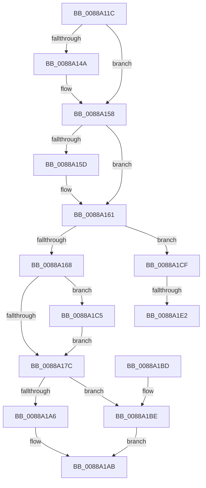

# AlpcpDeleteBlob

- RVA: `0x0088A11C`–`0x0088A1F0` (길이 `212` bytes)
- VA: `0x000000014088A11C`
- 실행 섹션: `PAGE`
- PDB 이름 있음: `예`; PDB Function 태그: `예`
- unwind 정보 RVA: `0x00069264`
- 디코드: `62`개 명령, `212/212` bytes 표시
- 미해석 바이트: `0` (있으면 어셈블리에 `.byte`로 보존)

> 이 문서는 커널 이미지의 기계어와 PDB 기호를 분석해 생성했습니다. 4번과 5번은 함수 원형과 자료형을 바이너리 사용 방식에서 추정한 C 해석이며 원본 소스 복구 결과는 아닙니다.

## 1. Dependencies

- 직접 호출 지점: **7**; 고유 호출 대상: **6**
- 직접 호출자로 확인된 함수: **10**
- RIP 상대 이미지 참조: **2**

### Outgoing calls
- `0x0088A13A` → [KeAbPreAcquire](../../text/21/KeAbPreAcquire_function_00210230.md) (function, `0x00210230`)
- `0x0088A153` → [ExfAcquirePushLockExclusiveEx](../../text/20/ExfAcquirePushLockExclusiveEx_function_0020FC90.md) (function, `0x0020FC90`)
- `0x0088A17F` → [KeAbPostRelease](../../text/2E/KeAbPostRelease_function_002E1600.md) (function, `0x002E1600`)
- `0x0088A1A6` → [AlpcSectionDeleteProcedure](AlpcSectionDeleteProcedure_function_0088A200.md) (function, `0x0088A200`)
- `0x0088A1BE` → [guard_dispatch_icall](../../text/6B/guard_dispatch_icall_function_006BAAD0.md) (function, `0x006BAAD0`)
- `0x0088A1C8` → [ExfTryToWakePushLock](../../text/26/ExfTryToWakePushLock_function_00265DD0.md) (function, `0x00265DD0`)
- `0x0088A1E5` → [ExfTryToWakePushLock](../../text/26/ExfTryToWakePushLock_function_00265DD0.md) (function, `0x00265DD0`)

### Direct callers
- [NtAlpcDeletePortSection](NtAlpcDeletePortSection_function_00888420.md) at `0x008884AC`
- [NtAlpcDeleteResourceReserve](NtAlpcDeleteResourceReserve_function_00888870.md) at `0x00888908`
- [NtAlpcDeleteSecurityContext](NtAlpcDeleteSecurityContext_function_00889E00.md) at `0x00889E92`
- [AlpcpDeleteView](AlpcpDeleteView_function_0088A26C.md) at `0x0088A275`
- [AlpcpCaptureSecurityAttribute](../89/AlpcpCaptureSecurityAttribute_function_00890540.md) at `0x00890882`
- [sub_008909EC](../89/Unknown_function_008909EC.md) at `0x00890B1D`
- [NtAlpcCreateSecurityContext](../89/NtAlpcCreateSecurityContext_function_00890B50.md) at `0x00890D6D`
- [NtAlpcCreatePortSection](../89/NtAlpcCreatePortSection_function_00893E60.md) at `0x0089400F`
- [AlpcpMapLegacyPortView](../92/AlpcpMapLegacyPortView_function_00921588.md) at `0x00921752`
- [AlpcpFlushResourcesPort](../92/AlpcpFlushResourcesPort_function_009253F4.md) at `0x009254CF`

### Static image references
- `0x0088A188` → RVA `0x00001450` (`.rdata`; read)
- `0x0088A193` → RVA `0x0088A200` (`AlpcSectionDeleteProcedure`; read)

## 2. Other-region calls and transfers

- 다른 실행 섹션으로 향하는 call: **6**
  - `0x0088A13A` → [KeAbPreAcquire](../../text/21/KeAbPreAcquire_function_00210230.md) (`PAGE` → `.text`)
  - `0x0088A153` → [ExfAcquirePushLockExclusiveEx](../../text/20/ExfAcquirePushLockExclusiveEx_function_0020FC90.md) (`PAGE` → `.text`)
  - `0x0088A17F` → [KeAbPostRelease](../../text/2E/KeAbPostRelease_function_002E1600.md) (`PAGE` → `.text`)
  - `0x0088A1BE` → [guard_dispatch_icall](../../text/6B/guard_dispatch_icall_function_006BAAD0.md) (`PAGE` → `.text`)
  - `0x0088A1C8` → [ExfTryToWakePushLock](../../text/26/ExfTryToWakePushLock_function_00265DD0.md) (`PAGE` → `.text`)
  - `0x0088A1E5` → [ExfTryToWakePushLock](../../text/26/ExfTryToWakePushLock_function_00265DD0.md) (`PAGE` → `.text`)
- call이 아닌 외부 분기/꼬리 이동: **2**
  - `0x0088A1DC` → [sub_00B19206](../B1/Unknown_function_00B19206.md) (`tail-transfer`)
  - `0x0088A1EB` → [sub_00B19206](../B1/Unknown_function_00B19206.md) (`tail-transfer`)

## 3. Assembly (complete function range)

```asm
0088A11C  48 89 5C 24 08                  mov qword ptr [rsp + 8], rbx
0088A121  48 89 74 24 10                  mov qword ptr [rsp + 0x10], rsi
0088A126  57                              push rdi
0088A127  48 83 EC 20                     sub rsp, 0x20
0088A12B  48 8D 59 F0                     lea rbx, [rcx - 0x10]
0088A12F  48 8B F9                        mov rdi, rcx
0088A132  48 8B CB                        mov rcx, rbx
0088A135  45 33 C0                        xor r8d, r8d
0088A138  33 D2                           xor edx, edx
0088A13A  E8 F1 60 98 FF                  call 0x140210230
0088A13F  F0 48 0F BA 2B 00               lock bts qword ptr [rbx], 0
0088A145  48 8B F0                        mov rsi, rax
0088A148  73 0E                           jae 0x14088a158
0088A14A  4C 8B C3                        mov r8, rbx
0088A14D  48 8B D0                        mov rdx, rax
0088A150  48 8B CB                        mov rcx, rbx
0088A153  E8 38 5B 98 FF                  call 0x14020fc90
0088A158  48 85 F6                        test rsi, rsi
0088A15B  74 04                           je 0x14088a161
0088A15D  C6 46 0A 01                     mov byte ptr [rsi + 0xa], 1
0088A161  8A 47 E0                        mov al, byte ptr [rdi - 0x20]
0088A164  A8 08                           test al, 8
0088A166  75 67                           jne 0x14088a1cf
0088A168  0C 08                           or al, 8
0088A16A  88 47 E0                        mov byte ptr [rdi - 0x20], al
0088A16D  48 83 C8 FF                     or rax, 0xffffffffffffffff
0088A171  F0 48 0F C1 03                  lock xadd qword ptr [rbx], rax
0088A176  24 06                           and al, 6
0088A178  3C 02                           cmp al, 2
0088A17A  74 49                           je 0x14088a1c5
0088A17C  48 8B CB                        mov rcx, rbx
0088A17F  E8 7C 74 A5 FF                  call 0x1402e1600
0088A184  0F B6 47 E1                     movzx eax, byte ptr [rdi - 0x1f]
0088A188  48 8D 0D C1 72 77 FF            lea rcx, [rip - 0x888d3f]
0088A18F  48 8B 04 C1                     mov rax, qword ptr [rcx + rax*8]
0088A193  48 8D 0D 66 00 00 00            lea rcx, [rip + 0x66]
0088A19A  48 8B 40 20                     mov rax, qword ptr [rax + 0x20]
0088A19E  48 3B C1                        cmp rax, rcx
0088A1A1  48 8B CF                        mov rcx, rdi
0088A1A4  75 18                           jne 0x14088a1be
0088A1A6  E8 55 00 00 00                  call 0x14088a200
0088A1AB  B0 01                           mov al, 1
0088A1AD  48 8B 5C 24 30                  mov rbx, qword ptr [rsp + 0x30]
0088A1B2  48 8B 74 24 38                  mov rsi, qword ptr [rsp + 0x38]
0088A1B7  48 83 C4 20                     add rsp, 0x20
0088A1BB  5F                              pop rdi
0088A1BC  C3                              ret
0088A1BD  CC                              int3
0088A1BE  E8 0D 09 E3 FF                  call 0x1406baad0
0088A1C3  EB E6                           jmp 0x14088a1ab
0088A1C5  48 8B CB                        mov rcx, rbx
0088A1C8  E8 03 BC 9D FF                  call 0x140265dd0
0088A1CD  EB AD                           jmp 0x14088a17c
0088A1CF  48 83 C8 FF                     or rax, 0xffffffffffffffff
0088A1D3  F0 48 0F C1 03                  lock xadd qword ptr [rbx], rax
0088A1D8  24 06                           and al, 6
0088A1DA  3C 02                           cmp al, 2
0088A1DC  0F 85 24 F0 28 00               jne 0x140b19206
0088A1E2  48 8B CB                        mov rcx, rbx
0088A1E5  E8 E6 BB 9D FF                  call 0x140265dd0
0088A1EA  90                              nop
0088A1EB  E9 16 F0 28 00                  jmp 0x140b19206
```

## 4. C-style interpretation (structured pseudocode)

```c
__int64 __fastcall AlpcpDeleteBlob(__int64 a1, int a2, int a3)
{
    __int64 result;
    __int64 v_rsp;
    unsigned __int64 v_stack_p10;
    unsigned __int64 v_stack_p8;

    v_stack_p8 = v_rbx;
    v_stack_p10 = v_rsi;
    v_rsp = (v_rsp) - (32);
    a3 = 0;
    a2 = 0;
    result = KeAbPreAcquire(a1 - 16, a2, a3, a4);
    if (!(condition_is_above_or_equal)) {
        a3 = a1 - 16;
        a2 = result;
        a1 = a1 - 16;
        result = ExfAcquirePushLockExclusiveEx(a1, a2, a3, a4);
    }
    if (result != 0) {
        *(unsigned __int8 *)(result + 10) = 1;
    }
    if ((((unsigned __int8)(*(unsigned __int8 *)(a1 - 32))) & (8)) != 0) goto loc_0088A1CF;
    result = (unsigned __int8)((*(unsigned __int8 *)(a1 - 32)) | (8));
    *(unsigned __int8 *)(a1 - 32) = (unsigned __int8)(result);
    result = (result) | (-1);
    result = (unsigned __int8)((result) & (6));
    if (((unsigned __int8)(result)) == 2) goto loc_0088A1C5;
loc_0088A17C:
    result = KeAbPostRelease(a1 - 16, a2, a3, a4);
    if ((*(unsigned __int64 *)(*(unsigned __int64 *)(v_rip - 8949055 + *(unsigned __int8 *)(a1 - 31) * 8) + 32)) != (v_rip + 102)) goto loc_0088A1BE;
    result = AlpcSectionDeleteProcedure(a1, a2, a3, a4);
loc_0088A1AB:
    v_rsp = (v_rsp) + (32);
    return 1;
loc_0088A1BE:
    result = guard_dispatch_icall(a1, a2, a3, a4);
    goto loc_0088A1AB;
loc_0088A1C5:
    result = ExfTryToWakePushLock(v_stack_p8, a2, a3, a4);
    goto loc_0088A17C;
loc_0088A1CF:
    result = (result) | (-1);
    result = (unsigned __int8)((result) & (6));
    result = ExfTryToWakePushLock(v_stack_p8, a2, a3, a4);
}
```

## 5. (Beta) C Style

```c
int64_t AlpcpDeleteBlob(void *Arg1, int32_t Arg2, int32_t Arg3)
{
    uint8_t *arg1 = (uint8_t *)Arg1;

    int64_t result;
    int64_t local_rsp;
    uint64_t v_stack_p10;
    uint64_t v_stack_p8;

    v_stack_p8 = local_rbx;
    v_stack_p10 = local_rsi;
    local_rsp = (local_rsp) - (32);
    Arg3 = 0;
    Arg2 = 0;
    result = KeAbPreAcquire(Arg1 - 16, Arg2, Arg3, a4);
    if (!(condition_is_above_or_equal)) {
        Arg3 = Arg1 - 16;
        Arg2 = result;
        Arg1 = Arg1 - 16;
        result = ExfAcquirePushLockExclusiveEx(Arg1, Arg2, Arg3, a4);
    }
    if (result != 0) {
        *(uint8_t *)(result + 0xA) = 1;
    }
    if ((((uint8_t)(*(uint8_t *)(arg1 - 0x20))) & (8)) != 0) goto loc_0088A1CF;
    result = (uint8_t)((*(uint8_t *)(arg1 - 0x20)) | (8));
    *(uint8_t *)(arg1 - 0x20) = (uint8_t)(result);
    result = (result) | (-1);
    result = (uint8_t)((result) & (6));
    if (((uint8_t)(result)) == 2) goto loc_0088A1C5;
loc_0088A17C:
    result = KeAbPostRelease(Arg1 - 16, Arg2, Arg3, a4);
    if ((*(uint64_t *)(*(uint64_t *)(v_rip - 0x888D3F + *(uint8_t *)(arg1 - 0x1F) * 8) + 0x20)) != (v_rip + 102)) goto loc_0088A1BE;
    result = AlpcSectionDeleteProcedure(Arg1, Arg2, Arg3, a4);
loc_0088A1AB:
    local_rsp = (local_rsp) + (32);
    return 1;
loc_0088A1BE:
    result = guard_dispatch_icall(Arg1, Arg2, Arg3, a4);
    goto loc_0088A1AB;
loc_0088A1C5:
    result = ExfTryToWakePushLock(v_stack_p8, Arg2, Arg3, a4);
    goto loc_0088A17C;
loc_0088A1CF:
    result = (result) | (-1);
    result = (uint8_t)((result) & (6));
    result = ExfTryToWakePushLock(v_stack_p8, Arg2, Arg3, a4);
}
```

### 관측된 메모리 오프셋

구조체 형식이 확인되지 않은 접근은 인자 기준의 오프셋으로만 기록했습니다.

| 기준 인자 | 오프셋 표현 | 폭 (bit) | 접근 |
|---|---:|---:|---|
| `Arg1` | `- 0x20` | `8` | `R` |
| `Arg1` | `- 0x20` | `8` | `W` |
| `Arg1` | `- 0x1F` | `8` | `R` |
| `Arg1` | `- 0x10` | `64` | `R` |
| `Arg1` | `+ 0x0` | `64` | `R/W` |

## 6. Execution-region graph

[열기: 2D/3D 그래프와 함수 탐색 컨트롤 패널](../../../control-panel.html?section=page&rva=0x0088A11C&view=graph)

- 2D 그래프는 위에서 아래로 흐르고, 3D 그래프는 빈 공간을 드래그해 회전합니다. Shift+드래그는 이동, 휠은 확대·축소, 함수 노드 선택은 대상 보고서 이동입니다.

### Static fallback


