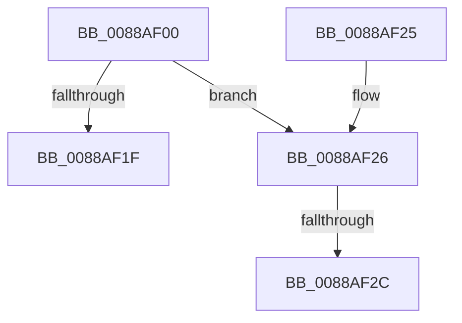

# AlpcpDereferenceBlobEx

- RVA: `0x0088AF00`–`0x0088AF37` (길이 `55` bytes)
- VA: `0x000000014088AF00`
- 실행 섹션: `PAGE`
- PDB 이름 있음: `예`; PDB Function 태그: `아니요`
- unwind 정보 RVA: `0x0007D174`
- 디코드: `17`개 명령, `55/55` bytes 표시
- 미해석 바이트: `0` (있으면 어셈블리에 `.byte`로 보존)

> 이 문서는 커널 이미지의 기계어와 PDB 기호를 분석해 생성했습니다. 4번과 5번은 함수 원형과 자료형을 바이너리 사용 방식에서 추정한 C 해석이며 원본 소스 복구 결과는 아닙니다.

## 1. Dependencies

- 직접 호출 지점: **0**; 고유 호출 대상: **0**
- 직접 호출자로 확인된 함수: **48**
- RIP 상대 이미지 참조: **1**

### Outgoing calls
- 직접 디코드된 call 명령이 없습니다.

### Direct callers
- [NtAlpcRevokeSecurityContext](../74/NtAlpcRevokeSecurityContext_function_0074C400.md) at `0x0074C4D4`
- [AlpcpForceUnlinkSecureView](../74/AlpcpForceUnlinkSecureView_function_0074C604.md) at `0x0074C6A1`
- [NtAlpcDeletePortSection](NtAlpcDeletePortSection_function_00888420.md) at `0x008884BD`
- [NtAlpcDeletePortSection](NtAlpcDeletePortSection_function_00888420.md) at `0x008884CA`
- [AlpcpCreateSectionView](AlpcpCreateSectionView_function_0088850C.md) at `0x008885FA`
- [NtAlpcCreateSectionView](NtAlpcCreateSectionView_function_00888640.md) at `0x008887F4`
- [NtAlpcCreateSectionView](NtAlpcCreateSectionView_function_00888640.md) at `0x00888801`
- [NtAlpcDeleteResourceReserve](NtAlpcDeleteResourceReserve_function_00888870.md) at `0x00888919`
- [NtAlpcDeleteResourceReserve](NtAlpcDeleteResourceReserve_function_00888870.md) at `0x00888926`
- [AlpcpCaptureViewAttribute](AlpcpCaptureViewAttribute_function_0088957C.md) at `0x00889635`
- [AlpcpCaptureViewAttribute](AlpcpCaptureViewAttribute_function_0088957C.md) at `0x008896F3`
- [AlpcpCaptureViewAttribute](AlpcpCaptureViewAttribute_function_0088957C.md) at `0x00889747`
- [AlpcpLocateSectionView](AlpcpLocateSectionView_function_00889754.md) at `0x008898C8`
- [AlpcpPrepareViewForDelivery](AlpcpPrepareViewForDelivery_function_00889A44.md) at `0x00889B89`
- [sub_00889BDC](Unknown_function_00889BDC.md) at `0x00889C11`
- [AlpcpCaptureViewAttributeInternal](AlpcpCaptureViewAttributeInternal_function_00889C6C.md) at `0x00889CE0`
- [AlpcpCaptureViewAttributeInternal](AlpcpCaptureViewAttributeInternal_function_00889C6C.md) at `0x00889D93`
- [AlpcpCaptureViewAttributeInternal](AlpcpCaptureViewAttributeInternal_function_00889C6C.md) at `0x00889DE5`
- [NtAlpcDeleteSecurityContext](NtAlpcDeleteSecurityContext_function_00889E00.md) at `0x00889EA3`
- [NtAlpcDeleteSecurityContext](NtAlpcDeleteSecurityContext_function_00889E00.md) at `0x00889EB0`
- [AlpcpDeleteView](AlpcpDeleteView_function_0088A26C.md) at `0x0088A286`
- [AlpcpCreateView](AlpcpCreateView_function_0088A9B8.md) at `0x0088AD96`
- [AlpcViewDestroyProcedure](AlpcViewDestroyProcedure_function_0088B080.md) at `0x0088B222`
- [AlpcViewDestroyProcedure](AlpcViewDestroyProcedure_function_0088B080.md) at `0x0088B230`
- [AlpcpSendMessage](AlpcpSendMessage_function_0088BD40.md) at `0x0088CBFA`
- [AlpcpReleaseAttributes](AlpcpReleaseAttributes_function_0088D750.md) at `0x0088D76E`
- [AlpcpReleaseAttributes](AlpcpReleaseAttributes_function_0088D750.md) at `0x0088D7B6`
- [AlpcpExposeViewAttributeInSenderContext](AlpcpExposeViewAttributeInSenderContext_function_0088F600.md) at `0x0088F727`
- [AlpcpExposeViewAttributeInSenderContext](AlpcpExposeViewAttributeInSenderContext_function_0088F600.md) at `0x0088F7B6`
- [AlpcpCaptureSecurityAttribute](../89/AlpcpCaptureSecurityAttribute_function_00890540.md) at `0x00890870`
- [AlpcpCaptureSecurityAttribute](../89/AlpcpCaptureSecurityAttribute_function_00890540.md) at `0x00890897`
- [sub_008909EC](../89/Unknown_function_008909EC.md) at `0x00890B0B`
- [sub_008909EC](../89/Unknown_function_008909EC.md) at `0x00890B32`
- [NtAlpcCreateSecurityContext](../89/NtAlpcCreateSecurityContext_function_00890B50.md) at `0x00890CCE`
- [NtAlpcCreateSecurityContext](../89/NtAlpcCreateSecurityContext_function_00890B50.md) at `0x00890D82`
- [AlpcpCreateSecurityContext](../89/AlpcpCreateSecurityContext_function_00890D94.md) at `0x00891116`
- [AlpcpCreateReserve](../89/AlpcpCreateReserve_function_00892318.md) at `0x00892448`
- [AlpcpCaptureHandleAttributeInternal](../89/AlpcpCaptureHandleAttributeInternal_function_00892CDC.md) at `0x00892FD2`
- [AlpcpCreateSection](../89/AlpcpCreateSection_function_0089307C.md) at `0x00893319`
- [NtAlpcCreatePortSection](../89/NtAlpcCreatePortSection_function_00893E60.md) at `0x00893FAE`
- [NtAlpcCreatePortSection](../89/NtAlpcCreatePortSection_function_00893E60.md) at `0x00894020`
- [AlpcpReleaseMessageAttributesOnCancel](../89/AlpcpReleaseMessageAttributesOnCancel_function_00894030.md) at `0x0089404A`
- [AlpcpReleaseMessageAttributesOnCancel](../89/AlpcpReleaseMessageAttributesOnCancel_function_00894030.md) at `0x00894074`
- [sub_00895B6D](../89/Unknown_function_00895B6D.md) at `0x00895D88`
- [NtAlpcImpersonateClientOfPort](../89/NtAlpcImpersonateClientOfPort_function_008961A0.md) at `0x008966FF`
- [sub_00896999](../89/Unknown_function_00896999.md) at `0x00896AE1`
- [AlpcpMapLegacyPortView](../92/AlpcpMapLegacyPortView_function_00921588.md) at `0x0092170A`
- [AlpcpMapLegacyPortView](../92/AlpcpMapLegacyPortView_function_00921588.md) at `0x00921763`
- [NtSecureConnectPort](../92/NtSecureConnectPort_function_00922F20.md) at `0x00923411`
- [AlpcConnectionDestroyProcedure](../92/AlpcConnectionDestroyProcedure_function_00924310.md) at `0x0092441B`
- [AlpcpDeletePort](../92/AlpcpDeletePort_function_00925010.md) at `0x0092509C`
- [AlpcpDeletePort](../92/AlpcpDeletePort_function_00925010.md) at `0x00925108`
- [AlpcpFlushResourcesPort](../92/AlpcpFlushResourcesPort_function_009253F4.md) at `0x009254E0`
- [AlpcpFlushResourcesPort](../92/AlpcpFlushResourcesPort_function_009253F4.md) at `0x009254ED`
- [AlpcpExposeHandleAttribute](../9C/AlpcpExposeHandleAttribute_function_009CAE60.md) at `0x009CAF80`
- [AlpcpFlushCancelQueue](../A2/AlpcpFlushCancelQueue_function_00A270CC.md) at `0x00A271A5`
- [NtAlpcDeleteSectionView](../A2/NtAlpcDeleteSectionView_function_00A2F240.md) at `0x00A2F34F`
- [AlpcRegionDestroyProcedure](../A3/AlpcRegionDestroyProcedure_function_00A30540.md) at `0x00A30581`
- [AlpcpReleaseViewAttribute](../A6/AlpcpReleaseViewAttribute_function_00A63A80.md) at `0x00A63AB0`
- [AlpcCreateSecurityContext](../A7/AlpcCreateSecurityContext_function_00A70930.md) at `0x00A709D5`
- [sub_00B19294](../B1/Unknown_function_00B19294.md) at `0x00B1934F`
- [sub_00B19294](../B1/Unknown_function_00B19294.md) at `0x00B193B4`
- [sub_00B193E8](../B1/Unknown_function_00B193E8.md) at `0x00B193F0`
- [sub_00B193FE](../B1/Unknown_function_00B193FE.md) at `0x00B19406`
- [sub_00B19414](../B1/Unknown_function_00B19414.md) at `0x00B1942F`
- [sub_00B194AC](../B1/Unknown_function_00B194AC.md) at `0x00B194C8`
- [sub_00B195F6](../B1/Unknown_function_00B195F6.md) at `0x00B19612`
- [sub_00B20EEE](../B2/Unknown_function_00B20EEE.md) at `0x00B20FF4`

### Static image references
- `0x0088AF30` → RVA `0x0088BBA0` (`AlpcMessageCleanupProcedure`; read)

## 2. Other-region calls and transfers

- 다른 실행 섹션으로 향하는 call: **0**
- call이 아닌 외부 분기/꼬리 이동: **1**
  - `0x0088AF26` → [sub_0088B059](Unknown_function_0088B059.md) (`tail-transfer`)

## 3. Assembly (complete function range)

```asm
0088AF00  40 53                           push rbx
0088AF02  48 83 EC 30                     sub rsp, 0x30
0088AF06  F7 DA                           neg edx
0088AF08  48 8B D9                        mov rbx, rcx
0088AF0B  4C 63 C2                        movsxd r8, edx
0088AF0E  49 8B C0                        mov rax, r8
0088AF11  F0 48 0F C1 41 E8               lock xadd qword ptr [rcx - 0x18], rax
0088AF17  49 03 C0                        add rax, r8
0088AF1A  48 85 C0                        test rax, rax
0088AF1D  7E 07                           jle 0x14088af26
0088AF1F  48 83 C4 30                     add rsp, 0x30
0088AF23  5B                              pop rbx
0088AF24  C3                              ret
0088AF25  CC                              int3
0088AF26  0F 85 2D 01 00 00               jne 0x14088b059
0088AF2C  0F B6 41 E1                     movzx eax, byte ptr [rcx - 0x1f]
0088AF30  48 8D 0D 69 0C 00 00            lea rcx, [rip + 0xc69]
```

## 4. C-style interpretation (structured pseudocode)

```c
__int64 __fastcall AlpcpDereferenceBlobEx(__int64 a1, int a2)
{
    __int64 result;
    __int64 v_rsp;

    v_rsp = (v_rsp) - (48);
    a2 = (unsigned int)(-(a2));
    result = ((int)(a2)) + ((int)(a2));
    if (condition_is_less_or_equal) goto loc_0088AF26;
    v_rsp = (v_rsp) + (48);
    return result;
loc_0088AF26:
    return *(unsigned __int8 *)(a1 - 31);
}
```

## 5. (Beta) C Style

```c
int64_t AlpcpDereferenceBlobEx(void *Arg1, int32_t Arg2)
{
    uint8_t *arg1 = (uint8_t *)Arg1;

    int64_t result;
    int64_t local_rsp;

    local_rsp = (local_rsp) - (48);
    Arg2 = (uint32_t)(-(Arg2));
    result = ((int32_t)(Arg2)) + ((int32_t)(Arg2));
    if (condition_is_less_or_equal) goto loc_0088AF26;
    local_rsp = (local_rsp) + (48);
    return result;
loc_0088AF26:
    return *(uint8_t *)(arg1 - 0x1F);
}
```

### 관측된 메모리 오프셋

구조체 형식이 확인되지 않은 접근은 인자 기준의 오프셋으로만 기록했습니다.

| 기준 인자 | 오프셋 표현 | 폭 (bit) | 접근 |
|---|---:|---:|---|
| `Arg1` | `- 0x1F` | `8` | `R` |
| `Arg1` | `- 0x18` | `64` | `R/W` |

## 6. Execution-region graph

[열기: 2D/3D 그래프와 함수 탐색 컨트롤 패널](../../../control-panel.html?section=page&rva=0x0088AF00&view=graph)

- 2D 그래프는 위에서 아래로 흐르고, 3D 그래프는 빈 공간을 드래그해 회전합니다. Shift+드래그는 이동, 휠은 확대·축소, 함수 노드 선택은 대상 보고서 이동입니다.

### Static fallback


