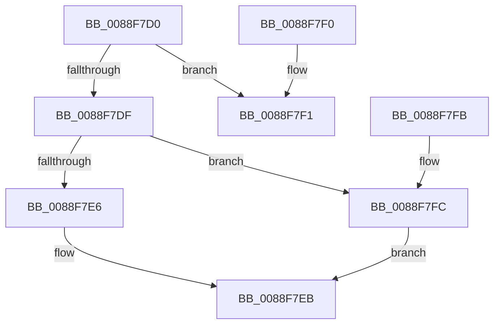

# AlpcpDispatchMessage

- RVA: `0x0088F7D0`–`0x0088F803` (길이 `51` bytes)
- VA: `0x000000014088F7D0`
- 실행 섹션: `PAGE`
- PDB 이름 있음: `예`; PDB Function 태그: `아니요`
- unwind 정보 RVA: `0x0007D604`
- 디코드: `16`개 명령, `51/51` bytes 표시
- 미해석 바이트: `0` (있으면 어셈블리에 `.byte`로 보존)

> 이 문서는 커널 이미지의 기계어와 PDB 기호를 분석해 생성했습니다. 4번과 5번은 함수 원형과 자료형을 바이너리 사용 방식에서 추정한 C 해석이며 원본 소스 복구 결과는 아닙니다.

## 1. Dependencies

- 직접 호출 지점: **3**; 고유 호출 대상: **3**
- 직접 호출자로 확인된 함수: **1**
- RIP 상대 이미지 참조: **0**

### Outgoing calls
- `0x0088F7E6` → [AlpcpDispatchReplyToWaitingThread](AlpcpDispatchReplyToWaitingThread_function_0088D7F0.md) (function, `0x0088D7F0`)
- `0x0088F7F1` → [AlpcpDispatchNewMessage](AlpcpDispatchNewMessage_function_0088DD20.md) (function, `0x0088DD20`)
- `0x0088F7FC` → [AlpcpDispatchReplyToPort](AlpcpDispatchReplyToPort_function_0088F880.md) (function, `0x0088F880`)

### Direct callers
- [AlpcpAcceptConnectPort](../A3/AlpcpAcceptConnectPort_function_00A34290.md) at `0x00A34CE6`

### Static image references
- 디코드된 RIP-relative 메모리 참조가 없습니다.

## 2. Other-region calls and transfers

- 다른 실행 섹션으로 향하는 call: **0**
- 별도 외부 분기/꼬리 이동을 확인하지 못했습니다.

## 3. Assembly (complete function range)

```asm
0088F7D0  48 83 EC 28                     sub rsp, 0x28
0088F7D4  48 8B 41 08                     mov rax, qword ptr [rcx + 8]
0088F7D8  48 83 78 18 00                  cmp qword ptr [rax + 0x18], 0
0088F7DD  74 12                           je 0x14088f7f1
0088F7DF  48 83 78 20 00                  cmp qword ptr [rax + 0x20], 0
0088F7E4  74 16                           je 0x14088f7fc
0088F7E6  E8 05 E0 FF FF                  call 0x14088d7f0
0088F7EB  48 83 C4 28                     add rsp, 0x28
0088F7EF  C3                              ret
0088F7F0  CC                              int3
0088F7F1  E8 2A E5 FF FF                  call 0x14088dd20
0088F7F6  48 83 C4 28                     add rsp, 0x28
0088F7FA  C3                              ret
0088F7FB  CC                              int3
0088F7FC  E8 7F 00 00 00                  call 0x14088f880
0088F801  EB E8                           jmp 0x14088f7eb
```

## 4. C-style interpretation (structured pseudocode)

```c
__int64 __fastcall AlpcpDispatchMessage(__int64 a1)
{
    __int64 result;
    __int64 v_rsp;

    v_rsp = (v_rsp) - (40);
    if ((*(unsigned __int64 *)(*(unsigned __int64 *)(a1 + 8) + 24)) == 0) goto loc_0088F7F1;
    if ((*(unsigned __int64 *)(*(unsigned __int64 *)(a1 + 8) + 32)) == 0) goto loc_0088F7FC;
    result = AlpcpDispatchReplyToWaitingThread(a1, a2, a3, a4);
loc_0088F7EB:
    v_rsp = (v_rsp) + (40);
    return result;
loc_0088F7F1:
    result = AlpcpDispatchNewMessage(a1, a2, a3, a4);
    v_rsp = (v_rsp) + (40);
    return result;
loc_0088F7FC:
    result = AlpcpDispatchReplyToPort(a1, a2, a3, a4);
    goto loc_0088F7EB;
}
```

## 5. (Beta) C Style

```c
int64_t AlpcpDispatchMessage(void *Arg1)
{
    uint8_t *arg1 = (uint8_t *)Arg1;

    int64_t result;
    int64_t local_rsp;

    local_rsp = (local_rsp) - (40);
    if ((*(uint64_t *)(*(uint64_t *)(arg1 + 0x8) + 0x18)) == 0) goto loc_0088F7F1;
    if ((*(uint64_t *)(*(uint64_t *)(arg1 + 0x8) + 0x20)) == 0) goto loc_0088F7FC;
    result = AlpcpDispatchReplyToWaitingThread(Arg1, a2, a3, a4);
loc_0088F7EB:
    local_rsp = (local_rsp) + (40);
    return result;
loc_0088F7F1:
    result = AlpcpDispatchNewMessage(Arg1, a2, a3, a4);
    local_rsp = (local_rsp) + (40);
    return result;
loc_0088F7FC:
    result = AlpcpDispatchReplyToPort(Arg1, a2, a3, a4);
    goto loc_0088F7EB;
}
```

### 관측된 메모리 오프셋

구조체 형식이 확인되지 않은 접근은 인자 기준의 오프셋으로만 기록했습니다.

| 기준 인자 | 오프셋 표현 | 폭 (bit) | 접근 |
|---|---:|---:|---|
| `Arg1` | `+ 0x8` | `64` | `R` |

## 6. Execution-region graph

[열기: 2D/3D 그래프와 함수 탐색 컨트롤 패널](../../../control-panel.html?section=page&rva=0x0088F7D0&view=graph)

- 2D 그래프는 위에서 아래로 흐르고, 3D 그래프는 빈 공간을 드래그해 회전합니다. Shift+드래그는 이동, 휠은 확대·축소, 함수 노드 선택은 대상 보고서 이동입니다.

### Static fallback


