# AlpcpDispatchNewMessage

- RVA: `0x0088DD20`–`0x0088E134` (길이 `1,044` bytes)
- VA: `0x000000014088DD20`
- 실행 섹션: `PAGE`
- PDB 이름 있음: `예`; PDB Function 태그: `예`
- unwind 정보 RVA: `0x0007D500`
- 디코드: `244`개 명령, `1,044/1,044` bytes 표시
- 미해석 바이트: `0` (있으면 어셈블리에 `.byte`로 보존)

> 이 문서는 커널 이미지의 기계어와 PDB 기호를 분석해 생성했습니다. 4번과 5번은 함수 원형과 자료형을 바이너리 사용 방식에서 추정한 C 해석이며 원본 소스 복구 결과는 아닙니다.

## 1. Dependencies

- 직접 호출 지점: **24**; 고유 호출 대상: **10**
- 직접 호출자로 확인된 함수: **2**
- RIP 상대 이미지 참조: **0**

### Outgoing calls
- `0x0088DD7C` → [KeAbPreAcquire](../../text/21/KeAbPreAcquire_function_00210230.md) (function, `0x00210230`)
- `0x0088DDA3` → [ExfAcquirePushLockSharedEx](../../text/21/ExfAcquirePushLockSharedEx_function_0021044C.md) (function, `0x0021044C`)
- `0x0088DDCB` → [ObReferenceObjectSafe](../../text/41/ObReferenceObjectSafe_function_0041DAE0.md) (function, `0x0041DAE0`)
- `0x0088DDE0` → [ObReferenceObjectSafe](../../text/41/ObReferenceObjectSafe_function_0041DAE0.md) (function, `0x0041DAE0`)
- `0x0088DE0B` → [KeAbPreAcquire](../../text/21/KeAbPreAcquire_function_00210230.md) (function, `0x00210230`)
- `0x0088DE38` → [ExfAcquirePushLockSharedEx](../../text/21/ExfAcquirePushLockSharedEx_function_0021044C.md) (function, `0x0021044C`)
- `0x0088DE58` → [KeAbPreAcquire](../../text/21/KeAbPreAcquire_function_00210230.md) (function, `0x00210230`)
- `0x0088DE85` → [ExfAcquirePushLockSharedEx](../../text/21/ExfAcquirePushLockSharedEx_function_0021044C.md) (function, `0x0021044C`)
- `0x0088DF6C` → [ObfReferenceObject](../../text/20/ObfReferenceObject_function_0020FA20.md) (function, `0x0020FA20`)
- `0x0088DFC6` → [ExfReleasePushLockShared](../../text/26/ExfReleasePushLockShared_function_00263440.md) (function, `0x00263440`)
- `0x0088DFD2` → [KeAbPostRelease](../../text/2E/KeAbPostRelease_function_002E1600.md) (function, `0x002E1600`)
- `0x0088E003` → [AlpcpCompleteDispatchMessage](AlpcpCompleteDispatchMessage_function_0088E140.md) (function, `0x0088E140`)
- `0x0088E00B` → [ObfDereferenceObject](../../text/2F/ObfDereferenceObject_function_002F9350.md) (function, `0x002F9350`)
- `0x0088E06D` → [KeAbPostRelease](../../text/2E/KeAbPostRelease_function_002E1600.md) (function, `0x002E1600`)
- `0x0088E07A` → [ObfDereferenceObject](../../text/2F/ObfDereferenceObject_function_002F9350.md) (function, `0x002F9350`)
- `0x0088E08B` → [AlpcpUnlockMessage](../89/AlpcpUnlockMessage_function_00897AE0.md) (function, `0x00897AE0`)
- `0x0088E0A3` → [AlpcpUnlockAndDereferenceTargetPortsAndCommunicationInfo](AlpcpUnlockAndDereferenceTargetPortsAndCommunicationInfo_function_0088FE2C.md) (function, `0x0088FE2C`)
- `0x0088E0AB` → [AlpcpUnlockMessage](../89/AlpcpUnlockMessage_function_00897AE0.md) (function, `0x00897AE0`)
- `0x0088E0BF` → [ExfReleasePushLockShared](../../text/26/ExfReleasePushLockShared_function_00263440.md) (function, `0x00263440`)
- `0x0088E0E0` → [AlpcpUnlockAndDereferenceTargetPortsAndCommunicationInfo](AlpcpUnlockAndDereferenceTargetPortsAndCommunicationInfo_function_0088FE2C.md) (function, `0x0088FE2C`)
- `0x0088E0E8` → [AlpcpUnlockMessage](../89/AlpcpUnlockMessage_function_00897AE0.md) (function, `0x00897AE0`)
- `0x0088E110` → [AlpcpUnlockAndDereferenceTargetPortsAndCommunicationInfo](AlpcpUnlockAndDereferenceTargetPortsAndCommunicationInfo_function_0088FE2C.md) (function, `0x0088FE2C`)
- `0x0088E118` → [AlpcpUnlockMessage](../89/AlpcpUnlockMessage_function_00897AE0.md) (function, `0x00897AE0`)
- `0x0088E12A` → [ObfDereferenceObject](../../text/2F/ObfDereferenceObject_function_002F9350.md) (function, `0x002F9350`)

### Direct callers
- [AlpcpSendMessage](AlpcpSendMessage_function_0088BD40.md) at `0x0088C6AC`
- [AlpcpDispatchMessage](AlpcpDispatchMessage_function_0088F7D0.md) at `0x0088F7F1`

### Static image references
- 디코드된 RIP-relative 메모리 참조가 없습니다.

## 2. Other-region calls and transfers

- 다른 실행 섹션으로 향하는 call: **16**
  - `0x0088DD7C` → [KeAbPreAcquire](../../text/21/KeAbPreAcquire_function_00210230.md) (`PAGE` → `.text`)
  - `0x0088DDA3` → [ExfAcquirePushLockSharedEx](../../text/21/ExfAcquirePushLockSharedEx_function_0021044C.md) (`PAGE` → `.text`)
  - `0x0088DDCB` → [ObReferenceObjectSafe](../../text/41/ObReferenceObjectSafe_function_0041DAE0.md) (`PAGE` → `.text`)
  - `0x0088DDE0` → [ObReferenceObjectSafe](../../text/41/ObReferenceObjectSafe_function_0041DAE0.md) (`PAGE` → `.text`)
  - `0x0088DE0B` → [KeAbPreAcquire](../../text/21/KeAbPreAcquire_function_00210230.md) (`PAGE` → `.text`)
  - `0x0088DE38` → [ExfAcquirePushLockSharedEx](../../text/21/ExfAcquirePushLockSharedEx_function_0021044C.md) (`PAGE` → `.text`)
  - `0x0088DE58` → [KeAbPreAcquire](../../text/21/KeAbPreAcquire_function_00210230.md) (`PAGE` → `.text`)
  - `0x0088DE85` → [ExfAcquirePushLockSharedEx](../../text/21/ExfAcquirePushLockSharedEx_function_0021044C.md) (`PAGE` → `.text`)
  - `0x0088DF6C` → [ObfReferenceObject](../../text/20/ObfReferenceObject_function_0020FA20.md) (`PAGE` → `.text`)
  - `0x0088DFC6` → [ExfReleasePushLockShared](../../text/26/ExfReleasePushLockShared_function_00263440.md) (`PAGE` → `.text`)
  - `0x0088DFD2` → [KeAbPostRelease](../../text/2E/KeAbPostRelease_function_002E1600.md) (`PAGE` → `.text`)
  - `0x0088E00B` → [ObfDereferenceObject](../../text/2F/ObfDereferenceObject_function_002F9350.md) (`PAGE` → `.text`)
  - `0x0088E06D` → [KeAbPostRelease](../../text/2E/KeAbPostRelease_function_002E1600.md) (`PAGE` → `.text`)
  - `0x0088E07A` → [ObfDereferenceObject](../../text/2F/ObfDereferenceObject_function_002F9350.md) (`PAGE` → `.text`)
  - `0x0088E0BF` → [ExfReleasePushLockShared](../../text/26/ExfReleasePushLockShared_function_00263440.md) (`PAGE` → `.text`)
  - `0x0088E12A` → [ObfDereferenceObject](../../text/2F/ObfDereferenceObject_function_002F9350.md) (`PAGE` → `.text`)
- call이 아닌 외부 분기/꼬리 이동: **1**
  - `0x0088DECC` → [sub_00B19216](../B1/Unknown_function_00B19216.md) (`tail-transfer`)

## 3. Assembly (complete function range)

```asm
0088DD20  48 89 5C 24 20                  mov qword ptr [rsp + 0x20], rbx
0088DD25  55                              push rbp
0088DD26  56                              push rsi
0088DD27  57                              push rdi
0088DD28  41 54                           push r12
0088DD2A  41 55                           push r13
0088DD2C  41 56                           push r14
0088DD2E  41 57                           push r15
0088DD30  48 83 EC 20                     sub rsp, 0x20
0088DD34  4C 8B 29                        mov r13, qword ptr [rcx]
0088DD37  45 33 FF                        xor r15d, r15d
0088DD3A  8B 41 30                        mov eax, dword ptr [rcx + 0x30]
0088DD3D  4C 8B F1                        mov r14, rcx
0088DD40  48 8B 79 08                     mov rdi, qword ptr [rcx + 8]
0088DD44  45 33 C0                        xor r8d, r8d
0088DD47  4C 89 79 20                     mov qword ptr [rcx + 0x20], r15
0088DD4B  33 D2                           xor edx, edx
0088DD4D  4C 89 79 18                     mov qword ptr [rcx + 0x18], r15
0088DD51  4C 89 79 28                     mov qword ptr [rcx + 0x28], r15
0088DD55  4D 8B 65 10                     mov r12, qword ptr [r13 + 0x10]
0088DD59  89 44 24 60                     mov dword ptr [rsp + 0x60], eax
0088DD5D  65 48 8B 04 25 88 01 00 00      mov rax, qword ptr gs:[0x188]
0088DD66  41 8B AD A0 01 00 00            mov ebp, dword ptr [r13 + 0x1a0]
0088DD6D  D1 ED                           shr ebp, 1
0088DD6F  49 8D 4C 24 F0                  lea rcx, [r12 - 0x10]
0088DD74  48 89 44 24 68                  mov qword ptr [rsp + 0x68], rax
0088DD79  83 E5 03                        and ebp, 3
0088DD7C  E8 AF 24 98 FF                  call 0x140210230
0088DD81  48 8B F0                        mov rsi, rax
0088DD84  B9 11 00 00 00                  mov ecx, 0x11
0088DD89  33 C0                           xor eax, eax
0088DD8B  F0 49 0F B1 4C 24 F0            lock cmpxchg qword ptr [r12 - 0x10], rcx
0088DD92  74 14                           je 0x14088dda8
0088DD94  4D 8D 4C 24 F0                  lea r9, [r12 - 0x10]
0088DD99  4C 8B C6                        mov r8, rsi
0088DD9C  33 D2                           xor edx, edx
0088DD9E  49 8D 4C 24 F0                  lea rcx, [r12 - 0x10]
0088DDA3  E8 A4 26 98 FF                  call 0x14021044c
0088DDA8  48 85 F6                        test rsi, rsi
0088DDAB  74 04                           je 0x14088ddb1
0088DDAD  C6 46 0A 01                     mov byte ptr [rsi + 0xa], 1
0088DDB1  83 FD 02                        cmp ebp, 2
0088DDB4  0F 85 6E 02 00 00               jne 0x14088e028
0088DDBA  49 8B 1C 24                     mov rbx, qword ptr [r12]
0088DDBE  49 8B 74 24 08                  mov rsi, qword ptr [r12 + 8]
0088DDC3  48 85 DB                        test rbx, rbx
0088DDC6  74 10                           je 0x14088ddd8
0088DDC8  48 8B CB                        mov rcx, rbx
0088DDCB  E8 10 FD B8 FF                  call 0x14041dae0
0088DDD0  84 C0                           test al, al
0088DDD2  0F 84 1F 03 00 00               je 0x14088e0f7
0088DDD8  48 85 F6                        test rsi, rsi
0088DDDB  74 10                           je 0x14088dded
0088DDDD  48 8B CE                        mov rcx, rsi
0088DDE0  E8 FB FC B8 FF                  call 0x14041dae0
0088DDE5  84 C0                           test al, al
0088DDE7  0F 84 12 03 00 00               je 0x14088e0ff
0088DDED  48 85 DB                        test rbx, rbx
0088DDF0  0F 84 64 02 00 00               je 0x14088e05a
0088DDF6  48 85 F6                        test rsi, rsi
0088DDF9  0F 84 5B 02 00 00               je 0x14088e05a
0088DDFF  45 33 C0                        xor r8d, r8d
0088DE02  48 8D 8B 60 01 00 00            lea rcx, [rbx + 0x160]
0088DE09  33 D2                           xor edx, edx
0088DE0B  E8 20 24 98 FF                  call 0x140210230
0088DE10  4C 8B F8                        mov r15, rax
0088DE13  B9 11 00 00 00                  mov ecx, 0x11
0088DE18  33 C0                           xor eax, eax
0088DE1A  F0 48 0F B1 8B 60 01 00 00      lock cmpxchg qword ptr [rbx + 0x160], rcx
0088DE23  74 18                           je 0x14088de3d
0088DE25  4C 8D 8B 60 01 00 00            lea r9, [rbx + 0x160]
0088DE2C  4D 8B C7                        mov r8, r15
0088DE2F  33 D2                           xor edx, edx
0088DE31  48 8D 8B 60 01 00 00            lea rcx, [rbx + 0x160]
0088DE38  E8 0F 26 98 FF                  call 0x14021044c
0088DE3D  4D 85 FF                        test r15, r15
0088DE40  74 05                           je 0x14088de47
0088DE42  41 C6 47 0A 01                  mov byte ptr [r15 + 0xa], 1
0088DE47  48 3B F3                        cmp rsi, rbx
0088DE4A  74 48                           je 0x14088de94
0088DE4C  45 33 C0                        xor r8d, r8d
0088DE4F  48 8D 8E 60 01 00 00            lea rcx, [rsi + 0x160]
0088DE56  33 D2                           xor edx, edx
0088DE58  E8 D3 23 98 FF                  call 0x140210230
0088DE5D  4C 8B F8                        mov r15, rax
0088DE60  B9 11 00 00 00                  mov ecx, 0x11
0088DE65  33 C0                           xor eax, eax
0088DE67  F0 48 0F B1 8E 60 01 00 00      lock cmpxchg qword ptr [rsi + 0x160], rcx
0088DE70  74 18                           je 0x14088de8a
0088DE72  4C 8D 8E 60 01 00 00            lea r9, [rsi + 0x160]
0088DE79  4D 8B C7                        mov r8, r15
0088DE7C  33 D2                           xor edx, edx
0088DE7E  48 8D 8E 60 01 00 00            lea rcx, [rsi + 0x160]
0088DE85  E8 C2 25 98 FF                  call 0x14021044c
0088DE8A  4D 85 FF                        test r15, r15
0088DE8D  74 05                           je 0x14088de94
0088DE8F  41 C6 47 0A 01                  mov byte ptr [r15 + 0xa], 1
0088DE94  8B 83 A0 01 00 00               mov eax, dword ptr [rbx + 0x1a0]
0088DE9A  A8 20                           test al, 0x20
0088DE9C  0F 85 35 02 00 00               jne 0x14088e0d7
0088DEA2  8B 86 A0 01 00 00               mov eax, dword ptr [rsi + 0x1a0]
0088DEA8  A8 20                           test al, 0x20
0088DEAA  0F 85 27 02 00 00               jne 0x14088e0d7
0088DEB0  41 8B 85 A0 01 00 00            mov eax, dword ptr [r13 + 0x1a0]
0088DEB7  A8 20                           test al, 0x20
0088DEB9  0F 85 07 02 00 00               jne 0x14088e0c6
0088DEBF  49 8B 06                        mov rax, qword ptr [r14]
0088DEC2  F7 80 00 01 00 00 00 00 80 00   test dword ptr [rax + 0x100], 0x800000
0088DECC  0F 85 44 B3 28 00               jne 0x140b19216
0088DED2  F7 83 00 01 00 00 00 00 02 00   test dword ptr [rbx + 0x100], 0x20000
0088DEDC  0F 84 B8 01 00 00               je 0x14088e09a
0088DEE2  41 0F B7 46 34                  movzx eax, word ptr [r14 + 0x34]
0088DEE7  48 3B 83 10 01 00 00            cmp rax, qword ptr [rbx + 0x110]
0088DEEE  0F 87 13 02 00 00               ja 0x14088e107
0088DEF4  4C 8B 7C 24 68                  mov r15, qword ptr [rsp + 0x68]
0088DEF9  33 C0                           xor eax, eax
0088DEFB  48 89 87 C8 00 00 00            mov qword ptr [rdi + 0xc8], rax
0088DF02  41 0F B7 46 34                  movzx eax, word ptr [r14 + 0x34]
0088DF07  66 89 87 F2 00 00 00            mov word ptr [rdi + 0xf2], ax
0088DF0E  41 0F B7 46 34                  movzx eax, word ptr [r14 + 0x34]
0088DF13  66 83 E8 28                     sub ax, 0x28
0088DF17  F7 44 24 60 00 00 01 00         test dword ptr [rsp + 0x60], 0x10000
0088DF1F  66 89 87 F0 00 00 00            mov word ptr [rdi + 0xf0], ax
0088DF26  41 0F B7 4E 36                  movzx ecx, word ptr [r14 + 0x36]
0088DF2B  66 89 8F F4 00 00 00            mov word ptr [rdi + 0xf4], cx
0088DF32  41 0F B7 46 38                  movzx eax, word ptr [r14 + 0x38]
0088DF37  66 89 87 F6 00 00 00            mov word ptr [rdi + 0xf6], ax
0088DF3E  41 0F 10 87 08 05 00 00         movups xmm0, xmmword ptr [r15 + 0x508]
0088DF46  0F 11 87 F8 00 00 00            movups xmmword ptr [rdi + 0xf8], xmm0
0088DF4D  0F 85 E7 00 00 00               jne 0x14088e03a
0088DF53  81 67 28 FF FD FF FF            and dword ptr [rdi + 0x28], 0xfffffdff
0088DF5A  B8 00 20 00 00                  mov eax, 0x2000
0088DF5F  66 0B C8                        or cx, ax
0088DF62  66 89 8F F4 00 00 00            mov word ptr [rdi + 0xf4], cx
0088DF69  49 8B CD                        mov rcx, r13
0088DF6C  E8 AF 1A 98 FF                  call 0x14020fa20
0088DF71  81 4F 28 00 10 00 00            or dword ptr [rdi + 0x28], 0x1000
0088DF78  B9 01 00 00 00                  mov ecx, 1
0088DF7D  4C 89 6F 18                     mov qword ptr [rdi + 0x18], r13
0088DF81  F0 0F C1 8E 90 01 00 00         lock xadd dword ptr [rsi + 0x190], ecx
0088DF89  FF C1                           inc ecx
0088DF8B  89 4F 2C                        mov dword ptr [rdi + 0x2c], ecx
0088DF8E  48 8B 4E 38                     mov rcx, qword ptr [rsi + 0x38]
0088DF92  48 89 4F 78                     mov qword ptr [rdi + 0x78], rcx
0088DF96  4C 89 A7 B8 00 00 00            mov qword ptr [rdi + 0xb8], r12
0088DF9D  49 8B 0C 24                     mov rcx, qword ptr [r12]
0088DFA1  48 89 8F C0 00 00 00            mov qword ptr [rdi + 0xc0], rcx
0088DFA8  48 3B F3                        cmp rsi, rbx
0088DFAB  74 2A                           je 0x14088dfd7
0088DFAD  B8 11 00 00 00                  mov eax, 0x11
0088DFB2  33 C9                           xor ecx, ecx
0088DFB4  F0 48 0F B1 8E 60 01 00 00      lock cmpxchg qword ptr [rsi + 0x160], rcx
0088DFBD  74 0C                           je 0x14088dfcb
0088DFBF  48 8D 8E 60 01 00 00            lea rcx, [rsi + 0x160]
0088DFC6  E8 75 54 9D FF                  call 0x140263440
0088DFCB  48 8D 8E 60 01 00 00            lea rcx, [rsi + 0x160]
0088DFD2  E8 29 36 A5 FF                  call 0x1402e1600
0088DFD7  F7 44 24 60 00 00 02 00         test dword ptr [rsp + 0x60], 0x20000
0088DFDF  74 17                           je 0x14088dff8
0088DFE1  81 67 28 FF FE FF FF            and dword ptr [rdi + 0x28], 0xfffffeff
0088DFE8  4C 89 7F 20                     mov qword ptr [rdi + 0x20], r15
0088DFEC  66 83 47 E2 02                  add word ptr [rdi - 0x1e], 2
0088DFF1  49 87 BF B8 05 00 00            xchg qword ptr [r15 + 0x5b8], rdi
0088DFF8  49 8B CE                        mov rcx, r14
0088DFFB  49 89 5E 20                     mov qword ptr [r14 + 0x20], rbx
0088DFFF  4D 89 66 10                     mov qword ptr [r14 + 0x10], r12
0088E003  E8 38 01 00 00                  call 0x14088e140
0088E008  48 8B CE                        mov rcx, rsi
0088E00B  E8 40 B3 A6 FF                  call 0x1402f9350
0088E010  33 C0                           xor eax, eax
0088E012  48 8B 5C 24 78                  mov rbx, qword ptr [rsp + 0x78]
0088E017  48 83 C4 20                     add rsp, 0x20
0088E01B  41 5F                           pop r15
0088E01D  41 5E                           pop r14
0088E01F  41 5D                           pop r13
0088E021  41 5C                           pop r12
0088E023  5F                              pop rdi
0088E024  5E                              pop rsi
0088E025  5D                              pop rbp
0088E026  C3                              ret
0088E027  CC                              int3
0088E028  83 FD 01                        cmp ebp, 1
0088E02B  74 21                           je 0x14088e04e
0088E02D  49 8B 5C 24 10                  mov rbx, qword ptr [r12 + 0x10]
0088E032  48 8B F3                        mov rsi, rbx
0088E035  E9 89 FD FF FF                  jmp 0x14088ddc3
0088E03A  81 4F 28 00 02 00 00            or dword ptr [rdi + 0x28], 0x200
0088E041  B8 FF DF FF FF                  mov eax, 0xffffdfff
0088E046  66 23 C8                        and cx, ax
0088E049  E9 14 FF FF FF                  jmp 0x14088df62
0088E04E  49 8B 1C 24                     mov rbx, qword ptr [r12]
0088E052  48 8B F3                        mov rsi, rbx
0088E055  E9 69 FD FF FF                  jmp 0x14088ddc3
0088E05A  B8 11 00 00 00                  mov eax, 0x11
0088E05F  F0 4D 0F B1 7C 24 F0            lock cmpxchg qword ptr [r12 - 0x10], r15
0088E066  75 52                           jne 0x14088e0ba
0088E068  49 8D 4C 24 F0                  lea rcx, [r12 - 0x10]
0088E06D  E8 8E 35 A5 FF                  call 0x1402e1600
0088E072  48 85 DB                        test rbx, rbx
0088E075  74 08                           je 0x14088e07f
0088E077  48 8B CB                        mov rcx, rbx
0088E07A  E8 D1 B2 A6 FF                  call 0x1402f9350
0088E07F  48 85 F6                        test rsi, rsi
0088E082  0F 85 9F 00 00 00               jne 0x14088e127
0088E088  48 8B CF                        mov rcx, rdi
0088E08B  E8 50 9A 00 00                  call 0x140897ae0
0088E090  B8 37 00 00 C0                  mov eax, 0xc0000037
0088E095  E9 78 FF FF FF                  jmp 0x14088e012
0088E09A  4C 8B C6                        mov r8, rsi
0088E09D  48 8B D3                        mov rdx, rbx
0088E0A0  49 8B CC                        mov rcx, r12
0088E0A3  E8 84 1D 00 00                  call 0x14088fe2c
0088E0A8  48 8B CF                        mov rcx, rdi
0088E0AB  E8 30 9A 00 00                  call 0x140897ae0
0088E0B0  B8 07 07 00 C0                  mov eax, 0xc0000707
0088E0B5  E9 58 FF FF FF                  jmp 0x14088e012
0088E0BA  49 8D 4C 24 F0                  lea rcx, [r12 - 0x10]
0088E0BF  E8 7C 53 9D FF                  call 0x140263440
0088E0C4  EB A2                           jmp 0x14088e068
0088E0C6  41 F7 85 00 01 00 00 00 10 00 00  test dword ptr [r13 + 0x100], 0x1000
0088E0D1  0F 85 E8 FD FF FF               jne 0x14088debf
0088E0D7  4C 8B C6                        mov r8, rsi
0088E0DA  48 8B D3                        mov rdx, rbx
0088E0DD  49 8B CC                        mov rcx, r12
0088E0E0  E8 47 1D 00 00                  call 0x14088fe2c
0088E0E5  48 8B CF                        mov rcx, rdi
0088E0E8  E8 F3 99 00 00                  call 0x140897ae0
0088E0ED  B8 37 00 00 C0                  mov eax, 0xc0000037
0088E0F2  E9 1B FF FF FF                  jmp 0x14088e012
0088E0F7  49 8B DF                        mov rbx, r15
0088E0FA  E9 D9 FC FF FF                  jmp 0x14088ddd8
0088E0FF  49 8B F7                        mov rsi, r15
0088E102  E9 E6 FC FF FF                  jmp 0x14088dded
0088E107  4C 8B C6                        mov r8, rsi
0088E10A  48 8B D3                        mov rdx, rbx
0088E10D  49 8B CC                        mov rcx, r12
0088E110  E8 17 1D 00 00                  call 0x14088fe2c
0088E115  48 8B CF                        mov rcx, rdi
0088E118  E8 C3 99 00 00                  call 0x140897ae0
0088E11D  B8 23 00 00 C0                  mov eax, 0xc0000023
0088E122  E9 EB FE FF FF                  jmp 0x14088e012
0088E127  48 8B CE                        mov rcx, rsi
0088E12A  E8 21 B2 A6 FF                  call 0x1402f9350
0088E12F  E9 54 FF FF FF                  jmp 0x14088e088
```

## 4. C-style interpretation (structured pseudocode)

```c
__int64 __fastcall AlpcpDispatchNewMessage(__int64 a1, int a2, int a3)
{
    __int64 result;
    __int64 v_r15;
    __int64 v_rbp;
    __int64 v_rsp;
    unsigned __int64 v_stack_p10;
    unsigned __int64 v_stack_p20;
    unsigned int v_stack_p8;

    v_stack_p20 = v_rbx;
    v_rsp = (v_rsp) - (32);
    v_r15 = 0;
    a3 = 0;
    *(unsigned __int64 *)(a1 + 32) = 0;
    a2 = 0;
    *(unsigned __int64 *)(a1 + 24) = 0;
    *(unsigned __int64 *)(a1 + 40) = 0;
    v_stack_p8 = (unsigned int)((unsigned int)(*(unsigned int *)(a1 + 48)));
    v_rbp = (unsigned int)(((unsigned int)(*(unsigned int *)(*(unsigned __int64 *)(a1) + 416))) >> (1));
    v_stack_p10 = *(unsigned __int64 *)(gs_base + (0 + 392));
    v_rbp = (unsigned int)((v_rbp) & (3));
    result = KeAbPreAcquire(*(unsigned __int64 *)(*(unsigned __int64 *)(a1) + 16) - 16, a2, a3, a4);
    result = 0;
    if (!(condition_is_equal)) {
        a4 = *(unsigned __int64 *)(*(unsigned __int64 *)(a1) + 16) - 16;
        a3 = 0;
        a2 = 0;
        a1 = *(unsigned __int64 *)(*(unsigned __int64 *)(a1) + 16) - 16;
        result = ExfAcquirePushLockSharedEx(a1, a2, a3, a4);
    }
    if (result != 0) {
        *(unsigned __int8 *)(result + 10) = 1;
    }
    if (((unsigned int)(v_rbp)) != 2) goto loc_0088E028;
loc_0088DDC3:
    if (*(unsigned __int64 *)(*(unsigned __int64 *)(*(unsigned __int64 *)(a1) + 16)) == 0) goto loc_0088DDD8;
    result = ObReferenceObjectSafe(*(unsigned __int64 *)(*(unsigned __int64 *)(*(unsigned __int64 *)(a1) + 16)), a2, a3, a4);
    if ((unsigned __int8)(result) == 0) goto loc_0088E0F7;
loc_0088DDD8:
    if (*(unsigned __int64 *)(*(unsigned __int64 *)(*(unsigned __int64 *)(a1) + 16) + 8) == 0) goto loc_0088DDED;
    result = ObReferenceObjectSafe(*(unsigned __int64 *)(*(unsigned __int64 *)(*(unsigned __int64 *)(a1) + 16) + 8), a2, a3, a4);
    if ((unsigned __int8)(result) == 0) goto loc_0088E0FF;
loc_0088DDED:
    if (*(unsigned __int64 *)(*(unsigned __int64 *)(*(unsigned __int64 *)(a1) + 16)) == 0) goto loc_0088E05A;
    if (*(unsigned __int64 *)(*(unsigned __int64 *)(*(unsigned __int64 *)(a1) + 16) + 8) == 0) goto loc_0088E05A;
    a3 = 0;
    a2 = 0;
    result = KeAbPreAcquire(*(unsigned __int64 *)(*(unsigned __int64 *)(*(unsigned __int64 *)(a1) + 16)) + 352, a2, a3, a4);
    result = 0;
    if (!(condition_is_equal)) {
        a4 = *(unsigned __int64 *)(*(unsigned __int64 *)(*(unsigned __int64 *)(a1) + 16)) + 352;
        a3 = 0;
        a2 = 0;
        a1 = *(unsigned __int64 *)(*(unsigned __int64 *)(*(unsigned __int64 *)(a1) + 16)) + 352;
        result = ExfAcquirePushLockSharedEx(a1, a2, a3, a4);
    }
    if (result != 0) {
        *(unsigned __int8 *)(result + 10) = 1;
    }
    if ((*(unsigned __int64 *)(*(unsigned __int64 *)(*(unsigned __int64 *)(a1) + 16) + 8)) == (*(unsigned __int64 *)(*(unsigned __int64 *)(*(unsigned __int64 *)(a1) + 16)))) goto loc_0088DE94;
    a3 = 0;
    a2 = 0;
    result = KeAbPreAcquire(*(unsigned __int64 *)(*(unsigned __int64 *)(*(unsigned __int64 *)(a1) + 16) + 8) + 352, a2, a3, a4);
    result = 0;
    if (!(condition_is_equal)) {
        a4 = *(unsigned __int64 *)(*(unsigned __int64 *)(*(unsigned __int64 *)(a1) + 16) + 8) + 352;
        a3 = 0;
        a2 = 0;
        a1 = *(unsigned __int64 *)(*(unsigned __int64 *)(*(unsigned __int64 *)(a1) + 16) + 8) + 352;
        result = ExfAcquirePushLockSharedEx(a1, a2, a3, a4);
    }
    if (result != 0) {
        *(unsigned __int8 *)(result + 10) = 1;
    }
    if ((((unsigned __int8)((unsigned int)(*(unsigned int *)(*(unsigned __int64 *)(*(unsigned __int64 *)(*(unsigned __int64 *)(a1) + 16)) + 416)))) & (32)) != 0) goto loc_0088E0D7;
    if ((((unsigned __int8)((unsigned int)(*(unsigned int *)(*(unsigned __int64 *)(*(unsigned __int64 *)(*(unsigned __int64 *)(a1) + 16) + 8) + 416)))) & (32)) != 0) goto loc_0088E0D7;
    if ((((unsigned __int8)((unsigned int)(*(unsigned int *)(*(unsigned __int64 *)(a1) + 416)))) & (32)) != 0) goto loc_0088E0C6;
loc_0088DEBF:
    if (((*(unsigned int *)(*(unsigned __int64 *)(*(unsigned __int64 *)(*(unsigned __int64 *)(a1) + 16)) + 256)) & (0x20000ULL)) == 0) goto loc_0088E09A;
    if ((*(unsigned __int16 *)(a1 + 52)) > (*(unsigned __int64 *)(*(unsigned __int64 *)(*(unsigned __int64 *)(*(unsigned __int64 *)(a1) + 16)) + 272))) goto loc_0088E107;
    result = 0;
    *(unsigned __int64 *)(*(unsigned __int64 *)(a1 + 8) + 200) = 0;
    *(unsigned __int16 *)(*(unsigned __int64 *)(a1 + 8) + 242) = (unsigned __int16)(*(unsigned __int16 *)(a1 + 52));
    result = (unsigned __int16)((*(unsigned __int16 *)(a1 + 52)) - (40));
    *(unsigned __int16 *)(*(unsigned __int64 *)(a1 + 8) + 240) = (unsigned __int16)(result);
    *(unsigned __int16 *)(*(unsigned __int64 *)(a1 + 8) + 244) = (unsigned __int16)(*(unsigned __int16 *)(a1 + 54));
    *(unsigned __int16 *)(*(unsigned __int64 *)(a1 + 8) + 246) = (unsigned __int16)(*(unsigned __int16 *)(a1 + 56));
    *(unsigned __int64 *)(*(unsigned __int64 *)(a1 + 8) + 248) = v_xmm0;
    if (((v_stack_p8) & (0x10000ULL)) != 0) goto loc_0088E03A;
    a1 = (unsigned __int16)((*(unsigned __int16 *)(a1 + 54)) | ((unsigned __int16)((unsigned int)(0x2000ULL))));
loc_0088DF62:
    *(unsigned __int16 *)(*(unsigned __int64 *)(a1 + 8) + 244) = (unsigned __int16)(a1);
    result = ObfReferenceObject(*(unsigned __int64 *)(a1), a2, a3, a4);
    *(unsigned __int64 *)(*(unsigned __int64 *)(a1 + 8) + 24) = *(unsigned __int64 *)(a1);
    a1 = (unsigned int)((1) + 1);
    *(unsigned int *)(*(unsigned __int64 *)(a1 + 8) + 44) = (unsigned int)(a1);
    *(unsigned __int64 *)(*(unsigned __int64 *)(a1 + 8) + 120) = *(unsigned __int64 *)(*(unsigned __int64 *)(*(unsigned __int64 *)(*(unsigned __int64 *)(a1) + 16) + 8) + 56);
    *(unsigned __int64 *)(*(unsigned __int64 *)(a1 + 8) + 184) = *(unsigned __int64 *)(*(unsigned __int64 *)(a1) + 16);
    *(unsigned __int64 *)(*(unsigned __int64 *)(a1 + 8) + 192) = *(unsigned __int64 *)(*(unsigned __int64 *)(*(unsigned __int64 *)(a1) + 16));
    if ((*(unsigned __int64 *)(*(unsigned __int64 *)(*(unsigned __int64 *)(a1) + 16) + 8)) == (*(unsigned __int64 *)(*(unsigned __int64 *)(*(unsigned __int64 *)(a1) + 16)))) goto loc_0088DFD7;
    a1 = 0;
    result = 17;
    if (!(condition_is_equal)) {
        a1 = *(unsigned __int64 *)(*(unsigned __int64 *)(*(unsigned __int64 *)(a1) + 16) + 8) + 352;
        result = ExfReleasePushLockShared(a1, a2, a3, a4);
    }
    result = KeAbPostRelease(*(unsigned __int64 *)(*(unsigned __int64 *)(*(unsigned __int64 *)(a1) + 16) + 8) + 352, a2, a3, a4);
loc_0088DFD7:
    if (((v_stack_p8) & (0x20000ULL)) != 0) {
        *(unsigned __int64 *)(*(unsigned __int64 *)(a1 + 8) + 32) = v_stack_p10;
    }
    *(unsigned __int64 *)(a1 + 32) = *(unsigned __int64 *)(*(unsigned __int64 *)(*(unsigned __int64 *)(a1) + 16));
    *(unsigned __int64 *)(a1 + 16) = *(unsigned __int64 *)(*(unsigned __int64 *)(a1) + 16);
    result = AlpcpCompleteDispatchMessage(a1, a2, a3, a4);
    result = ObfDereferenceObject(*(unsigned __int64 *)(*(unsigned __int64 *)(*(unsigned __int64 *)(a1) + 16) + 8), a2, a3, a4);
    result = 0;
loc_0088E012:
    v_rsp = (v_rsp) + (32);
    return result;
loc_0088E028:
    if (((unsigned int)(v_rbp)) == 1) goto loc_0088E04E;
    goto loc_0088DDC3;
loc_0088E03A:
    a1 = (unsigned __int16)((*(unsigned __int64 *)(*(unsigned __int64 *)(*(unsigned __int64 *)(a1) + 16) + 8)) & ((unsigned __int16)((unsigned int)(0xFFFFDFFFULL))));
    goto loc_0088DF62;
loc_0088E04E:
    goto loc_0088DDC3;
loc_0088E05A:
    if (condition_is_not_equal) goto loc_0088E0BA;
loc_0088E068:
    result = KeAbPostRelease(*(unsigned __int64 *)(*(unsigned __int64 *)(a1) + 16) - 16, a2, a3, a4);
    if (*(unsigned __int64 *)(*(unsigned __int64 *)(*(unsigned __int64 *)(a1) + 16)) != 0) {
        a1 = *(unsigned __int64 *)(*(unsigned __int64 *)(*(unsigned __int64 *)(a1) + 16));
        result = ObfDereferenceObject(a1, a2, a3, a4);
    }
    if (*(unsigned __int64 *)(*(unsigned __int64 *)(*(unsigned __int64 *)(a1) + 16)) != 0) goto loc_0088E127;
loc_0088E088:
    result = AlpcpUnlockMessage(*(unsigned __int64 *)(a1 + 8), a2, a3, a4);
    goto loc_0088E012;
loc_0088E09A:
    result = AlpcpUnlockAndDereferenceTargetPortsAndCommunicationInfo(*(unsigned __int64 *)(*(unsigned __int64 *)(a1) + 16), *(unsigned __int64 *)(*(unsigned __int64 *)(*(unsigned __int64 *)(a1) + 16)), *(unsigned __int64 *)(*(unsigned __int64 *)(*(unsigned __int64 *)(a1) + 16)), a4);
    result = AlpcpUnlockMessage(*(unsigned __int64 *)(a1 + 8), *(unsigned __int64 *)(*(unsigned __int64 *)(*(unsigned __int64 *)(a1) + 16)), *(unsigned __int64 *)(*(unsigned __int64 *)(*(unsigned __int64 *)(a1) + 16)), a4);
    goto loc_0088E012;
loc_0088E0BA:
    result = ExfReleasePushLockShared(*(unsigned __int64 *)(*(unsigned __int64 *)(a1) + 16) - 16, *(unsigned __int64 *)(*(unsigned __int64 *)(*(unsigned __int64 *)(a1) + 16)), *(unsigned __int64 *)(*(unsigned __int64 *)(*(unsigned __int64 *)(a1) + 16)), a4);
    goto loc_0088E068;
loc_0088E0C6:
    if (((*(unsigned int *)(*(unsigned __int64 *)(a1) + 256)) & (0x1000ULL)) != 0) goto loc_0088DEBF;
loc_0088E0D7:
    result = AlpcpUnlockAndDereferenceTargetPortsAndCommunicationInfo(*(unsigned __int64 *)(*(unsigned __int64 *)(a1) + 16), *(unsigned __int64 *)(*(unsigned __int64 *)(*(unsigned __int64 *)(a1) + 16)), *(unsigned __int64 *)(*(unsigned __int64 *)(*(unsigned __int64 *)(a1) + 16)), a4);
    result = AlpcpUnlockMessage(*(unsigned __int64 *)(a1 + 8), *(unsigned __int64 *)(*(unsigned __int64 *)(*(unsigned __int64 *)(a1) + 16)), *(unsigned __int64 *)(*(unsigned __int64 *)(*(unsigned __int64 *)(a1) + 16)), a4);
    goto loc_0088E012;
loc_0088E0F7:
    goto loc_0088DDD8;
loc_0088E0FF:
    goto loc_0088DDED;
loc_0088E107:
    result = AlpcpUnlockAndDereferenceTargetPortsAndCommunicationInfo(*(unsigned __int64 *)(*(unsigned __int64 *)(a1) + 16), v_stack_p10, v_stack_p10, a4);
    result = AlpcpUnlockMessage(*(unsigned __int64 *)(a1 + 8), v_stack_p10, v_stack_p10, a4);
    goto loc_0088E012;
loc_0088E127:
    result = ObfDereferenceObject(v_stack_p10, v_stack_p10, v_stack_p10, a4);
    goto loc_0088E088;
}
```

## 5. (Beta) C Style

```c
int64_t AlpcpDispatchNewMessage(void *Arg1, int32_t Arg2, int32_t Arg3)
{
    uint8_t *arg1 = (uint8_t *)Arg1;

    int64_t result;
    int64_t local_r15;
    int64_t local_rbp;
    int64_t local_rsp;
    uint64_t v_stack_p10;
    uint64_t v_stack_p20;
    uint32_t v_stack_p8;

    v_stack_p20 = local_rbx;
    local_rsp = (local_rsp) - (32);
    local_r15 = 0;
    Arg3 = 0;
    *(uint64_t *)(arg1 + 0x20) = 0;
    Arg2 = 0;
    *(uint64_t *)(arg1 + 0x18) = 0;
    *(uint64_t *)(arg1 + 0x28) = 0;
    v_stack_p8 = (uint32_t)((uint32_t)(*(uint32_t *)(arg1 + 0x30)));
    local_rbp = (uint32_t)(((uint32_t)(*(uint32_t *)(*(uint64_t *)(arg1) + 0x1A0))) >> (1));
    v_stack_p10 = *(uint64_t *)(gs_base + (0 + 0x188));
    local_rbp = (uint32_t)((local_rbp) & (3));
    result = KeAbPreAcquire(*(uint64_t *)(*(uint64_t *)(arg1) + 0x10) - 16, Arg2, Arg3, a4);
    result = 0;
    if (!(condition_is_equal)) {
        a4 = *(uint64_t *)(*(uint64_t *)(arg1) + 0x10) - 16;
        Arg3 = 0;
        Arg2 = 0;
        Arg1 = *(uint64_t *)(*(uint64_t *)(arg1) + 0x10) - 16;
        result = ExfAcquirePushLockSharedEx(Arg1, Arg2, Arg3, a4);
    }
    if (result != 0) {
        *(uint8_t *)(result + 0xA) = 1;
    }
    if (((uint32_t)(local_rbp)) != 2) goto loc_0088E028;
loc_0088DDC3:
    if (*(uint64_t *)(*(uint64_t *)(*(uint64_t *)(arg1) + 0x10)) == 0) goto loc_0088DDD8;
    result = ObReferenceObjectSafe(*(uint64_t *)(*(uint64_t *)(*(uint64_t *)(arg1) + 0x10)), Arg2, Arg3, a4);
    if ((uint8_t)(result) == 0) goto loc_0088E0F7;
loc_0088DDD8:
    if (*(uint64_t *)(*(uint64_t *)(*(uint64_t *)(arg1) + 0x10) + 0x8) == 0) goto loc_0088DDED;
    result = ObReferenceObjectSafe(*(uint64_t *)(*(uint64_t *)(*(uint64_t *)(arg1) + 0x10) + 0x8), Arg2, Arg3, a4);
    if ((uint8_t)(result) == 0) goto loc_0088E0FF;
loc_0088DDED:
    if (*(uint64_t *)(*(uint64_t *)(*(uint64_t *)(arg1) + 0x10)) == 0) goto loc_0088E05A;
    if (*(uint64_t *)(*(uint64_t *)(*(uint64_t *)(arg1) + 0x10) + 0x8) == 0) goto loc_0088E05A;
    Arg3 = 0;
    Arg2 = 0;
    result = KeAbPreAcquire(*(uint64_t *)(*(uint64_t *)(*(uint64_t *)(arg1) + 0x10)) + 352, Arg2, Arg3, a4);
    result = 0;
    if (!(condition_is_equal)) {
        a4 = *(uint64_t *)(*(uint64_t *)(*(uint64_t *)(arg1) + 0x10)) + 352;
        Arg3 = 0;
        Arg2 = 0;
        Arg1 = *(uint64_t *)(*(uint64_t *)(*(uint64_t *)(arg1) + 0x10)) + 352;
        result = ExfAcquirePushLockSharedEx(Arg1, Arg2, Arg3, a4);
    }
    if (result != 0) {
        *(uint8_t *)(result + 0xA) = 1;
    }
    if ((*(uint64_t *)(*(uint64_t *)(*(uint64_t *)(arg1) + 0x10) + 0x8)) == (*(uint64_t *)(*(uint64_t *)(*(uint64_t *)(arg1) + 0x10)))) goto loc_0088DE94;
    Arg3 = 0;
    Arg2 = 0;
    result = KeAbPreAcquire(*(uint64_t *)(*(uint64_t *)(*(uint64_t *)(arg1) + 0x10) + 0x8) + 352, Arg2, Arg3, a4);
    result = 0;
    if (!(condition_is_equal)) {
        a4 = *(uint64_t *)(*(uint64_t *)(*(uint64_t *)(arg1) + 0x10) + 0x8) + 352;
        Arg3 = 0;
        Arg2 = 0;
        Arg1 = *(uint64_t *)(*(uint64_t *)(*(uint64_t *)(arg1) + 0x10) + 0x8) + 352;
        result = ExfAcquirePushLockSharedEx(Arg1, Arg2, Arg3, a4);
    }
    if (result != 0) {
        *(uint8_t *)(result + 0xA) = 1;
    }
    if ((((uint8_t)((uint32_t)(*(uint32_t *)(*(uint64_t *)(*(uint64_t *)(*(uint64_t *)(arg1) + 0x10)) + 0x1A0)))) & (32)) != 0) goto loc_0088E0D7;
    if ((((uint8_t)((uint32_t)(*(uint32_t *)(*(uint64_t *)(*(uint64_t *)(*(uint64_t *)(arg1) + 0x10) + 0x8) + 0x1A0)))) & (32)) != 0) goto loc_0088E0D7;
    if ((((uint8_t)((uint32_t)(*(uint32_t *)(*(uint64_t *)(arg1) + 0x1A0)))) & (32)) != 0) goto loc_0088E0C6;
loc_0088DEBF:
    if (((*(uint32_t *)(*(uint64_t *)(*(uint64_t *)(*(uint64_t *)(arg1) + 0x10)) + 0x100)) & (0x20000ULL)) == 0) goto loc_0088E09A;
    if ((*(uint16_t *)(arg1 + 0x34)) > (*(uint64_t *)(*(uint64_t *)(*(uint64_t *)(*(uint64_t *)(arg1) + 0x10)) + 0x110))) goto loc_0088E107;
    result = 0;
    *(uint64_t *)(*(uint64_t *)(arg1 + 0x8) + 0xC8) = 0;
    *(uint16_t *)(*(uint64_t *)(arg1 + 0x8) + 0xF2) = (uint16_t)(*(uint16_t *)(arg1 + 0x34));
    result = (uint16_t)((*(uint16_t *)(arg1 + 0x34)) - (40));
    *(uint16_t *)(*(uint64_t *)(arg1 + 0x8) + 0xF0) = (uint16_t)(result);
    *(uint16_t *)(*(uint64_t *)(arg1 + 0x8) + 0xF4) = (uint16_t)(*(uint16_t *)(arg1 + 0x36));
    *(uint16_t *)(*(uint64_t *)(arg1 + 0x8) + 0xF6) = (uint16_t)(*(uint16_t *)(arg1 + 0x38));
    *(uint64_t *)(*(uint64_t *)(arg1 + 0x8) + 0xF8) = v_xmm0;
    if (((v_stack_p8) & (0x10000ULL)) != 0) goto loc_0088E03A;
    Arg1 = (uint16_t)((*(uint16_t *)(arg1 + 0x36)) | ((uint16_t)((uint32_t)(0x2000ULL))));
loc_0088DF62:
    *(uint16_t *)(*(uint64_t *)(arg1 + 0x8) + 0xF4) = (uint16_t)(Arg1);
    result = ObfReferenceObject(*(uint64_t *)(arg1), Arg2, Arg3, a4);
    *(uint64_t *)(*(uint64_t *)(arg1 + 0x8) + 0x18) = *(uint64_t *)(arg1);
    Arg1 = (uint32_t)((1) + 1);
    *(uint32_t *)(*(uint64_t *)(arg1 + 0x8) + 0x2C) = (uint32_t)(Arg1);
    *(uint64_t *)(*(uint64_t *)(arg1 + 0x8) + 0x78) = *(uint64_t *)(*(uint64_t *)(*(uint64_t *)(*(uint64_t *)(arg1) + 0x10) + 0x8) + 0x38);
    *(uint64_t *)(*(uint64_t *)(arg1 + 0x8) + 0xB8) = *(uint64_t *)(*(uint64_t *)(arg1) + 0x10);
    *(uint64_t *)(*(uint64_t *)(arg1 + 0x8) + 0xC0) = *(uint64_t *)(*(uint64_t *)(*(uint64_t *)(arg1) + 0x10));
    if ((*(uint64_t *)(*(uint64_t *)(*(uint64_t *)(arg1) + 0x10) + 0x8)) == (*(uint64_t *)(*(uint64_t *)(*(uint64_t *)(arg1) + 0x10)))) goto loc_0088DFD7;
    Arg1 = 0;
    result = 17;
    if (!(condition_is_equal)) {
        Arg1 = *(uint64_t *)(*(uint64_t *)(*(uint64_t *)(arg1) + 0x10) + 0x8) + 352;
        result = ExfReleasePushLockShared(Arg1, Arg2, Arg3, a4);
    }
    result = KeAbPostRelease(*(uint64_t *)(*(uint64_t *)(*(uint64_t *)(arg1) + 0x10) + 0x8) + 352, Arg2, Arg3, a4);
loc_0088DFD7:
    if (((v_stack_p8) & (0x20000ULL)) != 0) {
        *(uint64_t *)(*(uint64_t *)(arg1 + 0x8) + 0x20) = v_stack_p10;
    }
    *(uint64_t *)(arg1 + 0x20) = *(uint64_t *)(*(uint64_t *)(*(uint64_t *)(arg1) + 0x10));
    *(uint64_t *)(arg1 + 0x10) = *(uint64_t *)(*(uint64_t *)(arg1) + 0x10);
    result = AlpcpCompleteDispatchMessage(Arg1, Arg2, Arg3, a4);
    result = ObfDereferenceObject(*(uint64_t *)(*(uint64_t *)(*(uint64_t *)(arg1) + 0x10) + 0x8), Arg2, Arg3, a4);
    result = 0;
loc_0088E012:
    local_rsp = (local_rsp) + (32);
    return result;
loc_0088E028:
    if (((uint32_t)(local_rbp)) == 1) goto loc_0088E04E;
    goto loc_0088DDC3;
loc_0088E03A:
    Arg1 = (uint16_t)((*(uint64_t *)(*(uint64_t *)(*(uint64_t *)(arg1) + 0x10) + 0x8)) & ((uint16_t)((uint32_t)(0xFFFFDFFFULL))));
    goto loc_0088DF62;
loc_0088E04E:
    goto loc_0088DDC3;
loc_0088E05A:
    if (condition_is_not_equal) goto loc_0088E0BA;
loc_0088E068:
    result = KeAbPostRelease(*(uint64_t *)(*(uint64_t *)(arg1) + 0x10) - 16, Arg2, Arg3, a4);
    if (*(uint64_t *)(*(uint64_t *)(*(uint64_t *)(arg1) + 0x10)) != 0) {
        Arg1 = *(uint64_t *)(*(uint64_t *)(*(uint64_t *)(arg1) + 0x10));
        result = ObfDereferenceObject(Arg1, Arg2, Arg3, a4);
    }
    if (*(uint64_t *)(*(uint64_t *)(*(uint64_t *)(arg1) + 0x10)) != 0) goto loc_0088E127;
loc_0088E088:
    result = AlpcpUnlockMessage(*(uint64_t *)(arg1 + 0x8), Arg2, Arg3, a4);
    goto loc_0088E012;
loc_0088E09A:
    result = AlpcpUnlockAndDereferenceTargetPortsAndCommunicationInfo(*(uint64_t *)(*(uint64_t *)(arg1) + 0x10), *(uint64_t *)(*(uint64_t *)(*(uint64_t *)(arg1) + 0x10)), *(uint64_t *)(*(uint64_t *)(*(uint64_t *)(arg1) + 0x10)), a4);
    result = AlpcpUnlockMessage(*(uint64_t *)(arg1 + 0x8), *(uint64_t *)(*(uint64_t *)(*(uint64_t *)(arg1) + 0x10)), *(uint64_t *)(*(uint64_t *)(*(uint64_t *)(arg1) + 0x10)), a4);
    goto loc_0088E012;
loc_0088E0BA:
    result = ExfReleasePushLockShared(*(uint64_t *)(*(uint64_t *)(arg1) + 0x10) - 16, *(uint64_t *)(*(uint64_t *)(*(uint64_t *)(arg1) + 0x10)), *(uint64_t *)(*(uint64_t *)(*(uint64_t *)(arg1) + 0x10)), a4);
    goto loc_0088E068;
loc_0088E0C6:
    if (((*(uint32_t *)(*(uint64_t *)(arg1) + 0x100)) & (0x1000ULL)) != 0) goto loc_0088DEBF;
loc_0088E0D7:
    result = AlpcpUnlockAndDereferenceTargetPortsAndCommunicationInfo(*(uint64_t *)(*(uint64_t *)(arg1) + 0x10), *(uint64_t *)(*(uint64_t *)(*(uint64_t *)(arg1) + 0x10)), *(uint64_t *)(*(uint64_t *)(*(uint64_t *)(arg1) + 0x10)), a4);
    result = AlpcpUnlockMessage(*(uint64_t *)(arg1 + 0x8), *(uint64_t *)(*(uint64_t *)(*(uint64_t *)(arg1) + 0x10)), *(uint64_t *)(*(uint64_t *)(*(uint64_t *)(arg1) + 0x10)), a4);
    goto loc_0088E012;
loc_0088E0F7:
    goto loc_0088DDD8;
loc_0088E0FF:
    goto loc_0088DDED;
loc_0088E107:
    result = AlpcpUnlockAndDereferenceTargetPortsAndCommunicationInfo(*(uint64_t *)(*(uint64_t *)(arg1) + 0x10), v_stack_p10, v_stack_p10, a4);
    result = AlpcpUnlockMessage(*(uint64_t *)(arg1 + 0x8), v_stack_p10, v_stack_p10, a4);
    goto loc_0088E012;
loc_0088E127:
    result = ObfDereferenceObject(v_stack_p10, v_stack_p10, v_stack_p10, a4);
    goto loc_0088E088;
}
```

### 관측된 메모리 오프셋

구조체 형식이 확인되지 않은 접근은 인자 기준의 오프셋으로만 기록했습니다.

| 기준 인자 | 오프셋 표현 | 폭 (bit) | 접근 |
|---|---:|---:|---|
| `Arg1` | `+ 0x0` | `64` | `R` |
| `Arg1` | `+ 0x8` | `64` | `R` |
| `Arg1` | `+ 0x10` | `64` | `W` |
| `Arg1` | `+ 0x18` | `64` | `W` |
| `Arg1` | `+ 0x20` | `64` | `W` |
| `Arg1` | `+ 0x28` | `64` | `W` |
| `Arg1` | `+ 0x30` | `32` | `R` |
| `Arg1` | `+ 0x34` | `16` | `R` |
| `Arg1` | `+ 0x36` | `16` | `R` |
| `Arg1` | `+ 0x38` | `16` | `R` |

## 6. Execution-region graph

[열기: 2D/3D 그래프와 함수 탐색 컨트롤 패널](../../../control-panel.html?section=page&rva=0x0088DD20&view=graph)

- 2D 그래프는 위에서 아래로 흐르고, 3D 그래프는 빈 공간을 드래그해 회전합니다. Shift+드래그는 이동, 휠은 확대·축소, 함수 노드 선택은 대상 보고서 이동입니다.

### Static fallback

```mermaid
flowchart TD
  bb_0088DD20[BB_0088DD20]
  bb_0088DD94[BB_0088DD94]
  bb_0088DDA8[BB_0088DDA8]
  bb_0088DDAD[BB_0088DDAD]
  bb_0088DDB1[BB_0088DDB1]
  bb_0088DDBA[BB_0088DDBA]
  bb_0088DDC3[BB_0088DDC3]
  bb_0088DDC8[BB_0088DDC8]
  bb_0088DDD8[BB_0088DDD8]
  bb_0088DDDD[BB_0088DDDD]
  bb_0088DDED[BB_0088DDED]
  bb_0088DDF6[BB_0088DDF6]
  bb_0088DDFF[BB_0088DDFF]
  bb_0088DE25[BB_0088DE25]
  bb_0088DE3D[BB_0088DE3D]
  bb_0088DE42[BB_0088DE42]
  bb_0088DE47[BB_0088DE47]
  bb_0088DE4C[BB_0088DE4C]
  bb_0088DE72[BB_0088DE72]
  bb_0088DE8A[BB_0088DE8A]
  bb_0088DE8F[BB_0088DE8F]
  bb_0088DE94[BB_0088DE94]
  bb_0088DEA2[BB_0088DEA2]
  bb_0088DEB0[BB_0088DEB0]
  bb_0088DEBF[BB_0088DEBF]
  bb_0088DED2[BB_0088DED2]
  bb_0088DEE2[BB_0088DEE2]
  bb_0088DEF4[BB_0088DEF4]
  bb_0088DF53[BB_0088DF53]
  bb_0088DF62[BB_0088DF62]
  bb_0088DFAD[BB_0088DFAD]
  bb_0088DFBF[BB_0088DFBF]
  bb_0088DFCB[BB_0088DFCB]
  bb_0088DFD7[BB_0088DFD7]
  bb_0088DFE1[BB_0088DFE1]
  bb_0088DFF8[BB_0088DFF8]
  bb_0088E012[BB_0088E012]
  bb_0088E027[BB_0088E027]
  bb_0088E028[BB_0088E028]
  bb_0088E02D[BB_0088E02D]
  bb_0088E03A[BB_0088E03A]
  bb_0088E04E[BB_0088E04E]
  bb_0088E05A[BB_0088E05A]
  bb_0088E068[BB_0088E068]
  bb_0088E077[BB_0088E077]
  bb_0088E07F[BB_0088E07F]
  bb_0088E088[BB_0088E088]
  bb_0088E09A[BB_0088E09A]
  bb_0088E0BA[BB_0088E0BA]
  bb_0088E0C6[BB_0088E0C6]
  bb_0088E0D7[BB_0088E0D7]
  bb_0088E0F7[BB_0088E0F7]
  bb_0088E0FF[BB_0088E0FF]
  bb_0088E107[BB_0088E107]
  bb_0088E127[BB_0088E127]
  bb_0088DD20 -->|branch| bb_0088DDA8
  bb_0088DD20 -->|fallthrough| bb_0088DD94
  bb_0088DD94 -->|flow| bb_0088DDA8
  bb_0088DDA8 -->|branch| bb_0088DDB1
  bb_0088DDA8 -->|fallthrough| bb_0088DDAD
  bb_0088DDAD -->|flow| bb_0088DDB1
  bb_0088DDB1 -->|branch| bb_0088E028
  bb_0088DDB1 -->|fallthrough| bb_0088DDBA
  bb_0088DDBA -->|flow| bb_0088DDC3
  bb_0088DDC3 -->|branch| bb_0088DDD8
  bb_0088DDC3 -->|fallthrough| bb_0088DDC8
  bb_0088DDC8 -->|branch| bb_0088E0F7
  bb_0088DDC8 -->|fallthrough| bb_0088DDD8
  bb_0088DDD8 -->|branch| bb_0088DDED
  bb_0088DDD8 -->|fallthrough| bb_0088DDDD
  bb_0088DDDD -->|branch| bb_0088E0FF
  bb_0088DDDD -->|fallthrough| bb_0088DDED
  bb_0088DDED -->|branch| bb_0088E05A
  bb_0088DDED -->|fallthrough| bb_0088DDF6
  bb_0088DDF6 -->|branch| bb_0088E05A
  bb_0088DDF6 -->|fallthrough| bb_0088DDFF
  bb_0088DDFF -->|branch| bb_0088DE3D
  bb_0088DDFF -->|fallthrough| bb_0088DE25
  bb_0088DE25 -->|flow| bb_0088DE3D
  bb_0088DE3D -->|branch| bb_0088DE47
  bb_0088DE3D -->|fallthrough| bb_0088DE42
  bb_0088DE42 -->|flow| bb_0088DE47
  bb_0088DE47 -->|branch| bb_0088DE94
  bb_0088DE47 -->|fallthrough| bb_0088DE4C
  bb_0088DE4C -->|branch| bb_0088DE8A
  bb_0088DE4C -->|fallthrough| bb_0088DE72
  bb_0088DE72 -->|flow| bb_0088DE8A
  bb_0088DE8A -->|branch| bb_0088DE94
  bb_0088DE8A -->|fallthrough| bb_0088DE8F
  bb_0088DE8F -->|flow| bb_0088DE94
  bb_0088DE94 -->|branch| bb_0088E0D7
  bb_0088DE94 -->|fallthrough| bb_0088DEA2
  bb_0088DEA2 -->|branch| bb_0088E0D7
  bb_0088DEA2 -->|fallthrough| bb_0088DEB0
  bb_0088DEB0 -->|branch| bb_0088E0C6
  bb_0088DEB0 -->|fallthrough| bb_0088DEBF
  bb_0088DEBF -->|fallthrough| bb_0088DED2
  bb_0088DED2 -->|branch| bb_0088E09A
  bb_0088DED2 -->|fallthrough| bb_0088DEE2
  bb_0088DEE2 -->|branch| bb_0088E107
  bb_0088DEE2 -->|fallthrough| bb_0088DEF4
  bb_0088DEF4 -->|branch| bb_0088E03A
  bb_0088DEF4 -->|fallthrough| bb_0088DF53
  bb_0088DF53 -->|flow| bb_0088DF62
  bb_0088DF62 -->|branch| bb_0088DFD7
  bb_0088DF62 -->|fallthrough| bb_0088DFAD
  bb_0088DFAD -->|branch| bb_0088DFCB
  bb_0088DFAD -->|fallthrough| bb_0088DFBF
  bb_0088DFBF -->|flow| bb_0088DFCB
  bb_0088DFCB -->|flow| bb_0088DFD7
  bb_0088DFD7 -->|branch| bb_0088DFF8
  bb_0088DFD7 -->|fallthrough| bb_0088DFE1
  bb_0088DFE1 -->|flow| bb_0088DFF8
  bb_0088DFF8 -->|flow| bb_0088E012
  bb_0088E027 -->|flow| bb_0088E028
  bb_0088E028 -->|branch| bb_0088E04E
  bb_0088E028 -->|fallthrough| bb_0088E02D
  bb_0088E02D -->|branch| bb_0088DDC3
  bb_0088E03A -->|branch| bb_0088DF62
  bb_0088E04E -->|branch| bb_0088DDC3
  bb_0088E05A -->|branch| bb_0088E0BA
  bb_0088E05A -->|fallthrough| bb_0088E068
  bb_0088E068 -->|branch| bb_0088E07F
  bb_0088E068 -->|fallthrough| bb_0088E077
  bb_0088E077 -->|flow| bb_0088E07F
  bb_0088E07F -->|branch| bb_0088E127
  bb_0088E07F -->|fallthrough| bb_0088E088
  bb_0088E088 -->|branch| bb_0088E012
  bb_0088E09A -->|branch| bb_0088E012
  bb_0088E0BA -->|branch| bb_0088E068
  bb_0088E0C6 -->|branch| bb_0088DEBF
  bb_0088E0C6 -->|fallthrough| bb_0088E0D7
  bb_0088E0D7 -->|branch| bb_0088E012
  bb_0088E0F7 -->|branch| bb_0088DDD8
  bb_0088E0FF -->|branch| bb_0088DDED
  bb_0088E107 -->|branch| bb_0088E012
  bb_0088E127 -->|branch| bb_0088E088
```


