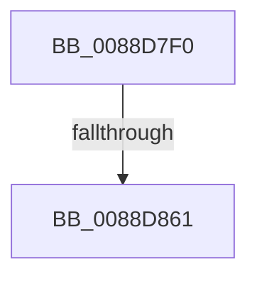

# AlpcpDispatchReplyToWaitingThread

- RVA: `0x0088D7F0`–`0x0088D871` (길이 `129` bytes)
- VA: `0x000000014088D7F0`
- 실행 섹션: `PAGE`
- PDB 이름 있음: `예`; PDB Function 태그: `아니요`
- unwind 정보 RVA: `0x0007D478`
- 디코드: `31`개 명령, `129/129` bytes 표시
- 미해석 바이트: `0` (있으면 어셈블리에 `.byte`로 보존)

> 이 문서는 커널 이미지의 기계어와 PDB 기호를 분석해 생성했습니다. 4번과 5번은 함수 원형과 자료형을 바이너리 사용 방식에서 추정한 C 해석이며 원본 소스 복구 결과는 아닙니다.

## 1. Dependencies

- 직접 호출 지점: **0**; 고유 호출 대상: **0**
- 직접 호출자로 확인된 함수: **2**
- RIP 상대 이미지 참조: **0**

### Outgoing calls
- 직접 디코드된 call 명령이 없습니다.

### Direct callers
- [AlpcpSendMessage](AlpcpSendMessage_function_0088BD40.md) at `0x0088C5CE`
- [AlpcpDispatchMessage](AlpcpDispatchMessage_function_0088F7D0.md) at `0x0088F7E6`

### Static image references
- 디코드된 RIP-relative 메모리 참조가 없습니다.

## 2. Other-region calls and transfers

- 다른 실행 섹션으로 향하는 call: **0**
- call이 아닌 외부 분기/꼬리 이동: **1**
  - `0x0088D85B` → [sub_0088DAFD + 0x55](Unknown_function_0088DAFD.md) (`tail-transfer`)

## 3. Assembly (complete function range)

```asm
0088D7F0  40 55                           push rbp
0088D7F2  56                              push rsi
0088D7F3  57                              push rdi
0088D7F4  41 54                           push r12
0088D7F6  41 55                           push r13
0088D7F8  41 56                           push r14
0088D7FA  41 57                           push r15
0088D7FC  48 83 EC 50                     sub rsp, 0x50
0088D800  48 8B 79 08                     mov rdi, qword ptr [rcx + 8]
0088D804  33 D2                           xor edx, edx
0088D806  4C 8B 39                        mov r15, qword ptr [rcx]
0088D809  48 8B F1                        mov rsi, rcx
0088D80C  44 8B 69 30                     mov r13d, dword ptr [rcx + 0x30]
0088D810  48 89 51 20                     mov qword ptr [rcx + 0x20], rdx
0088D814  48 89 51 18                     mov qword ptr [rcx + 0x18], rdx
0088D818  48 89 51 28                     mov qword ptr [rcx + 0x28], rdx
0088D81C  48 8B 6F 18                     mov rbp, qword ptr [rdi + 0x18]
0088D820  48 8B 47 20                     mov rax, qword ptr [rdi + 0x20]
0088D824  8B 4F 28                        mov ecx, dword ptr [rdi + 0x28]
0088D827  48 89 84 24 A0 00 00 00         mov qword ptr [rsp + 0xa0], rax
0088D82F  44 8B A5 A0 01 00 00            mov r12d, dword ptr [rbp + 0x1a0]
0088D836  0F B7 46 34                     movzx eax, word ptr [rsi + 0x34]
0088D83A  41 D1 EC                        shr r12d, 1
0088D83D  4C 89 BC 24 A8 00 00 00         mov qword ptr [rsp + 0xa8], r15
0088D845  44 89 AC 24 90 00 00 00         mov dword ptr [rsp + 0x90], r13d
0088D84D  89 8C 24 98 00 00 00            mov dword ptr [rsp + 0x98], ecx
0088D854  48 3B 85 10 01 00 00            cmp rax, qword ptr [rbp + 0x110]
0088D85B  0F 87 F1 02 00 00               ja 0x14088db52
0088D861  48 89 57 18                     mov qword ptr [rdi + 0x18], rdx
0088D865  48 89 97 C8 00 00 00            mov qword ptr [rdi + 0xc8], rdx
0088D86C  66 83 7E 36 0B                  cmp word ptr [rsi + 0x36], 0xb
```

## 4. C-style interpretation (structured pseudocode)

```c
__int64 __fastcall AlpcpDispatchReplyToWaitingThread(__int64 a1, int a2)
{
    __int64 v_r12;
    __int64 v_rsp;
    unsigned int v_stack_p10;
    unsigned __int64 v_stack_p18;
    unsigned __int64 v_stack_p20;
    unsigned int v_stack_p8;

    v_rsp = (v_rsp) - (80);
    a2 = 0;
    *(unsigned __int64 *)(a1 + 32) = 0;
    *(unsigned __int64 *)(a1 + 24) = 0;
    *(unsigned __int64 *)(a1 + 40) = 0;
    v_stack_p18 = *(unsigned __int64 *)(*(unsigned __int64 *)(a1 + 8) + 32);
    v_r12 = (unsigned int)(((unsigned int)(*(unsigned int *)(*(unsigned __int64 *)(*(unsigned __int64 *)(a1 + 8) + 24) + 416))) >> (1));
    v_stack_p20 = *(unsigned __int64 *)(a1);
    v_stack_p8 = (unsigned int)((unsigned int)(*(unsigned int *)(a1 + 48)));
    v_stack_p10 = (unsigned int)((unsigned int)(*(unsigned int *)(*(unsigned __int64 *)(a1 + 8) + 40)));
    *(unsigned __int64 *)(*(unsigned __int64 *)(a1 + 8) + 24) = 0;
    *(unsigned __int64 *)(*(unsigned __int64 *)(a1 + 8) + 200) = 0;
    return *(unsigned __int16 *)(a1 + 52);
}
```

## 5. (Beta) C Style

```c
int64_t AlpcpDispatchReplyToWaitingThread(void *Arg1, int32_t Arg2)
{
    uint8_t *arg1 = (uint8_t *)Arg1;

    int64_t local_r12;
    int64_t local_rsp;
    uint32_t v_stack_p10;
    uint64_t v_stack_p18;
    uint64_t v_stack_p20;
    uint32_t v_stack_p8;

    local_rsp = (local_rsp) - (80);
    Arg2 = 0;
    *(uint64_t *)(arg1 + 0x20) = 0;
    *(uint64_t *)(arg1 + 0x18) = 0;
    *(uint64_t *)(arg1 + 0x28) = 0;
    v_stack_p18 = *(uint64_t *)(*(uint64_t *)(arg1 + 0x8) + 0x20);
    local_r12 = (uint32_t)(((uint32_t)(*(uint32_t *)(*(uint64_t *)(*(uint64_t *)(arg1 + 0x8) + 0x18) + 0x1A0))) >> (1));
    v_stack_p20 = *(uint64_t *)(arg1);
    v_stack_p8 = (uint32_t)((uint32_t)(*(uint32_t *)(arg1 + 0x30)));
    v_stack_p10 = (uint32_t)((uint32_t)(*(uint32_t *)(*(uint64_t *)(arg1 + 0x8) + 0x28)));
    *(uint64_t *)(*(uint64_t *)(arg1 + 0x8) + 0x18) = 0;
    *(uint64_t *)(*(uint64_t *)(arg1 + 0x8) + 0xC8) = 0;
    return *(uint16_t *)(arg1 + 0x34);
}
```

### 관측된 메모리 오프셋

구조체 형식이 확인되지 않은 접근은 인자 기준의 오프셋으로만 기록했습니다.

| 기준 인자 | 오프셋 표현 | 폭 (bit) | 접근 |
|---|---:|---:|---|
| `Arg1` | `+ 0x0` | `64` | `R` |
| `Arg1` | `+ 0x8` | `64` | `R` |
| `Arg1` | `+ 0x18` | `64` | `W` |
| `Arg1` | `+ 0x20` | `64` | `W` |
| `Arg1` | `+ 0x28` | `64` | `W` |
| `Arg1` | `+ 0x30` | `32` | `R` |
| `Arg1` | `+ 0x34` | `16` | `R` |
| `Arg1` | `+ 0x36` | `16` | `R` |

## 6. Execution-region graph

[열기: 2D/3D 그래프와 함수 탐색 컨트롤 패널](../../../control-panel.html?section=page&rva=0x0088D7F0&view=graph)

- 2D 그래프는 위에서 아래로 흐르고, 3D 그래프는 빈 공간을 드래그해 회전합니다. Shift+드래그는 이동, 휠은 확대·축소, 함수 노드 선택은 대상 보고서 이동입니다.

### Static fallback


