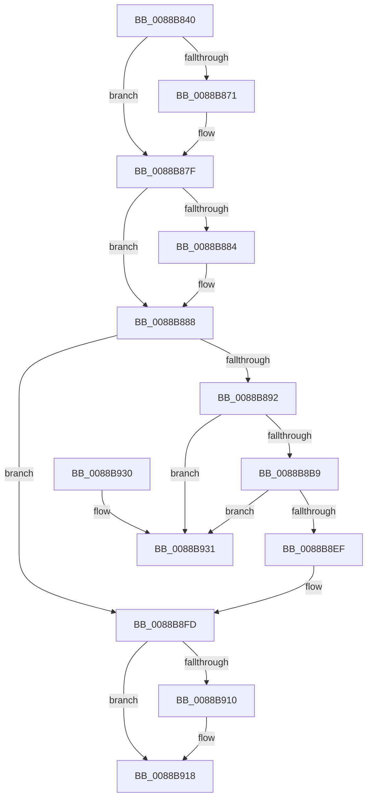

# AlpcpEnterAllocationEventMessageLog

- RVA: `0x0088B840`–`0x0088B938` (길이 `248` bytes)
- VA: `0x000000014088B840`
- 실행 섹션: `PAGE`
- PDB 이름 있음: `예`; PDB Function 태그: `아니요`
- unwind 정보 RVA: `0x0006383C`
- 디코드: `65`개 명령, `248/248` bytes 표시
- 미해석 바이트: `0` (있으면 어셈블리에 `.byte`로 보존)

> 이 문서는 커널 이미지의 기계어와 PDB 기호를 분석해 생성했습니다. 4번과 5번은 함수 원형과 자료형을 바이너리 사용 방식에서 추정한 C 해석이며 원본 소스 복구 결과는 아닙니다.

## 1. Dependencies

- 직접 호출 지점: **5**; 고유 호출 대상: **5**
- 직접 호출자로 확인된 함수: **2**
- RIP 상대 이미지 참조: **6**

### Outgoing calls
- `0x0088B861` → [KeAbPreAcquire](../../text/21/KeAbPreAcquire_function_00210230.md) (function, `0x00210230`)
- `0x0088B87A` → [ExfAcquirePushLockExclusiveEx](../../text/20/ExfAcquirePushLockExclusiveEx_function_0020FC90.md) (function, `0x0020FC90`)
- `0x0088B888` → [AlpcpAllocateMessageLog](../6F/AlpcpAllocateMessageLog_function_006FE8D4.md) (function, `0x006FE8D4`)
- `0x0088B913` → [ExfTryToWakePushLock](../../text/26/ExfTryToWakePushLock_function_00265DD0.md) (function, `0x00265DD0`)
- `0x0088B91B` → [KeAbPostRelease](../../text/2E/KeAbPostRelease_function_002E1600.md) (function, `0x002E1600`)

### Direct callers
- [AlpcpSendMessage](AlpcpSendMessage_function_0088BD40.md) at `0x0088C393`
- [AlpcpSendLegacySynchronousRequest](../92/AlpcpSendLegacySynchronousRequest_function_0092376C.md) at `0x00923E36`

### Static image references
- `0x0088B852` → RVA `0x00F10080` (`.data`; read)
- `0x0088B896` → RVA `0x00F100B0` (`.data`; read)
- `0x0088B8AD` → RVA `0x00F100B8` (`.data`; read)
- `0x0088B8C7` → RVA `0x00F100B8` (`.data`; write)
- `0x0088B8DF` → RVA `0x00F100A0` (`.data`; read)
- `0x0088B901` → RVA `0x00F10080` (`.data`; read/write)

## 2. Other-region calls and transfers

- 다른 실행 섹션으로 향하는 call: **4**
  - `0x0088B861` → [KeAbPreAcquire](../../text/21/KeAbPreAcquire_function_00210230.md) (`PAGE` → `.text`)
  - `0x0088B87A` → [ExfAcquirePushLockExclusiveEx](../../text/20/ExfAcquirePushLockExclusiveEx_function_0020FC90.md) (`PAGE` → `.text`)
  - `0x0088B913` → [ExfTryToWakePushLock](../../text/26/ExfTryToWakePushLock_function_00265DD0.md) (`PAGE` → `.text`)
  - `0x0088B91B` → [KeAbPostRelease](../../text/2E/KeAbPostRelease_function_002E1600.md) (`PAGE` → `.text`)
- 별도 외부 분기/꼬리 이동을 확인하지 못했습니다.

## 3. Assembly (complete function range)

```asm
0088B840  48 89 5C 24 08                  mov qword ptr [rsp + 8], rbx
0088B845  48 89 74 24 10                  mov qword ptr [rsp + 0x10], rsi
0088B84A  57                              push rdi
0088B84B  48 83 EC 20                     sub rsp, 0x20
0088B84F  48 8B F9                        mov rdi, rcx
0088B852  48 8D 35 27 48 68 00            lea rsi, [rip + 0x684827]
0088B859  48 8B CE                        mov rcx, rsi
0088B85C  45 33 C0                        xor r8d, r8d
0088B85F  33 D2                           xor edx, edx
0088B861  E8 CA 49 98 FF                  call 0x140210230
0088B866  F0 48 0F BA 2E 00               lock bts qword ptr [rsi], 0
0088B86C  48 8B D8                        mov rbx, rax
0088B86F  73 0E                           jae 0x14088b87f
0088B871  4C 8B C6                        mov r8, rsi
0088B874  48 8B D0                        mov rdx, rax
0088B877  48 8B CE                        mov rcx, rsi
0088B87A  E8 11 44 98 FF                  call 0x14020fc90
0088B87F  48 85 DB                        test rbx, rbx
0088B882  74 04                           je 0x14088b888
0088B884  C6 43 0A 01                     mov byte ptr [rbx + 0xa], 1
0088B888  E8 47 30 E7 FF                  call 0x1406fe8d4
0088B88D  48 85 C0                        test rax, rax
0088B890  74 6B                           je 0x14088b8fd
0088B892  48 89 78 20                     mov qword ptr [rax + 0x20], rdi
0088B896  48 8D 15 13 48 68 00            lea rdx, [rip + 0x684813]
0088B89D  8B 8F 08 01 00 00               mov ecx, dword ptr [rdi + 0x108]
0088B8A3  89 48 28                        mov dword ptr [rax + 0x28], ecx
0088B8A6  C7 40 2C 01 00 00 00            mov dword ptr [rax + 0x2c], 1
0088B8AD  48 8B 0D 04 48 68 00            mov rcx, qword ptr [rip + 0x684804]
0088B8B4  48 39 11                        cmp qword ptr [rcx], rdx
0088B8B7  75 78                           jne 0x14088b931
0088B8B9  48 89 48 08                     mov qword ptr [rax + 8], rcx
0088B8BD  48 89 10                        mov qword ptr [rax], rdx
0088B8C0  48 8D 50 10                     lea rdx, [rax + 0x10]
0088B8C4  48 89 01                        mov qword ptr [rcx], rax
0088B8C7  48 89 05 EA 47 68 00            mov qword ptr [rip + 0x6847ea], rax
0088B8CE  8B 48 28                        mov ecx, dword ptr [rax + 0x28]
0088B8D1  48 C1 E9 02                     shr rcx, 2
0088B8D5  81 E1 FF 03 00 00               and ecx, 0x3ff
0088B8DB  48 C1 E1 04                     shl rcx, 4
0088B8DF  48 03 0D BA 47 68 00            add rcx, qword ptr [rip + 0x6847ba]
0088B8E6  48 8B 41 08                     mov rax, qword ptr [rcx + 8]
0088B8EA  48 39 08                        cmp qword ptr [rax], rcx
0088B8ED  75 42                           jne 0x14088b931
0088B8EF  48 89 0A                        mov qword ptr [rdx], rcx
0088B8F2  48 89 42 08                     mov qword ptr [rdx + 8], rax
0088B8F6  48 89 10                        mov qword ptr [rax], rdx
0088B8F9  48 89 51 08                     mov qword ptr [rcx + 8], rdx
0088B8FD  48 83 C8 FF                     or rax, 0xffffffffffffffff
0088B901  F0 48 0F C1 05 76 47 68 00      lock xadd qword ptr [rip + 0x684776], rax
0088B90A  24 06                           and al, 6
0088B90C  3C 02                           cmp al, 2
0088B90E  75 08                           jne 0x14088b918
0088B910  48 8B CE                        mov rcx, rsi
0088B913  E8 B8 A4 9D FF                  call 0x140265dd0
0088B918  48 8B CE                        mov rcx, rsi
0088B91B  E8 E0 5C A5 FF                  call 0x1402e1600
0088B920  48 8B 5C 24 30                  mov rbx, qword ptr [rsp + 0x30]
0088B925  48 8B 74 24 38                  mov rsi, qword ptr [rsp + 0x38]
0088B92A  48 83 C4 20                     add rsp, 0x20
0088B92E  5F                              pop rdi
0088B92F  C3                              ret
0088B930  CC                              int3
0088B931  B9 03 00 00 00                  mov ecx, 3
0088B936  CD 29                           int 0x29
```

## 4. C-style interpretation (structured pseudocode)

```c
__int64 __fastcall AlpcpEnterAllocationEventMessageLog(__int64 a1, int a2, int a3)
{
    __int64 result;
    __int64 v_rsp;
    unsigned __int64 v_stack_p10;
    unsigned __int64 v_stack_p8;

    v_stack_p8 = v_rbx;
    v_stack_p10 = v_rsi;
    v_rsp = (v_rsp) - (32);
    a3 = 0;
    a2 = 0;
    result = KeAbPreAcquire(v_rip + 6834215, a2, a3, a4);
    if (!(condition_is_above_or_equal)) {
        a3 = v_rip + 6834215;
        a2 = result;
        a1 = v_rip + 6834215;
        result = ExfAcquirePushLockExclusiveEx(a1, a2, a3, a4);
    }
    if (result != 0) {
        *(unsigned __int8 *)(result + 10) = 1;
    }
    result = AlpcpAllocateMessageLog(a1, a2, a3, a4);
    if (result == 0) goto loc_0088B8FD;
    *(unsigned __int64 *)(result + 32) = a1;
    *(unsigned int *)(result + 40) = (unsigned int)((unsigned int)(*(unsigned int *)(a1 + 264)));
    *(unsigned int *)(result + 44) = 1;
    if ((*(unsigned __int64 *)(*(unsigned __int64 *)(v_rip + 6834180))) != (v_rip + 6834195)) goto loc_0088B931;
    *(unsigned __int64 *)(result + 8) = *(unsigned __int64 *)(v_rip + 6834180);
    *(unsigned __int64 *)(result) = v_rip + 6834195;
    *(unsigned __int64 *)(*(unsigned __int64 *)(v_rip + 6834180)) = result;
    *(unsigned __int64 *)(v_rip + 6834154) = result;
    a1 = ((unsigned int)(*(unsigned int *)(result + 40))) >> (2);
    a1 = (unsigned int)((a1) & (0x3FFULL));
    a1 = (a1) << (4);
    a1 = (a1) + (*(unsigned __int64 *)(v_rip + 6834106));
    if ((*(unsigned __int64 *)(*(unsigned __int64 *)(a1 + 8))) != a1) goto loc_0088B931;
    *(unsigned __int64 *)(result + 16) = a1;
    *(unsigned __int64 *)(result + 16 + 8) = *(unsigned __int64 *)(a1 + 8);
    *(unsigned __int64 *)(*(unsigned __int64 *)(a1 + 8)) = result + 16;
    *(unsigned __int64 *)(a1 + 8) = result + 16;
loc_0088B8FD:
    result = (*(unsigned __int64 *)(a1 + 8)) | (-1);
    result = (unsigned __int8)((result) & (6));
    if (((unsigned __int8)(result)) == 2) {
        a1 = v_rip + 6834215;
        result = ExfTryToWakePushLock(a1, result + 16, a3, a4);
    }
    result = KeAbPostRelease(v_rip + 6834215, result + 16, a3, a4);
    v_rsp = (v_rsp) + (32);
    return result;
loc_0088B931:
    return result;
}
```

## 5. (Beta) C Style

```c
int64_t AlpcpEnterAllocationEventMessageLog(void *Arg1, int32_t Arg2, int32_t Arg3)
{
    uint8_t *arg1 = (uint8_t *)Arg1;

    int64_t result;
    int64_t local_rsp;
    uint64_t v_stack_p10;
    uint64_t v_stack_p8;

    v_stack_p8 = local_rbx;
    v_stack_p10 = local_rsi;
    local_rsp = (local_rsp) - (32);
    Arg3 = 0;
    Arg2 = 0;
    result = KeAbPreAcquire(v_rip + 6834215, Arg2, Arg3, a4);
    if (!(condition_is_above_or_equal)) {
        Arg3 = v_rip + 6834215;
        Arg2 = result;
        Arg1 = v_rip + 6834215;
        result = ExfAcquirePushLockExclusiveEx(Arg1, Arg2, Arg3, a4);
    }
    if (result != 0) {
        *(uint8_t *)(result + 0xA) = 1;
    }
    result = AlpcpAllocateMessageLog(Arg1, Arg2, Arg3, a4);
    if (result == 0) goto loc_0088B8FD;
    *(void **)(result + 0x20) = Arg1;
    *(uint32_t *)(result + 0x28) = (uint32_t)((uint32_t)(*(uint32_t *)(arg1 + 0x108)));
    *(uint32_t *)(result + 0x2C) = 1;
    if ((*(uint64_t *)(*(uint64_t *)(v_rip + 0x684804))) != (v_rip + 6834195)) goto loc_0088B931;
    *(uint64_t *)(result + 0x8) = *(uint64_t *)(v_rip + 0x684804);
    *(uint64_t *)(result) = v_rip + 6834195;
    *(uint64_t *)(*(uint64_t *)(v_rip + 0x684804)) = result;
    *(uint64_t *)(v_rip + 0x6847EA) = result;
    Arg1 = ((uint32_t)(*(uint32_t *)(result + 0x28))) >> (2);
    Arg1 = (uint32_t)((Arg1) & (0x3FFULL));
    Arg1 = (Arg1) << (4);
    Arg1 = (Arg1) + (*(uint64_t *)(v_rip + 0x6847BA));
    if ((*(uint64_t *)(*(uint64_t *)(arg1 + 0x8))) != Arg1) goto loc_0088B931;
    *(void **)(result + 0x10) = Arg1;
    *(uint64_t *)(result + 0x10 + 0x8) = *(uint64_t *)(arg1 + 0x8);
    *(uint64_t *)(*(uint64_t *)(arg1 + 0x8)) = result + 16;
    *(uint64_t *)(arg1 + 0x8) = result + 16;
loc_0088B8FD:
    result = (*(uint64_t *)(arg1 + 0x8)) | (-1);
    result = (uint8_t)((result) & (6));
    if (((uint8_t)(result)) == 2) {
        Arg1 = v_rip + 6834215;
        result = ExfTryToWakePushLock(Arg1, result + 16, Arg3, a4);
    }
    result = KeAbPostRelease(v_rip + 6834215, result + 16, Arg3, a4);
    local_rsp = (local_rsp) + (32);
    return result;
loc_0088B931:
    return result;
}
```

### 관측된 메모리 오프셋

구조체 형식이 확인되지 않은 접근은 인자 기준의 오프셋으로만 기록했습니다.

| 기준 인자 | 오프셋 표현 | 폭 (bit) | 접근 |
|---|---:|---:|---|
| `Arg1` | `+ 0x108` | `32` | `R` |

## 6. Execution-region graph

[열기: 2D/3D 그래프와 함수 탐색 컨트롤 패널](../../../control-panel.html?section=page&rva=0x0088B840&view=graph)

- 2D 그래프는 위에서 아래로 흐르고, 3D 그래프는 빈 공간을 드래그해 회전합니다. Shift+드래그는 이동, 휠은 확대·축소, 함수 노드 선택은 대상 보고서 이동입니다.

### Static fallback


