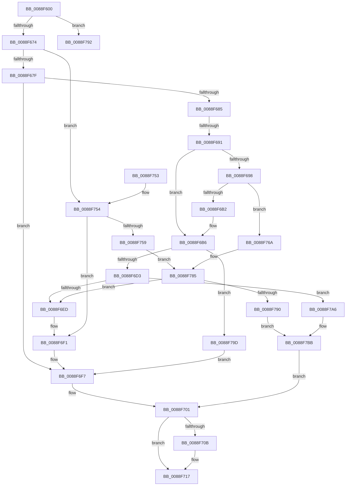

# AlpcpExposeViewAttributeInSenderContext

- RVA: `0x0088F600`–`0x0088F7C7` (길이 `455` bytes)
- VA: `0x000000014088F600`
- 실행 섹션: `PAGE`
- PDB 이름 있음: `예`; PDB Function 태그: `예`
- unwind 정보 RVA: `0x0007D5D0`
- 디코드: `127`개 명령, `455/455` bytes 표시
- 미해석 바이트: `0` (있으면 어셈블리에 `.byte`로 보존)

> 이 문서는 커널 이미지의 기계어와 PDB 기호를 분석해 생성했습니다. 4번과 5번은 함수 원형과 자료형을 바이너리 사용 방식에서 추정한 C 해석이며 원본 소스 복구 결과는 아닙니다.

## 1. Dependencies

- 직접 호출 지점: **13**; 고유 호출 대상: **10**
- 직접 호출자로 확인된 함수: **2**
- RIP 상대 이미지 참조: **1**

### Outgoing calls
- `0x0088F64B` → [AlpcpLockForCachedReferenceBlob](AlpcpLockForCachedReferenceBlob_function_0088A8B0.md) (function, `0x0088A8B0`)
- `0x0088F656` → [AlpcpLocateView](../89/AlpcpLocateView_function_008900E8.md) (function, `0x008900E8`)
- `0x0088F6A4` → [MmSecureVirtualMemoryAgainstWrites](../89/MmSecureVirtualMemoryAgainstWrites_function_00890164.md) (function, `0x00890164`)
- `0x0088F6BD` → [AlpcpReferenceBlob](../89/AlpcpReferenceBlob_function_00890110.md) (function, `0x00890110`)
- `0x0088F6DD` → [AlpcpCreateView](AlpcpCreateView_function_0088A9B8.md) (function, `0x0088A9B8`)
- `0x0088F70E` → [AlpcpDeleteView](AlpcpDeleteView_function_0088A26C.md) (function, `0x0088A26C`)
- `0x0088F71A` → [AlpcpUnlockBlob](AlpcpUnlockBlob_function_0088B990.md) (function, `0x0088B990`)
- `0x0088F727` → [AlpcpDereferenceBlobEx](AlpcpDereferenceBlobEx_function_0088AF00.md) (function, `0x0088AF00`)
- `0x0088F736` → [_security_check_cookie](../../text/6A/_security_check_cookie_function_006AC640.md) (function, `0x006AC640`)
- `0x0088F763` → [AlpcpCreateView](AlpcpCreateView_function_0088A9B8.md) (function, `0x0088A9B8`)
- `0x0088F780` → [AlpcpCreateView](AlpcpCreateView_function_0088A9B8.md) (function, `0x0088A9B8`)
- `0x0088F7A9` → [AlpcpRestoreWriteAccess](AlpcpRestoreWriteAccess_function_00889990.md) (function, `0x00889990`)
- `0x0088F7B6` → [AlpcpDereferenceBlobEx](AlpcpDereferenceBlobEx_function_0088AF00.md) (function, `0x0088AF00`)

### Direct callers
- [sub_0088D871](Unknown_function_0088D871.md) at `0x0088DACC`
- [sub_0088E1DC](Unknown_function_0088E1DC.md) at `0x0088E373`
- [sub_0088E1DC](Unknown_function_0088E1DC.md) at `0x0088E43A`
- [sub_0088E1DC](Unknown_function_0088E1DC.md) at `0x0088E600`

### Static image references
- `0x0088F617` → RVA `0x00E0A740` (`.data`; read)

## 2. Other-region calls and transfers

- 다른 실행 섹션으로 향하는 call: **1**
  - `0x0088F736` → [_security_check_cookie](../../text/6A/_security_check_cookie_function_006AC640.md) (`PAGE` → `.text`)
- call이 아닌 외부 분기/꼬리 이동: **2**
  - `0x0088F68B` → [sub_00B19294 + 0x5D](../B1/Unknown_function_00B19294.md) (`tail-transfer`)
  - `0x0088F798` → [sub_00B19294](../B1/Unknown_function_00B19294.md) (`tail-transfer`)

## 3. Assembly (complete function range)

```asm
0088F600  48 89 5C 24 18                  mov qword ptr [rsp + 0x18], rbx
0088F605  55                              push rbp
0088F606  56                              push rsi
0088F607  57                              push rdi
0088F608  41 54                           push r12
0088F60A  41 55                           push r13
0088F60C  41 56                           push r14
0088F60E  41 57                           push r15
0088F610  48 8B EC                        mov rbp, rsp
0088F613  48 83 EC 70                     sub rsp, 0x70
0088F617  48 8B 05 22 B1 57 00            mov rax, qword ptr [rip + 0x57b122]
0088F61E  48 33 C4                        xor rax, rsp
0088F621  48 89 45 F0                     mov qword ptr [rbp - 0x10], rax
0088F625  48 8B BA 90 00 00 00            mov rdi, qword ptr [rdx + 0x90]
0088F62C  0F 57 C0                        xorps xmm0, xmm0
0088F62F  0F 11 45 C0                     movups xmmword ptr [rbp - 0x40], xmm0
0088F633  4C 8B E1                        mov r12, rcx
0088F636  4C 8B F2                        mov r14, rdx
0088F639  0F 11 45 D0                     movups xmmword ptr [rbp - 0x30], xmm0
0088F63D  45 33 FF                        xor r15d, r15d
0088F640  0F 11 45 E0                     movups xmmword ptr [rbp - 0x20], xmm0
0088F644  48 8B 77 10                     mov rsi, qword ptr [rdi + 0x10]
0088F648  48 8B CE                        mov rcx, rsi
0088F64B  E8 60 B2 FF FF                  call 0x14088a8b0
0088F650  49 8B D4                        mov rdx, r12
0088F653  48 8B CE                        mov rcx, rsi
0088F656  E8 8D 0A 00 00                  call 0x1408900e8
0088F65B  48 89 45 B0                     mov qword ptr [rbp - 0x50], rax
0088F65F  48 8B D8                        mov rbx, rax
0088F662  4C 8B E8                        mov r13, rax
0088F665  48 8B D0                        mov rdx, rax
0088F668  48 8B C8                        mov rcx, rax
0088F66B  48 85 C0                        test rax, rax
0088F66E  0F 85 1E 01 00 00               jne 0x14088f792
0088F674  8B 46 30                        mov eax, dword ptr [rsi + 0x30]
0088F677  A8 01                           test al, 1
0088F679  0F 84 D5 00 00 00               je 0x14088f754
0088F67F  48 3B 56 50                     cmp rdx, qword ptr [rsi + 0x50]
0088F683  74 72                           je 0x14088f6f7
0088F685  45 33 ED                        xor r13d, r13d
0088F688  48 85 C9                        test rcx, rcx
0088F68B  0F 85 60 9C 28 00               jne 0x140b192f1
0088F691  8B 47 48                        mov eax, dword ptr [rdi + 0x48]
0088F694  A8 08                           test al, 8
0088F696  75 1E                           jne 0x14088f6b6
0088F698  4C 8B 47 30                     mov r8, qword ptr [rdi + 0x30]
0088F69C  48 8B 57 28                     mov rdx, qword ptr [rdi + 0x28]
0088F6A0  48 8B 4F 20                     mov rcx, qword ptr [rdi + 0x20]
0088F6A4  E8 BB 0A 00 00                  call 0x140890164
0088F6A9  48 85 C0                        test rax, rax
0088F6AC  0F 84 B8 00 00 00               je 0x14088f76a
0088F6B2  48 89 47 40                     mov qword ptr [rdi + 0x40], rax
0088F6B6  83 67 48 FE                     and dword ptr [rdi + 0x48], 0xfffffffe
0088F6BA  48 8B CF                        mov rcx, rdi
0088F6BD  E8 4E 0A 00 00                  call 0x140890110
0088F6C2  48 89 7E 48                     mov qword ptr [rsi + 0x48], rdi
0088F6C6  4C 89 6E 50                     mov qword ptr [rsi + 0x50], r13
0088F6CA  48 85 DB                        test rbx, rbx
0088F6CD  0F 85 CA 00 00 00               jne 0x14088f79d
0088F6D3  4C 8D 45 B0                     lea r8, [rbp - 0x50]
0088F6D7  49 8B D4                        mov rdx, r12
0088F6DA  48 8B CE                        mov rcx, rsi
0088F6DD  E8 D6 B2 FF FF                  call 0x14088a9b8
0088F6E2  44 8B F8                        mov r15d, eax
0088F6E5  85 C0                           test eax, eax
0088F6E7  0F 88 B9 00 00 00               js 0x14088f7a6
0088F6ED  48 8B 5D B0                     mov rbx, qword ptr [rbp - 0x50]
0088F6F1  41 0F BA 6E 28 0F               bts dword ptr [r14 + 0x28], 0xf
0088F6F7  49 89 9E 90 00 00 00            mov qword ptr [r14 + 0x90], rbx
0088F6FE  FF 43 4C                        inc dword ptr [rbx + 0x4c]
0088F701  FF 4F 4C                        dec dword ptr [rdi + 0x4c]
0088F704  8B 47 48                        mov eax, dword ptr [rdi + 0x48]
0088F707  A8 02                           test al, 2
0088F709  74 0C                           je 0x14088f717
0088F70B  48 8B CF                        mov rcx, rdi
0088F70E  E8 59 AB FF FF                  call 0x14088a26c
0088F713  83 67 48 FD                     and dword ptr [rdi + 0x48], 0xfffffffd
0088F717  48 8B CE                        mov rcx, rsi
0088F71A  E8 71 C2 FF FF                  call 0x14088b990
0088F71F  BA 01 00 00 00                  mov edx, 1
0088F724  48 8B CF                        mov rcx, rdi
0088F727  E8 D4 B7 FF FF                  call 0x14088af00
0088F72C  41 8B C7                        mov eax, r15d
0088F72F  48 8B 4D F0                     mov rcx, qword ptr [rbp - 0x10]
0088F733  48 33 CC                        xor rcx, rsp
0088F736  E8 05 CF E1 FF                  call 0x1406ac640
0088F73B  48 8B 9C 24 C0 00 00 00         mov rbx, qword ptr [rsp + 0xc0]
0088F743  48 83 C4 70                     add rsp, 0x70
0088F747  41 5F                           pop r15
0088F749  41 5E                           pop r14
0088F74B  41 5D                           pop r13
0088F74D  41 5C                           pop r12
0088F74F  5F                              pop rdi
0088F750  5E                              pop rsi
0088F751  5D                              pop rbp
0088F752  C3                              ret
0088F753  CC                              int3
0088F754  4D 85 ED                        test r13, r13
0088F757  75 98                           jne 0x14088f6f1
0088F759  4C 8D 45 B0                     lea r8, [rbp - 0x50]
0088F75D  49 8B D4                        mov rdx, r12
0088F760  48 8B CE                        mov rcx, rsi
0088F763  E8 50 B2 FF FF                  call 0x14088a9b8
0088F768  EB 1B                           jmp 0x14088f785
0088F76A  83 66 30 FE                     and dword ptr [rsi + 0x30], 0xfffffffe
0088F76E  4C 8D 45 B0                     lea r8, [rbp - 0x50]
0088F772  49 8B D4                        mov rdx, r12
0088F775  4C 89 6E 48                     mov qword ptr [rsi + 0x48], r13
0088F779  48 8B CE                        mov rcx, rsi
0088F77C  4C 89 6E 50                     mov qword ptr [rsi + 0x50], r13
0088F780  E8 33 B2 FF FF                  call 0x14088a9b8
0088F785  44 8B F8                        mov r15d, eax
0088F788  85 C0                           test eax, eax
0088F78A  0F 89 5D FF FF FF               jns 0x14088f6ed
0088F790  EB 29                           jmp 0x14088f7bb
0088F792  4C 8B C0                        mov r8, rax
0088F795  4C 8B C8                        mov r9, rax
0088F798  E9 F7 9A 28 00                  jmp 0x140b19294
0088F79D  48 89 5E 50                     mov qword ptr [rsi + 0x50], rbx
0088F7A1  E9 51 FF FF FF                  jmp 0x14088f6f7
0088F7A6  48 8B CF                        mov rcx, rdi
0088F7A9  E8 E2 A1 FF FF                  call 0x140889990
0088F7AE  BA 01 00 00 00                  mov edx, 1
0088F7B3  48 8B CF                        mov rcx, rdi
0088F7B6  E8 45 B7 FF FF                  call 0x14088af00
0088F7BB  4D 89 AE 90 00 00 00            mov qword ptr [r14 + 0x90], r13
0088F7C2  E9 3A FF FF FF                  jmp 0x14088f701
```

## 4. C-style interpretation (structured pseudocode)

```c
__int64 __fastcall AlpcpExposeViewAttributeInSenderContext(__int64 a1, __int64 a2)
{
    __int64 result;
    __int64 v_r13;
    __int64 v_r15;
    __int64 v_rsp;
    unsigned __int64 v_stack_m48;
    unsigned __int64 v_stack_m58;
    unsigned __int64 v_stack_m68;
    unsigned __int64 v_stack_m78;
    unsigned __int64 v_stack_m88;
    unsigned __int64 v_stack_p18;

    v_stack_p18 = v_rbx;
    v_rsp = (v_rsp) - (112);
    result = (*(unsigned __int64 *)(v_rip + 5746978)) ^ (v_rsp);
    v_stack_m48 = result;
    v_stack_m78 = v_xmm0;
    v_stack_m68 = v_xmm0;
    v_r15 = 0;
    v_stack_m58 = v_xmm0;
    result = AlpcpLockForCachedReferenceBlob(*(unsigned __int64 *)(*(unsigned __int64 *)(a2 + 144) + 16), a2, a3, a4);
    result = AlpcpLocateView(*(unsigned __int64 *)(*(unsigned __int64 *)(a2 + 144) + 16), a1, a3, a4);
    v_stack_m88 = result;
    if (result != 0) goto loc_0088F792;
    if ((((unsigned __int8)((unsigned int)(*(unsigned int *)(*(unsigned __int64 *)(*(unsigned __int64 *)(a2 + 144) + 16) + 48)))) & (1)) == 0) goto loc_0088F754;
    if (result == (*(unsigned __int64 *)(*(unsigned __int64 *)(*(unsigned __int64 *)(a2 + 144) + 16) + 80))) goto loc_0088F6F7;
    v_r13 = 0;
    if ((((unsigned __int8)((unsigned int)(*(unsigned int *)(*(unsigned __int64 *)(a2 + 144) + 72)))) & (8)) != 0) goto loc_0088F6B6;
    result = MmSecureVirtualMemoryAgainstWrites(*(unsigned __int64 *)(*(unsigned __int64 *)(a2 + 144) + 32), *(unsigned __int64 *)(*(unsigned __int64 *)(a2 + 144) + 40), *(unsigned __int64 *)(*(unsigned __int64 *)(a2 + 144) + 48), a4);
    if (result == 0) goto loc_0088F76A;
    *(unsigned __int64 *)(*(unsigned __int64 *)(a2 + 144) + 64) = result;
loc_0088F6B6:
    result = AlpcpReferenceBlob(*(unsigned __int64 *)(a2 + 144), *(unsigned __int64 *)(*(unsigned __int64 *)(a2 + 144) + 40), *(unsigned __int64 *)(*(unsigned __int64 *)(a2 + 144) + 48), a4);
    *(unsigned __int64 *)(*(unsigned __int64 *)(*(unsigned __int64 *)(a2 + 144) + 16) + 72) = *(unsigned __int64 *)(a2 + 144);
    *(unsigned __int64 *)(*(unsigned __int64 *)(*(unsigned __int64 *)(a2 + 144) + 16) + 80) = 0;
    if (result != 0) goto loc_0088F79D;
    result = AlpcpCreateView(*(unsigned __int64 *)(*(unsigned __int64 *)(a2 + 144) + 16), a1, v_stack_m88, a4);
    if (sign_flag) goto loc_0088F7A6;
loc_0088F6ED:
loc_0088F6F1:
loc_0088F6F7:
    *(unsigned __int64 *)(a2 + 144) = v_stack_m88;
loc_0088F701:
    result = (unsigned int)(*(unsigned int *)(*(unsigned __int64 *)(a2 + 144) + 72));
    if ((((unsigned __int8)((unsigned int)(*(unsigned int *)(*(unsigned __int64 *)(a2 + 144) + 72)))) & (2)) != 0) {
        a1 = *(unsigned __int64 *)(a2 + 144);
        result = AlpcpDeleteView(a1, a1, v_stack_m88, a4);
    }
    result = AlpcpUnlockBlob(*(unsigned __int64 *)(*(unsigned __int64 *)(a2 + 144) + 16), a1, v_stack_m88, a4);
    result = AlpcpDereferenceBlobEx(*(unsigned __int64 *)(a2 + 144), 1, v_stack_m88, a4);
    a1 = (v_stack_m48) ^ (v_rsp);
    result = _security_check_cookie(a1, 1, v_stack_m88, a4);
    v_rsp = (v_rsp) + (112);
    return result;
loc_0088F754:
    if (0 != 0) goto loc_0088F6F1;
    result = AlpcpCreateView(*(unsigned __int64 *)(*(unsigned __int64 *)(a2 + 144) + 16), a1, v_stack_m88, a4);
    goto loc_0088F785;
loc_0088F76A:
    *(unsigned __int64 *)(*(unsigned __int64 *)(*(unsigned __int64 *)(a2 + 144) + 16) + 72) = 0;
    *(unsigned __int64 *)(*(unsigned __int64 *)(*(unsigned __int64 *)(a2 + 144) + 16) + 80) = 0;
    result = AlpcpCreateView(*(unsigned __int64 *)(*(unsigned __int64 *)(a2 + 144) + 16), a1, v_stack_m88, a4);
loc_0088F785:
    if (!sign_flag) goto loc_0088F6ED;
    goto loc_0088F7BB;
loc_0088F792:
loc_0088F79D:
    *(unsigned __int64 *)(*(unsigned __int64 *)(*(unsigned __int64 *)(a2 + 144) + 16) + 80) = v_stack_p18;
    goto loc_0088F6F7;
loc_0088F7A6:
    result = AlpcpRestoreWriteAccess(*(unsigned __int64 *)(a2 + 144), a1, result, result);
    result = AlpcpDereferenceBlobEx(*(unsigned __int64 *)(a2 + 144), 1, result, result);
loc_0088F7BB:
    *(unsigned __int64 *)(a2 + 144) = 0;
    goto loc_0088F701;
}
```

## 5. (Beta) C Style

```c
int64_t AlpcpExposeViewAttributeInSenderContext(int64_t Arg1, void *Arg2)
{
    uint8_t *arg2 = (uint8_t *)Arg2;

    int64_t result;
    int64_t local_r13;
    int64_t local_r15;
    int64_t local_rsp;
    uint64_t v_stack_m48;
    uint64_t v_stack_m58;
    uint64_t v_stack_m68;
    uint64_t v_stack_m78;
    uint64_t v_stack_m88;
    uint64_t v_stack_p18;

    v_stack_p18 = local_rbx;
    local_rsp = (local_rsp) - (112);
    result = (*(uint64_t *)(v_rip + 0x57B122)) ^ (local_rsp);
    v_stack_m48 = result;
    v_stack_m78 = v_xmm0;
    v_stack_m68 = v_xmm0;
    local_r15 = 0;
    v_stack_m58 = v_xmm0;
    result = AlpcpLockForCachedReferenceBlob(*(uint64_t *)(*(uint64_t *)(arg2 + 0x90) + 0x10), Arg2, a3, a4);
    result = AlpcpLocateView(*(uint64_t *)(*(uint64_t *)(arg2 + 0x90) + 0x10), Arg1, a3, a4);
    v_stack_m88 = result;
    if (result != 0) goto loc_0088F792;
    if ((((uint8_t)((uint32_t)(*(uint32_t *)(*(uint64_t *)(*(uint64_t *)(arg2 + 0x90) + 0x10) + 0x30)))) & (1)) == 0) goto loc_0088F754;
    if (result == (*(uint64_t *)(*(uint64_t *)(*(uint64_t *)(arg2 + 0x90) + 0x10) + 0x50))) goto loc_0088F6F7;
    local_r13 = 0;
    if ((((uint8_t)((uint32_t)(*(uint32_t *)(*(uint64_t *)(arg2 + 0x90) + 0x48)))) & (8)) != 0) goto loc_0088F6B6;
    result = MmSecureVirtualMemoryAgainstWrites(*(uint64_t *)(*(uint64_t *)(arg2 + 0x90) + 0x20), *(uint64_t *)(*(uint64_t *)(arg2 + 0x90) + 0x28), *(uint64_t *)(*(uint64_t *)(arg2 + 0x90) + 0x30), a4);
    if (result == 0) goto loc_0088F76A;
    *(uint64_t *)(*(uint64_t *)(arg2 + 0x90) + 0x40) = result;
loc_0088F6B6:
    result = AlpcpReferenceBlob(*(uint64_t *)(arg2 + 0x90), *(uint64_t *)(*(uint64_t *)(arg2 + 0x90) + 0x28), *(uint64_t *)(*(uint64_t *)(arg2 + 0x90) + 0x30), a4);
    *(uint64_t *)(*(uint64_t *)(*(uint64_t *)(arg2 + 0x90) + 0x10) + 0x48) = *(uint64_t *)(arg2 + 0x90);
    *(uint64_t *)(*(uint64_t *)(*(uint64_t *)(arg2 + 0x90) + 0x10) + 0x50) = 0;
    if (result != 0) goto loc_0088F79D;
    result = AlpcpCreateView(*(uint64_t *)(*(uint64_t *)(arg2 + 0x90) + 0x10), Arg1, v_stack_m88, a4);
    if (sign_flag) goto loc_0088F7A6;
loc_0088F6ED:
loc_0088F6F1:
loc_0088F6F7:
    *(uint64_t *)(arg2 + 0x90) = v_stack_m88;
loc_0088F701:
    result = (uint32_t)(*(uint32_t *)(*(uint64_t *)(arg2 + 0x90) + 0x48));
    if ((((uint8_t)((uint32_t)(*(uint32_t *)(*(uint64_t *)(arg2 + 0x90) + 0x48)))) & (2)) != 0) {
        Arg1 = *(uint64_t *)(arg2 + 0x90);
        result = AlpcpDeleteView(Arg1, Arg1, v_stack_m88, a4);
    }
    result = AlpcpUnlockBlob(*(uint64_t *)(*(uint64_t *)(arg2 + 0x90) + 0x10), Arg1, v_stack_m88, a4);
    result = AlpcpDereferenceBlobEx(*(uint64_t *)(arg2 + 0x90), 1, v_stack_m88, a4);
    Arg1 = (v_stack_m48) ^ (local_rsp);
    result = _security_check_cookie(Arg1, 1, v_stack_m88, a4);
    local_rsp = (local_rsp) + (112);
    return result;
loc_0088F754:
    if (0 != 0) goto loc_0088F6F1;
    result = AlpcpCreateView(*(uint64_t *)(*(uint64_t *)(arg2 + 0x90) + 0x10), Arg1, v_stack_m88, a4);
    goto loc_0088F785;
loc_0088F76A:
    *(uint64_t *)(*(uint64_t *)(*(uint64_t *)(arg2 + 0x90) + 0x10) + 0x48) = 0;
    *(uint64_t *)(*(uint64_t *)(*(uint64_t *)(arg2 + 0x90) + 0x10) + 0x50) = 0;
    result = AlpcpCreateView(*(uint64_t *)(*(uint64_t *)(arg2 + 0x90) + 0x10), Arg1, v_stack_m88, a4);
loc_0088F785:
    if (!sign_flag) goto loc_0088F6ED;
    goto loc_0088F7BB;
loc_0088F792:
loc_0088F79D:
    *(uint64_t *)(*(uint64_t *)(*(uint64_t *)(arg2 + 0x90) + 0x10) + 0x50) = v_stack_p18;
    goto loc_0088F6F7;
loc_0088F7A6:
    result = AlpcpRestoreWriteAccess(*(uint64_t *)(arg2 + 0x90), Arg1, result, result);
    result = AlpcpDereferenceBlobEx(*(uint64_t *)(arg2 + 0x90), 1, result, result);
loc_0088F7BB:
    *(uint64_t *)(arg2 + 0x90) = 0;
    goto loc_0088F701;
}
```

### 관측된 메모리 오프셋

구조체 형식이 확인되지 않은 접근은 인자 기준의 오프셋으로만 기록했습니다.

| 기준 인자 | 오프셋 표현 | 폭 (bit) | 접근 |
|---|---:|---:|---|
| `Arg2` | `+ 0x28` | `32` | `R/W` |
| `Arg2` | `+ 0x90` | `64` | `R` |
| `Arg2` | `+ 0x90` | `64` | `W` |

## 6. Execution-region graph

[열기: 2D/3D 그래프와 함수 탐색 컨트롤 패널](../../../control-panel.html?section=page&rva=0x0088F600&view=graph)

- 2D 그래프는 위에서 아래로 흐르고, 3D 그래프는 빈 공간을 드래그해 회전합니다. Shift+드래그는 이동, 휠은 확대·축소, 함수 노드 선택은 대상 보고서 이동입니다.

### Static fallback


