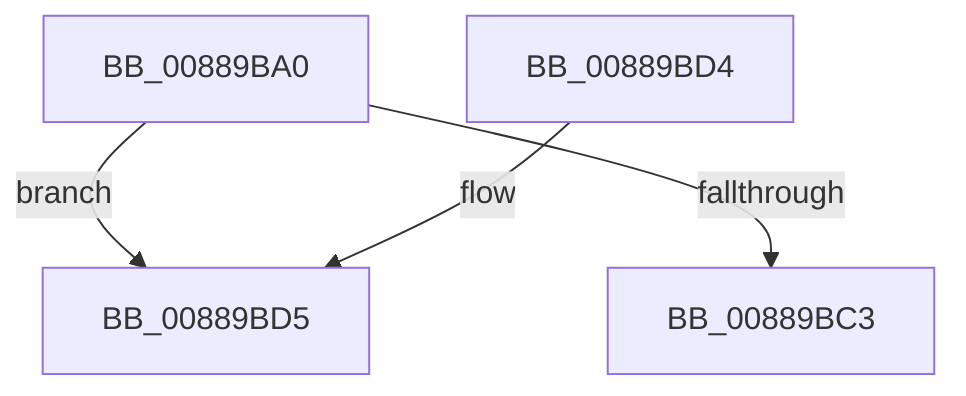

# AlpcpExposeViewAttribute

- RVA: `0x00889BA0`–`0x00889BDC` (길이 `60` bytes)
- VA: `0x0000000140889BA0`
- 실행 섹션: `PAGE`
- PDB 이름 있음: `예`; PDB Function 태그: `아니요`
- unwind 정보 RVA: `0x0007CFB0`
- 디코드: `21`개 명령, `60/60` bytes 표시
- 미해석 바이트: `0` (있으면 어셈블리에 `.byte`로 보존)

> 이 문서는 커널 이미지의 기계어와 PDB 기호를 분석해 생성했습니다. 4번과 5번은 함수 원형과 자료형을 바이너리 사용 방식에서 추정한 C 해석이며 원본 소스 복구 결과는 아닙니다.

## 1. Dependencies

- 직접 호출 지점: **0**; 고유 호출 대상: **0**
- 직접 호출자로 확인된 함수: **1**
- RIP 상대 이미지 참조: **0**

### Outgoing calls
- 직접 디코드된 call 명령이 없습니다.

### Direct callers
- [AlpcpExposeAttributes](../89/AlpcpExposeAttributes_function_00897630.md) at `0x008976E4`
- [AlpcpExposeAttributes](../89/AlpcpExposeAttributes_function_00897630.md) at `0x0089791E`

### Static image references
- 디코드된 RIP-relative 메모리 참조가 없습니다.

## 2. Other-region calls and transfers

- 다른 실행 섹션으로 향하는 call: **0**
- 별도 외부 분기/꼬리 이동을 확인하지 못했습니다.

## 3. Assembly (complete function range)

```asm
00889BA0  48 89 5C 24 18                  mov qword ptr [rsp + 0x18], rbx
00889BA5  56                              push rsi
00889BA6  41 56                           push r14
00889BA8  41 57                           push r15
00889BAA  48 83 EC 20                     sub rsp, 0x20
00889BAE  48 8B B2 90 00 00 00            mov rsi, qword ptr [rdx + 0x90]
00889BB5  4D 8B F1                        mov r14, r9
00889BB8  4D 8B F8                        mov r15, r8
00889BBB  48 8B DA                        mov rbx, rdx
00889BBE  48 85 F6                        test rsi, rsi
00889BC1  75 12                           jne 0x140889bd5
00889BC3  48 8B 5C 24 50                  mov rbx, qword ptr [rsp + 0x50]
00889BC8  33 C0                           xor eax, eax
00889BCA  48 83 C4 20                     add rsp, 0x20
00889BCE  41 5F                           pop r15
00889BD0  41 5E                           pop r14
00889BD2  5E                              pop rsi
00889BD3  C3                              ret
00889BD4  CC                              int3
00889BD5  48 8B 76 10                     mov rsi, qword ptr [rsi + 0x10]
00889BD9  48 8B CE                        mov rcx, rsi
```

## 4. C-style interpretation (structured pseudocode)

```c
__int64 __fastcall AlpcpExposeViewAttribute(__int64 a1, __int64 a2, __int64 a3, __int64 a4)
{
    __int64 result;
    __int64 v_rsp;
    unsigned __int64 v_stack_p18;

    v_stack_p18 = v_rbx;
    v_rsp = (v_rsp) - (32);
    if (*(unsigned __int64 *)(a2 + 144) != 0) goto loc_00889BD5;
    result = 0;
    v_rsp = (v_rsp) + (32);
    return result;
loc_00889BD5:
    return result;
}
```

## 5. (Beta) C Style

```c
int64_t AlpcpExposeViewAttribute(int64_t Arg1, void *Arg2, int64_t Arg3, int64_t Arg4)
{
    uint8_t *arg2 = (uint8_t *)Arg2;

    int64_t result;
    int64_t local_rsp;
    uint64_t v_stack_p18;

    v_stack_p18 = local_rbx;
    local_rsp = (local_rsp) - (32);
    if (*(uint64_t *)(arg2 + 0x90) != 0) goto loc_00889BD5;
    result = 0;
    local_rsp = (local_rsp) + (32);
    return result;
loc_00889BD5:
    return result;
}
```

### 관측된 메모리 오프셋

구조체 형식이 확인되지 않은 접근은 인자 기준의 오프셋으로만 기록했습니다.

| 기준 인자 | 오프셋 표현 | 폭 (bit) | 접근 |
|---|---:|---:|---|
| `Arg2` | `+ 0x90` | `64` | `R` |

## 6. Execution-region graph

[열기: 2D/3D 그래프와 함수 탐색 컨트롤 패널](../../../control-panel.html?section=page&rva=0x00889BA0&view=graph)

- 2D 그래프는 위에서 아래로 흐르고, 3D 그래프는 빈 공간을 드래그해 회전합니다. Shift+드래그는 이동, 휠은 확대·축소, 함수 노드 선택은 대상 보고서 이동입니다.

### Static fallback


