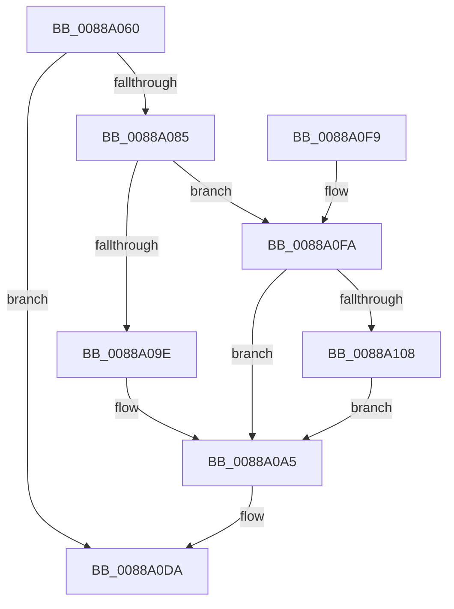

# AlpcpFreeMessageFunction

- RVA: `0x0088A060`–`0x0088A114` (길이 `180` bytes)
- VA: `0x000000014088A060`
- 실행 섹션: `PAGE`
- PDB 이름 있음: `예`; PDB Function 태그: `아니요`
- unwind 정보 RVA: `0x00078640`
- 디코드: `45`개 명령, `180/180` bytes 표시
- 미해석 바이트: `0` (있으면 어셈블리에 `.byte`로 보존)

> 이 문서는 커널 이미지의 기계어와 PDB 기호를 분석해 생성했습니다. 4번과 5번은 함수 원형과 자료형을 바이너리 사용 방식에서 추정한 C 해석이며 원본 소스 복구 결과는 아닙니다.

## 1. Dependencies

- 직접 호출 지점: **4**; 고유 호출 대상: **4**
- 직접 호출자로 확인된 함수: **6**
- RIP 상대 이미지 참조: **2**

### Outgoing calls
- `0x0088A0C0` → [ExMapHandleToPointerEx](ExMapHandleToPointerEx_function_00889390.md) (function, `0x00889390`)
- `0x0088A0CD` → [ExDestroyHandle](ExDestroyHandle_function_00889430.md) (function, `0x00889430`)
- `0x0088A0D5` → [KiLeaveCriticalRegionUnsafe](../../text/25/KiLeaveCriticalRegionUnsafe_function_0025F010.md) (function, `0x0025F010`)
- `0x0088A0DF` → [ExFreePoolWithTag](../../poolcode/B8/ExFreePoolWithTag_function_00B82870.md) (function, `0x00B82870`)

### Direct callers
- [ExFreeToPagedLookasideList](../../text/38/ExFreeToPagedLookasideList_function_00387D30.md) at `0x00387DBD`
- [FsRtlUninitializeBaseMcb](../../text/44/FsRtlUninitializeBaseMcb_function_00446CB0.md) at `0x00446D83`
- [sub_0088AFE4](Unknown_function_0088AFE4.md) at `0x0088B01D`
- [sub_0088B688](Unknown_function_0088B688.md) at `0x0088B6C4`
- [sub_0088BAE7](Unknown_function_0088BAE7.md) at `0x0088BB20`
- [sub_00897C45](../89/Unknown_function_00897C45.md) at `0x00897C7E`

### Static image references
- `0x0088A09E` → RVA `0x00FC6F68` (`ALMOSTRO`; read)
- `0x0088A0FA` → RVA `0x00FC5130` (`ALMOSTRO`; read)

## 2. Other-region calls and transfers

- 다른 실행 섹션으로 향하는 call: **2**
  - `0x0088A0D5` → [KiLeaveCriticalRegionUnsafe](../../text/25/KiLeaveCriticalRegionUnsafe_function_0025F010.md) (`PAGE` → `.text`)
  - `0x0088A0DF` → [ExFreePoolWithTag](../../poolcode/B8/ExFreePoolWithTag_function_00B82870.md) (`PAGE` → `POOLCODE`)
- 별도 외부 분기/꼬리 이동을 확인하지 못했습니다.

## 3. Assembly (complete function range)

```asm
0088A060  48 89 5C 24 08                  mov qword ptr [rsp + 8], rbx
0088A065  48 89 6C 24 10                  mov qword ptr [rsp + 0x10], rbp
0088A06A  48 89 74 24 18                  mov qword ptr [rsp + 0x18], rsi
0088A06F  57                              push rdi
0088A070  48 83 EC 20                     sub rsp, 0x20
0088A074  8B 99 38 01 00 00               mov ebx, dword ptr [rcx + 0x138]
0088A07A  48 8B E9                        mov rbp, rcx
0088A07D  81 E3 FF FF FF 7F               and ebx, 0x7fffffff
0088A083  74 55                           je 0x14088a0da
0088A085  65 48 8B 34 25 88 01 00 00      mov rsi, qword ptr gs:[0x188]
0088A08E  66 FF 8E E4 01 00 00            dec word ptr [rsi + 0x1e4]
0088A095  90                              nop
0088A096  F7 C3 00 00 00 FC               test ebx, 0xfc000000
0088A09C  75 5C                           jne 0x14088a0fa
0088A09E  48 8B 3D C3 CE 73 00            mov rdi, qword ptr [rip + 0x73cec3]
0088A0A5  65 48 8B 04 25 88 01 00 00      mov rax, qword ptr gs:[0x188]
0088A0AE  81 E3 FF FF FF 03               and ebx, 0x3ffffff
0088A0B4  8B D3                           mov edx, ebx
0088A0B6  48 8B CF                        mov rcx, rdi
0088A0B9  44 8A 80 32 02 00 00            mov r8b, byte ptr [rax + 0x232]
0088A0C0  E8 CB F2 FF FF                  call 0x140889390
0088A0C5  4C 8B C0                        mov r8, rax
0088A0C8  8B D3                           mov edx, ebx
0088A0CA  48 8B CF                        mov rcx, rdi
0088A0CD  E8 5E F3 FF FF                  call 0x140889430
0088A0D2  48 8B CE                        mov rcx, rsi
0088A0D5  E8 36 4F 9D FF                  call 0x14025f010
0088A0DA  33 D2                           xor edx, edx
0088A0DC  48 8B CD                        mov rcx, rbp
0088A0DF  E8 8C 87 2F 00                  call 0x140b82870
0088A0E4  48 8B 5C 24 30                  mov rbx, qword ptr [rsp + 0x30]
0088A0E9  48 8B 6C 24 38                  mov rbp, qword ptr [rsp + 0x38]
0088A0EE  48 8B 74 24 40                  mov rsi, qword ptr [rsp + 0x40]
0088A0F3  48 83 C4 20                     add rsp, 0x20
0088A0F7  5F                              pop rdi
0088A0F8  C3                              ret
0088A0F9  CC                              int3
0088A0FA  48 8B 0D 2F B0 73 00            mov rcx, qword ptr [rip + 0x73b02f]
0088A101  33 FF                           xor edi, edi
0088A103  48 85 C9                        test rcx, rcx
0088A106  74 9D                           je 0x14088a0a5
0088A108  8B C3                           mov eax, ebx
0088A10A  48 C1 E8 1A                     shr rax, 0x1a
0088A10E  48 8B 3C C1                     mov rdi, qword ptr [rcx + rax*8]
0088A112  EB 91                           jmp 0x14088a0a5
```

## 4. C-style interpretation (structured pseudocode)

```c
__int64 __fastcall AlpcpFreeMessageFunction(__int64 a1)
{
    __int64 result;
    __int64 v_rbx;
    __int64 v_rdi;
    __int64 v_rsp;
    unsigned __int64 v_stack_p10;
    unsigned __int64 v_stack_p18;
    unsigned __int64 v_stack_p8;

    v_stack_p8 = v_rbx;
    v_stack_p10 = v_rbp;
    v_stack_p18 = v_rsi;
    v_rsp = (v_rsp) - (32);
    v_rbx = (unsigned int)(((unsigned int)(*(unsigned int *)(a1 + 312))) & (0x7FFFFFFFULL));
    if (condition_is_equal) goto loc_0088A0DA;
    if ((((unsigned int)(v_rbx)) & (0xFC000000ULL)) != 0) goto loc_0088A0FA;
loc_0088A0A5:
    v_rbx = (unsigned int)((v_rbx) & (0x3FFFFFFULL));
    result = ExMapHandleToPointerEx(*(unsigned __int64 *)(v_rip + 7589571), (unsigned int)((unsigned int)(v_rbx)), *(unsigned __int8 *)(*(unsigned __int64 *)(gs_base + (0 + 392)) + 562), a4);
    result = ExDestroyHandle(*(unsigned __int64 *)(v_rip + 7589571), (unsigned int)((unsigned int)(v_rbx)), result, a4);
    result = KiLeaveCriticalRegionUnsafe(*(unsigned __int64 *)(gs_base + (0 + 392)), (unsigned int)((unsigned int)(v_rbx)), result, a4);
loc_0088A0DA:
    a2 = 0;
    result = ExFreePoolWithTag(a1, a2, result, a4);
    v_rsp = (v_rsp) + (32);
    return result;
loc_0088A0FA:
    v_rdi = 0;
    if (*(unsigned __int64 *)(v_rip + 7581743) == 0) goto loc_0088A0A5;
    result = ((unsigned int)((unsigned int)(v_stack_p8))) >> (26);
    goto loc_0088A0A5;
}
```

## 5. (Beta) C Style

```c
int64_t AlpcpFreeMessageFunction(void *Arg1)
{
    uint8_t *arg1 = (uint8_t *)Arg1;

    int64_t result;
    int64_t local_rbx;
    int64_t local_rdi;
    int64_t local_rsp;
    uint64_t v_stack_p10;
    uint64_t v_stack_p18;
    uint64_t v_stack_p8;

    v_stack_p8 = local_rbx;
    v_stack_p10 = local_rbp;
    v_stack_p18 = local_rsi;
    local_rsp = (local_rsp) - (32);
    local_rbx = (uint32_t)(((uint32_t)(*(uint32_t *)(arg1 + 0x138))) & (0x7FFFFFFFULL));
    if (condition_is_equal) goto loc_0088A0DA;
    if ((((uint32_t)(local_rbx)) & (0xFC000000ULL)) != 0) goto loc_0088A0FA;
loc_0088A0A5:
    local_rbx = (uint32_t)((local_rbx) & (0x3FFFFFFULL));
    result = ExMapHandleToPointerEx(*(uint64_t *)(v_rip + 0x73CEC3), (uint32_t)((uint32_t)(local_rbx)), *(uint8_t *)(*(uint64_t *)(gs_base + (0 + 0x188)) + 0x232), a4);
    result = ExDestroyHandle(*(uint64_t *)(v_rip + 0x73CEC3), (uint32_t)((uint32_t)(local_rbx)), result, a4);
    result = KiLeaveCriticalRegionUnsafe(*(uint64_t *)(gs_base + (0 + 0x188)), (uint32_t)((uint32_t)(local_rbx)), result, a4);
loc_0088A0DA:
    a2 = 0;
    result = ExFreePoolWithTag(Arg1, a2, result, a4);
    local_rsp = (local_rsp) + (32);
    return result;
loc_0088A0FA:
    local_rdi = 0;
    if (*(uint64_t *)(v_rip + 0x73B02F) == 0) goto loc_0088A0A5;
    result = ((uint32_t)((uint32_t)(v_stack_p8))) >> (26);
    goto loc_0088A0A5;
}
```

### 관측된 메모리 오프셋

구조체 형식이 확인되지 않은 접근은 인자 기준의 오프셋으로만 기록했습니다.

| 기준 인자 | 오프셋 표현 | 폭 (bit) | 접근 |
|---|---:|---:|---|
| `Arg1` | `+ 0x138` | `32` | `R` |

## 6. Execution-region graph

[열기: 2D/3D 그래프와 함수 탐색 컨트롤 패널](../../../control-panel.html?section=page&rva=0x0088A060&view=graph)

- 2D 그래프는 위에서 아래로 흐르고, 3D 그래프는 빈 공간을 드래그해 회전합니다. Shift+드래그는 이동, 휠은 확대·축소, 함수 노드 선택은 대상 보고서 이동입니다.

### Static fallback


