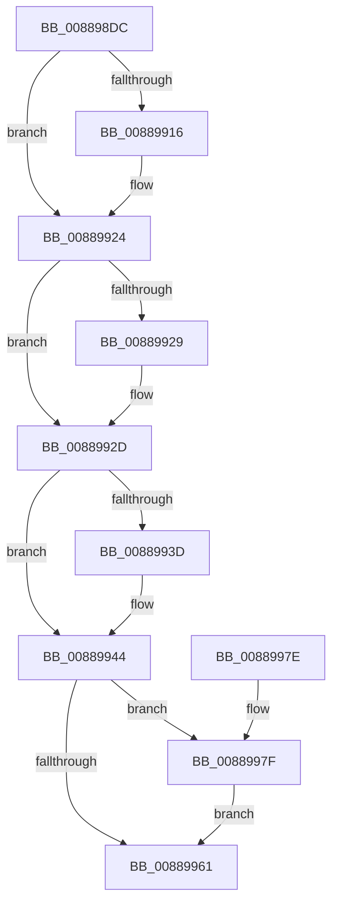

# AlpcpInsertResourcePort

- RVA: `0x008898DC`–`0x00889989` (길이 `173` bytes)
- VA: `0x00000001408898DC`
- 실행 섹션: `PAGE`
- PDB 이름 있음: `예`; PDB Function 태그: `아니요`
- unwind 정보 RVA: `0x00073808`
- 디코드: `49`개 명령, `173/173` bytes 표시
- 미해석 바이트: `0` (있으면 어셈블리에 `.byte`로 보존)

> 이 문서는 커널 이미지의 기계어와 PDB 기호를 분석해 생성했습니다. 4번과 5번은 함수 원형과 자료형을 바이너리 사용 방식에서 추정한 C 해석이며 원본 소스 복구 결과는 아닙니다.

## 1. Dependencies

- 직접 호출 지점: **4**; 고유 호출 대상: **4**
- 직접 호출자로 확인된 함수: **5**
- RIP 상대 이미지 참조: **0**

### Outgoing calls
- `0x00889906` → [KeAbPreAcquire](../../text/21/KeAbPreAcquire_function_00210230.md) (function, `0x00210230`)
- `0x0088991F` → [ExfAcquirePushLockExclusiveEx](../../text/20/ExfAcquirePushLockExclusiveEx_function_0020FC90.md) (function, `0x0020FC90`)
- `0x00889964` → [KeAbPostRelease](../../text/2E/KeAbPostRelease_function_002E1600.md) (function, `0x002E1600`)
- `0x00889982` → [ExfTryToWakePushLock](../../text/26/ExfTryToWakePushLock_function_00265DD0.md) (function, `0x00265DD0`)

### Direct callers
- [AlpcpCreateView](AlpcpCreateView_function_0088A9B8.md) at `0x0088AC50`
- [AlpcpCreateSecurityContext](../89/AlpcpCreateSecurityContext_function_00890D94.md) at `0x00891002`
- [AlpcpCreateReserve](../89/AlpcpCreateReserve_function_00892318.md) at `0x00892507`
- [AlpcpCreateSection](../89/AlpcpCreateSection_function_0089307C.md) at `0x0089323B`
- [AlpcpMapLegacyPortRemoteView](../A9/AlpcpMapLegacyPortRemoteView_function_00A9FEE4.md) at `0x00A9FFDA`

### Static image references
- 디코드된 RIP-relative 메모리 참조가 없습니다.

## 2. Other-region calls and transfers

- 다른 실행 섹션으로 향하는 call: **4**
  - `0x00889906` → [KeAbPreAcquire](../../text/21/KeAbPreAcquire_function_00210230.md) (`PAGE` → `.text`)
  - `0x0088991F` → [ExfAcquirePushLockExclusiveEx](../../text/20/ExfAcquirePushLockExclusiveEx_function_0020FC90.md) (`PAGE` → `.text`)
  - `0x00889964` → [KeAbPostRelease](../../text/2E/KeAbPostRelease_function_002E1600.md) (`PAGE` → `.text`)
  - `0x00889982` → [ExfTryToWakePushLock](../../text/26/ExfTryToWakePushLock_function_00265DD0.md) (`PAGE` → `.text`)
- 별도 외부 분기/꼬리 이동을 확인하지 못했습니다.

## 3. Assembly (complete function range)

```asm
008898DC  48 89 5C 24 08                  mov qword ptr [rsp + 8], rbx
008898E1  48 89 6C 24 10                  mov qword ptr [rsp + 0x10], rbp
008898E6  48 89 74 24 18                  mov qword ptr [rsp + 0x18], rsi
008898EB  57                              push rdi
008898EC  48 83 EC 20                     sub rsp, 0x20
008898F0  48 8D 99 48 01 00 00            lea rbx, [rcx + 0x148]
008898F7  48 8B E9                        mov rbp, rcx
008898FA  48 8D 72 D0                     lea rsi, [rdx - 0x30]
008898FE  48 8B CB                        mov rcx, rbx
00889901  45 33 C0                        xor r8d, r8d
00889904  33 D2                           xor edx, edx
00889906  E8 25 69 98 FF                  call 0x140210230
0088990B  F0 48 0F BA 2B 00               lock bts qword ptr [rbx], 0
00889911  48 8B F8                        mov rdi, rax
00889914  73 0E                           jae 0x140889924
00889916  4C 8B C3                        mov r8, rbx
00889919  48 8B D0                        mov rdx, rax
0088991C  48 8B CB                        mov rcx, rbx
0088991F  E8 6C 63 98 FF                  call 0x14020fc90
00889924  48 85 FF                        test rdi, rdi
00889927  74 04                           je 0x14088992d
00889929  C6 47 0A 01                     mov byte ptr [rdi + 0xa], 1
0088992D  48 8D 85 50 01 00 00            lea rax, [rbp + 0x150]
00889934  48 8B 48 08                     mov rcx, qword ptr [rax + 8]
00889938  48 39 01                        cmp qword ptr [rcx], rax
0088993B  74 07                           je 0x140889944
0088993D  B9 03 00 00 00                  mov ecx, 3
00889942  CD 29                           int 0x29
00889944  48 89 06                        mov qword ptr [rsi], rax
00889947  48 89 4E 08                     mov qword ptr [rsi + 8], rcx
0088994B  48 89 31                        mov qword ptr [rcx], rsi
0088994E  48 89 70 08                     mov qword ptr [rax + 8], rsi
00889952  48 83 C8 FF                     or rax, 0xffffffffffffffff
00889956  F0 48 0F C1 03                  lock xadd qword ptr [rbx], rax
0088995B  24 06                           and al, 6
0088995D  3C 02                           cmp al, 2
0088995F  74 1E                           je 0x14088997f
00889961  48 8B CB                        mov rcx, rbx
00889964  E8 97 7C A5 FF                  call 0x1402e1600
00889969  48 8B 5C 24 30                  mov rbx, qword ptr [rsp + 0x30]
0088996E  48 8B 6C 24 38                  mov rbp, qword ptr [rsp + 0x38]
00889973  48 8B 74 24 40                  mov rsi, qword ptr [rsp + 0x40]
00889978  48 83 C4 20                     add rsp, 0x20
0088997C  5F                              pop rdi
0088997D  C3                              ret
0088997E  CC                              int3
0088997F  48 8B CB                        mov rcx, rbx
00889982  E8 49 C4 9D FF                  call 0x140265dd0
00889987  EB D8                           jmp 0x140889961
```

## 4. C-style interpretation (structured pseudocode)

```c
__int64 __fastcall AlpcpInsertResourcePort(__int64 a1, __int64 a2, int a3)
{
    __int64 result;
    __int64 v_rsp;
    unsigned __int64 v_stack_p10;
    unsigned __int64 v_stack_p18;
    unsigned __int64 v_stack_p8;

    v_stack_p8 = v_rbx;
    v_stack_p10 = v_rbp;
    v_stack_p18 = v_rsi;
    v_rsp = (v_rsp) - (32);
    a3 = 0;
    a2 = 0;
    result = KeAbPreAcquire(a1 + 328, a2, a3, a4);
    if (!(condition_is_above_or_equal)) {
        a3 = a1 + 328;
        a2 = result;
        a1 = a1 + 328;
        result = ExfAcquirePushLockExclusiveEx(a1, a2, a3, a4);
    }
    if (result != 0) {
        *(unsigned __int8 *)(result + 10) = 1;
    }
    if ((*(unsigned __int64 *)(*(unsigned __int64 *)(a1 + 336 + 8))) != (a1 + 336)) {
        a1 = 3;
    }
    *(unsigned __int64 *)(a2 - 48) = a1 + 336;
    *(unsigned __int64 *)(a2 - 48 + 8) = a1;
    *(unsigned __int64 *)(a1) = a2 - 48;
    *(unsigned __int64 *)(a1 + 336 + 8) = a2 - 48;
    result = (a1 + 336) | (-1);
    result = (unsigned __int8)((result) & (6));
    if (((unsigned __int8)(result)) == 2) goto loc_0088997F;
loc_00889961:
    result = KeAbPostRelease(a1 + 328, a2, a3, a4);
    v_rsp = (v_rsp) + (32);
    return result;
loc_0088997F:
    result = ExfTryToWakePushLock(v_stack_p8, a2, a3, a4);
    goto loc_00889961;
}
```

## 5. (Beta) C Style

```c
int64_t AlpcpInsertResourcePort(void *Arg1, void *Arg2, int32_t Arg3)
{
    uint8_t *arg1 = (uint8_t *)Arg1;
    uint8_t *arg2 = (uint8_t *)Arg2;

    int64_t result;
    int64_t local_rsp;
    uint64_t v_stack_p10;
    uint64_t v_stack_p18;
    uint64_t v_stack_p8;

    v_stack_p8 = local_rbx;
    v_stack_p10 = local_rbp;
    v_stack_p18 = local_rsi;
    local_rsp = (local_rsp) - (32);
    Arg3 = 0;
    Arg2 = 0;
    result = KeAbPreAcquire(Arg1 + 328, Arg2, Arg3, a4);
    if (!(condition_is_above_or_equal)) {
        Arg3 = Arg1 + 328;
        Arg2 = result;
        Arg1 = Arg1 + 328;
        result = ExfAcquirePushLockExclusiveEx(Arg1, Arg2, Arg3, a4);
    }
    if (result != 0) {
        *(uint8_t *)(result + 0xA) = 1;
    }
    if ((*(uint64_t *)(*(uint64_t *)(arg1 + 0x150 + 0x8))) != (Arg1 + 336)) {
        Arg1 = 3;
    }
    *(void **)(arg2 - 0x30) = Arg1 + 336;
    *(void **)(arg2 - 0x30 + 0x8) = Arg1;
    *(void **)(arg1) = Arg2 - 48;
    *(void **)(arg1 + 0x150 + 0x8) = Arg2 - 48;
    result = (Arg1 + 336) | (-1);
    result = (uint8_t)((result) & (6));
    if (((uint8_t)(result)) == 2) goto loc_0088997F;
loc_00889961:
    result = KeAbPostRelease(Arg1 + 328, Arg2, Arg3, a4);
    local_rsp = (local_rsp) + (32);
    return result;
loc_0088997F:
    result = ExfTryToWakePushLock(v_stack_p8, Arg2, Arg3, a4);
    goto loc_00889961;
}
```

### 관측된 메모리 오프셋

구조체 형식이 확인되지 않은 접근은 인자 기준의 오프셋으로만 기록했습니다.

| 기준 인자 | 오프셋 표현 | 폭 (bit) | 접근 |
|---|---:|---:|---|
| `Arg1` | `+ 0x0` | `64` | `R/W` |
| `Arg1` | `+ 0x8` | `64` | `R` |
| `Arg1` | `+ 0x8` | `64` | `W` |
| `Arg1` | `+ 0x148` | `64` | `R` |
| `Arg1` | `+ 0x150` | `64` | `R` |
| `Arg2` | `- 0x30` | `64` | `R` |
| `Arg2` | `+ 0x0` | `64` | `W` |
| `Arg2` | `+ 0x8` | `64` | `W` |

## 6. Execution-region graph

[열기: 2D/3D 그래프와 함수 탐색 컨트롤 패널](../../../control-panel.html?section=page&rva=0x008898DC&view=graph)

- 2D 그래프는 위에서 아래로 흐르고, 3D 그래프는 빈 공간을 드래그해 회전합니다. Shift+드래그는 이동, 휠은 확대·축소, 함수 노드 선택은 대상 보고서 이동입니다.

### Static fallback


