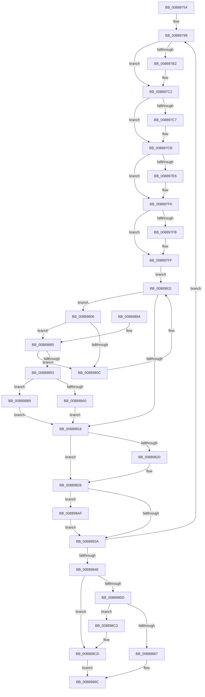

# AlpcpLocateSectionView

- RVA: `0x00889754`–`0x008898D4` (길이 `384` bytes)
- VA: `0x0000000140889754`
- 실행 섹션: `PAGE`
- PDB 이름 있음: `예`; PDB Function 태그: `아니요`
- unwind 정보 RVA: `0x0007CF48`
- 디코드: `115`개 명령, `384/384` bytes 표시
- 미해석 바이트: `0` (있으면 어셈블리에 `.byte`로 보존)

> 이 문서는 커널 이미지의 기계어와 PDB 기호를 분석해 생성했습니다. 4번과 5번은 함수 원형과 자료형을 바이너리 사용 방식에서 추정한 C 해석이며 원본 소스 복구 결과는 아닙니다.

## 1. Dependencies

- 직접 호출 지점: **10**; 고유 호출 대상: **6**
- 직접 호출자로 확인된 함수: **2**
- RIP 상대 이미지 참조: **0**

### Outgoing calls
- `0x008897A1` → [KeAbPreAcquire](../../text/21/KeAbPreAcquire_function_00210230.md) (function, `0x00210230`)
- `0x008897BD` → [ExfAcquirePushLockSharedEx](../../text/21/ExfAcquirePushLockSharedEx_function_0021044C.md) (function, `0x0021044C`)
- `0x008897D5` → [KeAbPreAcquire](../../text/21/KeAbPreAcquire_function_00210230.md) (function, `0x00210230`)
- `0x008897F1` → [ExfAcquirePushLockSharedEx](../../text/21/ExfAcquirePushLockSharedEx_function_0021044C.md) (function, `0x0021044C`)
- `0x00889823` → [ExfReleasePushLockShared](../../text/26/ExfReleasePushLockShared_function_00263440.md) (function, `0x00263440`)
- `0x0088982B` → [KeAbPostRelease](../../text/2E/KeAbPostRelease_function_002E1600.md) (function, `0x002E1600`)
- `0x0088983D` → [KeAbPostRelease](../../text/2E/KeAbPostRelease_function_002E1600.md) (function, `0x002E1600`)
- `0x00889896` → [AlpcpReferenceBlob](../89/AlpcpReferenceBlob_function_00890110.md) (function, `0x00890110`)
- `0x008898B2` → [ExfReleasePushLockShared](../../text/26/ExfReleasePushLockShared_function_00263440.md) (function, `0x00263440`)
- `0x008898C8` → [AlpcpDereferenceBlobEx](AlpcpDereferenceBlobEx_function_0088AF00.md) (function, `0x0088AF00`)

### Direct callers
- [AlpcpCaptureViewAttribute](AlpcpCaptureViewAttribute_function_0088957C.md) at `0x008896AC`
- [AlpcpCaptureViewAttributeInternal](AlpcpCaptureViewAttributeInternal_function_00889C6C.md) at `0x00889D4F`

### Static image references
- 디코드된 RIP-relative 메모리 참조가 없습니다.

## 2. Other-region calls and transfers

- 다른 실행 섹션으로 향하는 call: **8**
  - `0x008897A1` → [KeAbPreAcquire](../../text/21/KeAbPreAcquire_function_00210230.md) (`PAGE` → `.text`)
  - `0x008897BD` → [ExfAcquirePushLockSharedEx](../../text/21/ExfAcquirePushLockSharedEx_function_0021044C.md) (`PAGE` → `.text`)
  - `0x008897D5` → [KeAbPreAcquire](../../text/21/KeAbPreAcquire_function_00210230.md) (`PAGE` → `.text`)
  - `0x008897F1` → [ExfAcquirePushLockSharedEx](../../text/21/ExfAcquirePushLockSharedEx_function_0021044C.md) (`PAGE` → `.text`)
  - `0x00889823` → [ExfReleasePushLockShared](../../text/26/ExfReleasePushLockShared_function_00263440.md) (`PAGE` → `.text`)
  - `0x0088982B` → [KeAbPostRelease](../../text/2E/KeAbPostRelease_function_002E1600.md) (`PAGE` → `.text`)
  - `0x0088983D` → [KeAbPostRelease](../../text/2E/KeAbPostRelease_function_002E1600.md) (`PAGE` → `.text`)
  - `0x008898B2` → [ExfReleasePushLockShared](../../text/26/ExfReleasePushLockShared_function_00263440.md) (`PAGE` → `.text`)
- 별도 외부 분기/꼬리 이동을 확인하지 못했습니다.

## 3. Assembly (complete function range)

```asm
00889754  48 89 5C 24 18                  mov qword ptr [rsp + 0x18], rbx
00889759  48 89 4C 24 08                  mov qword ptr [rsp + 8], rcx
0088975E  55                              push rbp
0088975F  56                              push rsi
00889760  57                              push rdi
00889761  41 54                           push r12
00889763  41 55                           push r13
00889765  41 56                           push r14
00889767  41 57                           push r15
00889769  48 83 EC 30                     sub rsp, 0x30
0088976D  33 ED                           xor ebp, ebp
0088976F  4C 8D B2 50 01 00 00            lea r14, [rdx + 0x150]
00889776  0F 57 C0                        xorps xmm0, xmm0
00889779  49 89 29                        mov qword ptr [r9], rbp
0088977C  4D 8B F9                        mov r15, r9
0088977F  48 8D B2 48 01 00 00            lea rsi, [rdx + 0x148]
00889786  4D 8B E8                        mov r13, r8
00889789  48 8D 9A 60 01 00 00            lea rbx, [rdx + 0x160]
00889790  44 8D 65 11                     lea r12d, [rbp + 0x11]
00889794  0F 11 44 24 20                  movups xmmword ptr [rsp + 0x20], xmm0
00889799  45 33 C0                        xor r8d, r8d
0088979C  33 D2                           xor edx, edx
0088979E  48 8B CB                        mov rcx, rbx
008897A1  E8 8A 6A 98 FF                  call 0x140210230
008897A6  48 8B F8                        mov rdi, rax
008897A9  33 C0                           xor eax, eax
008897AB  F0 4C 0F B1 23                  lock cmpxchg qword ptr [rbx], r12
008897B0  74 10                           je 0x1408897c2
008897B2  4C 8B CB                        mov r9, rbx
008897B5  4C 8B C7                        mov r8, rdi
008897B8  33 D2                           xor edx, edx
008897BA  48 8B CB                        mov rcx, rbx
008897BD  E8 8A 6C 98 FF                  call 0x14021044c
008897C2  48 85 FF                        test rdi, rdi
008897C5  74 04                           je 0x1408897cb
008897C7  C6 47 0A 01                     mov byte ptr [rdi + 0xa], 1
008897CB  45 33 C0                        xor r8d, r8d
008897CE  33 D2                           xor edx, edx
008897D0  48 8B CE                        mov rcx, rsi
008897D3  8B FD                           mov edi, ebp
008897D5  E8 56 6A 98 FF                  call 0x140210230
008897DA  48 8B E8                        mov rbp, rax
008897DD  33 C0                           xor eax, eax
008897DF  F0 4C 0F B1 26                  lock cmpxchg qword ptr [rsi], r12
008897E4  74 10                           je 0x1408897f6
008897E6  4C 8B CE                        mov r9, rsi
008897E9  4C 8B C5                        mov r8, rbp
008897EC  33 D2                           xor edx, edx
008897EE  48 8B CE                        mov rcx, rsi
008897F1  E8 56 6C 98 FF                  call 0x14021044c
008897F6  48 85 ED                        test rbp, rbp
008897F9  74 04                           je 0x1408897ff
008897FB  C6 45 0A 01                     mov byte ptr [rbp + 0xa], 1
008897FF  49 8B 06                        mov rax, qword ptr [r14]
00889802  33 ED                           xor ebp, ebp
00889804  EB 0B                           jmp 0x140889811
00889806  80 78 11 06                     cmp byte ptr [rax + 0x11], 6
0088980A  74 79                           je 0x140889885
0088980C  48 8B 00                        mov rax, qword ptr [rax]
0088980F  8B FD                           mov edi, ebp
00889811  49 3B C6                        cmp rax, r14
00889814  75 F0                           jne 0x140889806
00889816  49 8B C4                        mov rax, r12
00889819  F0 48 0F B1 2E                  lock cmpxchg qword ptr [rsi], rbp
0088981E  74 08                           je 0x140889828
00889820  48 8B CE                        mov rcx, rsi
00889823  E8 18 9C 9D FF                  call 0x140263440
00889828  48 8B CE                        mov rcx, rsi
0088982B  E8 D0 7D A5 FF                  call 0x1402e1600
00889830  49 8B C4                        mov rax, r12
00889833  F0 48 0F B1 2B                  lock cmpxchg qword ptr [rbx], rbp
00889838  75 75                           jne 0x1408898af
0088983A  48 8B CB                        mov rcx, rbx
0088983D  E8 BE 7D A5 FF                  call 0x1402e1600
00889842  81 FF 2D 02 00 C0               cmp edi, 0xc000022d
00889848  0F 84 4B FF FF FF               je 0x140889799
0088984E  48 8B 4C 24 28                  mov rcx, qword ptr [rsp + 0x28]
00889853  4C 8B 64 24 70                  mov r12, qword ptr [rsp + 0x70]
00889858  48 85 C9                        test rcx, rcx
0088985B  74 70                           je 0x1408898cd
0088985D  48 8B 41 10                     mov rax, qword ptr [rcx + 0x10]
00889861  4C 39 60 10                     cmp qword ptr [rax + 0x10], r12
00889865  75 5C                           jne 0x1408898c3
00889867  49 89 0F                        mov qword ptr [r15], rcx
0088986A  33 C0                           xor eax, eax
0088986C  48 8B 9C 24 80 00 00 00         mov rbx, qword ptr [rsp + 0x80]
00889874  48 83 C4 30                     add rsp, 0x30
00889878  41 5F                           pop r15
0088987A  41 5E                           pop r14
0088987C  41 5D                           pop r13
0088987E  41 5C                           pop r12
00889880  5F                              pop rdi
00889881  5E                              pop rsi
00889882  5D                              pop rbp
00889883  C3                              ret
00889884  CC                              int3
00889885  48 8D 78 30                     lea rdi, [rax + 0x30]
00889889  4C 39 6F 28                     cmp qword ptr [rdi + 0x28], r13
0088988D  0F 85 79 FF FF FF               jne 0x14088980c
00889893  48 8B CF                        mov rcx, rdi
00889896  E8 75 68 00 00                  call 0x140890110
0088989B  48 85 C0                        test rax, rax
0088989E  74 19                           je 0x1408898b9
008898A0  48 89 7C 24 28                  mov qword ptr [rsp + 0x28], rdi
008898A5  BF 01 00 00 C0                  mov edi, 0xc0000001
008898AA  E9 67 FF FF FF                  jmp 0x140889816
008898AF  48 8B CB                        mov rcx, rbx
008898B2  E8 89 9B 9D FF                  call 0x140263440
008898B7  EB 81                           jmp 0x14088983a
008898B9  BF 2D 02 00 C0                  mov edi, 0xc000022d
008898BE  E9 53 FF FF FF                  jmp 0x140889816
008898C3  BA 01 00 00 00                  mov edx, 1
008898C8  E8 33 16 00 00                  call 0x14088af00
008898CD  B8 41 01 00 C0                  mov eax, 0xc0000141
008898D2  EB 98                           jmp 0x14088986c
```

## 4. C-style interpretation (structured pseudocode)

```c
__int64 __fastcall AlpcpLocateSectionView(__int64 a1, __int64 a2, __int64 a3, __int64 a4)
{
    __int64 result;
    __int64 v_rbp;
    __int64 v_rsp;
    unsigned __int64 v_stack_m40;
    unsigned __int64 v_stack_m48;
    unsigned __int64 v_stack_p18;
    unsigned __int64 v_stack_p28;
    unsigned __int64 v_stack_p8;

    v_stack_p18 = v_rbx;
    v_stack_p8 = a1;
    v_rsp = (v_rsp) - (48);
    v_rbp = 0;
    *(unsigned __int64 *)(a4) = 0;
    v_stack_m48 = v_xmm0;
loc_00889799:
    a3 = 0;
    a2 = 0;
    result = KeAbPreAcquire(a2 + 352, a2, a3, a4);
    result = 0;
    if (!(condition_is_equal)) {
        a4 = a2 + 352;
        a3 = 0;
        a2 = 0;
        a1 = a2 + 352;
        result = ExfAcquirePushLockSharedEx(a1, a2, a3, a4);
    }
    if (result != 0) {
        *(unsigned __int8 *)(result + 10) = 1;
    }
    a3 = 0;
    a2 = 0;
    result = KeAbPreAcquire(a2 + 328, a2, a3, a4);
    result = 0;
    if (!(condition_is_equal)) {
        a4 = a2 + 328;
        a3 = 0;
        a2 = 0;
        a1 = a2 + 328;
        result = ExfAcquirePushLockSharedEx(a1, a2, a3, a4);
    }
    if (result != 0) {
        *(unsigned __int8 *)(result + 10) = 1;
    }
    v_rbp = 0;
    goto loc_00889811;
loc_00889806:
    if ((*(unsigned __int8 *)(*(unsigned __int64 *)(a2 + 336) + 17)) == 6) goto loc_00889885;
loc_0088980C:
loc_00889811:
    if ((*(unsigned __int64 *)(*(unsigned __int64 *)(a2 + 336))) != (a2 + 336)) goto loc_00889806;
loc_00889816:
    result = v_rbp + 17;
    if ((*(unsigned __int64 *)(*(unsigned __int64 *)(a2 + 336))) != (a2 + 336)) {
        a1 = a2 + 328;
        result = ExfReleasePushLockShared(a1, a2, a3, a4);
    }
    result = KeAbPostRelease(a2 + 328, a2, a3, a4);
    if ((*(unsigned __int64 *)(*(unsigned __int64 *)(a2 + 336))) != (a2 + 336)) goto loc_008898AF;
loc_0088983A:
    result = KeAbPostRelease(a2 + 352, a2, a3, a4);
    if (0 == 0xC000022DULL) goto loc_00889799;
    if (v_stack_m40 == 0) goto loc_008898CD;
    if ((*(unsigned __int64 *)(*(unsigned __int64 *)(v_stack_m40 + 16) + 16)) != v_stack_p8) goto loc_008898C3;
    *(unsigned __int64 *)(a4) = v_stack_m40;
    result = 0;
loc_0088986C:
    v_rsp = (v_rsp) + (48);
    return result;
loc_00889885:
    if ((*(unsigned __int64 *)(result + 48 + 40)) != a3) goto loc_0088980C;
    result = AlpcpReferenceBlob(result + 48, a2, a3, a4);
    if (result == 0) goto loc_008898B9;
    v_stack_p28 = result + 48;
    goto loc_00889816;
loc_008898AF:
    result = ExfReleasePushLockShared(v_stack_p18, a2, a3, a4);
    goto loc_0088983A;
loc_008898B9:
    goto loc_00889816;
loc_008898C3:
    result = AlpcpDereferenceBlobEx(v_stack_p18, 1, a3, a4);
loc_008898CD:
    goto loc_0088986C;
}
```

## 5. (Beta) C Style

```c
int64_t AlpcpLocateSectionView(int64_t Arg1, void *Arg2, int64_t Arg3, void *Arg4)
{
    uint8_t *arg2 = (uint8_t *)Arg2;
    uint8_t *arg4 = (uint8_t *)Arg4;

    int64_t result;
    int64_t local_rbp;
    int64_t local_rsp;
    uint64_t v_stack_m40;
    uint64_t v_stack_m48;
    uint64_t v_stack_p18;
    uint64_t v_stack_p28;
    uint64_t v_stack_p8;

    v_stack_p18 = local_rbx;
    v_stack_p8 = Arg1;
    local_rsp = (local_rsp) - (48);
    local_rbp = 0;
    *(uint64_t *)(arg4) = 0;
    v_stack_m48 = v_xmm0;
loc_00889799:
    Arg3 = 0;
    Arg2 = 0;
    result = KeAbPreAcquire(Arg2 + 352, Arg2, Arg3, Arg4);
    result = 0;
    if (!(condition_is_equal)) {
        Arg4 = Arg2 + 352;
        Arg3 = 0;
        Arg2 = 0;
        Arg1 = Arg2 + 352;
        result = ExfAcquirePushLockSharedEx(Arg1, Arg2, Arg3, Arg4);
    }
    if (result != 0) {
        *(uint8_t *)(result + 0xA) = 1;
    }
    Arg3 = 0;
    Arg2 = 0;
    result = KeAbPreAcquire(Arg2 + 328, Arg2, Arg3, Arg4);
    result = 0;
    if (!(condition_is_equal)) {
        Arg4 = Arg2 + 328;
        Arg3 = 0;
        Arg2 = 0;
        Arg1 = Arg2 + 328;
        result = ExfAcquirePushLockSharedEx(Arg1, Arg2, Arg3, Arg4);
    }
    if (result != 0) {
        *(uint8_t *)(result + 0xA) = 1;
    }
    local_rbp = 0;
    goto loc_00889811;
loc_00889806:
    if ((*(uint8_t *)(*(uint64_t *)(arg2 + 0x150) + 0x11)) == 6) goto loc_00889885;
loc_0088980C:
loc_00889811:
    if ((*(uint64_t *)(*(uint64_t *)(arg2 + 0x150))) != (Arg2 + 336)) goto loc_00889806;
loc_00889816:
    result = local_rbp + 17;
    if ((*(uint64_t *)(*(uint64_t *)(arg2 + 0x150))) != (Arg2 + 336)) {
        Arg1 = Arg2 + 328;
        result = ExfReleasePushLockShared(Arg1, Arg2, Arg3, Arg4);
    }
    result = KeAbPostRelease(Arg2 + 328, Arg2, Arg3, Arg4);
    if ((*(uint64_t *)(*(uint64_t *)(arg2 + 0x150))) != (Arg2 + 336)) goto loc_008898AF;
loc_0088983A:
    result = KeAbPostRelease(Arg2 + 352, Arg2, Arg3, Arg4);
    if (0 == 0xC000022DULL) goto loc_00889799;
    if (v_stack_m40 == 0) goto loc_008898CD;
    if ((*(uint64_t *)(*(uint64_t *)(v_stack_m40 + 0x10) + 0x10)) != v_stack_p8) goto loc_008898C3;
    *(uint64_t *)(arg4) = v_stack_m40;
    result = 0;
loc_0088986C:
    local_rsp = (local_rsp) + (48);
    return result;
loc_00889885:
    if ((*(uint64_t *)(result + 0x30 + 0x28)) != Arg3) goto loc_0088980C;
    result = AlpcpReferenceBlob(result + 48, Arg2, Arg3, Arg4);
    if (result == 0) goto loc_008898B9;
    v_stack_p28 = result + 48;
    goto loc_00889816;
loc_008898AF:
    result = ExfReleasePushLockShared(v_stack_p18, Arg2, Arg3, Arg4);
    goto loc_0088983A;
loc_008898B9:
    goto loc_00889816;
loc_008898C3:
    result = AlpcpDereferenceBlobEx(v_stack_p18, 1, Arg3, Arg4);
loc_008898CD:
    goto loc_0088986C;
}
```

### 관측된 메모리 오프셋

구조체 형식이 확인되지 않은 접근은 인자 기준의 오프셋으로만 기록했습니다.

| 기준 인자 | 오프셋 표현 | 폭 (bit) | 접근 |
|---|---:|---:|---|
| `Arg2` | `+ 0x0` | `64` | `R` |
| `Arg2` | `+ 0x148` | `64` | `R` |
| `Arg2` | `+ 0x150` | `64` | `R` |
| `Arg2` | `+ 0x160` | `64` | `R` |
| `Arg4` | `+ 0x0` | `64` | `W` |

## 6. Execution-region graph

[열기: 2D/3D 그래프와 함수 탐색 컨트롤 패널](../../../control-panel.html?section=page&rva=0x00889754&view=graph)

- 2D 그래프는 위에서 아래로 흐르고, 3D 그래프는 빈 공간을 드래그해 회전합니다. Shift+드래그는 이동, 휠은 확대·축소, 함수 노드 선택은 대상 보고서 이동입니다.

### Static fallback


