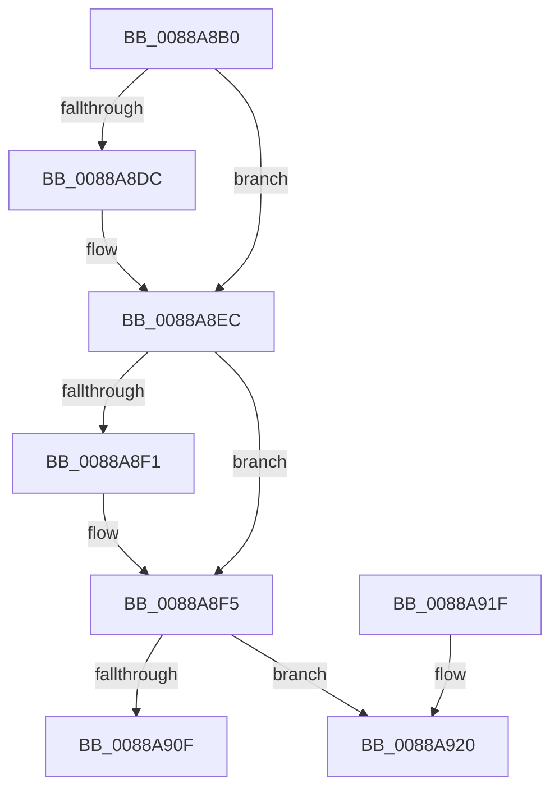

# AlpcpLockForCachedReferenceBlob

- RVA: `0x0088A8B0`–`0x0088A939` (길이 `137` bytes)
- VA: `0x000000014088A8B0`
- 실행 섹션: `PAGE`
- PDB 이름 있음: `예`; PDB Function 태그: `아니요`
- unwind 정보 RVA: `0x0005DCDC`
- 디코드: `38`개 명령, `137/137` bytes 표시
- 미해석 바이트: `0` (있으면 어셈블리에 `.byte`로 보존)

> 이 문서는 커널 이미지의 기계어와 PDB 기호를 분석해 생성했습니다. 4번과 5번은 함수 원형과 자료형을 바이너리 사용 방식에서 추정한 C 해석이며 원본 소스 복구 결과는 아닙니다.

## 1. Dependencies

- 직접 호출 지점: **3**; 고유 호출 대상: **3**
- 직접 호출자로 확인된 함수: **29**
- RIP 상대 이미지 참조: **0**

### Outgoing calls
- `0x0088A8CB` → [KeAbPreAcquire](../../text/21/KeAbPreAcquire_function_00210230.md) (function, `0x00210230`)
- `0x0088A8E7` → [ExfAcquirePushLockExclusiveEx](../../text/20/ExfAcquirePushLockExclusiveEx_function_0020FC90.md) (function, `0x0020FC90`)
- `0x0088A933` → [KeBugCheckEx](../../text/4F/KeBugCheckEx_function_004FD660.md) (function, `0x004FD660`)

### Direct callers
- [AlpcpForceUnlinkSecureView](../74/AlpcpForceUnlinkSecureView_function_0074C604.md) at `0x0074C642`
- [AlpcpPortQueryServerInfo](../74/AlpcpPortQueryServerInfo_function_0074C784.md) at `0x0074C889`
- [AlpcReserveDestroyProcedure](AlpcReserveDestroyProcedure_function_00888230.md) at `0x00888249`
- [AlpcpCreateSectionView](AlpcpCreateSectionView_function_0088850C.md) at `0x00888548`
- [AlpcpCreateSectionView](AlpcpCreateSectionView_function_0088850C.md) at `0x008885B7`
- [AlpcpCaptureViewAttribute](AlpcpCaptureViewAttribute_function_0088957C.md) at `0x00889608`
- [AlpcpPrepareViewForDelivery](AlpcpPrepareViewForDelivery_function_00889A44.md) at `0x00889A89`
- [sub_00889BDC](Unknown_function_00889BDC.md) at `0x00889BF9`
- [AlpcpCaptureViewAttributeInternal](AlpcpCaptureViewAttributeInternal_function_00889C6C.md) at `0x00889CB3`
- [AlpcSectionDeleteProcedure](AlpcSectionDeleteProcedure_function_0088A200.md) at `0x0088A233`
- [AlpcpCreateView](AlpcpCreateView_function_0088A9B8.md) at `0x0088A9F5`
- [AlpcViewDestroyProcedure](AlpcViewDestroyProcedure_function_0088B080.md) at `0x0088B0DE`
- [AlpcpSendMessage](AlpcpSendMessage_function_0088BD40.md) at `0x0088C9FF`
- [AlpcpExposeViewAttributeInSenderContext](AlpcpExposeViewAttributeInSenderContext_function_0088F600.md) at `0x0088F64B`
- [sub_00895B6D](../89/Unknown_function_00895B6D.md) at `0x00895CD6`
- [NtAlpcImpersonateClientOfPort](../89/NtAlpcImpersonateClientOfPort_function_008961A0.md) at `0x0089661F`
- [AlpcpReceiveMessagePort](../89/AlpcpReceiveMessagePort_function_00896B40.md) at `0x00896FA6`
- [AlpcpMapLegacyPortView](../92/AlpcpMapLegacyPortView_function_00921588.md) at `0x009216F1`
- [AlpcpSendLegacySynchronousRequest](../92/AlpcpSendLegacySynchronousRequest_function_0092376C.md) at `0x009238AF`
- [AlpcpDisconnectPort](../92/AlpcpDisconnectPort_function_00924A68.md) at `0x00924CB7`
- [AlpcpSendCloseMessage](../92/AlpcpSendCloseMessage_function_0092524C.md) at `0x009252BC`
- [AlpcpFlushMessagesPort](../92/AlpcpFlushMessagesPort_function_00925554.md) at `0x00925818`
- [AlpcpFlushMessagesPort](../92/AlpcpFlushMessagesPort_function_00925554.md) at `0x0092589B`
- [AlpcpFlushMessagesPort](../92/AlpcpFlushMessagesPort_function_00925554.md) at `0x009258EB`
- [AlpcpFlushMessagesPort](../92/AlpcpFlushMessagesPort_function_00925554.md) at `0x0092593B`
- [AlpcpFlushMessagesPort](../92/AlpcpFlushMessagesPort_function_00925554.md) at `0x00925C13`
- [AlpcpFlushMessagesPort](../92/AlpcpFlushMessagesPort_function_00925554.md) at `0x00925C61`
- [AlpcpFlushMessagesPort](../92/AlpcpFlushMessagesPort_function_00925554.md) at `0x00925CA7`
- [AlpcRegionDestroyProcedure](../A3/AlpcRegionDestroyProcedure_function_00A30540.md) at `0x00A30554`
- [AlpcpFlushMessagesByRequestor](../A3/AlpcpFlushMessagesByRequestor_function_00A352F0.md) at `0x00A3545C`
- [AlpcpQueryRemoteView](../A4/AlpcpQueryRemoteView_function_00A49744.md) at `0x00A497F4`
- [AlpcpReleaseViewAttribute](../A6/AlpcpReleaseViewAttribute_function_00A63A80.md) at `0x00A63A93`
- [AlpcpMapLegacyPortRemoteView](../A9/AlpcpMapLegacyPortRemoteView_function_00A9FEE4.md) at `0x00A9FF48`
- [sub_00B19294](../B1/Unknown_function_00B19294.md) at `0x00B192B7`
- [sub_00B197CC](../B1/Unknown_function_00B197CC.md) at `0x00B19896`
- [sub_00B22892](../B2/Unknown_function_00B22892.md) at `0x00B228CE`

### Static image references
- 디코드된 RIP-relative 메모리 참조가 없습니다.

## 2. Other-region calls and transfers

- 다른 실행 섹션으로 향하는 call: **3**
  - `0x0088A8CB` → [KeAbPreAcquire](../../text/21/KeAbPreAcquire_function_00210230.md) (`PAGE` → `.text`)
  - `0x0088A8E7` → [ExfAcquirePushLockExclusiveEx](../../text/20/ExfAcquirePushLockExclusiveEx_function_0020FC90.md) (`PAGE` → `.text`)
  - `0x0088A933` → [KeBugCheckEx](../../text/4F/KeBugCheckEx_function_004FD660.md) (`PAGE` → `.text`)
- 별도 외부 분기/꼬리 이동을 확인하지 못했습니다.

## 3. Assembly (complete function range)

```asm
0088A8B0  48 89 5C 24 08                  mov qword ptr [rsp + 8], rbx
0088A8B5  48 89 74 24 10                  mov qword ptr [rsp + 0x10], rsi
0088A8BA  57                              push rdi
0088A8BB  48 83 EC 30                     sub rsp, 0x30
0088A8BF  48 8B F9                        mov rdi, rcx
0088A8C2  45 33 C0                        xor r8d, r8d
0088A8C5  48 83 C1 F0                     add rcx, -0x10
0088A8C9  33 D2                           xor edx, edx
0088A8CB  E8 60 59 98 FF                  call 0x140210230
0088A8D0  F0 48 0F BA 6F F0 00            lock bts qword ptr [rdi - 0x10], 0
0088A8D7  48 8B D8                        mov rbx, rax
0088A8DA  73 10                           jae 0x14088a8ec
0088A8DC  4C 8D 47 F0                     lea r8, [rdi - 0x10]
0088A8E0  48 8B D0                        mov rdx, rax
0088A8E3  48 8D 4F F0                     lea rcx, [rdi - 0x10]
0088A8E7  E8 A4 53 98 FF                  call 0x14020fc90
0088A8EC  48 85 DB                        test rbx, rbx
0088A8EF  74 04                           je 0x14088a8f5
0088A8F1  C6 43 0A 01                     mov byte ptr [rbx + 0xa], 1
0088A8F5  80 4F E0 01                     or byte ptr [rdi - 0x20], 1
0088A8F9  B8 00 00 01 00                  mov eax, 0x10000
0088A8FE  F0 48 0F C1 47 E8               lock xadd qword ptr [rdi - 0x18], rax
0088A904  48 05 00 00 01 00               add rax, 0x10000
0088A90A  48 85 C0                        test rax, rax
0088A90D  7E 11                           jle 0x14088a920
0088A90F  48 8B 5C 24 40                  mov rbx, qword ptr [rsp + 0x40]
0088A914  48 8B 74 24 48                  mov rsi, qword ptr [rsp + 0x48]
0088A919  48 83 C4 30                     add rsp, 0x30
0088A91D  5F                              pop rdi
0088A91E  C3                              ret
0088A91F  CC                              int3
0088A920  33 D2                           xor edx, edx
0088A922  48 89 44 24 20                  mov qword ptr [rsp + 0x20], rax
0088A927  41 B9 26 00 00 00               mov r9d, 0x26
0088A92D  4C 8B C7                        mov r8, rdi
0088A930  8D 4A 18                        lea ecx, [rdx + 0x18]
0088A933  E8 28 2D C7 FF                  call 0x1404fd660
0088A938  CC                              int3
```

## 4. C-style interpretation (structured pseudocode)

```c
__int64 __fastcall AlpcpLockForCachedReferenceBlob(__int64 a1, int a2, int a3)
{
    __int64 result;
    __int64 v_rsp;
    unsigned __int64 v_stack_p10;
    unsigned __int64 v_stack_p20;
    unsigned __int64 v_stack_p8;

    v_stack_p8 = v_rbx;
    v_stack_p10 = v_rsi;
    v_rsp = (v_rsp) - (48);
    a3 = 0;
    a1 = (a1) + (-16);
    a2 = 0;
    result = KeAbPreAcquire(a1, a2, a3, a4);
    if (!(condition_is_above_or_equal)) {
        a3 = a1 - 16;
        a2 = result;
        a1 = a1 - 16;
        result = ExfAcquirePushLockExclusiveEx(a1, a2, a3, a4);
    }
    if (result != 0) {
        *(unsigned __int8 *)(result + 10) = 1;
    }
    result = ((unsigned int)(0x10000ULL)) + (0x10000ULL);
    if (condition_is_less_or_equal) goto loc_0088A920;
    v_rsp = (v_rsp) + (48);
    return result;
loc_0088A920:
    a2 = 0;
    v_stack_p20 = result;
    result = KeBugCheckEx(a2 + 24, a2, a1, 38);
    return result;
}
```

## 5. (Beta) C Style

```c
int64_t AlpcpLockForCachedReferenceBlob(void *Arg1, int32_t Arg2, int32_t Arg3)
{
    uint8_t *arg1 = (uint8_t *)Arg1;

    int64_t result;
    int64_t local_rsp;
    uint64_t v_stack_p10;
    uint64_t v_stack_p20;
    uint64_t v_stack_p8;

    v_stack_p8 = local_rbx;
    v_stack_p10 = local_rsi;
    local_rsp = (local_rsp) - (48);
    Arg3 = 0;
    Arg1 = (Arg1) + (-16);
    Arg2 = 0;
    result = KeAbPreAcquire(Arg1, Arg2, Arg3, a4);
    if (!(condition_is_above_or_equal)) {
        Arg3 = Arg1 - 16;
        Arg2 = result;
        Arg1 = Arg1 - 16;
        result = ExfAcquirePushLockExclusiveEx(Arg1, Arg2, Arg3, a4);
    }
    if (result != 0) {
        *(uint8_t *)(result + 0xA) = 1;
    }
    result = ((uint32_t)(0x10000ULL)) + (0x10000ULL);
    if (condition_is_less_or_equal) goto loc_0088A920;
    local_rsp = (local_rsp) + (48);
    return result;
loc_0088A920:
    Arg2 = 0;
    v_stack_p20 = result;
    result = KeBugCheckEx(Arg2 + 24, Arg2, Arg1, 38);
    return result;
}
```

### 관측된 메모리 오프셋

구조체 형식이 확인되지 않은 접근은 인자 기준의 오프셋으로만 기록했습니다.

| 기준 인자 | 오프셋 표현 | 폭 (bit) | 접근 |
|---|---:|---:|---|
| `Arg1` | `- 0x20` | `8` | `R/W` |
| `Arg1` | `- 0x18` | `64` | `R/W` |
| `Arg1` | `- 0x10` | `64` | `R` |
| `Arg1` | `- 0x10` | `64` | `R/W` |

## 6. Execution-region graph

[열기: 2D/3D 그래프와 함수 탐색 컨트롤 패널](../../../control-panel.html?section=page&rva=0x0088A8B0&view=graph)

- 2D 그래프는 위에서 아래로 흐르고, 3D 그래프는 빈 공간을 드래그해 회전합니다. Shift+드래그는 이동, 휠은 확대·축소, 함수 노드 선택은 대상 보고서 이동입니다.

### Static fallback


