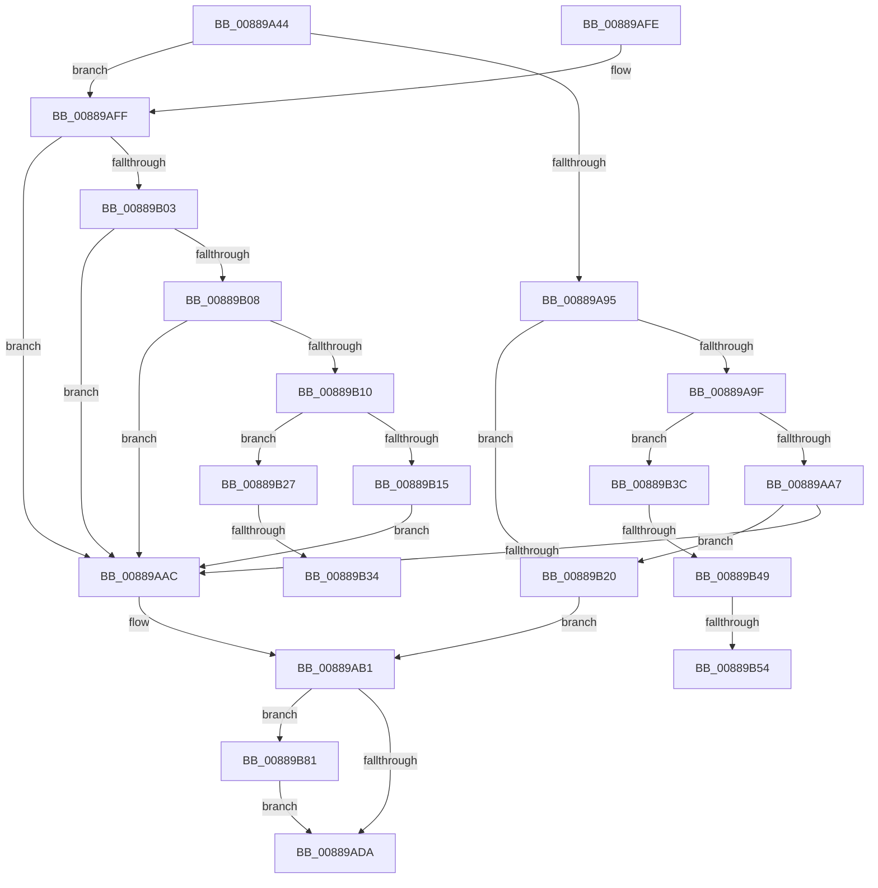

# AlpcpPrepareViewForDelivery

- RVA: `0x00889A44`–`0x00889B93` (길이 `335` bytes)
- VA: `0x0000000140889A44`
- 실행 섹션: `PAGE`
- PDB 이름 있음: `예`; PDB Function 태그: `예`
- unwind 정보 RVA: `0x0007CF80`
- 디코드: `94`개 명령, `335/335` bytes 표시
- 미해석 바이트: `0` (있으면 어셈블리에 `.byte`로 보존)

> 이 문서는 커널 이미지의 기계어와 PDB 기호를 분석해 생성했습니다. 4번과 5번은 함수 원형과 자료형을 바이너리 사용 방식에서 추정한 C 해석이며 원본 소스 복구 결과는 아닙니다.

## 1. Dependencies

- 직접 호출 지점: **7**; 고유 호출 대상: **7**
- 직접 호출자로 확인된 함수: **2**
- RIP 상대 이미지 참조: **1**

### Outgoing calls
- `0x00889A89` → [AlpcpLockForCachedReferenceBlob](AlpcpLockForCachedReferenceBlob_function_0088A8B0.md) (function, `0x0088A8B0`)
- `0x00889ACC` → [AlpcpUnlockBlob](AlpcpUnlockBlob_function_0088B990.md) (function, `0x0088B990`)
- `0x00889AE4` → [_security_check_cookie](../../text/6A/_security_check_cookie_function_006AC640.md) (function, `0x006AC640`)
- `0x00889B5D` → [KeStackAttachProcess](../../text/21/KeStackAttachProcess_function_00216800.md) (function, `0x00216800`)
- `0x00889B66` → [MmUnsecureVirtualMemory](MmUnsecureVirtualMemory_function_0088A2A0.md) (function, `0x0088A2A0`)
- `0x00889B72` → [KiUnstackDetachProcess](../../text/21/KiUnstackDetachProcess_function_00217D30.md) (function, `0x00217D30`)
- `0x00889B89` → [AlpcpDereferenceBlobEx](AlpcpDereferenceBlobEx_function_0088AF00.md) (function, `0x0088AF00`)

### Direct callers
- [AlpcpCaptureViewAttribute](AlpcpCaptureViewAttribute_function_0088957C.md) at `0x008896DA`
- [AlpcpCaptureViewAttributeInternal](AlpcpCaptureViewAttributeInternal_function_00889C6C.md) at `0x00889D7C`

### Static image references
- `0x00889A56` → RVA `0x00E0A740` (`.data`; read)

## 2. Other-region calls and transfers

- 다른 실행 섹션으로 향하는 call: **3**
  - `0x00889AE4` → [_security_check_cookie](../../text/6A/_security_check_cookie_function_006AC640.md) (`PAGE` → `.text`)
  - `0x00889B5D` → [KeStackAttachProcess](../../text/21/KeStackAttachProcess_function_00216800.md) (`PAGE` → `.text`)
  - `0x00889B72` → [KiUnstackDetachProcess](../../text/21/KiUnstackDetachProcess_function_00217D30.md) (`PAGE` → `.text`)
- call이 아닌 외부 분기/꼬리 이동: **5**
  - `0x00889B2E` → [sub_00B191AC](../B1/Unknown_function_00B191AC.md) (`tail-transfer`)
  - `0x00889B37` → [sub_00B191AC](../B1/Unknown_function_00B191AC.md) (`tail-transfer`)
  - `0x00889B43` → [sub_00B191AC + 0x4B](../B1/Unknown_function_00B191AC.md) (`tail-transfer`)
  - `0x00889B4E` → [sub_00B191AC + 0x42](../B1/Unknown_function_00B191AC.md) (`tail-transfer`)
  - `0x00889B7C` → [sub_00B191AC + 0x42](../B1/Unknown_function_00B191AC.md) (`tail-transfer`)

## 3. Assembly (complete function range)

```asm
00889A44  48 89 5C 24 10                  mov qword ptr [rsp + 0x10], rbx
00889A49  48 89 6C 24 18                  mov qword ptr [rsp + 0x18], rbp
00889A4E  56                              push rsi
00889A4F  57                              push rdi
00889A50  41 56                           push r14
00889A52  48 83 EC 60                     sub rsp, 0x60
00889A56  48 8B 05 E3 0C 58 00            mov rax, qword ptr [rip + 0x580ce3]
00889A5D  48 33 C4                        xor rax, rsp
00889A60  48 89 44 24 50                  mov qword ptr [rsp + 0x50], rax
00889A65  48 8B 71 10                     mov rsi, qword ptr [rcx + 0x10]
00889A69  0F 57 C0                        xorps xmm0, xmm0
00889A6C  48 8B F9                        mov rdi, rcx
00889A6F  45 0F B6 F0                     movzx r14d, r8b
00889A73  48 8B CE                        mov rcx, rsi
00889A76  8A DA                           mov bl, dl
00889A78  0F 11 44 24 20                  movups xmmword ptr [rsp + 0x20], xmm0
00889A7D  33 ED                           xor ebp, ebp
00889A7F  0F 11 44 24 30                  movups xmmword ptr [rsp + 0x30], xmm0
00889A84  0F 11 44 24 40                  movups xmmword ptr [rsp + 0x40], xmm0
00889A89  E8 22 0E 00 00                  call 0x14088a8b0
00889A8E  8B 46 30                        mov eax, dword ptr [rsi + 0x30]
00889A91  A8 01                           test al, 1
00889A93  74 6A                           je 0x140889aff
00889A95  48 3B 7E 50                     cmp rdi, qword ptr [rsi + 0x50]
00889A99  0F 85 81 00 00 00               jne 0x140889b20
00889A9F  84 DB                           test bl, bl
00889AA1  0F 84 95 00 00 00               je 0x140889b3c
00889AA7  39 6F 4C                        cmp dword ptr [rdi + 0x4c], ebp
00889AAA  77 74                           ja 0x140889b20
00889AAC  33 DB                           xor ebx, ebx
00889AAE  FF 47 4C                        inc dword ptr [rdi + 0x4c]
00889AB1  44 8B 47 48                     mov r8d, dword ptr [rdi + 0x48]
00889AB5  45 8B CE                        mov r9d, r14d
00889AB8  45 03 C9                        add r9d, r9d
00889ABB  48 8B CE                        mov rcx, rsi
00889ABE  45 33 C8                        xor r9d, r8d
00889AC1  41 83 E1 02                     and r9d, 2
00889AC5  45 33 C8                        xor r9d, r8d
00889AC8  44 89 4F 48                     mov dword ptr [rdi + 0x48], r9d
00889ACC  E8 BF 1E 00 00                  call 0x14088b990
00889AD1  48 85 ED                        test rbp, rbp
00889AD4  0F 85 A7 00 00 00               jne 0x140889b81
00889ADA  8B C3                           mov eax, ebx
00889ADC  48 8B 4C 24 50                  mov rcx, qword ptr [rsp + 0x50]
00889AE1  48 33 CC                        xor rcx, rsp
00889AE4  E8 57 2B E2 FF                  call 0x1406ac640
00889AE9  4C 8D 5C 24 60                  lea r11, [rsp + 0x60]
00889AEE  49 8B 5B 28                     mov rbx, qword ptr [r11 + 0x28]
00889AF2  49 8B 6B 30                     mov rbp, qword ptr [r11 + 0x30]
00889AF6  49 8B E3                        mov rsp, r11
00889AF9  41 5E                           pop r14
00889AFB  5F                              pop rdi
00889AFC  5E                              pop rsi
00889AFD  C3                              ret
00889AFE  CC                              int3
00889AFF  84 DB                           test bl, bl
00889B01  74 A9                           je 0x140889aac
00889B03  39 6F 4C                        cmp dword ptr [rdi + 0x4c], ebp
00889B06  77 A4                           ja 0x140889aac
00889B08  8B 4E 34                        mov ecx, dword ptr [rsi + 0x34]
00889B0B  83 F9 02                        cmp ecx, 2
00889B0E  77 9C                           ja 0x140889aac
00889B10  83 F9 01                        cmp ecx, 1
00889B13  75 12                           jne 0x140889b27
00889B15  0B C1                           or eax, ecx
00889B17  48 89 7E 50                     mov qword ptr [rsi + 0x50], rdi
00889B1B  89 46 30                        mov dword ptr [rsi + 0x30], eax
00889B1E  EB 8C                           jmp 0x140889aac
00889B20  BB 22 00 00 C0                  mov ebx, 0xc0000022
00889B25  EB 8A                           jmp 0x140889ab1
00889B27  48 8B 5E 38                     mov rbx, qword ptr [rsi + 0x38]
00889B2B  48 3B DF                        cmp rbx, rdi
00889B2E  0F 85 78 F6 28 00               jne 0x140b191ac
00889B34  48 8B 1B                        mov rbx, qword ptr [rbx]
00889B37  E9 70 F6 28 00                  jmp 0x140b191ac
00889B3C  48 8B 6E 48                     mov rbp, qword ptr [rsi + 0x48]
00889B40  48 85 ED                        test rbp, rbp
00889B43  0F 84 AE F6 28 00               je 0x140b191f7
00889B49  48 83 7D 40 00                  cmp qword ptr [rbp + 0x40], 0
00889B4E  0F 84 9A F6 28 00               je 0x140b191ee
00889B54  48 8B 4D 20                     mov rcx, qword ptr [rbp + 0x20]
00889B58  48 8D 54 24 20                  lea rdx, [rsp + 0x20]
00889B5D  E8 9E CC 98 FF                  call 0x140216800
00889B62  48 8B 4D 40                     mov rcx, qword ptr [rbp + 0x40]
00889B66  E8 35 07 00 00                  call 0x14088a2a0
00889B6B  33 D2                           xor edx, edx
00889B6D  48 8D 4C 24 20                  lea rcx, [rsp + 0x20]
00889B72  E8 B9 E1 98 FF                  call 0x140217d30
00889B77  48 83 65 40 00                  and qword ptr [rbp + 0x40], 0
00889B7C  E9 6D F6 28 00                  jmp 0x140b191ee
00889B81  BA 01 00 00 00                  mov edx, 1
00889B86  48 8B CD                        mov rcx, rbp
00889B89  E8 72 13 00 00                  call 0x14088af00
00889B8E  E9 47 FF FF FF                  jmp 0x140889ada
```

## 4. C-style interpretation (structured pseudocode)

```c
__int64 __fastcall AlpcpPrepareViewForDelivery(__int64 a1, unsigned __int8 a2, unsigned __int8 a3)
{
    __int64 result;
    __int64 v_rbp;
    __int64 v_rbx;
    __int64 v_rsp;
    unsigned __int64 v_stack_m18;
    unsigned __int64 v_stack_m28;
    unsigned __int64 v_stack_m38;
    unsigned __int64 v_stack_m40;
    unsigned __int64 v_stack_m48;
    unsigned __int64 v_stack_m58;
    unsigned __int64 v_stack_p10;
    unsigned __int64 v_stack_p18;

    v_stack_p10 = v_rbx;
    v_stack_p18 = v_rbp;
    v_rsp = (v_rsp) - (96);
    result = (*(unsigned __int64 *)(v_rip + 5770467)) ^ (v_rsp);
    v_stack_m28 = result;
    v_stack_m58 = v_xmm0;
    v_rbp = 0;
    v_stack_m48 = v_xmm0;
    v_stack_m38 = v_xmm0;
    result = AlpcpLockForCachedReferenceBlob(*(unsigned __int64 *)(a1 + 16), a2, a3, a4);
    if ((((unsigned __int8)((unsigned int)(*(unsigned int *)(*(unsigned __int64 *)(a1 + 16) + 48)))) & (1)) == 0) goto loc_00889AFF;
    if (a1 != (*(unsigned __int64 *)(*(unsigned __int64 *)(a1 + 16) + 80))) goto loc_00889B20;
    if (a2 == 0) goto loc_00889B3C;
    if ((*(unsigned int *)(a1 + 76)) > 0) goto loc_00889B20;
loc_00889AAC:
    v_rbx = 0;
loc_00889AB1:
    a4 = (unsigned int)(((unsigned int)(a3)) + ((unsigned int)((unsigned int)(a3))));
    a4 = (unsigned int)((a4) ^ ((unsigned int)((unsigned int)(*(unsigned int *)(a1 + 72)))));
    a4 = (unsigned int)((a4) & (2));
    a4 = (unsigned int)((a4) ^ ((unsigned int)((unsigned int)(*(unsigned int *)(a1 + 72)))));
    *(unsigned int *)(a1 + 72) = (unsigned int)(a4);
    result = AlpcpUnlockBlob(*(unsigned __int64 *)(a1 + 16), a2, (unsigned int)(*(unsigned int *)(a1 + 72)), a4);
    if (0 != 0) goto loc_00889B81;
loc_00889ADA:
    a1 = (v_stack_m28) ^ (v_rsp);
    result = _security_check_cookie(a1, a2, (unsigned int)(*(unsigned int *)(a1 + 72)), a4);
    return result;
loc_00889AFF:
    if ((unsigned __int8)(*(unsigned __int64 *)(v_stack_m18 + 40)) == 0) goto loc_00889AAC;
    if ((*(unsigned int *)(a1 + 76)) > ((unsigned int)(*(unsigned __int64 *)(v_stack_m18 + 48)))) goto loc_00889AAC;
    if (((unsigned int)((unsigned int)(*(unsigned int *)(*(unsigned __int64 *)(a1 + 16) + 52)))) > 2) goto loc_00889AAC;
    if (((unsigned int)((unsigned int)(*(unsigned int *)(*(unsigned __int64 *)(a1 + 16) + 52)))) != 1) goto loc_00889B27;
    result = (unsigned int)((result) | ((unsigned int)((unsigned int)(*(unsigned int *)(*(unsigned __int64 *)(a1 + 16) + 52)))));
    *(unsigned __int64 *)(*(unsigned __int64 *)(a1 + 16) + 80) = a1;
    *(unsigned int *)(*(unsigned __int64 *)(a1 + 16) + 48) = (unsigned int)(result);
    goto loc_00889AAC;
loc_00889B20:
    goto loc_00889AB1;
loc_00889B27:
loc_00889B3C:
    result = KeStackAttachProcess(*(unsigned __int64 *)(*(unsigned __int64 *)(*(unsigned __int64 *)(a1 + 16) + 72) + 32), v_stack_m40, (unsigned int)(*(unsigned int *)(a1 + 72)), a4);
    result = MmUnsecureVirtualMemory(*(unsigned __int64 *)(*(unsigned __int64 *)(*(unsigned __int64 *)(a1 + 16) + 72) + 64), v_stack_m40, (unsigned int)(*(unsigned int *)(a1 + 72)), a4);
    a2 = 0;
    result = KiUnstackDetachProcess(v_stack_m40, a2, (unsigned int)(*(unsigned int *)(a1 + 72)), a4);
loc_00889B81:
    result = AlpcpDereferenceBlobEx(*(unsigned __int64 *)(*(unsigned __int64 *)(a1 + 16) + 72), 1, (unsigned int)(*(unsigned int *)(a1 + 72)), a4);
    goto loc_00889ADA;
}
```

## 5. (Beta) C Style

```c
int64_t AlpcpPrepareViewForDelivery(void *Arg1, uint8_t Arg2, uint8_t Arg3)
{
    uint8_t *arg1 = (uint8_t *)Arg1;

    int64_t result;
    int64_t local_rbp;
    int64_t local_rbx;
    int64_t local_rsp;
    uint64_t v_stack_m18;
    uint64_t v_stack_m28;
    uint64_t v_stack_m38;
    uint64_t v_stack_m40;
    uint64_t v_stack_m48;
    uint64_t v_stack_m58;
    uint64_t v_stack_p10;
    uint64_t v_stack_p18;

    v_stack_p10 = local_rbx;
    v_stack_p18 = local_rbp;
    local_rsp = (local_rsp) - (96);
    result = (*(uint64_t *)(v_rip + 0x580CE3)) ^ (local_rsp);
    v_stack_m28 = result;
    v_stack_m58 = v_xmm0;
    local_rbp = 0;
    v_stack_m48 = v_xmm0;
    v_stack_m38 = v_xmm0;
    result = AlpcpLockForCachedReferenceBlob(*(uint64_t *)(arg1 + 0x10), Arg2, Arg3, a4);
    if ((((uint8_t)((uint32_t)(*(uint32_t *)(*(uint64_t *)(arg1 + 0x10) + 0x30)))) & (1)) == 0) goto loc_00889AFF;
    if (Arg1 != (*(uint64_t *)(*(uint64_t *)(arg1 + 0x10) + 0x50))) goto loc_00889B20;
    if (Arg2 == 0) goto loc_00889B3C;
    if ((*(uint32_t *)(arg1 + 0x4C)) > 0) goto loc_00889B20;
loc_00889AAC:
    local_rbx = 0;
loc_00889AB1:
    a4 = (uint32_t)(((uint32_t)(Arg3)) + ((uint32_t)((uint32_t)(Arg3))));
    a4 = (uint32_t)((a4) ^ ((uint32_t)((uint32_t)(*(uint32_t *)(arg1 + 0x48)))));
    a4 = (uint32_t)((a4) & (2));
    a4 = (uint32_t)((a4) ^ ((uint32_t)((uint32_t)(*(uint32_t *)(arg1 + 0x48)))));
    *(uint32_t *)(arg1 + 0x48) = (uint32_t)(a4);
    result = AlpcpUnlockBlob(*(uint64_t *)(arg1 + 0x10), Arg2, (uint32_t)(*(uint32_t *)(arg1 + 0x48)), a4);
    if (0 != 0) goto loc_00889B81;
loc_00889ADA:
    Arg1 = (v_stack_m28) ^ (local_rsp);
    result = _security_check_cookie(Arg1, Arg2, (uint32_t)(*(uint32_t *)(arg1 + 0x48)), a4);
    return result;
loc_00889AFF:
    if ((uint8_t)(*(uint64_t *)(v_stack_m18 + 0x28)) == 0) goto loc_00889AAC;
    if ((*(uint32_t *)(arg1 + 0x4C)) > ((uint32_t)(*(uint64_t *)(v_stack_m18 + 0x30)))) goto loc_00889AAC;
    if (((uint32_t)((uint32_t)(*(uint32_t *)(*(uint64_t *)(arg1 + 0x10) + 0x34)))) > 2) goto loc_00889AAC;
    if (((uint32_t)((uint32_t)(*(uint32_t *)(*(uint64_t *)(arg1 + 0x10) + 0x34)))) != 1) goto loc_00889B27;
    result = (uint32_t)((result) | ((uint32_t)((uint32_t)(*(uint32_t *)(*(uint64_t *)(arg1 + 0x10) + 0x34)))));
    *(void **)(*(uint64_t *)(arg1 + 0x10) + 0x50) = Arg1;
    *(uint32_t *)(*(uint64_t *)(arg1 + 0x10) + 0x30) = (uint32_t)(result);
    goto loc_00889AAC;
loc_00889B20:
    goto loc_00889AB1;
loc_00889B27:
loc_00889B3C:
    result = KeStackAttachProcess(*(uint64_t *)(*(uint64_t *)(*(uint64_t *)(arg1 + 0x10) + 0x48) + 0x20), v_stack_m40, (uint32_t)(*(uint32_t *)(arg1 + 0x48)), a4);
    result = MmUnsecureVirtualMemory(*(uint64_t *)(*(uint64_t *)(*(uint64_t *)(arg1 + 0x10) + 0x48) + 0x40), v_stack_m40, (uint32_t)(*(uint32_t *)(arg1 + 0x48)), a4);
    Arg2 = 0;
    result = KiUnstackDetachProcess(v_stack_m40, Arg2, (uint32_t)(*(uint32_t *)(arg1 + 0x48)), a4);
loc_00889B81:
    result = AlpcpDereferenceBlobEx(*(uint64_t *)(*(uint64_t *)(arg1 + 0x10) + 0x48), 1, (uint32_t)(*(uint32_t *)(arg1 + 0x48)), a4);
    goto loc_00889ADA;
}
```

### 관측된 메모리 오프셋

구조체 형식이 확인되지 않은 접근은 인자 기준의 오프셋으로만 기록했습니다.

| 기준 인자 | 오프셋 표현 | 폭 (bit) | 접근 |
|---|---:|---:|---|
| `Arg1` | `+ 0x10` | `64` | `R` |
| `Arg1` | `+ 0x4C` | `32` | `R` |

## 6. Execution-region graph

[열기: 2D/3D 그래프와 함수 탐색 컨트롤 패널](../../../control-panel.html?section=page&rva=0x00889A44&view=graph)

- 2D 그래프는 위에서 아래로 흐르고, 3D 그래프는 빈 공간을 드래그해 회전합니다. Shift+드래그는 이동, 휠은 확대·축소, 함수 노드 선택은 대상 보고서 이동입니다.

### Static fallback


