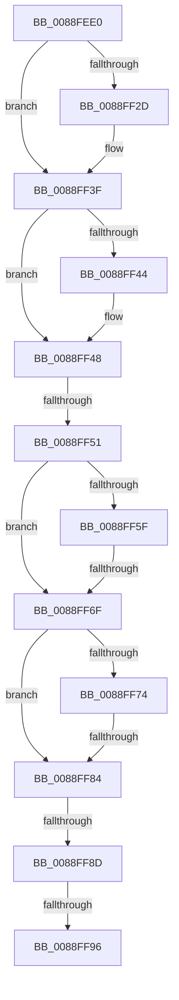

# AlpcpReferenceAndLockTargetPortsAndCommunicationInfo

- RVA: `0x0088FEE0`–`0x0088FF99` (길이 `185` bytes)
- VA: `0x000000014088FEE0`
- 실행 섹션: `PAGE`
- PDB 이름 있음: `예`; PDB Function 태그: `아니요`
- unwind 정보 RVA: `0x0007D658`
- 디코드: `53`개 명령, `185/185` bytes 표시
- 미해석 바이트: `0` (있으면 어셈블리에 `.byte`로 보존)

> 이 문서는 커널 이미지의 기계어와 PDB 기호를 분석해 생성했습니다. 4번과 5번은 함수 원형과 자료형을 바이너리 사용 방식에서 추정한 C 해석이며 원본 소스 복구 결과는 아닙니다.

## 1. Dependencies

- 직접 호출 지점: **4**; 고유 호출 대상: **3**
- 직접 호출자로 확인된 함수: **1**
- RIP 상대 이미지 참조: **0**

### Outgoing calls
- `0x0088FF15` → [KeAbPreAcquire](../../text/21/KeAbPreAcquire_function_00210230.md) (function, `0x00210230`)
- `0x0088FF3A` → [ExfAcquirePushLockSharedEx](../../text/21/ExfAcquirePushLockSharedEx_function_0021044C.md) (function, `0x0021044C`)
- `0x0088FF62` → [ObReferenceObjectSafe](../../text/41/ObReferenceObjectSafe_function_0041DAE0.md) (function, `0x0041DAE0`)
- `0x0088FF77` → [ObReferenceObjectSafe](../../text/41/ObReferenceObjectSafe_function_0041DAE0.md) (function, `0x0041DAE0`)

### Direct callers
- [AlpcpDispatchCloseMessage](../92/AlpcpDispatchCloseMessage_function_00923FBC.md) at `0x00924003`

### Static image references
- 디코드된 RIP-relative 메모리 참조가 없습니다.

## 2. Other-region calls and transfers

- 다른 실행 섹션으로 향하는 call: **4**
  - `0x0088FF15` → [KeAbPreAcquire](../../text/21/KeAbPreAcquire_function_00210230.md) (`PAGE` → `.text`)
  - `0x0088FF3A` → [ExfAcquirePushLockSharedEx](../../text/21/ExfAcquirePushLockSharedEx_function_0021044C.md) (`PAGE` → `.text`)
  - `0x0088FF62` → [ObReferenceObjectSafe](../../text/41/ObReferenceObjectSafe_function_0041DAE0.md) (`PAGE` → `.text`)
  - `0x0088FF77` → [ObReferenceObjectSafe](../../text/41/ObReferenceObjectSafe_function_0041DAE0.md) (`PAGE` → `.text`)
- call이 아닌 외부 분기/꼬리 이동: **5**
  - `0x0088FF4B` → [sub_00890033 + 0x2C](../89/Unknown_function_00890033.md) (`tail-transfer`)
  - `0x0088FF69` → [sub_00890033 + 0x95](../89/Unknown_function_00890033.md) (`tail-transfer`)
  - `0x0088FF7E` → [sub_00890033 + 0x9D](../89/Unknown_function_00890033.md) (`tail-transfer`)
  - `0x0088FF87` → [sub_00890033 + 0x48](../89/Unknown_function_00890033.md) (`tail-transfer`)
  - `0x0088FF90` → [sub_00890033 + 0x48](../89/Unknown_function_00890033.md) (`tail-transfer`)

## 3. Assembly (complete function range)

```asm
0088FEE0  48 89 5C 24 18                  mov qword ptr [rsp + 0x18], rbx
0088FEE5  48 89 74 24 20                  mov qword ptr [rsp + 0x20], rsi
0088FEEA  57                              push rdi
0088FEEB  41 54                           push r12
0088FEED  41 55                           push r13
0088FEEF  41 56                           push r14
0088FEF1  41 57                           push r15
0088FEF3  48 83 EC 20                     sub rsp, 0x20
0088FEF7  8B B1 A0 01 00 00               mov esi, dword ptr [rcx + 0x1a0]
0088FEFD  4D 8B F8                        mov r15, r8
0088FF00  4C 8B 71 10                     mov r14, qword ptr [rcx + 0x10]
0088FF04  4C 8B E2                        mov r12, rdx
0088FF07  D1 EE                           shr esi, 1
0088FF09  45 33 C0                        xor r8d, r8d
0088FF0C  33 D2                           xor edx, edx
0088FF0E  83 E6 03                        and esi, 3
0088FF11  49 8D 4E F0                     lea rcx, [r14 - 0x10]
0088FF15  E8 16 03 98 FF                  call 0x140210230
0088FF1A  48 8B D8                        mov rbx, rax
0088FF1D  41 BD 11 00 00 00               mov r13d, 0x11
0088FF23  33 C0                           xor eax, eax
0088FF25  F0 4D 0F B1 6E F0               lock cmpxchg qword ptr [r14 - 0x10], r13
0088FF2B  74 12                           je 0x14088ff3f
0088FF2D  4D 8D 4E F0                     lea r9, [r14 - 0x10]
0088FF31  4C 8B C3                        mov r8, rbx
0088FF34  33 D2                           xor edx, edx
0088FF36  49 8D 4E F0                     lea rcx, [r14 - 0x10]
0088FF3A  E8 0D 05 98 FF                  call 0x14021044c
0088FF3F  48 85 DB                        test rbx, rbx
0088FF42  74 04                           je 0x14088ff48
0088FF44  C6 43 0A 01                     mov byte ptr [rbx + 0xa], 1
0088FF48  83 FE 02                        cmp esi, 2
0088FF4B  0F 85 0E 01 00 00               jne 0x14089005f
0088FF51  49 8B 1E                        mov rbx, qword ptr [r14]
0088FF54  49 8B 7E 08                     mov rdi, qword ptr [r14 + 8]
0088FF58  33 F6                           xor esi, esi
0088FF5A  48 85 DB                        test rbx, rbx
0088FF5D  74 10                           je 0x14088ff6f
0088FF5F  48 8B CB                        mov rcx, rbx
0088FF62  E8 79 DB B8 FF                  call 0x14041dae0
0088FF67  84 C0                           test al, al
0088FF69  0F 84 59 01 00 00               je 0x1408900c8
0088FF6F  48 85 FF                        test rdi, rdi
0088FF72  74 10                           je 0x14088ff84
0088FF74  48 8B CF                        mov rcx, rdi
0088FF77  E8 64 DB B8 FF                  call 0x14041dae0
0088FF7C  84 C0                           test al, al
0088FF7E  0F 84 4C 01 00 00               je 0x1408900d0
0088FF84  48 85 DB                        test rbx, rbx
0088FF87  0F 84 EE 00 00 00               je 0x14089007b
0088FF8D  48 85 FF                        test rdi, rdi
0088FF90  0F 84 E5 00 00 00               je 0x14089007b
0088FF96  45 33 C0                        xor r8d, r8d
```

## 4. C-style interpretation (structured pseudocode)

```c
__int64 __fastcall AlpcpReferenceAndLockTargetPortsAndCommunicationInfo(__int64 a1, __int64 a2, __int64 a3)
{
    __int64 result;
    __int64 v_rsi;
    __int64 v_rsp;
    unsigned __int64 v_stack_p18;
    unsigned __int64 v_stack_p20;

    v_stack_p18 = v_rbx;
    v_stack_p20 = v_rsi;
    v_rsp = (v_rsp) - (32);
    v_rsi = (unsigned int)(((unsigned int)(*(unsigned int *)(a1 + 416))) >> (1));
    a3 = 0;
    a2 = 0;
    v_rsi = (unsigned int)((v_rsi) & (3));
    result = KeAbPreAcquire(*(unsigned __int64 *)(a1 + 16) - 16, a2, a3, a4);
    result = 0;
    if (!(condition_is_equal)) {
        a4 = *(unsigned __int64 *)(a1 + 16) - 16;
        a3 = 0;
        a2 = 0;
        a1 = *(unsigned __int64 *)(a1 + 16) - 16;
        result = ExfAcquirePushLockSharedEx(a1, a2, a3, a4);
    }
    if (result != 0) {
        *(unsigned __int8 *)(result + 10) = 1;
    }
    v_rsi = 0;
    if (*(unsigned __int64 *)(*(unsigned __int64 *)(a1 + 16)) == 0) goto loc_0088FF6F;
    result = ObReferenceObjectSafe(*(unsigned __int64 *)(*(unsigned __int64 *)(a1 + 16)), a2, a3, a4);
loc_0088FF6F:
    if (*(unsigned __int64 *)(*(unsigned __int64 *)(a1 + 16) + 8) == 0) goto loc_0088FF84;
    result = ObReferenceObjectSafe(*(unsigned __int64 *)(*(unsigned __int64 *)(a1 + 16) + 8), a2, a3, a4);
loc_0088FF84:
    a3 = 0;
    return result;
}
```

## 5. (Beta) C Style

```c
int64_t AlpcpReferenceAndLockTargetPortsAndCommunicationInfo(void *Arg1, int64_t Arg2, int64_t Arg3)
{
    uint8_t *arg1 = (uint8_t *)Arg1;

    int64_t result;
    int64_t local_rsi;
    int64_t local_rsp;
    uint64_t v_stack_p18;
    uint64_t v_stack_p20;

    v_stack_p18 = local_rbx;
    v_stack_p20 = local_rsi;
    local_rsp = (local_rsp) - (32);
    local_rsi = (uint32_t)(((uint32_t)(*(uint32_t *)(arg1 + 0x1A0))) >> (1));
    Arg3 = 0;
    Arg2 = 0;
    local_rsi = (uint32_t)((local_rsi) & (3));
    result = KeAbPreAcquire(*(uint64_t *)(arg1 + 0x10) - 16, Arg2, Arg3, a4);
    result = 0;
    if (!(condition_is_equal)) {
        a4 = *(uint64_t *)(arg1 + 0x10) - 16;
        Arg3 = 0;
        Arg2 = 0;
        Arg1 = *(uint64_t *)(arg1 + 0x10) - 16;
        result = ExfAcquirePushLockSharedEx(Arg1, Arg2, Arg3, a4);
    }
    if (result != 0) {
        *(uint8_t *)(result + 0xA) = 1;
    }
    local_rsi = 0;
    if (*(uint64_t *)(*(uint64_t *)(arg1 + 0x10)) == 0) goto loc_0088FF6F;
    result = ObReferenceObjectSafe(*(uint64_t *)(*(uint64_t *)(arg1 + 0x10)), Arg2, Arg3, a4);
loc_0088FF6F:
    if (*(uint64_t *)(*(uint64_t *)(arg1 + 0x10) + 0x8) == 0) goto loc_0088FF84;
    result = ObReferenceObjectSafe(*(uint64_t *)(*(uint64_t *)(arg1 + 0x10) + 0x8), Arg2, Arg3, a4);
loc_0088FF84:
    Arg3 = 0;
    return result;
}
```

### 관측된 메모리 오프셋

구조체 형식이 확인되지 않은 접근은 인자 기준의 오프셋으로만 기록했습니다.

| 기준 인자 | 오프셋 표현 | 폭 (bit) | 접근 |
|---|---:|---:|---|
| `Arg1` | `+ 0x10` | `64` | `R` |
| `Arg1` | `+ 0x1A0` | `32` | `R` |

## 6. Execution-region graph

[열기: 2D/3D 그래프와 함수 탐색 컨트롤 패널](../../../control-panel.html?section=page&rva=0x0088FEE0&view=graph)

- 2D 그래프는 위에서 아래로 흐르고, 3D 그래프는 빈 공간을 드래그해 회전합니다. Shift+드래그는 이동, 휠은 확대·축소, 함수 노드 선택은 대상 보고서 이동입니다.

### Static fallback


