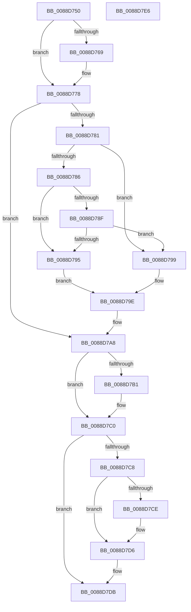

# AlpcpReleaseAttributes

- RVA: `0x0088D750`–`0x0088D7E7` (길이 `151` bytes)
- VA: `0x000000014088D750`
- 실행 섹션: `PAGE`
- PDB 이름 있음: `예`; PDB Function 태그: `아니요`
- unwind 정보 RVA: `0x0005CAAC`
- 디코드: `45`개 명령, `151/151` bytes 표시
- 미해석 바이트: `0` (있으면 어셈블리에 `.byte`로 보존)

> 이 문서는 커널 이미지의 기계어와 PDB 기호를 분석해 생성했습니다. 4번과 5번은 함수 원형과 자료형을 바이너리 사용 방식에서 추정한 C 해석이며 원본 소스 복구 결과는 아닙니다.

## 1. Dependencies

- 직접 호출 지점: **4**; 고유 호출 대상: **3**
- 직접 호출자로 확인된 함수: **4**
- RIP 상대 이미지 참조: **0**

### Outgoing calls
- `0x0088D76E` → [AlpcpDereferenceBlobEx](AlpcpDereferenceBlobEx_function_0088AF00.md) (function, `0x0088AF00`)
- `0x0088D79E` → [AlpcpReleaseViewAttribute](../A6/AlpcpReleaseViewAttribute_function_00A63A80.md) (function, `0x00A63A80`)
- `0x0088D7B6` → [AlpcpDereferenceBlobEx](AlpcpDereferenceBlobEx_function_0088AF00.md) (function, `0x0088AF00`)
- `0x0088D7D1` → [AlpcpReleaseDirectAttribute](../../text/47/AlpcpReleaseDirectAttribute_function_00474804.md) (function, `0x00474804`)

### Direct callers
- [AlpcMessageCleanupProcedure](AlpcMessageCleanupProcedure_function_0088BBA0.md) at `0x0088BBE5`
- [AlpcpSendMessage](AlpcpSendMessage_function_0088BD40.md) at `0x0088C635`
- [AlpcpSendMessage](AlpcpSendMessage_function_0088BD40.md) at `0x0088C680`
- [AlpcpCaptureAttributes](AlpcpCaptureAttributes_function_0088CD20.md) at `0x0088CE32`
- [AlpcpAcceptConnectPort](../A3/AlpcpAcceptConnectPort_function_00A34290.md) at `0x00A346A9`
- [AlpcpAcceptConnectPort](../A3/AlpcpAcceptConnectPort_function_00A34290.md) at `0x00A34B79`

### Static image references
- 디코드된 RIP-relative 메모리 참조가 없습니다.

## 2. Other-region calls and transfers

- 다른 실행 섹션으로 향하는 call: **1**
  - `0x0088D7D1` → [AlpcpReleaseDirectAttribute](../../text/47/AlpcpReleaseDirectAttribute_function_00474804.md) (`PAGE` → `.text`)
- 별도 외부 분기/꼬리 이동을 확인하지 못했습니다.

## 3. Assembly (complete function range)

```asm
0088D750  48 89 5C 24 08                  mov qword ptr [rsp + 8], rbx
0088D755  57                              push rdi
0088D756  48 83 EC 20                     sub rsp, 0x20
0088D75A  48 8B F9                        mov rdi, rcx
0088D75D  48 8B DA                        mov rbx, rdx
0088D760  48 8B 4A 20                     mov rcx, qword ptr [rdx + 0x20]
0088D764  48 85 C9                        test rcx, rcx
0088D767  74 0F                           je 0x14088d778
0088D769  BA 01 00 00 00                  mov edx, 1
0088D76E  E8 8D D7 FF FF                  call 0x14088af00
0088D773  48 83 63 20 00                  and qword ptr [rbx + 0x20], 0
0088D778  48 8B 4B 28                     mov rcx, qword ptr [rbx + 0x28]
0088D77C  48 85 C9                        test rcx, rcx
0088D77F  74 27                           je 0x14088d7a8
0088D781  48 85 FF                        test rdi, rdi
0088D784  74 13                           je 0x14088d799
0088D786  8B 47 28                        mov eax, dword ptr [rdi + 0x28]
0088D789  0F BA E0 0F                     bt eax, 0xf
0088D78D  73 06                           jae 0x14088d795
0088D78F  0F BA E0 0E                     bt eax, 0xe
0088D793  73 04                           jae 0x14088d799
0088D795  33 D2                           xor edx, edx
0088D797  EB 05                           jmp 0x14088d79e
0088D799  BA 01 00 00 00                  mov edx, 1
0088D79E  E8 DD 62 1D 00                  call 0x140a63a80
0088D7A3  48 83 63 28 00                  and qword ptr [rbx + 0x28], 0
0088D7A8  48 8B 4B 30                     mov rcx, qword ptr [rbx + 0x30]
0088D7AC  48 85 C9                        test rcx, rcx
0088D7AF  74 0F                           je 0x14088d7c0
0088D7B1  BA 01 00 00 00                  mov edx, 1
0088D7B6  E8 45 D7 FF FF                  call 0x14088af00
0088D7BB  48 83 63 30 00                  and qword ptr [rbx + 0x30], 0
0088D7C0  48 8B 43 38                     mov rax, qword ptr [rbx + 0x38]
0088D7C4  A8 01                           test al, 1
0088D7C6  74 13                           je 0x14088d7db
0088D7C8  48 83 F8 04                     cmp rax, 4
0088D7CC  72 08                           jb 0x14088d7d6
0088D7CE  48 8B C8                        mov rcx, rax
0088D7D1  E8 2E 70 BE FF                  call 0x140474804
0088D7D6  48 83 63 38 00                  and qword ptr [rbx + 0x38], 0
0088D7DB  48 8B 5C 24 30                  mov rbx, qword ptr [rsp + 0x30]
0088D7E0  48 83 C4 20                     add rsp, 0x20
0088D7E4  5F                              pop rdi
0088D7E5  C3                              ret
0088D7E6  CC                              int3
```

## 4. C-style interpretation (structured pseudocode)

```c
__int64 __fastcall AlpcpReleaseAttributes(__int64 a1, __int64 a2)
{
    __int64 result;
    __int64 v_rsp;
    unsigned __int64 v_stack_p8;

    v_stack_p8 = v_rbx;
    v_rsp = (v_rsp) - (32);
    if (*(unsigned __int64 *)(a2 + 32) != 0) {
        a2 = 1;
        result = AlpcpDereferenceBlobEx(*(unsigned __int64 *)(a2 + 32), a2, a3, a4);
    }
    if (*(unsigned __int64 *)(a2 + 40) == 0) goto loc_0088D7A8;
    if (a1 == 0) goto loc_0088D799;
    if (condition_is_above_or_equal) goto loc_0088D795;
    if (condition_is_above_or_equal) goto loc_0088D799;
loc_0088D795:
    a2 = 0;
    goto loc_0088D79E;
loc_0088D799:
loc_0088D79E:
    result = AlpcpReleaseViewAttribute(*(unsigned __int64 *)(a2 + 40), 1, a3, a4);
loc_0088D7A8:
    if (*(unsigned __int64 *)(a2 + 48) != 0) {
        a2 = 1;
        result = AlpcpDereferenceBlobEx(*(unsigned __int64 *)(a2 + 48), a2, a3, a4);
    }
    if ((((unsigned __int8)(*(unsigned __int64 *)(a2 + 56))) & (1)) == 0) goto loc_0088D7DB;
    result = *(unsigned __int64 *)(a2 + 56);
    if ((*(unsigned __int64 *)(a2 + 56)) >= 4) {
        a1 = *(unsigned __int64 *)(a2 + 56);
        result = AlpcpReleaseDirectAttribute(a1, a2, a3, a4);
    }
loc_0088D7DB:
    v_rsp = (v_rsp) + (32);
    return result;
}
```

## 5. (Beta) C Style

```c
int64_t AlpcpReleaseAttributes(int64_t Arg1, void *Arg2)
{
    uint8_t *arg2 = (uint8_t *)Arg2;

    int64_t result;
    int64_t local_rsp;
    uint64_t v_stack_p8;

    v_stack_p8 = local_rbx;
    local_rsp = (local_rsp) - (32);
    if (*(uint64_t *)(arg2 + 0x20) != 0) {
        Arg2 = 1;
        result = AlpcpDereferenceBlobEx(*(uint64_t *)(arg2 + 0x20), Arg2, a3, a4);
    }
    if (*(uint64_t *)(arg2 + 0x28) == 0) goto loc_0088D7A8;
    if (Arg1 == 0) goto loc_0088D799;
    if (condition_is_above_or_equal) goto loc_0088D795;
    if (condition_is_above_or_equal) goto loc_0088D799;
loc_0088D795:
    Arg2 = 0;
    goto loc_0088D79E;
loc_0088D799:
loc_0088D79E:
    result = AlpcpReleaseViewAttribute(*(uint64_t *)(arg2 + 0x28), 1, a3, a4);
loc_0088D7A8:
    if (*(uint64_t *)(arg2 + 0x30) != 0) {
        Arg2 = 1;
        result = AlpcpDereferenceBlobEx(*(uint64_t *)(arg2 + 0x30), Arg2, a3, a4);
    }
    if ((((uint8_t)(*(uint64_t *)(arg2 + 0x38))) & (1)) == 0) goto loc_0088D7DB;
    result = *(uint64_t *)(arg2 + 0x38);
    if ((*(uint64_t *)(arg2 + 0x38)) >= 4) {
        Arg1 = *(uint64_t *)(arg2 + 0x38);
        result = AlpcpReleaseDirectAttribute(Arg1, Arg2, a3, a4);
    }
loc_0088D7DB:
    local_rsp = (local_rsp) + (32);
    return result;
}
```

### 관측된 메모리 오프셋

구조체 형식이 확인되지 않은 접근은 인자 기준의 오프셋으로만 기록했습니다.

| 기준 인자 | 오프셋 표현 | 폭 (bit) | 접근 |
|---|---:|---:|---|
| `Arg2` | `+ 0x20` | `64` | `R` |
| `Arg2` | `+ 0x20` | `64` | `R/W` |
| `Arg2` | `+ 0x28` | `64` | `R` |
| `Arg2` | `+ 0x28` | `64` | `R/W` |
| `Arg2` | `+ 0x30` | `64` | `R` |
| `Arg2` | `+ 0x30` | `64` | `R/W` |
| `Arg2` | `+ 0x38` | `64` | `R` |
| `Arg2` | `+ 0x38` | `64` | `R/W` |

## 6. Execution-region graph

[열기: 2D/3D 그래프와 함수 탐색 컨트롤 패널](../../../control-panel.html?section=page&rva=0x0088D750&view=graph)

- 2D 그래프는 위에서 아래로 흐르고, 3D 그래프는 빈 공간을 드래그해 회전합니다. Shift+드래그는 이동, 휠은 확대·축소, 함수 노드 선택은 대상 보고서 이동입니다.

### Static fallback


