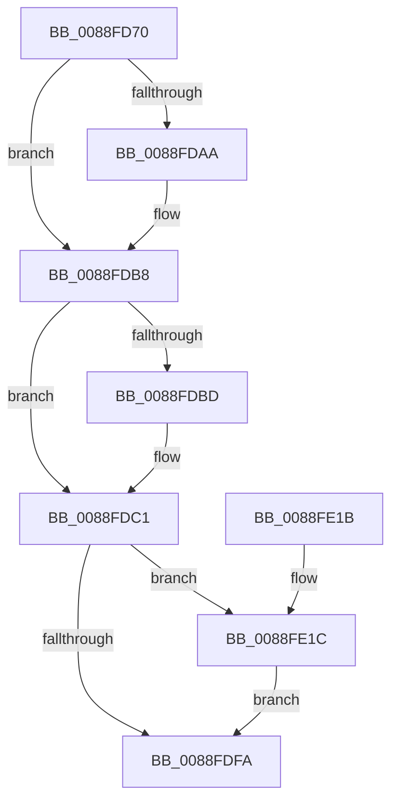

# AlpcpRemoveMessageFromPendingQueue

- RVA: `0x0088FD70`–`0x0088FE26` (길이 `182` bytes)
- VA: `0x000000014088FD70`
- 실행 섹션: `PAGE`
- PDB 이름 있음: `예`; PDB Function 태그: `아니요`
- unwind 정보 RVA: `0x00073808`
- 디코드: `49`개 명령, `182/182` bytes 표시
- 미해석 바이트: `0` (있으면 어셈블리에 `.byte`로 보존)

> 이 문서는 커널 이미지의 기계어와 PDB 기호를 분석해 생성했습니다. 4번과 5번은 함수 원형과 자료형을 바이너리 사용 방식에서 추정한 C 해석이며 원본 소스 복구 결과는 아닙니다.

## 1. Dependencies

- 직접 호출 지점: **4**; 고유 호출 대상: **4**
- 직접 호출자로 확인된 함수: **4**
- RIP 상대 이미지 참조: **0**

### Outgoing calls
- `0x0088FD9A` → [KeAbPreAcquire](../../text/21/KeAbPreAcquire_function_00210230.md) (function, `0x00210230`)
- `0x0088FDB3` → [ExfAcquirePushLockExclusiveEx](../../text/20/ExfAcquirePushLockExclusiveEx_function_0020FC90.md) (function, `0x0020FC90`)
- `0x0088FDFD` → [KeAbPostRelease](../../text/2E/KeAbPostRelease_function_002E1600.md) (function, `0x002E1600`)
- `0x0088FE1F` → [ExfTryToWakePushLock](../../text/26/ExfTryToWakePushLock_function_00265DD0.md) (function, `0x00265DD0`)

### Direct callers
- [AlpcpDispatchReplyToPort](AlpcpDispatchReplyToPort_function_0088F880.md) at `0x0088FAE2`
- [AlpcpCancelMessage](../89/AlpcpCancelMessage_function_00894120.md) at `0x008943F3`
- [AlpcpCancelMessage](../89/AlpcpCancelMessage_function_00894120.md) at `0x008946ED`
- [AlpcpReplyLegacySynchronousRequest](../9F/AlpcpReplyLegacySynchronousRequest_function_009F5CF0.md) at `0x009F604A`
- [AlpcpReturnMessageOnInsufficientBuffer](../A2/AlpcpReturnMessageOnInsufficientBuffer_function_00A2EF7C.md) at `0x00A2F007`

### Static image references
- 디코드된 RIP-relative 메모리 참조가 없습니다.

## 2. Other-region calls and transfers

- 다른 실행 섹션으로 향하는 call: **4**
  - `0x0088FD9A` → [KeAbPreAcquire](../../text/21/KeAbPreAcquire_function_00210230.md) (`PAGE` → `.text`)
  - `0x0088FDB3` → [ExfAcquirePushLockExclusiveEx](../../text/20/ExfAcquirePushLockExclusiveEx_function_0020FC90.md) (`PAGE` → `.text`)
  - `0x0088FDFD` → [KeAbPostRelease](../../text/2E/KeAbPostRelease_function_002E1600.md) (`PAGE` → `.text`)
  - `0x0088FE1F` → [ExfTryToWakePushLock](../../text/26/ExfTryToWakePushLock_function_00265DD0.md) (`PAGE` → `.text`)
- 별도 외부 분기/꼬리 이동을 확인하지 못했습니다.

## 3. Assembly (complete function range)

```asm
0088FD70  48 89 5C 24 08                  mov qword ptr [rsp + 8], rbx
0088FD75  48 89 6C 24 10                  mov qword ptr [rsp + 0x10], rbp
0088FD7A  48 89 74 24 18                  mov qword ptr [rsp + 0x18], rsi
0088FD7F  57                              push rdi
0088FD80  48 83 EC 20                     sub rsp, 0x20
0088FD84  48 8B 69 10                     mov rbp, qword ptr [rcx + 0x10]
0088FD88  48 8B F1                        mov rsi, rcx
0088FD8B  45 33 C0                        xor r8d, r8d
0088FD8E  33 D2                           xor edx, edx
0088FD90  48 8D 9D B0 00 00 00            lea rbx, [rbp + 0xb0]
0088FD97  48 8B CB                        mov rcx, rbx
0088FD9A  E8 91 04 98 FF                  call 0x140210230
0088FD9F  F0 48 0F BA 2B 00               lock bts qword ptr [rbx], 0
0088FDA5  48 8B F8                        mov rdi, rax
0088FDA8  73 0E                           jae 0x14088fdb8
0088FDAA  4C 8B C3                        mov r8, rbx
0088FDAD  48 8B D0                        mov rdx, rax
0088FDB0  48 8B CB                        mov rcx, rbx
0088FDB3  E8 D8 FE 97 FF                  call 0x14020fc90
0088FDB8  48 85 FF                        test rdi, rdi
0088FDBB  74 04                           je 0x14088fdc1
0088FDBD  C6 47 0A 01                     mov byte ptr [rdi + 0xa], 1
0088FDC1  FF 8D C8 01 00 00               dec dword ptr [rbp + 0x1c8]
0088FDC7  83 66 28 F8                     and dword ptr [rsi + 0x28], 0xfffffff8
0088FDCB  48 C7 46 10 00 00 00 00         mov qword ptr [rsi + 0x10], 0
0088FDD3  48 8B 4E 08                     mov rcx, qword ptr [rsi + 8]
0088FDD7  48 8B 06                        mov rax, qword ptr [rsi]
0088FDDA  48 89 01                        mov qword ptr [rcx], rax
0088FDDD  48 8B 46 08                     mov rax, qword ptr [rsi + 8]
0088FDE1  48 8B 0E                        mov rcx, qword ptr [rsi]
0088FDE4  48 89 41 08                     mov qword ptr [rcx + 8], rax
0088FDE8  48 C7 C0 FF FF FF FF            mov rax, 0xffffffffffffffff
0088FDEF  F0 48 0F C1 03                  lock xadd qword ptr [rbx], rax
0088FDF4  24 06                           and al, 6
0088FDF6  3C 02                           cmp al, 2
0088FDF8  74 22                           je 0x14088fe1c
0088FDFA  48 8B CB                        mov rcx, rbx
0088FDFD  E8 FE 17 A5 FF                  call 0x1402e1600
0088FE02  66 FF 4E E2                     dec word ptr [rsi - 0x1e]
0088FE06  48 8B 74 24 40                  mov rsi, qword ptr [rsp + 0x40]
0088FE0B  48 8B 5C 24 30                  mov rbx, qword ptr [rsp + 0x30]
0088FE10  48 8B 6C 24 38                  mov rbp, qword ptr [rsp + 0x38]
0088FE15  48 83 C4 20                     add rsp, 0x20
0088FE19  5F                              pop rdi
0088FE1A  C3                              ret
0088FE1B  CC                              int3
0088FE1C  48 8B CB                        mov rcx, rbx
0088FE1F  E8 AC 5F 9D FF                  call 0x140265dd0
0088FE24  EB D4                           jmp 0x14088fdfa
```

## 4. C-style interpretation (structured pseudocode)

```c
__int64 __fastcall AlpcpRemoveMessageFromPendingQueue(__int64 a1, int a2, int a3)
{
    __int64 result;
    __int64 v_rsp;
    unsigned __int64 v_stack_p10;
    unsigned __int64 v_stack_p18;
    unsigned __int64 v_stack_p8;

    v_stack_p8 = v_rbx;
    v_stack_p10 = v_rbp;
    v_stack_p18 = v_rsi;
    v_rsp = (v_rsp) - (32);
    a3 = 0;
    a2 = 0;
    result = KeAbPreAcquire(*(unsigned __int64 *)(a1 + 16) + 176, a2, a3, a4);
    if (!(condition_is_above_or_equal)) {
        a3 = *(unsigned __int64 *)(a1 + 16) + 176;
        a2 = result;
        a1 = *(unsigned __int64 *)(a1 + 16) + 176;
        result = ExfAcquirePushLockExclusiveEx(a1, a2, a3, a4);
    }
    if (result != 0) {
        *(unsigned __int8 *)(result + 10) = 1;
    }
    *(unsigned __int64 *)(a1 + 16) = 0;
    *(unsigned __int64 *)(*(unsigned __int64 *)(a1 + 8)) = *(unsigned __int64 *)(a1);
    *(unsigned __int64 *)(*(unsigned __int64 *)(a1) + 8) = *(unsigned __int64 *)(a1 + 8);
    result = (unsigned __int8)((-1) & (6));
    if (((unsigned __int8)(result)) == 2) goto loc_0088FE1C;
loc_0088FDFA:
    result = KeAbPostRelease(*(unsigned __int64 *)(a1 + 16) + 176, a2, a3, a4);
    v_rsp = (v_rsp) + (32);
    return result;
loc_0088FE1C:
    result = ExfTryToWakePushLock(v_stack_p8, a2, a3, a4);
    goto loc_0088FDFA;
}
```

## 5. (Beta) C Style

```c
int64_t AlpcpRemoveMessageFromPendingQueue(void *Arg1, int32_t Arg2, int32_t Arg3)
{
    uint8_t *arg1 = (uint8_t *)Arg1;

    int64_t result;
    int64_t local_rsp;
    uint64_t v_stack_p10;
    uint64_t v_stack_p18;
    uint64_t v_stack_p8;

    v_stack_p8 = local_rbx;
    v_stack_p10 = local_rbp;
    v_stack_p18 = local_rsi;
    local_rsp = (local_rsp) - (32);
    Arg3 = 0;
    Arg2 = 0;
    result = KeAbPreAcquire(*(uint64_t *)(arg1 + 0x10) + 176, Arg2, Arg3, a4);
    if (!(condition_is_above_or_equal)) {
        Arg3 = *(uint64_t *)(arg1 + 0x10) + 176;
        Arg2 = result;
        Arg1 = *(uint64_t *)(arg1 + 0x10) + 176;
        result = ExfAcquirePushLockExclusiveEx(Arg1, Arg2, Arg3, a4);
    }
    if (result != 0) {
        *(uint8_t *)(result + 0xA) = 1;
    }
    *(uint64_t *)(arg1 + 0x10) = 0;
    *(uint64_t *)(*(uint64_t *)(arg1 + 0x8)) = *(uint64_t *)(arg1);
    *(uint64_t *)(*(uint64_t *)(arg1) + 0x8) = *(uint64_t *)(arg1 + 0x8);
    result = (uint8_t)((-1) & (6));
    if (((uint8_t)(result)) == 2) goto loc_0088FE1C;
loc_0088FDFA:
    result = KeAbPostRelease(*(uint64_t *)(arg1 + 0x10) + 176, Arg2, Arg3, a4);
    local_rsp = (local_rsp) + (32);
    return result;
loc_0088FE1C:
    result = ExfTryToWakePushLock(v_stack_p8, Arg2, Arg3, a4);
    goto loc_0088FDFA;
}
```

### 관측된 메모리 오프셋

구조체 형식이 확인되지 않은 접근은 인자 기준의 오프셋으로만 기록했습니다.

| 기준 인자 | 오프셋 표현 | 폭 (bit) | 접근 |
|---|---:|---:|---|
| `Arg1` | `- 0x1E` | `16` | `R/W` |
| `Arg1` | `+ 0x0` | `64` | `R` |
| `Arg1` | `+ 0x8` | `64` | `R` |
| `Arg1` | `+ 0x10` | `64` | `R` |
| `Arg1` | `+ 0x10` | `64` | `W` |
| `Arg1` | `+ 0x28` | `32` | `R/W` |

## 6. Execution-region graph

[열기: 2D/3D 그래프와 함수 탐색 컨트롤 패널](../../../control-panel.html?section=page&rva=0x0088FD70&view=graph)

- 2D 그래프는 위에서 아래로 흐르고, 3D 그래프는 빈 공간을 드래그해 회전합니다. Shift+드래그는 이동, 휠은 확대·축소, 함수 노드 선택은 대상 보고서 이동입니다.

### Static fallback


