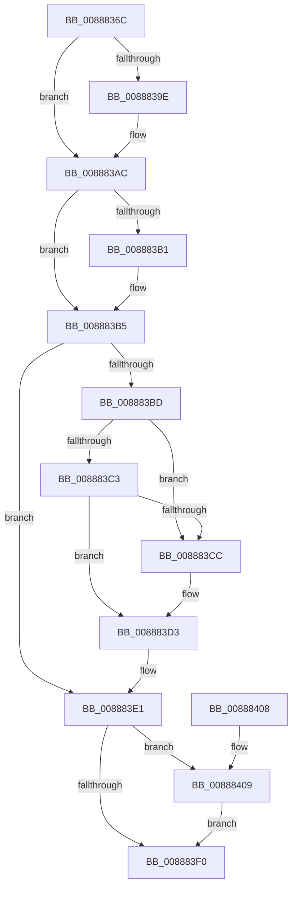

# AlpcpRemoveResourcePort

- RVA: `0x0088836C`–`0x00888413` (길이 `167` bytes)
- VA: `0x000000014088836C`
- 실행 섹션: `PAGE`
- PDB 이름 있음: `예`; PDB Function 태그: `아니요`
- unwind 정보 RVA: `0x0005C748`
- 디코드: `50`개 명령, `167/167` bytes 표시
- 미해석 바이트: `0` (있으면 어셈블리에 `.byte`로 보존)

> 이 문서는 커널 이미지의 기계어와 PDB 기호를 분석해 생성했습니다. 4번과 5번은 함수 원형과 자료형을 바이너리 사용 방식에서 추정한 C 해석이며 원본 소스 복구 결과는 아닙니다.

## 1. Dependencies

- 직접 호출 지점: **4**; 고유 호출 대상: **4**
- 직접 호출자로 확인된 함수: **4**
- RIP 상대 이미지 참조: **0**

### Outgoing calls
- `0x0088838E` → [KeAbPreAcquire](../../text/21/KeAbPreAcquire_function_00210230.md) (function, `0x00210230`)
- `0x008883A7` → [ExfAcquirePushLockExclusiveEx](../../text/20/ExfAcquirePushLockExclusiveEx_function_0020FC90.md) (function, `0x0020FC90`)
- `0x008883F3` → [KeAbPostRelease](../../text/2E/KeAbPostRelease_function_002E1600.md) (function, `0x002E1600`)
- `0x0088840C` → [ExfTryToWakePushLock](../../text/26/ExfTryToWakePushLock_function_00265DD0.md) (function, `0x00265DD0`)

### Direct callers
- [AlpcReserveDestroyProcedure](AlpcReserveDestroyProcedure_function_00888230.md) at `0x00888280`
- [AlpcSectionDeleteProcedure](AlpcSectionDeleteProcedure_function_0088A200.md) at `0x0088A23E`
- [AlpcSectionDestroyProcedure](../A3/AlpcSectionDestroyProcedure_function_00A327D0.md) at `0x00A32817`
- [AlpcpMapLegacyPortRemoteView](../A9/AlpcpMapLegacyPortRemoteView_function_00A9FEE4.md) at `0x00A9FFBA`

### Static image references
- 디코드된 RIP-relative 메모리 참조가 없습니다.

## 2. Other-region calls and transfers

- 다른 실행 섹션으로 향하는 call: **4**
  - `0x0088838E` → [KeAbPreAcquire](../../text/21/KeAbPreAcquire_function_00210230.md) (`PAGE` → `.text`)
  - `0x008883A7` → [ExfAcquirePushLockExclusiveEx](../../text/20/ExfAcquirePushLockExclusiveEx_function_0020FC90.md) (`PAGE` → `.text`)
  - `0x008883F3` → [KeAbPostRelease](../../text/2E/KeAbPostRelease_function_002E1600.md) (`PAGE` → `.text`)
  - `0x0088840C` → [ExfTryToWakePushLock](../../text/26/ExfTryToWakePushLock_function_00265DD0.md) (`PAGE` → `.text`)
- 별도 외부 분기/꼬리 이동을 확인하지 못했습니다.

## 3. Assembly (complete function range)

```asm
0088836C  48 89 5C 24 08                  mov qword ptr [rsp + 8], rbx
00888371  48 89 74 24 10                  mov qword ptr [rsp + 0x10], rsi
00888376  57                              push rdi
00888377  48 83 EC 20                     sub rsp, 0x20
0088837B  48 8D B9 48 01 00 00            lea rdi, [rcx + 0x148]
00888382  45 33 C0                        xor r8d, r8d
00888385  48 8D 5A D0                     lea rbx, [rdx - 0x30]
00888389  48 8B CF                        mov rcx, rdi
0088838C  33 D2                           xor edx, edx
0088838E  E8 9D 7E 98 FF                  call 0x140210230
00888393  F0 48 0F BA 2F 00               lock bts qword ptr [rdi], 0
00888399  48 8B F0                        mov rsi, rax
0088839C  73 0E                           jae 0x1408883ac
0088839E  4C 8B C7                        mov r8, rdi
008883A1  48 8B D0                        mov rdx, rax
008883A4  48 8B CF                        mov rcx, rdi
008883A7  E8 E4 78 98 FF                  call 0x14020fc90
008883AC  48 85 F6                        test rsi, rsi
008883AF  74 04                           je 0x1408883b5
008883B1  C6 46 0A 01                     mov byte ptr [rsi + 0xa], 1
008883B5  48 8B 03                        mov rax, qword ptr [rbx]
008883B8  48 3B C3                        cmp rax, rbx
008883BB  74 24                           je 0x1408883e1
008883BD  48 39 58 08                     cmp qword ptr [rax + 8], rbx
008883C1  75 09                           jne 0x1408883cc
008883C3  48 8B 4B 08                     mov rcx, qword ptr [rbx + 8]
008883C7  48 39 19                        cmp qword ptr [rcx], rbx
008883CA  74 07                           je 0x1408883d3
008883CC  B9 03 00 00 00                  mov ecx, 3
008883D1  CD 29                           int 0x29
008883D3  48 89 01                        mov qword ptr [rcx], rax
008883D6  48 89 48 08                     mov qword ptr [rax + 8], rcx
008883DA  48 89 5B 08                     mov qword ptr [rbx + 8], rbx
008883DE  48 89 1B                        mov qword ptr [rbx], rbx
008883E1  48 83 C8 FF                     or rax, 0xffffffffffffffff
008883E5  F0 48 0F C1 07                  lock xadd qword ptr [rdi], rax
008883EA  24 06                           and al, 6
008883EC  3C 02                           cmp al, 2
008883EE  74 19                           je 0x140888409
008883F0  48 8B CF                        mov rcx, rdi
008883F3  E8 08 92 A5 FF                  call 0x1402e1600
008883F8  48 8B 5C 24 30                  mov rbx, qword ptr [rsp + 0x30]
008883FD  48 8B 74 24 38                  mov rsi, qword ptr [rsp + 0x38]
00888402  48 83 C4 20                     add rsp, 0x20
00888406  5F                              pop rdi
00888407  C3                              ret
00888408  CC                              int3
00888409  48 8B CF                        mov rcx, rdi
0088840C  E8 BF D9 9D FF                  call 0x140265dd0
00888411  EB DD                           jmp 0x1408883f0
```

## 4. C-style interpretation (structured pseudocode)

```c
__int64 __fastcall AlpcpRemoveResourcePort(__int64 a1, __int64 a2, int a3)
{
    __int64 result;
    __int64 v_rsp;
    unsigned __int64 v_stack_p10;
    unsigned __int64 v_stack_p8;

    v_stack_p8 = v_rbx;
    v_stack_p10 = v_rsi;
    v_rsp = (v_rsp) - (32);
    a3 = 0;
    a2 = 0;
    result = KeAbPreAcquire(a1 + 328, a2, a3, a4);
    if (!(condition_is_above_or_equal)) {
        a3 = a1 + 328;
        a2 = result;
        a1 = a1 + 328;
        result = ExfAcquirePushLockExclusiveEx(a1, a2, a3, a4);
    }
    if (result != 0) {
        *(unsigned __int8 *)(result + 10) = 1;
    }
    if ((*(unsigned __int64 *)(a2 - 48)) == (a2 - 48)) goto loc_008883E1;
    if ((*(unsigned __int64 *)(*(unsigned __int64 *)(a2 - 48) + 8)) != (a2 - 48)) goto loc_008883CC;
    if ((*(unsigned __int64 *)(*(unsigned __int64 *)(a2 - 48 + 8))) != (a2 - 48)) {
        a1 = 3;
    }
    *(unsigned __int64 *)(a1) = *(unsigned __int64 *)(a2 - 48);
    *(unsigned __int64 *)(*(unsigned __int64 *)(a2 - 48) + 8) = a1;
    *(unsigned __int64 *)(a2 - 48 + 8) = a2 - 48;
    *(unsigned __int64 *)(a2 - 48) = a2 - 48;
loc_008883E1:
    result = (*(unsigned __int64 *)(a2 - 48)) | (-1);
    result = (unsigned __int8)((result) & (6));
    if (((unsigned __int8)(result)) == 2) goto loc_00888409;
loc_008883F0:
    result = KeAbPostRelease(a1 + 328, a2, a3, a4);
    v_rsp = (v_rsp) + (32);
    return result;
loc_00888409:
    result = ExfTryToWakePushLock(a1 + 328, a2, a3, a4);
    goto loc_008883F0;
}
```

## 5. (Beta) C Style

```c
int64_t AlpcpRemoveResourcePort(void *Arg1, void *Arg2, int32_t Arg3)
{
    uint8_t *arg1 = (uint8_t *)Arg1;
    uint8_t *arg2 = (uint8_t *)Arg2;

    int64_t result;
    int64_t local_rsp;
    uint64_t v_stack_p10;
    uint64_t v_stack_p8;

    v_stack_p8 = local_rbx;
    v_stack_p10 = local_rsi;
    local_rsp = (local_rsp) - (32);
    Arg3 = 0;
    Arg2 = 0;
    result = KeAbPreAcquire(Arg1 + 328, Arg2, Arg3, a4);
    if (!(condition_is_above_or_equal)) {
        Arg3 = Arg1 + 328;
        Arg2 = result;
        Arg1 = Arg1 + 328;
        result = ExfAcquirePushLockExclusiveEx(Arg1, Arg2, Arg3, a4);
    }
    if (result != 0) {
        *(uint8_t *)(result + 0xA) = 1;
    }
    if ((*(uint64_t *)(arg2 - 0x30)) == (Arg2 - 48)) goto loc_008883E1;
    if ((*(uint64_t *)(*(uint64_t *)(arg2 - 0x30) + 0x8)) != (Arg2 - 48)) goto loc_008883CC;
    if ((*(uint64_t *)(*(uint64_t *)(arg2 - 0x30 + 0x8))) != (Arg2 - 48)) {
        Arg1 = 3;
    }
    *(uint64_t *)(arg1) = *(uint64_t *)(arg2 - 0x30);
    *(void **)(*(uint64_t *)(arg2 - 0x30) + 0x8) = Arg1;
    *(void **)(arg2 - 0x30 + 0x8) = Arg2 - 48;
    *(void **)(arg2 - 0x30) = Arg2 - 48;
loc_008883E1:
    result = (*(uint64_t *)(arg2 - 0x30)) | (-1);
    result = (uint8_t)((result) & (6));
    if (((uint8_t)(result)) == 2) goto loc_00888409;
loc_008883F0:
    result = KeAbPostRelease(Arg1 + 328, Arg2, Arg3, a4);
    local_rsp = (local_rsp) + (32);
    return result;
loc_00888409:
    result = ExfTryToWakePushLock(Arg1 + 328, Arg2, Arg3, a4);
    goto loc_008883F0;
}
```

### 관측된 메모리 오프셋

구조체 형식이 확인되지 않은 접근은 인자 기준의 오프셋으로만 기록했습니다.

| 기준 인자 | 오프셋 표현 | 폭 (bit) | 접근 |
|---|---:|---:|---|
| `Arg1` | `+ 0x0` | `64` | `R/W` |
| `Arg1` | `+ 0x148` | `64` | `R` |
| `Arg2` | `- 0x30` | `64` | `R` |
| `Arg2` | `+ 0x0` | `64` | `R` |
| `Arg2` | `+ 0x0` | `64` | `W` |
| `Arg2` | `+ 0x8` | `64` | `R` |
| `Arg2` | `+ 0x8` | `64` | `W` |

## 6. Execution-region graph

[열기: 2D/3D 그래프와 함수 탐색 컨트롤 패널](../../../control-panel.html?section=page&rva=0x0088836C&view=graph)

- 2D 그래프는 위에서 아래로 흐르고, 3D 그래프는 빈 공간을 드래그해 회전합니다. Shift+드래그는 이동, 휠은 확대·축소, 함수 노드 선택은 대상 보고서 이동입니다.

### Static fallback


