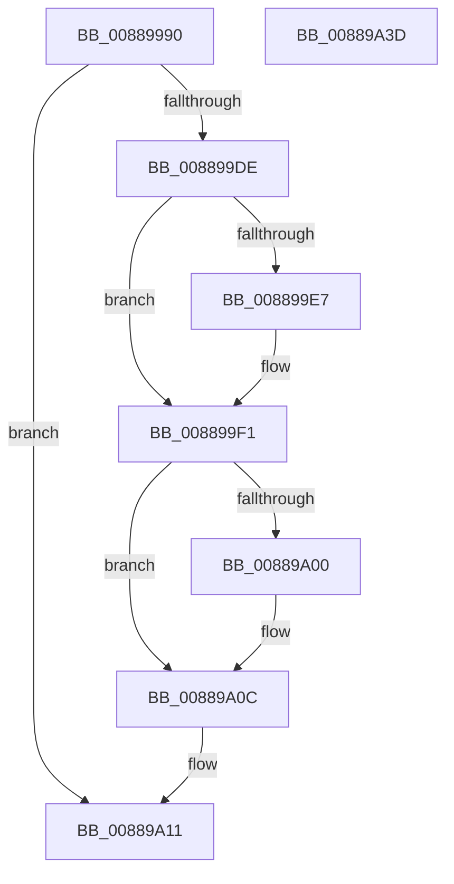

# AlpcpRestoreWriteAccess

- RVA: `0x00889990`–`0x00889A3E` (길이 `174` bytes)
- VA: `0x0000000140889990`
- 실행 섹션: `PAGE`
- PDB 이름 있음: `예`; PDB Function 태그: `아니요`
- unwind 정보 RVA: `0x0007CF64`
- 디코드: `43`개 명령, `174/174` bytes 표시
- 미해석 바이트: `0` (있으면 어셈블리에 `.byte`로 보존)

> 이 문서는 커널 이미지의 기계어와 PDB 기호를 분석해 생성했습니다. 4번과 5번은 함수 원형과 자료형을 바이너리 사용 방식에서 추정한 C 해석이며 원본 소스 복구 결과는 아닙니다.

## 1. Dependencies

- 직접 호출 지점: **4**; 고유 호출 대상: **4**
- 직접 호출자로 확인된 함수: **2**
- RIP 상대 이미지 참조: **1**

### Outgoing calls
- `0x008899EC` → [KeStackAttachProcess](../../text/21/KeStackAttachProcess_function_00216800.md) (function, `0x00216800`)
- `0x008899F5` → [MmUnsecureVirtualMemory](MmUnsecureVirtualMemory_function_0088A2A0.md) (function, `0x0088A2A0`)
- `0x00889A07` → [KiUnstackDetachProcess](../../text/21/KiUnstackDetachProcess_function_00217D30.md) (function, `0x00217D30`)
- `0x00889A26` → [_security_check_cookie](../../text/6A/_security_check_cookie_function_006AC640.md) (function, `0x006AC640`)

### Direct callers
- [AlpcViewDestroyProcedure](AlpcViewDestroyProcedure_function_0088B080.md) at `0x0088B122`
- [AlpcpExposeViewAttributeInSenderContext](AlpcpExposeViewAttributeInSenderContext_function_0088F600.md) at `0x0088F7A9`

### Static image references
- `0x0088999F` → RVA `0x00E0A740` (`.data`; read)

## 2. Other-region calls and transfers

- 다른 실행 섹션으로 향하는 call: **3**
  - `0x008899EC` → [KeStackAttachProcess](../../text/21/KeStackAttachProcess_function_00216800.md) (`PAGE` → `.text`)
  - `0x00889A07` → [KiUnstackDetachProcess](../../text/21/KiUnstackDetachProcess_function_00217D30.md) (`PAGE` → `.text`)
  - `0x00889A26` → [_security_check_cookie](../../text/6A/_security_check_cookie_function_006AC640.md) (`PAGE` → `.text`)
- 별도 외부 분기/꼬리 이동을 확인하지 못했습니다.

## 3. Assembly (complete function range)

```asm
00889990  48 89 5C 24 10                  mov qword ptr [rsp + 0x10], rbx
00889995  48 89 74 24 18                  mov qword ptr [rsp + 0x18], rsi
0088999A  57                              push rdi
0088999B  48 83 EC 60                     sub rsp, 0x60
0088999F  48 8B 05 9A 0D 58 00            mov rax, qword ptr [rip + 0x580d9a]
008899A6  48 33 C4                        xor rax, rsp
008899A9  48 89 44 24 50                  mov qword ptr [rsp + 0x50], rax
008899AE  0F 57 C0                        xorps xmm0, xmm0
008899B1  48 8B D9                        mov rbx, rcx
008899B4  0F 11 44 24 20                  movups xmmword ptr [rsp + 0x20], xmm0
008899B9  0F 11 44 24 30                  movups xmmword ptr [rsp + 0x30], xmm0
008899BE  0F 11 44 24 40                  movups xmmword ptr [rsp + 0x40], xmm0
008899C3  65 48 8B 04 25 88 01 00 00      mov rax, qword ptr gs:[0x188]
008899CC  48 83 79 40 00                  cmp qword ptr [rcx + 0x40], 0
008899D1  48 8B 79 10                     mov rdi, qword ptr [rcx + 0x10]
008899D5  48 8B B0 B8 00 00 00            mov rsi, qword ptr [rax + 0xb8]
008899DC  74 33                           je 0x140889a11
008899DE  48 8B 49 20                     mov rcx, qword ptr [rcx + 0x20]
008899E2  48 3B CE                        cmp rcx, rsi
008899E5  74 0A                           je 0x1408899f1
008899E7  48 8D 54 24 20                  lea rdx, [rsp + 0x20]
008899EC  E8 0F CE 98 FF                  call 0x140216800
008899F1  48 8B 4B 40                     mov rcx, qword ptr [rbx + 0x40]
008899F5  E8 A6 08 00 00                  call 0x14088a2a0
008899FA  48 39 73 20                     cmp qword ptr [rbx + 0x20], rsi
008899FE  74 0C                           je 0x140889a0c
00889A00  33 D2                           xor edx, edx
00889A02  48 8D 4C 24 20                  lea rcx, [rsp + 0x20]
00889A07  E8 24 E3 98 FF                  call 0x140217d30
00889A0C  48 83 63 40 00                  and qword ptr [rbx + 0x40], 0
00889A11  83 4B 48 01                     or dword ptr [rbx + 0x48], 1
00889A15  48 83 67 48 00                  and qword ptr [rdi + 0x48], 0
00889A1A  48 89 5F 50                     mov qword ptr [rdi + 0x50], rbx
00889A1E  48 8B 4C 24 50                  mov rcx, qword ptr [rsp + 0x50]
00889A23  48 33 CC                        xor rcx, rsp
00889A26  E8 15 2C E2 FF                  call 0x1406ac640
00889A2B  4C 8D 5C 24 60                  lea r11, [rsp + 0x60]
00889A30  49 8B 5B 18                     mov rbx, qword ptr [r11 + 0x18]
00889A34  49 8B 73 20                     mov rsi, qword ptr [r11 + 0x20]
00889A38  49 8B E3                        mov rsp, r11
00889A3B  5F                              pop rdi
00889A3C  C3                              ret
00889A3D  CC                              int3
```

## 4. C-style interpretation (structured pseudocode)

```c
__int64 __fastcall AlpcpRestoreWriteAccess(__int64 a1)
{
    __int64 result;
    __int64 v_rsp;
    unsigned __int64 v_stack_m18;
    unsigned __int64 v_stack_m28;
    unsigned __int64 v_stack_m38;
    unsigned __int64 v_stack_m48;
    unsigned __int64 v_stack_m8;
    unsigned __int64 v_stack_p10;
    unsigned __int64 v_stack_p18;

    v_stack_p10 = v_rbx;
    v_stack_p18 = v_rsi;
    v_rsp = (v_rsp) - (96);
    result = (*(unsigned __int64 *)(v_rip + 5770650)) ^ (v_rsp);
    v_stack_m18 = result;
    v_stack_m48 = v_xmm0;
    v_stack_m38 = v_xmm0;
    v_stack_m28 = v_xmm0;
    if ((*(unsigned __int64 *)(a1 + 64)) == 0) goto loc_00889A11;
    result = *(unsigned __int64 *)(gs_base + (0 + 392));
    if ((*(unsigned __int64 *)(a1 + 32)) != (*(unsigned __int64 *)(*(unsigned __int64 *)(gs_base + (0 + 392)) + 184))) {
        a2 = v_stack_m48;
        result = KeStackAttachProcess(*(unsigned __int64 *)(a1 + 32), a2, a3, a4);
    }
    result = MmUnsecureVirtualMemory(*(unsigned __int64 *)(a1 + 64), a2, a3, a4);
    if ((*(unsigned __int64 *)(a1 + 32)) != (*(unsigned __int64 *)(*(unsigned __int64 *)(gs_base + (0 + 392)) + 184))) {
        a2 = 0;
        a1 = v_stack_m48;
        result = KiUnstackDetachProcess(a1, a2, a3, a4);
    }
loc_00889A11:
    *(unsigned __int64 *)(*(unsigned __int64 *)(a1 + 16) + 80) = a1;
    a1 = (v_stack_m18) ^ (v_rsp);
    result = _security_check_cookie(a1, a2, a3, a4);
    return result;
}
```

## 5. (Beta) C Style

```c
int64_t AlpcpRestoreWriteAccess(void *Arg1)
{
    uint8_t *arg1 = (uint8_t *)Arg1;

    int64_t result;
    int64_t local_rsp;
    uint64_t v_stack_m18;
    uint64_t v_stack_m28;
    uint64_t v_stack_m38;
    uint64_t v_stack_m48;
    uint64_t v_stack_m8;
    uint64_t v_stack_p10;
    uint64_t v_stack_p18;

    v_stack_p10 = local_rbx;
    v_stack_p18 = local_rsi;
    local_rsp = (local_rsp) - (96);
    result = (*(uint64_t *)(v_rip + 0x580D9A)) ^ (local_rsp);
    v_stack_m18 = result;
    v_stack_m48 = v_xmm0;
    v_stack_m38 = v_xmm0;
    v_stack_m28 = v_xmm0;
    if ((*(uint64_t *)(arg1 + 0x40)) == 0) goto loc_00889A11;
    result = *(uint64_t *)(gs_base + (0 + 0x188));
    if ((*(uint64_t *)(arg1 + 0x20)) != (*(uint64_t *)(*(uint64_t *)(gs_base + (0 + 0x188)) + 0xB8))) {
        a2 = v_stack_m48;
        result = KeStackAttachProcess(*(uint64_t *)(arg1 + 0x20), a2, a3, a4);
    }
    result = MmUnsecureVirtualMemory(*(uint64_t *)(arg1 + 0x40), a2, a3, a4);
    if ((*(uint64_t *)(arg1 + 0x20)) != (*(uint64_t *)(*(uint64_t *)(gs_base + (0 + 0x188)) + 0xB8))) {
        a2 = 0;
        Arg1 = v_stack_m48;
        result = KiUnstackDetachProcess(Arg1, a2, a3, a4);
    }
loc_00889A11:
    *(void **)(*(uint64_t *)(arg1 + 0x10) + 0x50) = Arg1;
    Arg1 = (v_stack_m18) ^ (local_rsp);
    result = _security_check_cookie(Arg1, a2, a3, a4);
    return result;
}
```

### 관측된 메모리 오프셋

구조체 형식이 확인되지 않은 접근은 인자 기준의 오프셋으로만 기록했습니다.

| 기준 인자 | 오프셋 표현 | 폭 (bit) | 접근 |
|---|---:|---:|---|
| `Arg1` | `+ 0x10` | `64` | `R` |
| `Arg1` | `+ 0x20` | `64` | `R` |
| `Arg1` | `+ 0x40` | `64` | `R` |
| `Arg1` | `+ 0x40` | `64` | `R/W` |
| `Arg1` | `+ 0x48` | `32` | `R/W` |

## 6. Execution-region graph

[열기: 2D/3D 그래프와 함수 탐색 컨트롤 패널](../../../control-panel.html?section=page&rva=0x00889990&view=graph)

- 2D 그래프는 위에서 아래로 흐르고, 3D 그래프는 빈 공간을 드래그해 회전합니다. Shift+드래그는 이동, 휠은 확대·축소, 함수 노드 선택은 대상 보고서 이동입니다.

### Static fallback


