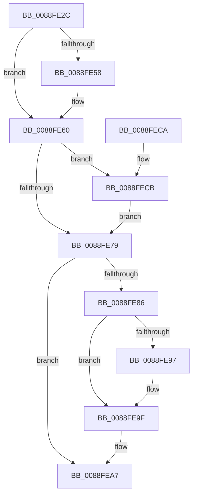

# AlpcpUnlockAndDereferenceTargetPortsAndCommunicationInfo

- RVA: `0x0088FE2C`–`0x0088FED5` (길이 `169` bytes)
- VA: `0x000000014088FE2C`
- 실행 섹션: `PAGE`
- PDB 이름 있음: `예`; PDB Function 태그: `아니요`
- unwind 정보 RVA: `0x0007D640`
- 디코드: `49`개 명령, `169/169` bytes 표시
- 미해석 바이트: `0` (있으면 어셈블리에 `.byte`로 보존)

> 이 문서는 커널 이미지의 기계어와 PDB 기호를 분석해 생성했습니다. 4번과 5번은 함수 원형과 자료형을 바이너리 사용 방식에서 추정한 C 해석이며 원본 소스 복구 결과는 아닙니다.

## 1. Dependencies

- 직접 호출 지점: **8**; 고유 호출 대상: **3**
- 직접 호출자로 확인된 함수: **4**
- RIP 상대 이미지 참조: **0**

### Outgoing calls
- `0x0088FE5B` → [ExfReleasePushLockShared](../../text/26/ExfReleasePushLockShared_function_00263440.md) (function, `0x00263440`)
- `0x0088FE63` → [KeAbPostRelease](../../text/2E/KeAbPostRelease_function_002E1600.md) (function, `0x002E1600`)
- `0x0088FE7C` → [KeAbPostRelease](../../text/2E/KeAbPostRelease_function_002E1600.md) (function, `0x002E1600`)
- `0x0088FE9A` → [ExfReleasePushLockShared](../../text/26/ExfReleasePushLockShared_function_00263440.md) (function, `0x00263440`)
- `0x0088FEA2` → [KeAbPostRelease](../../text/2E/KeAbPostRelease_function_002E1600.md) (function, `0x002E1600`)
- `0x0088FEAA` → [ObfDereferenceObject](../../text/2F/ObfDereferenceObject_function_002F9350.md) (function, `0x002F9350`)
- `0x0088FEB2` → [ObfDereferenceObject](../../text/2F/ObfDereferenceObject_function_002F9350.md) (function, `0x002F9350`)
- `0x0088FECE` → [ExfReleasePushLockShared](../../text/26/ExfReleasePushLockShared_function_00263440.md) (function, `0x00263440`)

### Direct callers
- [AlpcpDispatchNewMessage](AlpcpDispatchNewMessage_function_0088DD20.md) at `0x0088E0A3`
- [AlpcpDispatchNewMessage](AlpcpDispatchNewMessage_function_0088DD20.md) at `0x0088E0E0`
- [AlpcpDispatchNewMessage](AlpcpDispatchNewMessage_function_0088DD20.md) at `0x0088E110`
- [sub_00890033](../89/Unknown_function_00890033.md) at `0x008900B1`
- [AlpcpDispatchCloseMessage](../92/AlpcpDispatchCloseMessage_function_00923FBC.md) at `0x0092414E`
- [sub_00B19216](../B1/Unknown_function_00B19216.md) at `0x00B19264`

### Static image references
- 디코드된 RIP-relative 메모리 참조가 없습니다.

## 2. Other-region calls and transfers

- 다른 실행 섹션으로 향하는 call: **8**
  - `0x0088FE5B` → [ExfReleasePushLockShared](../../text/26/ExfReleasePushLockShared_function_00263440.md) (`PAGE` → `.text`)
  - `0x0088FE63` → [KeAbPostRelease](../../text/2E/KeAbPostRelease_function_002E1600.md) (`PAGE` → `.text`)
  - `0x0088FE7C` → [KeAbPostRelease](../../text/2E/KeAbPostRelease_function_002E1600.md) (`PAGE` → `.text`)
  - `0x0088FE9A` → [ExfReleasePushLockShared](../../text/26/ExfReleasePushLockShared_function_00263440.md) (`PAGE` → `.text`)
  - `0x0088FEA2` → [KeAbPostRelease](../../text/2E/KeAbPostRelease_function_002E1600.md) (`PAGE` → `.text`)
  - `0x0088FEAA` → [ObfDereferenceObject](../../text/2F/ObfDereferenceObject_function_002F9350.md) (`PAGE` → `.text`)
  - `0x0088FEB2` → [ObfDereferenceObject](../../text/2F/ObfDereferenceObject_function_002F9350.md) (`PAGE` → `.text`)
  - `0x0088FECE` → [ExfReleasePushLockShared](../../text/26/ExfReleasePushLockShared_function_00263440.md) (`PAGE` → `.text`)
- 별도 외부 분기/꼬리 이동을 확인하지 못했습니다.

## 3. Assembly (complete function range)

```asm
0088FE2C  48 89 5C 24 10                  mov qword ptr [rsp + 0x10], rbx
0088FE31  48 89 6C 24 18                  mov qword ptr [rsp + 0x18], rbp
0088FE36  56                              push rsi
0088FE37  57                              push rdi
0088FE38  41 56                           push r14
0088FE3A  48 83 EC 20                     sub rsp, 0x20
0088FE3E  45 33 F6                        xor r14d, r14d
0088FE41  48 8D 59 F0                     lea rbx, [rcx - 0x10]
0088FE45  49 8B F8                        mov rdi, r8
0088FE48  48 8B F2                        mov rsi, rdx
0088FE4B  41 8D 6E 11                     lea ebp, [r14 + 0x11]
0088FE4F  8B C5                           mov eax, ebp
0088FE51  F0 4C 0F B1 33                  lock cmpxchg qword ptr [rbx], r14
0088FE56  74 08                           je 0x14088fe60
0088FE58  48 8B CB                        mov rcx, rbx
0088FE5B  E8 E0 35 9D FF                  call 0x140263440
0088FE60  48 8B CB                        mov rcx, rbx
0088FE63  E8 98 17 A5 FF                  call 0x1402e1600
0088FE68  48 8B C5                        mov rax, rbp
0088FE6B  48 8D 9E 60 01 00 00            lea rbx, [rsi + 0x160]
0088FE72  F0 4C 0F B1 33                  lock cmpxchg qword ptr [rbx], r14
0088FE77  75 52                           jne 0x14088fecb
0088FE79  48 8B CB                        mov rcx, rbx
0088FE7C  E8 7F 17 A5 FF                  call 0x1402e1600
0088FE81  48 3B FE                        cmp rdi, rsi
0088FE84  74 21                           je 0x14088fea7
0088FE86  48 8D 9F 60 01 00 00            lea rbx, [rdi + 0x160]
0088FE8D  48 8B C5                        mov rax, rbp
0088FE90  F0 4C 0F B1 33                  lock cmpxchg qword ptr [rbx], r14
0088FE95  74 08                           je 0x14088fe9f
0088FE97  48 8B CB                        mov rcx, rbx
0088FE9A  E8 A1 35 9D FF                  call 0x140263440
0088FE9F  48 8B CB                        mov rcx, rbx
0088FEA2  E8 59 17 A5 FF                  call 0x1402e1600
0088FEA7  48 8B CE                        mov rcx, rsi
0088FEAA  E8 A1 94 A6 FF                  call 0x1402f9350
0088FEAF  48 8B CF                        mov rcx, rdi
0088FEB2  E8 99 94 A6 FF                  call 0x1402f9350
0088FEB7  48 8B 5C 24 48                  mov rbx, qword ptr [rsp + 0x48]
0088FEBC  48 8B 6C 24 50                  mov rbp, qword ptr [rsp + 0x50]
0088FEC1  48 83 C4 20                     add rsp, 0x20
0088FEC5  41 5E                           pop r14
0088FEC7  5F                              pop rdi
0088FEC8  5E                              pop rsi
0088FEC9  C3                              ret
0088FECA  CC                              int3
0088FECB  48 8B CB                        mov rcx, rbx
0088FECE  E8 6D 35 9D FF                  call 0x140263440
0088FED3  EB A4                           jmp 0x14088fe79
```

## 4. C-style interpretation (structured pseudocode)

```c
__int64 __fastcall AlpcpUnlockAndDereferenceTargetPortsAndCommunicationInfo(__int64 a1, __int64 a2, __int64 a3)
{
    __int64 result;
    __int64 v_r14;
    __int64 v_rsp;
    unsigned __int64 v_stack_p10;
    unsigned __int64 v_stack_p18;

    v_stack_p10 = v_rbx;
    v_stack_p18 = v_rbp;
    v_rsp = (v_rsp) - (32);
    v_r14 = 0;
    result = (unsigned int)((unsigned int)(v_r14 + 17));
    if (!(condition_is_equal)) {
        a1 = a1 - 16;
        result = ExfReleasePushLockShared(a1, a2, a3, a4);
    }
    result = KeAbPostRelease(a1 - 16, a2, a3, a4);
    if (condition_is_not_equal) goto loc_0088FECB;
loc_0088FE79:
    result = KeAbPostRelease(a2 + 352, a2, a3, a4);
    if (a3 == a2) goto loc_0088FEA7;
    result = v_r14 + 17;
    if (a3 != a2) {
        a1 = a3 + 352;
        result = ExfReleasePushLockShared(a1, a2, a3, a4);
    }
    result = KeAbPostRelease(a3 + 352, a2, a3, a4);
loc_0088FEA7:
    result = ObfDereferenceObject(a2, a2, a3, a4);
    result = ObfDereferenceObject(a3, a2, a3, a4);
    v_rsp = (v_rsp) + (32);
    return result;
loc_0088FECB:
    result = ExfReleasePushLockShared(v_stack_p10, a2, a3, a4);
    goto loc_0088FE79;
}
```

## 5. (Beta) C Style

```c
int64_t AlpcpUnlockAndDereferenceTargetPortsAndCommunicationInfo(void *Arg1, void *Arg2, int64_t Arg3)
{
    uint8_t *arg1 = (uint8_t *)Arg1;
    uint8_t *arg2 = (uint8_t *)Arg2;

    int64_t result;
    int64_t local_r14;
    int64_t local_rsp;
    uint64_t v_stack_p10;
    uint64_t v_stack_p18;

    v_stack_p10 = local_rbx;
    v_stack_p18 = local_rbp;
    local_rsp = (local_rsp) - (32);
    local_r14 = 0;
    result = (uint32_t)((uint32_t)(local_r14 + 17));
    if (!(condition_is_equal)) {
        Arg1 = Arg1 - 16;
        result = ExfReleasePushLockShared(Arg1, Arg2, Arg3, a4);
    }
    result = KeAbPostRelease(Arg1 - 16, Arg2, Arg3, a4);
    if (condition_is_not_equal) goto loc_0088FECB;
loc_0088FE79:
    result = KeAbPostRelease(Arg2 + 352, Arg2, Arg3, a4);
    if (Arg3 == Arg2) goto loc_0088FEA7;
    result = local_r14 + 17;
    if (Arg3 != Arg2) {
        Arg1 = Arg3 + 352;
        result = ExfReleasePushLockShared(Arg1, Arg2, Arg3, a4);
    }
    result = KeAbPostRelease(Arg3 + 352, Arg2, Arg3, a4);
loc_0088FEA7:
    result = ObfDereferenceObject(Arg2, Arg2, Arg3, a4);
    result = ObfDereferenceObject(Arg3, Arg2, Arg3, a4);
    local_rsp = (local_rsp) + (32);
    return result;
loc_0088FECB:
    result = ExfReleasePushLockShared(v_stack_p10, Arg2, Arg3, a4);
    goto loc_0088FE79;
}
```

### 관측된 메모리 오프셋

구조체 형식이 확인되지 않은 접근은 인자 기준의 오프셋으로만 기록했습니다.

| 기준 인자 | 오프셋 표현 | 폭 (bit) | 접근 |
|---|---:|---:|---|
| `Arg1` | `- 0x10` | `64` | `R` |
| `Arg1` | `+ 0x0` | `64` | `R` |
| `Arg2` | `+ 0x0` | `64` | `R` |
| `Arg2` | `+ 0x160` | `64` | `R` |

## 6. Execution-region graph

[열기: 2D/3D 그래프와 함수 탐색 컨트롤 패널](../../../control-panel.html?section=page&rva=0x0088FE2C&view=graph)

- 2D 그래프는 위에서 아래로 흐르고, 3D 그래프는 빈 공간을 드래그해 회전합니다. Shift+드래그는 이동, 휠은 확대·축소, 함수 노드 선택은 대상 보고서 이동입니다.

### Static fallback


