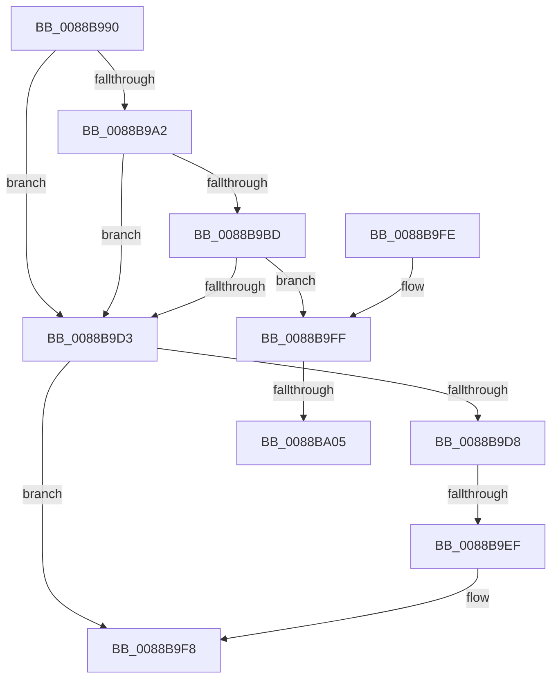

# AlpcpUnlockBlob

- RVA: `0x0088B990`–`0x0088BA10` (길이 `128` bytes)
- VA: `0x000000014088B990`
- 실행 섹션: `PAGE`
- PDB 이름 있음: `예`; PDB Function 태그: `아니요`
- unwind 정보 RVA: `0x0007D2C8`
- 디코드: `38`개 명령, `128/128` bytes 표시
- 미해석 바이트: `0` (있으면 어셈블리에 `.byte`로 보존)

> 이 문서는 커널 이미지의 기계어와 PDB 기호를 분석해 생성했습니다. 4번과 5번은 함수 원형과 자료형을 바이너리 사용 방식에서 추정한 C 해석이며 원본 소스 복구 결과는 아닙니다.

## 1. Dependencies

- 직접 호출 지점: **1**; 고유 호출 대상: **1**
- 직접 호출자로 확인된 함수: **16**
- RIP 상대 이미지 참조: **1**

### Outgoing calls
- `0x0088B9F3` → [KeAbPostRelease](../../text/2E/KeAbPostRelease_function_002E1600.md) (function, `0x002E1600`)

### Direct callers
- [AlpcpForceUnlinkSecureView](../74/AlpcpForceUnlinkSecureView_function_0074C604.md) at `0x0074C68F`
- [AlpcpCreateSectionView](AlpcpCreateSectionView_function_0088850C.md) at `0x00888565`
- [AlpcpCreateSectionView](AlpcpCreateSectionView_function_0088850C.md) at `0x008885D1`
- [AlpcpCaptureViewAttribute](AlpcpCaptureViewAttribute_function_0088957C.md) at `0x00889614`
- [AlpcpPrepareViewForDelivery](AlpcpPrepareViewForDelivery_function_00889A44.md) at `0x00889ACC`
- [sub_00889BDC](Unknown_function_00889BDC.md) at `0x00889C04`
- [AlpcpCaptureViewAttributeInternal](AlpcpCaptureViewAttributeInternal_function_00889C6C.md) at `0x00889CBF`
- [AlpcSectionDeleteProcedure](AlpcSectionDeleteProcedure_function_0088A200.md) at `0x0088A24B`
- [AlpcpCreateView](AlpcpCreateView_function_0088A9B8.md) at `0x0088AD9E`
- [AlpcViewDestroyProcedure](AlpcViewDestroyProcedure_function_0088B080.md) at `0x0088B12A`
- [AlpcpExposeViewAttributeInSenderContext](AlpcpExposeViewAttributeInSenderContext_function_0088F600.md) at `0x0088F71A`
- [AlpcpMapLegacyPortView](../92/AlpcpMapLegacyPortView_function_00921588.md) at `0x009216FD`
- [AlpcRegionDestroyProcedure](../A3/AlpcRegionDestroyProcedure_function_00A30540.md) at `0x00A30574`
- [AlpcpQueryRemoteView](../A4/AlpcpQueryRemoteView_function_00A49744.md) at `0x00A49823`
- [AlpcpReleaseViewAttribute](../A6/AlpcpReleaseViewAttribute_function_00A63A80.md) at `0x00A63A9F`
- [AlpcpMapLegacyPortRemoteView](../A9/AlpcpMapLegacyPortRemoteView_function_00A9FEE4.md) at `0x00A9FF7E`
- [sub_00B19294](../B1/Unknown_function_00B19294.md) at `0x00B192AF`

### Static image references
- `0x0088BA09` → RVA `0x0088BBA0` (`AlpcMessageCleanupProcedure`; read)

## 2. Other-region calls and transfers

- 다른 실행 섹션으로 향하는 call: **1**
  - `0x0088B9F3` → [KeAbPostRelease](../../text/2E/KeAbPostRelease_function_002E1600.md) (`PAGE` → `.text`)
- call이 아닌 외부 분기/꼬리 이동: **2**
  - `0x0088B9E9` → [sub_0088BB34](Unknown_function_0088BB34.md) (`tail-transfer`)
  - `0x0088B9FF` → [sub_0088BB78](Unknown_function_0088BB78.md) (`tail-transfer`)

## 3. Assembly (complete function range)

```asm
0088B990  40 53                           push rbx
0088B992  48 83 EC 30                     sub rsp, 0x30
0088B996  48 8B D9                        mov rbx, rcx
0088B999  0F B6 49 E0                     movzx ecx, byte ptr [rcx - 0x20]
0088B99D  F6 C1 01                        test cl, 1
0088B9A0  74 31                           je 0x14088b9d3
0088B9A2  0F BF 43 E2                     movsx eax, word ptr [rbx - 0x1e]
0088B9A6  80 E1 FE                        and cl, 0xfe
0088B9A9  BA 00 00 01 00                  mov edx, 0x10000
0088B9AE  88 4B E0                        mov byte ptr [rbx - 0x20], cl
0088B9B1  2B D0                           sub edx, eax
0088B9B3  33 C0                           xor eax, eax
0088B9B5  66 89 43 E2                     mov word ptr [rbx - 0x1e], ax
0088B9B9  85 D2                           test edx, edx
0088B9BB  7E 16                           jle 0x14088b9d3
0088B9BD  F7 DA                           neg edx
0088B9BF  48 63 C2                        movsxd rax, edx
0088B9C2  48 8B C8                        mov rcx, rax
0088B9C5  F0 48 0F C1 4B E8               lock xadd qword ptr [rbx - 0x18], rcx
0088B9CB  48 03 C8                        add rcx, rax
0088B9CE  48 85 C9                        test rcx, rcx
0088B9D1  7E 2C                           jle 0x14088b9ff
0088B9D3  48 85 DB                        test rbx, rbx
0088B9D6  74 20                           je 0x14088b9f8
0088B9D8  48 C7 C0 FF FF FF FF            mov rax, 0xffffffffffffffff
0088B9DF  F0 48 0F C1 43 F0               lock xadd qword ptr [rbx - 0x10], rax
0088B9E5  24 06                           and al, 6
0088B9E7  3C 02                           cmp al, 2
0088B9E9  0F 84 45 01 00 00               je 0x14088bb34
0088B9EF  48 8D 4B F0                     lea rcx, [rbx - 0x10]
0088B9F3  E8 08 5C A5 FF                  call 0x1402e1600
0088B9F8  48 83 C4 30                     add rsp, 0x30
0088B9FC  5B                              pop rbx
0088B9FD  C3                              ret
0088B9FE  CC                              int3
0088B9FF  0F 85 73 01 00 00               jne 0x14088bb78
0088BA05  0F B6 43 E1                     movzx eax, byte ptr [rbx - 0x1f]
0088BA09  48 8D 0D 90 01 00 00            lea rcx, [rip + 0x190]
```

## 4. C-style interpretation (structured pseudocode)

```c
__int64 __fastcall AlpcpUnlockBlob(__int64 a1)
{
    __int64 result;
    __int64 v_rsp;

    v_rsp = (v_rsp) - (48);
    if ((((unsigned __int8)(*(unsigned __int8 *)(a1 - 32))) & (1)) == 0) goto loc_0088B9D3;
    a1 = (unsigned __int8)((*(unsigned __int8 *)(a1 - 32)) & (254));
    *(unsigned __int8 *)(a1 - 32) = (unsigned __int8)(a1);
    a2 = (unsigned int)(((unsigned int)(0x10000ULL)) - ((unsigned int)((__int16)(*(unsigned __int16 *)(a1 - 30)))));
    result = 0;
    *(unsigned __int16 *)(a1 - 30) = 0;
    if (condition_is_less_or_equal) goto loc_0088B9D3;
    a2 = (unsigned int)(-(a2));
    a1 = ((int)((unsigned int)(a2))) + ((int)((unsigned int)(a2)));
    if (condition_is_less_or_equal) goto loc_0088B9FF;
loc_0088B9D3:
    if (a1 == 0) goto loc_0088B9F8;
    result = (unsigned __int8)((-1) & (6));
    result = KeAbPostRelease(a1 - 16, a2, a3, a4);
loc_0088B9F8:
    v_rsp = (v_rsp) + (48);
    return result;
loc_0088B9FF:
    return *(unsigned __int8 *)(a1 - 31);
}
```

## 5. (Beta) C Style

```c
int64_t AlpcpUnlockBlob(void *Arg1)
{
    uint8_t *arg1 = (uint8_t *)Arg1;

    int64_t result;
    int64_t local_rsp;

    local_rsp = (local_rsp) - (48);
    if ((((uint8_t)(*(uint8_t *)(arg1 - 0x20))) & (1)) == 0) goto loc_0088B9D3;
    Arg1 = (uint8_t)((*(uint8_t *)(arg1 - 0x20)) & (254));
    *(uint8_t *)(arg1 - 0x20) = (uint8_t)(Arg1);
    a2 = (uint32_t)(((uint32_t)(0x10000ULL)) - ((uint32_t)((int16_t)(*(uint16_t *)(arg1 - 0x1E)))));
    result = 0;
    *(uint16_t *)(arg1 - 0x1E) = 0;
    if (condition_is_less_or_equal) goto loc_0088B9D3;
    a2 = (uint32_t)(-(a2));
    Arg1 = ((int32_t)((uint32_t)(a2))) + ((int32_t)((uint32_t)(a2)));
    if (condition_is_less_or_equal) goto loc_0088B9FF;
loc_0088B9D3:
    if (Arg1 == NULL) goto loc_0088B9F8;
    result = (uint8_t)((-1) & (6));
    result = KeAbPostRelease(Arg1 - 16, a2, a3, a4);
loc_0088B9F8:
    local_rsp = (local_rsp) + (48);
    return result;
loc_0088B9FF:
    return *(uint8_t *)(arg1 - 0x1F);
}
```

### 관측된 메모리 오프셋

구조체 형식이 확인되지 않은 접근은 인자 기준의 오프셋으로만 기록했습니다.

| 기준 인자 | 오프셋 표현 | 폭 (bit) | 접근 |
|---|---:|---:|---|
| `Arg1` | `- 0x20` | `8` | `R` |
| `Arg1` | `- 0x20` | `8` | `W` |
| `Arg1` | `- 0x1F` | `8` | `R` |
| `Arg1` | `- 0x1E` | `16` | `R` |
| `Arg1` | `- 0x1E` | `16` | `W` |
| `Arg1` | `- 0x18` | `64` | `R/W` |

## 6. Execution-region graph

[열기: 2D/3D 그래프와 함수 탐색 컨트롤 패널](../../../control-panel.html?section=page&rva=0x0088B990&view=graph)

- 2D 그래프는 위에서 아래로 흐르고, 3D 그래프는 빈 공간을 드래그해 회전합니다. Shift+드래그는 이동, 휠은 확대·축소, 함수 노드 선택은 대상 보고서 이동입니다.

### Static fallback


