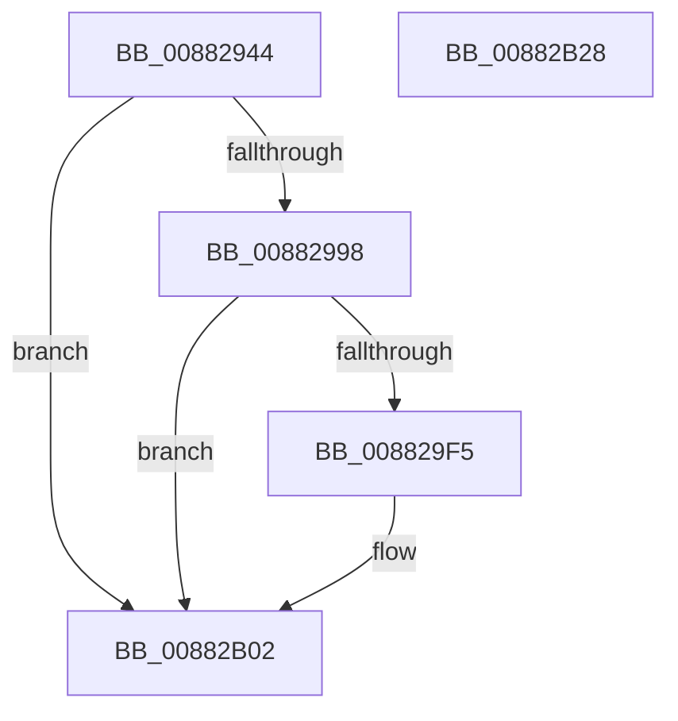

# EtwTiLogAllocExecVm

- RVA: `0x00882944`–`0x00882B29` (길이 `485` bytes)
- VA: `0x0000000140882944`
- 실행 섹션: `PAGE`
- PDB 이름 있음: `예`; PDB Function 태그: `아니요`
- unwind 정보 RVA: `0x0007C6F4`
- 디코드: `117`개 명령, `485/485` bytes 표시
- 미해석 바이트: `0` (있으면 어셈블리에 `.byte`로 보존)

> 이 문서는 커널 이미지의 기계어와 PDB 기호를 분석해 생성했습니다. 4번과 5번은 함수 원형과 자료형을 바이너리 사용 방식에서 추정한 C 해석이며 원본 소스 복구 결과는 아닙니다.

## 1. Dependencies

- 직접 호출 지점: **8**; 고유 호출 대상: **6**
- 직접 호출자로 확인된 함수: **1**
- RIP 상대 이미지 참조: **3**

### Outgoing calls
- `0x0088298B` → [EtwProviderEnabled](../../text/3B/EtwProviderEnabled_function_003BA250.md) (function, `0x003BA250`)
- `0x008829E8` → [EtwEventEnabled](../../text/39/EtwEventEnabled_function_00392450.md) (function, `0x00392450`)
- `0x00882A02` → [EtwpTiFillProcessIdentity](../../text/3B/EtwpTiFillProcessIdentity_function_003B8F30.md) (function, `0x003B8F30`)
- `0x00882A21` → [EtwpTiFillThreadIdentity](../../text/47/EtwpTiFillThreadIdentity_function_00471C1C.md) (function, `0x00471C1C`)
- `0x00882A40` → [EtwpTiFillProcessIdentity](../../text/3B/EtwpTiFillProcessIdentity_function_003B8F30.md) (function, `0x003B8F30`)
- `0x00882A5F` → [EtwpTiFillProcessIdentity](../../text/3B/EtwpTiFillProcessIdentity_function_003B8F30.md) (function, `0x003B8F30`)
- `0x00882AFD` → [EtwWrite](../../text/41/EtwWrite_function_0041C720.md) (function, `0x0041C720`)
- `0x00882B0C` → [_security_check_cookie](../../text/6A/_security_check_cookie_function_006AC640.md) (function, `0x006AC640`)

### Direct callers
- [MiAllocateVirtualMemory](MiAllocateVirtualMemory_function_00883B40.md) at `0x00883ED1`

### Static image references
- `0x00882968` → RVA `0x00E0A740` (`.data`; read)
- `0x0088297E` → RVA `0x00EFFA30` (`.data`; read)
- `0x008829C7` → RVA `0x000013F8` (`.rdata`; read)

## 2. Other-region calls and transfers

- 다른 실행 섹션으로 향하는 call: **8**
  - `0x0088298B` → [EtwProviderEnabled](../../text/3B/EtwProviderEnabled_function_003BA250.md) (`PAGE` → `.text`)
  - `0x008829E8` → [EtwEventEnabled](../../text/39/EtwEventEnabled_function_00392450.md) (`PAGE` → `.text`)
  - `0x00882A02` → [EtwpTiFillProcessIdentity](../../text/3B/EtwpTiFillProcessIdentity_function_003B8F30.md) (`PAGE` → `.text`)
  - `0x00882A21` → [EtwpTiFillThreadIdentity](../../text/47/EtwpTiFillThreadIdentity_function_00471C1C.md) (`PAGE` → `.text`)
  - `0x00882A40` → [EtwpTiFillProcessIdentity](../../text/3B/EtwpTiFillProcessIdentity_function_003B8F30.md) (`PAGE` → `.text`)
  - `0x00882A5F` → [EtwpTiFillProcessIdentity](../../text/3B/EtwpTiFillProcessIdentity_function_003B8F30.md) (`PAGE` → `.text`)
  - `0x00882AFD` → [EtwWrite](../../text/41/EtwWrite_function_0041C720.md) (`PAGE` → `.text`)
  - `0x00882B0C` → [_security_check_cookie](../../text/6A/_security_check_cookie_function_006AC640.md) (`PAGE` → `.text`)
- 별도 외부 분기/꼬리 이동을 확인하지 못했습니다.

## 3. Assembly (complete function range)

```asm
00882944  48 8B C4                        mov rax, rsp
00882947  48 89 58 10                     mov qword ptr [rax + 0x10], rbx
0088294B  4C 89 48 20                     mov qword ptr [rax + 0x20], r9
0088294F  4C 89 40 18                     mov qword ptr [rax + 0x18], r8
00882953  55                              push rbp
00882954  56                              push rsi
00882955  57                              push rdi
00882956  41 54                           push r12
00882958  41 56                           push r14
0088295A  48 8D A8 F8 FE FF FF            lea rbp, [rax - 0x108]
00882961  48 81 EC E0 01 00 00            sub rsp, 0x1e0
00882968  48 8B 05 D1 7D 58 00            mov rax, qword ptr [rip + 0x587dd1]
0088296F  48 33 C4                        xor rax, rsp
00882972  48 89 85 D0 00 00 00            mov qword ptr [rbp + 0xd0], rax
00882979  8A DA                           mov bl, dl
0088297B  48 8B F9                        mov rdi, rcx
0088297E  48 8B 0D AB D0 67 00            mov rcx, qword ptr [rip + 0x67d0ab]
00882985  33 D2                           xor edx, edx
00882987  44 8D 42 0F                     lea r8d, [rdx + 0xf]
0088298B  E8 C0 78 B3 FF                  call 0x1403ba250
00882990  84 C0                           test al, al
00882992  0F 84 6A 01 00 00               je 0x140882b02
00882998  65 48 8B 04 25 88 01 00 00      mov rax, qword ptr gs:[0x188]
008829A1  33 C9                           xor ecx, ecx
008829A3  4C 8B B0 B8 00 00 00            mov r14, qword ptr [rax + 0xb8]
008829AA  44 8D 61 08                     lea r12d, [rcx + 8]
008829AE  65 48 8B 04 25 88 01 00 00      mov rax, qword ptr gs:[0x188]
008829B7  48 8B B0 20 02 00 00            mov rsi, qword ptr [rax + 0x220]
008829BE  48 3B F7                        cmp rsi, rdi
008829C1  41 0F 44 CC                     cmove ecx, r12d
008829C5  F6 DB                           neg bl
008829C7  48 8D 1D 2A EA 77 FF            lea rbx, [rip - 0x8815d6]
008829CE  48 1B C0                        sbb rax, rax
008829D1  48 F7 D0                        not rax
008829D4  83 E0 10                        and eax, 0x10
008829D7  48 03 C8                        add rcx, rax
008829DA  48 8B 1C 19                     mov rbx, qword ptr [rcx + rbx]
008829DE  48 8B 0D 4B D0 67 00            mov rcx, qword ptr [rip + 0x67d04b]
008829E5  48 8B D3                        mov rdx, rbx
008829E8  E8 63 FA B0 FF                  call 0x140392450
008829ED  84 C0                           test al, al
008829EF  0F 84 0D 01 00 00               je 0x140882b02
008829F5  4C 8D 44 24 30                  lea r8, [rsp + 0x30]
008829FA  49 8B D6                        mov rdx, r14
008829FD  48 8D 4C 24 50                  lea rcx, [rsp + 0x50]
00882A02  E8 29 65 B3 FF                  call 0x1403b8f30
00882A07  65 48 8B 14 25 88 01 00 00      mov rdx, qword ptr gs:[0x188]
00882A10  8B C8                           mov ecx, eax
00882A12  44 8B C8                        mov r9d, eax
00882A15  48 8D 44 24 50                  lea rax, [rsp + 0x50]
00882A1A  48 C1 E1 04                     shl rcx, 4
00882A1E  48 03 C8                        add rcx, rax
00882A21  E8 F6 F1 BE FF                  call 0x140471c1c
00882A26  44 03 C8                        add r9d, eax
00882A29  4C 8D 44 24 38                  lea r8, [rsp + 0x38]
00882A2E  48 8D 44 24 50                  lea rax, [rsp + 0x50]
00882A33  41 8B C9                        mov ecx, r9d
00882A36  48 C1 E1 04                     shl rcx, 4
00882A3A  48 8B D7                        mov rdx, rdi
00882A3D  48 03 C8                        add rcx, rax
00882A40  E8 EB 64 B3 FF                  call 0x1403b8f30
00882A45  44 03 C8                        add r9d, eax
00882A48  48 8D 4C 24 50                  lea rcx, [rsp + 0x50]
00882A4D  41 8B C1                        mov eax, r9d
00882A50  4C 8D 44 24 40                  lea r8, [rsp + 0x40]
00882A55  48 C1 E0 04                     shl rax, 4
00882A59  48 8B D6                        mov rdx, rsi
00882A5C  48 03 C8                        add rcx, rax
00882A5F  E8 CC 64 B3 FF                  call 0x1403b8f30
00882A64  44 03 C8                        add r9d, eax
00882A67  41 8D 54 24 FC                  lea edx, [r12 - 4]
00882A6C  41 8B C1                        mov eax, r9d
00882A6F  48 8D 8D 20 01 00 00            lea rcx, [rbp + 0x120]
00882A76  48 03 C0                        add rax, rax
00882A79  41 FF C1                        inc r9d
00882A7C  45 33 C0                        xor r8d, r8d
00882A7F  83 64 C4 5C 00                  and dword ptr [rsp + rax*8 + 0x5c], 0
00882A84  48 89 4C C4 50                  mov qword ptr [rsp + rax*8 + 0x50], rcx
00882A89  48 8D 8D 28 01 00 00            lea rcx, [rbp + 0x128]
00882A90  44 89 64 C4 58                  mov dword ptr [rsp + rax*8 + 0x58], r12d
00882A95  41 8B C1                        mov eax, r9d
00882A98  41 FF C1                        inc r9d
00882A9B  48 03 C0                        add rax, rax
00882A9E  83 64 C4 5C 00                  and dword ptr [rsp + rax*8 + 0x5c], 0
00882AA3  48 89 4C C4 50                  mov qword ptr [rsp + rax*8 + 0x50], rcx
00882AA8  48 8D 8D 30 01 00 00            lea rcx, [rbp + 0x130]
00882AAF  44 89 64 C4 58                  mov dword ptr [rsp + rax*8 + 0x58], r12d
00882AB4  41 8B C1                        mov eax, r9d
00882AB7  41 FF C1                        inc r9d
00882ABA  48 03 C0                        add rax, rax
00882ABD  83 64 C4 5C 00                  and dword ptr [rsp + rax*8 + 0x5c], 0
00882AC2  48 89 4C C4 50                  mov qword ptr [rsp + rax*8 + 0x50], rcx
00882AC7  48 8D 8D 38 01 00 00            lea rcx, [rbp + 0x138]
00882ACE  89 54 C4 58                     mov dword ptr [rsp + rax*8 + 0x58], edx
00882AD2  41 8B C1                        mov eax, r9d
00882AD5  48 03 C0                        add rax, rax
00882AD8  83 64 C4 5C 00                  and dword ptr [rsp + rax*8 + 0x5c], 0
00882ADD  48 89 4C C4 50                  mov qword ptr [rsp + rax*8 + 0x50], rcx
00882AE2  41 FF C1                        inc r9d
00882AE5  48 8B 0D 44 CF 67 00            mov rcx, qword ptr [rip + 0x67cf44]
00882AEC  89 54 C4 58                     mov dword ptr [rsp + rax*8 + 0x58], edx
00882AF0  48 8D 44 24 50                  lea rax, [rsp + 0x50]
00882AF5  48 8B D3                        mov rdx, rbx
00882AF8  48 89 44 24 20                  mov qword ptr [rsp + 0x20], rax
00882AFD  E8 1E 9C B9 FF                  call 0x14041c720
00882B02  48 8B 8D D0 00 00 00            mov rcx, qword ptr [rbp + 0xd0]
00882B09  48 33 CC                        xor rcx, rsp
00882B0C  E8 2F 9B E2 FF                  call 0x1406ac640
00882B11  48 8B 9C 24 18 02 00 00         mov rbx, qword ptr [rsp + 0x218]
00882B19  48 81 C4 E0 01 00 00            add rsp, 0x1e0
00882B20  41 5E                           pop r14
00882B22  41 5C                           pop r12
00882B24  5F                              pop rdi
00882B25  5E                              pop rsi
00882B26  5D                              pop rbp
00882B27  C3                              ret
00882B28  CC                              int3
```

## 4. C-style interpretation (structured pseudocode)

```c
__int64 __fastcall EtwTiLogAllocExecVm(__int64 a1, int a2, __int64 a3, __int64 a4)
{
    __int64 result;
    __int64 v_rbx;
    __int64 v_rsp;
    unsigned __int64 v_stack_m1B8;
    unsigned __int64 v_stack_m1C8;
    unsigned __int64 v_stack_m1D0;
    unsigned __int64 v_stack_m1D8;
    unsigned __int64 v_stack_m1E8;
    unsigned __int64 v_stack_p10;

    *(unsigned __int64 *)(v_rsp + 16) = v_rbx;
    *(unsigned __int64 *)(v_rsp + 32) = a4;
    *(unsigned __int64 *)(v_rsp + 24) = a3;
    v_rsp = (v_rsp) - (480);
    result = (*(unsigned __int64 *)(v_rip + 5799377)) ^ (v_rsp);
    *(unsigned __int64 *)(v_rsp - 264 + 208) = result;
    a2 = 0;
    result = EtwProviderEnabled(*(unsigned __int64 *)(v_rip + 6803627), a2, a2 + 15, a4);
    if ((unsigned __int8)(result) == 0) goto loc_00882B02;
    a1 = 0;
    if ((*(unsigned __int64 *)(*(unsigned __int64 *)(gs_base + (0 + 392)) + 544)) == 0) { a1 = (unsigned int)(a1 + 8); }
    v_rbx = (unsigned __int8)(-((unsigned __int8)(a2)));
    result = ~(*(unsigned __int64 *)(gs_base + (0 + 392)));
    result = (unsigned int)((result) & (16));
    a1 = (a1) + (result);
    result = EtwEventEnabled(*(unsigned __int64 *)(v_rip + 6803531), *(unsigned __int64 *)(a1 + v_rip - 8918486 * 1), a2 + 15, a4);
    if ((unsigned __int8)(result) != 0) {
        a3 = v_stack_m1D8;
        a2 = *(unsigned __int64 *)(*(unsigned __int64 *)(gs_base + (0 + 392)) + 184);
        a1 = v_stack_m1B8;
        result = EtwpTiFillProcessIdentity(a1, a2, a3, a4);
        a2 = *(unsigned __int64 *)(gs_base + (0 + 392));
        a1 = (unsigned int)(result);
        a4 = (unsigned int)(result);
        result = v_stack_m1B8;
        a1 = (a1) << (4);
        a1 = (a1) + (result);
        result = EtwpTiFillThreadIdentity(a1, a2, a3, a4);
        a4 = (unsigned int)((a4) + ((unsigned int)(result)));
        a3 = v_stack_m1D0;
        result = v_stack_m1B8;
        a1 = (unsigned int)(a4);
        a1 = (a1) << (4);
        a2 = a1;
        a1 = (a1) + (result);
        result = EtwpTiFillProcessIdentity(a1, a2, a3, a4);
        a4 = (unsigned int)((a4) + ((unsigned int)(result)));
        a1 = v_stack_m1B8;
        result = (unsigned int)(a4);
        a3 = v_stack_m1C8;
        result = (result) << (4);
        a2 = *(unsigned __int64 *)(*(unsigned __int64 *)(gs_base + (0 + 392)) + 544);
        a1 = (a1) + (result);
        result = EtwpTiFillProcessIdentity(a1, a2, a3, a4);
        a4 = (unsigned int)((a4) + ((unsigned int)(result)));
        a2 = a1 + 8 - 4;
        result = (unsigned int)(a4);
        a1 = v_rsp - 264 + 288;
        result = (result) + (result);
        a4 = (unsigned int)((a4) + 1);
        a3 = 0;
        *(unsigned __int64 *)(v_rsp + result * 8 + 80) = a1;
        a1 = v_rsp - 264 + 296;
        *(unsigned int *)(v_rsp + result * 8 + 88) = (unsigned int)(a1 + 8);
        result = (unsigned int)(a4);
        a4 = (unsigned int)((a4) + 1);
        result = (result) + (result);
        *(unsigned __int64 *)(v_rsp + result * 8 + 80) = a1;
        a1 = v_rsp - 264 + 304;
        *(unsigned int *)(v_rsp + result * 8 + 88) = (unsigned int)(a1 + 8);
        result = (unsigned int)(a4);
        a4 = (unsigned int)((a4) + 1);
        result = (result) + (result);
        *(unsigned __int64 *)(v_rsp + result * 8 + 80) = a1;
        a1 = v_rsp - 264 + 312;
        *(unsigned int *)(v_rsp + result * 8 + 88) = a2;
        result = (unsigned int)(a4);
        result = (result) + (result);
        *(unsigned __int64 *)(v_rsp + result * 8 + 80) = a1;
        a4 = (unsigned int)((a4) + 1);
        a1 = *(unsigned __int64 *)(v_rip + 6803268);
        *(unsigned int *)(v_rsp + result * 8 + 88) = a2;
        result = v_stack_m1B8;
        a2 = *(unsigned __int64 *)(a1 + v_rip - 8918486 * 1);
        v_stack_m1E8 = result;
        result = EtwWrite(a1, a2, a3, a4);
    }
    a1 = (*(unsigned __int64 *)(v_rsp - 264 + 208)) ^ (v_rsp);
    result = _security_check_cookie(a1, a2, a3, a4);
    v_rsp = (v_rsp) + (480);
    return result;
}
```

## 5. (Beta) C Style

```c
int64_t EtwTiLogAllocExecVm(int64_t Arg1, int32_t Arg2, int64_t Arg3, int64_t Arg4)
{
    int64_t result;
    int64_t local_rbx;
    int64_t local_rsp;
    uint64_t v_stack_m1B8;
    uint64_t v_stack_m1C8;
    uint64_t v_stack_m1D0;
    uint64_t v_stack_m1D8;
    uint64_t v_stack_m1E8;
    uint64_t v_stack_p10;

    *(uint64_t *)(local_rsp + 0x10) = local_rbx;
    *(uint64_t *)(local_rsp + 0x20) = Arg4;
    *(uint64_t *)(local_rsp + 0x18) = Arg3;
    local_rsp = (local_rsp) - (480);
    result = (*(uint64_t *)(v_rip + 0x587DD1)) ^ (local_rsp);
    *(uint64_t *)(local_rsp - 0x108 + 0xD0) = result;
    Arg2 = 0;
    result = EtwProviderEnabled(*(uint64_t *)(v_rip + 0x67D0AB), Arg2, Arg2 + 15, Arg4);
    if ((uint8_t)(result) == 0) goto loc_00882B02;
    Arg1 = 0;
    if ((*(uint64_t *)(*(uint64_t *)(gs_base + (0 + 0x188)) + 0x220)) == 0) { Arg1 = (uint32_t)(Arg1 + 8); }
    local_rbx = (uint8_t)(-((uint8_t)(Arg2)));
    result = ~(*(uint64_t *)(gs_base + (0 + 0x188)));
    result = (uint32_t)((result) & (16));
    Arg1 = (Arg1) + (result);
    result = EtwEventEnabled(*(uint64_t *)(v_rip + 0x67D04B), *(uint64_t *)(Arg1 + v_rip - 0x8815D6 * 1), Arg2 + 15, Arg4);
    if ((uint8_t)(result) != 0) {
        Arg3 = v_stack_m1D8;
        Arg2 = *(uint64_t *)(*(uint64_t *)(gs_base + (0 + 0x188)) + 0xB8);
        Arg1 = v_stack_m1B8;
        result = EtwpTiFillProcessIdentity(Arg1, Arg2, Arg3, Arg4);
        Arg2 = *(uint64_t *)(gs_base + (0 + 0x188));
        Arg1 = (uint32_t)(result);
        Arg4 = (uint32_t)(result);
        result = v_stack_m1B8;
        Arg1 = (Arg1) << (4);
        Arg1 = (Arg1) + (result);
        result = EtwpTiFillThreadIdentity(Arg1, Arg2, Arg3, Arg4);
        Arg4 = (uint32_t)((Arg4) + ((uint32_t)(result)));
        Arg3 = v_stack_m1D0;
        result = v_stack_m1B8;
        Arg1 = (uint32_t)(Arg4);
        Arg1 = (Arg1) << (4);
        Arg2 = Arg1;
        Arg1 = (Arg1) + (result);
        result = EtwpTiFillProcessIdentity(Arg1, Arg2, Arg3, Arg4);
        Arg4 = (uint32_t)((Arg4) + ((uint32_t)(result)));
        Arg1 = v_stack_m1B8;
        result = (uint32_t)(Arg4);
        Arg3 = v_stack_m1C8;
        result = (result) << (4);
        Arg2 = *(uint64_t *)(*(uint64_t *)(gs_base + (0 + 0x188)) + 0x220);
        Arg1 = (Arg1) + (result);
        result = EtwpTiFillProcessIdentity(Arg1, Arg2, Arg3, Arg4);
        Arg4 = (uint32_t)((Arg4) + ((uint32_t)(result)));
        Arg2 = Arg1 + 8 - 4;
        result = (uint32_t)(Arg4);
        Arg1 = local_rsp - 264 + 288;
        result = (result) + (result);
        Arg4 = (uint32_t)((Arg4) + 1);
        Arg3 = 0;
        *(uint64_t *)(local_rsp + result * 8 + 0x50) = Arg1;
        Arg1 = local_rsp - 264 + 296;
        *(uint32_t *)(local_rsp + result * 8 + 0x58) = (uint32_t)(Arg1 + 8);
        result = (uint32_t)(Arg4);
        Arg4 = (uint32_t)((Arg4) + 1);
        result = (result) + (result);
        *(uint64_t *)(local_rsp + result * 8 + 0x50) = Arg1;
        Arg1 = local_rsp - 264 + 304;
        *(uint32_t *)(local_rsp + result * 8 + 0x58) = (uint32_t)(Arg1 + 8);
        result = (uint32_t)(Arg4);
        Arg4 = (uint32_t)((Arg4) + 1);
        result = (result) + (result);
        *(uint64_t *)(local_rsp + result * 8 + 0x50) = Arg1;
        Arg1 = local_rsp - 264 + 312;
        *(uint32_t *)(local_rsp + result * 8 + 0x58) = Arg2;
        result = (uint32_t)(Arg4);
        result = (result) + (result);
        *(uint64_t *)(local_rsp + result * 8 + 0x50) = Arg1;
        Arg4 = (uint32_t)((Arg4) + 1);
        Arg1 = *(uint64_t *)(v_rip + 0x67CF44);
        *(uint32_t *)(local_rsp + result * 8 + 0x58) = Arg2;
        result = v_stack_m1B8;
        Arg2 = *(uint64_t *)(Arg1 + v_rip - 0x8815D6 * 1);
        v_stack_m1E8 = result;
        result = EtwWrite(Arg1, Arg2, Arg3, Arg4);
    }
    Arg1 = (*(uint64_t *)(local_rsp - 0x108 + 0xD0)) ^ (local_rsp);
    result = _security_check_cookie(Arg1, Arg2, Arg3, Arg4);
    local_rsp = (local_rsp) + (480);
    return result;
}
```

## 6. Execution-region graph

[열기: 2D/3D 그래프와 함수 탐색 컨트롤 패널](../../../control-panel.html?section=page&rva=0x00882944&view=graph)

- 2D 그래프는 위에서 아래로 흐르고, 3D 그래프는 빈 공간을 드래그해 회전합니다. Shift+드래그는 이동, 휠은 확대·축소, 함수 노드 선택은 대상 보고서 이동입니다.

### Static fallback


