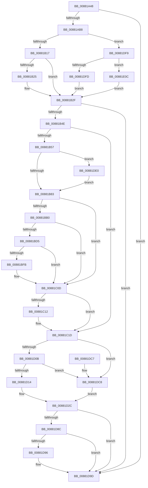

# EtwTiLogProtectExecVm

- RVA: `0x00881A48`–`0x00881E1B` (길이 `979` bytes)
- VA: `0x0000000140881A48`
- 실행 섹션: `PAGE`
- PDB 이름 있음: `예`; PDB Function 태그: `아니요`
- unwind 정보 RVA: `0x0007C5D0`
- 디코드: `228`개 명령, `979/979` bytes 표시
- 미해석 바이트: `0` (있으면 어셈블리에 `.byte`로 보존)

> 이 문서는 커널 이미지의 기계어와 PDB 기호를 분석해 생성했습니다. 4번과 5번은 함수 원형과 자료형을 바이너리 사용 방식에서 추정한 C 해석이며 원본 소스 복구 결과는 아닙니다.

## 1. Dependencies

- 직접 호출 지점: **19**; 고유 호출 대상: **14**
- 직접 호출자로 확인된 함수: **1**
- RIP 상대 이미지 참조: **3**

### Outgoing calls
- `0x00881A91` → [memset](../../text/6C/memset_function_006C6C40.md) (function, `0x006C6C40`)
- `0x00881AAB` → [EtwProviderEnabled](../../text/3B/EtwProviderEnabled_function_003BA250.md) (function, `0x003BA250`)
- `0x00881B2F` → [EtwProviderEnabled](../../text/3B/EtwProviderEnabled_function_003BA250.md) (function, `0x003BA250`)
- `0x00881B41` → [EtwEventEnabled](../../text/39/EtwEventEnabled_function_00392450.md) (function, `0x00392450`)
- `0x00881BA3` → [ZwQueryVirtualMemory](../../text/6A/ZwQueryVirtualMemory_function_006AD530.md) (function, `0x006AD530`)
- `0x00881BC6` → [ExAllocatePool2](../../poolcode/B8/ExAllocatePool2_function_00B820F0.md) (function, `0x00B820F0`)
- `0x00881BF2` → [ZwQueryVirtualMemory](../../text/6A/ZwQueryVirtualMemory_function_006AD530.md) (function, `0x006AD530`)
- `0x00881C02` → [ExFreePoolWithTag](../../poolcode/B8/ExFreePoolWithTag_function_00B82870.md) (function, `0x00B82870`)
- `0x00881C18` → [KiUnstackDetachProcess](../../text/21/KiUnstackDetachProcess_function_00217D30.md) (function, `0x00217D30`)
- `0x00881C28` → [EtwpTiFillProcessIdentity](../../text/3B/EtwpTiFillProcessIdentity_function_003B8F30.md) (function, `0x003B8F30`)
- `0x00881C46` → [EtwpTiFillThreadIdentity](../../text/47/EtwpTiFillThreadIdentity_function_00471C1C.md) (function, `0x00471C1C`)
- `0x00881C63` → [EtwpTiFillProcessIdentity](../../text/3B/EtwpTiFillProcessIdentity_function_003B8F30.md) (function, `0x003B8F30`)
- `0x00881C82` → [EtwpTiFillProcessIdentity](../../text/3B/EtwpTiFillProcessIdentity_function_003B8F30.md) (function, `0x003B8F30`)
- `0x00881D27` → [EtwpTiFillVad](../../text/46/EtwpTiFillVad_function_004695B0.md) (function, `0x004695B0`)
- `0x00881D82` → [EtwWrite](../../text/41/EtwWrite_function_0041C720.md) (function, `0x0041C720`)
- `0x00881D98` → [ExFreePoolWithTag](../../poolcode/B8/ExFreePoolWithTag_function_00B82870.md) (function, `0x00B82870`)
- `0x00881DA7` → [_security_check_cookie](../../text/6A/_security_check_cookie_function_006AC640.md) (function, `0x006AC640`)
- `0x00881DD6` → [EtwpTiFillZeroVad](../../text/46/EtwpTiFillZeroVad_function_00469548.md) (function, `0x00469548`)
- `0x00881DE9` → [KiStackAttachProcess](../../text/21/KiStackAttachProcess_function_00216820.md) (function, `0x00216820`)

### Direct callers
- [NtProtectVirtualMemory](NtProtectVirtualMemory_function_00880CA0.md) at `0x00880F69`

### Static image references
- `0x00881A70` → RVA `0x00E0A740` (`.data`; read)
- `0x00881A96` → RVA `0x00EFFA30` (`.data`; read)
- `0x00881AC1` → RVA `0x000013D8` (`.rdata`; read)

## 2. Other-region calls and transfers

- 다른 실행 섹션으로 향하는 call: **19**
  - `0x00881A91` → [memset](../../text/6C/memset_function_006C6C40.md) (`PAGE` → `.text`)
  - `0x00881AAB` → [EtwProviderEnabled](../../text/3B/EtwProviderEnabled_function_003BA250.md) (`PAGE` → `.text`)
  - `0x00881B2F` → [EtwProviderEnabled](../../text/3B/EtwProviderEnabled_function_003BA250.md) (`PAGE` → `.text`)
  - `0x00881B41` → [EtwEventEnabled](../../text/39/EtwEventEnabled_function_00392450.md) (`PAGE` → `.text`)
  - `0x00881BA3` → [ZwQueryVirtualMemory](../../text/6A/ZwQueryVirtualMemory_function_006AD530.md) (`PAGE` → `.text`)
  - `0x00881BC6` → [ExAllocatePool2](../../poolcode/B8/ExAllocatePool2_function_00B820F0.md) (`PAGE` → `POOLCODE`)
  - `0x00881BF2` → [ZwQueryVirtualMemory](../../text/6A/ZwQueryVirtualMemory_function_006AD530.md) (`PAGE` → `.text`)
  - `0x00881C02` → [ExFreePoolWithTag](../../poolcode/B8/ExFreePoolWithTag_function_00B82870.md) (`PAGE` → `POOLCODE`)
  - `0x00881C18` → [KiUnstackDetachProcess](../../text/21/KiUnstackDetachProcess_function_00217D30.md) (`PAGE` → `.text`)
  - `0x00881C28` → [EtwpTiFillProcessIdentity](../../text/3B/EtwpTiFillProcessIdentity_function_003B8F30.md) (`PAGE` → `.text`)
  - `0x00881C46` → [EtwpTiFillThreadIdentity](../../text/47/EtwpTiFillThreadIdentity_function_00471C1C.md) (`PAGE` → `.text`)
  - `0x00881C63` → [EtwpTiFillProcessIdentity](../../text/3B/EtwpTiFillProcessIdentity_function_003B8F30.md) (`PAGE` → `.text`)
  - `0x00881C82` → [EtwpTiFillProcessIdentity](../../text/3B/EtwpTiFillProcessIdentity_function_003B8F30.md) (`PAGE` → `.text`)
  - `0x00881D27` → [EtwpTiFillVad](../../text/46/EtwpTiFillVad_function_004695B0.md) (`PAGE` → `.text`)
  - `0x00881D82` → [EtwWrite](../../text/41/EtwWrite_function_0041C720.md) (`PAGE` → `.text`)
  - `0x00881D98` → [ExFreePoolWithTag](../../poolcode/B8/ExFreePoolWithTag_function_00B82870.md) (`PAGE` → `POOLCODE`)
  - `0x00881DA7` → [_security_check_cookie](../../text/6A/_security_check_cookie_function_006AC640.md) (`PAGE` → `.text`)
  - `0x00881DD6` → [EtwpTiFillZeroVad](../../text/46/EtwpTiFillZeroVad_function_00469548.md) (`PAGE` → `.text`)
  - `0x00881DE9` → [KiStackAttachProcess](../../text/21/KiStackAttachProcess_function_00216820.md) (`PAGE` → `.text`)
- 별도 외부 분기/꼬리 이동을 확인하지 못했습니다.

## 3. Assembly (complete function range)

```asm
00881A48  48 8B C4                        mov rax, rsp
00881A4B  48 89 58 10                     mov qword ptr [rax + 0x10], rbx
00881A4F  4C 89 48 20                     mov qword ptr [rax + 0x20], r9
00881A53  4C 89 40 18                     mov qword ptr [rax + 0x18], r8
00881A57  55                              push rbp
00881A58  56                              push rsi
00881A59  57                              push rdi
00881A5A  41 54                           push r12
00881A5C  41 55                           push r13
00881A5E  41 56                           push r14
00881A60  41 57                           push r15
00881A62  48 8D A8 D8 FD FF FF            lea rbp, [rax - 0x228]
00881A69  48 81 EC F0 02 00 00            sub rsp, 0x2f0
00881A70  48 8B 05 C9 8C 58 00            mov rax, qword ptr [rip + 0x588cc9]
00881A77  48 33 C4                        xor rax, rsp
00881A7A  48 89 85 E0 01 00 00            mov qword ptr [rbp + 0x1e0], rax
00881A81  8A DA                           mov bl, dl
00881A83  48 8B F1                        mov rsi, rcx
00881A86  33 D2                           xor edx, edx
00881A88  48 8D 4C 24 40                  lea rcx, [rsp + 0x40]
00881A8D  44 8D 42 40                     lea r8d, [rdx + 0x40]
00881A91  E8 AA 51 E4 FF                  call 0x1406c6c40
00881A96  48 8B 0D 93 DF 67 00            mov rcx, qword ptr [rip + 0x67df93]
00881A9D  45 33 FF                        xor r15d, r15d
00881AA0  33 D2                           xor edx, edx
00881AA2  41 B8 F0 00 00 00               mov r8d, 0xf0
00881AA8  45 8B F7                        mov r14d, r15d
00881AAB  E8 A0 87 B3 FF                  call 0x1403ba250
00881AB0  84 C0                           test al, al
00881AB2  0F 84 E5 02 00 00               je 0x140881d9d
00881AB8  65 48 8B 04 25 88 01 00 00      mov rax, qword ptr gs:[0x188]
00881AC1  4C 8D 2D 10 F9 77 FF            lea r13, [rip - 0x8806f0]
00881AC8  41 8B D7                        mov edx, r15d
00881ACB  4C 8B A0 B8 00 00 00            mov r12, qword ptr [rax + 0xb8]
00881AD2  65 48 8B 04 25 88 01 00 00      mov rax, qword ptr gs:[0x188]
00881ADB  4C 3B E6                        cmp r12, rsi
00881ADE  48 8B 80 20 02 00 00            mov rax, qword ptr [rax + 0x220]
00881AE5  48 89 44 24 30                  mov qword ptr [rsp + 0x30], rax
00881AEA  41 8D 47 08                     lea eax, [r15 + 8]
00881AEE  0F 44 D0                        cmove edx, eax
00881AF1  8A C3                           mov al, bl
00881AF3  F6 D8                           neg al
00881AF5  48 1B C9                        sbb rcx, rcx
00881AF8  48 F7 D1                        not rcx
00881AFB  83 E1 10                        and ecx, 0x10
00881AFE  48 03 D1                        add rdx, rcx
00881B01  48 8B 0D 28 DF 67 00            mov rcx, qword ptr [rip + 0x67df28]
00881B08  4E 8B 2C 2A                     mov r13, qword ptr [rdx + r13]
00881B0C  33 D2                           xor edx, edx
00881B0E  4C 3B E6                        cmp r12, rsi
00881B11  0F 85 E2 02 00 00               jne 0x140881df9
00881B17  49 B8 00 00 00 00 08 00 00 00   movabs r8, 0x800000000
00881B21  84 DB                           test bl, bl
00881B23  74 0A                           je 0x140881b2f
00881B25  49 B8 00 00 00 00 04 00 00 00   movabs r8, 0x400000000
00881B2F  E8 1C 87 B3 FF                  call 0x1403ba250
00881B34  48 8B 0D F5 DE 67 00            mov rcx, qword ptr [rip + 0x67def5]
00881B3B  49 8B D5                        mov rdx, r13
00881B3E  40 8A F8                        mov dil, al
00881B41  E8 0A 09 B1 FF                  call 0x140392450
00881B46  84 C0                           test al, al
00881B48  0F 84 4F 02 00 00               je 0x140881d9d
00881B4E  40 84 FF                        test dil, dil
00881B51  0F 84 C6 00 00 00               je 0x140881c1d
00881B57  48 8B 9D 50 02 00 00            mov rbx, qword ptr [rbp + 0x250]
00881B5E  0F 57 C0                        xorps xmm0, xmm0
00881B61  0F 11 45 80                     movups xmmword ptr [rbp - 0x80], xmm0
00881B65  0F 11 45 90                     movups xmmword ptr [rbp - 0x70], xmm0
00881B69  0F 11 45 A0                     movups xmmword ptr [rbp - 0x60], xmm0
00881B6D  65 48 8B 04 25 88 01 00 00      mov rax, qword ptr gs:[0x188]
00881B76  48 3B B0 B8 00 00 00            cmp rsi, qword ptr [rax + 0xb8]
00881B7D  0F 85 5D 02 00 00               jne 0x140881de0
00881B83  4C 21 74 24 28                  and qword ptr [rsp + 0x28], r14
00881B88  4C 8D 4C 24 48                  lea r9, [rsp + 0x48]
00881B8D  41 B8 03 00 00 00               mov r8d, 3
00881B93  48 C7 44 24 20 30 00 00 00      mov qword ptr [rsp + 0x20], 0x30
00881B9C  48 8B D3                        mov rdx, rbx
00881B9F  48 83 C9 FF                     or rcx, 0xffffffffffffffff
00881BA3  E8 88 B9 E2 FF                  call 0x1406ad530
00881BA8  89 44 24 40                     mov dword ptr [rsp + 0x40], eax
00881BAC  85 C0                           test eax, eax
00881BAE  78 5D                           js 0x140881c0d
00881BB0  BA 00 02 00 00                  mov edx, 0x200
00881BB5  B9 00 01 00 00                  mov ecx, 0x100
00881BBA  41 B8 54 49 73 6E               mov r8d, 0x6e734954
00881BC0  41 BE 01 00 00 00               mov r14d, 1
00881BC6  E8 25 05 30 00                  call 0x140b820f0
00881BCB  48 89 44 24 78                  mov qword ptr [rsp + 0x78], rax
00881BD0  48 85 C0                        test rax, rax
00881BD3  74 38                           je 0x140881c0d
00881BD5  48 83 64 24 28 00               and qword ptr [rsp + 0x28], 0
00881BDB  45 8D 46 01                     lea r8d, [r14 + 1]
00881BDF  4C 8B C8                        mov r9, rax
00881BE2  48 C7 44 24 20 00 02 00 00      mov qword ptr [rsp + 0x20], 0x200
00881BEB  48 8B D3                        mov rdx, rbx
00881BEE  48 83 C9 FF                     or rcx, 0xffffffffffffffff
00881BF2  E8 39 B9 E2 FF                  call 0x1406ad530
00881BF7  85 C0                           test eax, eax
00881BF9  79 12                           jns 0x140881c0d
00881BFB  48 8B 4C 24 78                  mov rcx, qword ptr [rsp + 0x78]
00881C00  33 D2                           xor edx, edx
00881C02  E8 69 0C 30 00                  call 0x140b82870
00881C07  48 83 64 24 78 00               and qword ptr [rsp + 0x78], 0
00881C0D  45 85 FF                        test r15d, r15d
00881C10  74 0B                           je 0x140881c1d
00881C12  33 D2                           xor edx, edx
00881C14  48 8D 4D 80                     lea rcx, [rbp - 0x80]
00881C18  E8 13 61 99 FF                  call 0x140217d30
00881C1D  4C 8D 45 B0                     lea r8, [rbp - 0x50]
00881C21  49 8B D4                        mov rdx, r12
00881C24  48 8D 4D D0                     lea rcx, [rbp - 0x30]
00881C28  E8 03 73 B3 FF                  call 0x1403b8f30
00881C2D  65 48 8B 14 25 88 01 00 00      mov rdx, qword ptr gs:[0x188]
00881C36  8B C8                           mov ecx, eax
00881C38  44 8B D8                        mov r11d, eax
00881C3B  48 8D 45 D0                     lea rax, [rbp - 0x30]
00881C3F  48 C1 E1 04                     shl rcx, 4
00881C43  48 03 C8                        add rcx, rax
00881C46  E8 D1 FF BE FF                  call 0x140471c1c
00881C4B  44 03 D8                        add r11d, eax
00881C4E  4C 8D 45 B8                     lea r8, [rbp - 0x48]
00881C52  48 8D 45 D0                     lea rax, [rbp - 0x30]
00881C56  41 8B CB                        mov ecx, r11d
00881C59  48 C1 E1 04                     shl rcx, 4
00881C5D  48 8B D6                        mov rdx, rsi
00881C60  48 03 C8                        add rcx, rax
00881C63  E8 C8 72 B3 FF                  call 0x1403b8f30
00881C68  48 8B 54 24 30                  mov rdx, qword ptr [rsp + 0x30]
00881C6D  48 8D 4D D0                     lea rcx, [rbp - 0x30]
00881C71  44 03 D8                        add r11d, eax
00881C74  4C 8D 45 C0                     lea r8, [rbp - 0x40]
00881C78  41 8B C3                        mov eax, r11d
00881C7B  48 C1 E0 04                     shl rax, 4
00881C7F  48 03 C8                        add rcx, rax
00881C82  E8 A9 72 B3 FF                  call 0x1403b8f30
00881C87  44 03 D8                        add r11d, eax
00881C8A  48 8D 8D 50 02 00 00            lea rcx, [rbp + 0x250]
00881C91  41 8B C3                        mov eax, r11d
00881C94  41 FF C3                        inc r11d
00881C97  48 03 C0                        add rax, rax
00881C9A  48 89 4C C5 D0                  mov qword ptr [rbp + rax*8 - 0x30], rcx
00881C9F  48 8D 8D 48 02 00 00            lea rcx, [rbp + 0x248]
00881CA6  48 C7 44 C5 D8 08 00 00 00      mov qword ptr [rbp + rax*8 - 0x28], 8
00881CAF  41 8B C3                        mov eax, r11d
00881CB2  41 FF C3                        inc r11d
00881CB5  48 03 C0                        add rax, rax
00881CB8  48 89 4C C5 D0                  mov qword ptr [rbp + rax*8 - 0x30], rcx
00881CBD  48 8D 8D 60 02 00 00            lea rcx, [rbp + 0x260]
00881CC4  48 C7 44 C5 D8 08 00 00 00      mov qword ptr [rbp + rax*8 - 0x28], 8
00881CCD  41 8B C3                        mov eax, r11d
00881CD0  41 FF C3                        inc r11d
00881CD3  48 03 C0                        add rax, rax
00881CD6  48 89 4C C5 D0                  mov qword ptr [rbp + rax*8 - 0x30], rcx
00881CDB  48 8D 8D 68 02 00 00            lea rcx, [rbp + 0x268]
00881CE2  48 C7 44 C5 D8 04 00 00 00      mov qword ptr [rbp + rax*8 - 0x28], 4
00881CEB  41 8B C3                        mov eax, r11d
00881CEE  41 FF C3                        inc r11d
00881CF1  48 03 C0                        add rax, rax
00881CF4  48 89 4C C5 D0                  mov qword ptr [rbp + rax*8 - 0x30], rcx
00881CF9  48 C7 44 C5 D8 04 00 00 00      mov qword ptr [rbp + rax*8 - 0x28], 4
00881D02  40 84 FF                        test dil, dil
00881D05  0F 84 BD 00 00 00               je 0x140881dc8
00881D0B  45 85 F6                        test r14d, r14d
00881D0E  0F 84 B4 00 00 00               je 0x140881dc8
00881D14  41 8B C3                        mov eax, r11d
00881D17  48 8D 4D D0                     lea rcx, [rbp - 0x30]
00881D1B  48 C1 E0 04                     shl rax, 4
00881D1F  48 8D 54 24 40                  lea rdx, [rsp + 0x40]
00881D24  48 03 C8                        add rcx, rax
00881D27  E8 84 78 BE FF                  call 0x1404695b0
00881D2C  41 8D 0C 03                     lea ecx, [r11 + rax]
00881D30  45 33 C0                        xor r8d, r8d
00881D33  44 8D 49 01                     lea r9d, [rcx + 1]
00881D37  8B C1                           mov eax, ecx
00881D39  48 03 C0                        add rax, rax
00881D3C  48 8D 95 40 02 00 00            lea rdx, [rbp + 0x240]
00881D43  48 8D 8D 58 02 00 00            lea rcx, [rbp + 0x258]
00881D4A  48 89 54 C5 D0                  mov qword ptr [rbp + rax*8 - 0x30], rdx
00881D4F  49 8B D5                        mov rdx, r13
00881D52  48 C7 44 C5 D8 08 00 00 00      mov qword ptr [rbp + rax*8 - 0x28], 8
00881D5B  41 8B C1                        mov eax, r9d
00881D5E  48 03 C0                        add rax, rax
00881D61  41 FF C1                        inc r9d
00881D64  48 89 4C C5 D0                  mov qword ptr [rbp + rax*8 - 0x30], rcx
00881D69  48 8B 0D C0 DC 67 00            mov rcx, qword ptr [rip + 0x67dcc0]
00881D70  48 C7 44 C5 D8 08 00 00 00      mov qword ptr [rbp + rax*8 - 0x28], 8
00881D79  48 8D 45 D0                     lea rax, [rbp - 0x30]
00881D7D  48 89 44 24 20                  mov qword ptr [rsp + 0x20], rax
00881D82  E8 99 A9 B9 FF                  call 0x14041c720
00881D87  45 85 F6                        test r14d, r14d
00881D8A  74 11                           je 0x140881d9d
00881D8C  48 8B 4C 24 78                  mov rcx, qword ptr [rsp + 0x78]
00881D91  48 85 C9                        test rcx, rcx
00881D94  74 07                           je 0x140881d9d
00881D96  33 D2                           xor edx, edx
00881D98  E8 D3 0A 30 00                  call 0x140b82870
00881D9D  48 8B 8D E0 01 00 00            mov rcx, qword ptr [rbp + 0x1e0]
00881DA4  48 33 CC                        xor rcx, rsp
00881DA7  E8 94 A8 E2 FF                  call 0x1406ac640
00881DAC  48 8B 9C 24 38 03 00 00         mov rbx, qword ptr [rsp + 0x338]
00881DB4  48 81 C4 F0 02 00 00            add rsp, 0x2f0
00881DBB  41 5F                           pop r15
00881DBD  41 5E                           pop r14
00881DBF  41 5D                           pop r13
00881DC1  41 5C                           pop r12
00881DC3  5F                              pop rdi
00881DC4  5E                              pop rsi
00881DC5  5D                              pop rbp
00881DC6  C3                              ret
00881DC7  CC                              int3
00881DC8  41 8B C3                        mov eax, r11d
00881DCB  48 8D 4D D0                     lea rcx, [rbp - 0x30]
00881DCF  48 C1 E0 04                     shl rax, 4
00881DD3  48 03 C8                        add rcx, rax
00881DD6  E8 6D 77 BE FF                  call 0x140469548
00881DDB  E9 4C FF FF FF                  jmp 0x140881d2c
00881DE0  4C 8D 45 80                     lea r8, [rbp - 0x80]
00881DE4  33 D2                           xor edx, edx
00881DE6  48 8B CE                        mov rcx, rsi
00881DE9  E8 32 4A 99 FF                  call 0x140216820
00881DEE  41 BF 01 00 00 00               mov r15d, 1
00881DF4  E9 8A FD FF FF                  jmp 0x140881b83
00881DF9  84 DB                           test bl, bl
00881DFB  74 0F                           je 0x140881e0c
00881DFD  49 B8 00 00 00 00 10 00 00 00   movabs r8, 0x1000000000
00881E07  E9 23 FD FF FF                  jmp 0x140881b2f
00881E0C  49 B8 00 00 00 00 20 00 00 00   movabs r8, 0x2000000000
00881E16  E9 14 FD FF FF                  jmp 0x140881b2f
```

## 4. C-style interpretation (structured pseudocode)

```c
__int64 __fastcall EtwTiLogProtectExecVm(__int64 a1, int a2, __int64 a3, __int64 a4)
{
    __int64 result;
    __int64 v_r11;
    __int64 v_r15;
    __int64 v_rsp;
    unsigned __int64 v_stack_m2B0;
    unsigned __int64 v_stack_m2E0;
    unsigned __int64 v_stack_m2E8;
    unsigned __int64 v_stack_m2F8;
    unsigned __int64 v_stack_m300;
    unsigned __int64 v_stack_m308;
    unsigned __int64 v_stack_p10;

    *(unsigned __int64 *)(v_rsp + 16) = v_rbx;
    *(unsigned __int64 *)(v_rsp + 32) = a4;
    *(unsigned __int64 *)(v_rsp + 24) = a3;
    v_rsp = (v_rsp) - (752);
    result = (*(unsigned __int64 *)(v_rip + 5803209)) ^ (v_rsp);
    *(unsigned __int64 *)(v_rsp - 552 + 480) = result;
    a2 = 0;
    result = memset(v_stack_m2E8, a2, a2 + 64, a4);
    v_r15 = 0;
    a2 = 0;
    result = EtwProviderEnabled(*(unsigned __int64 *)(v_rip + 6807443), a2, 240, a4);
    if ((unsigned __int8)(result) == 0) goto loc_00881D9D;
    v_stack_m2F8 = *(unsigned __int64 *)(*(unsigned __int64 *)(gs_base + (0 + 392)) + 544);
    a2 = 0;
    if ((*(unsigned __int64 *)(*(unsigned __int64 *)(gs_base + (0 + 392)) + 184)) == a1) { a2 = (unsigned int)(v_r15 + 8); }
    result = (unsigned __int8)(-((unsigned __int8)((unsigned __int8)(a2))));
    a1 = ~(*(unsigned __int64 *)(v_rip + 6807443));
    a1 = (unsigned int)((a1) & (16));
    a2 = (a2) + (a1);
    a2 = 0;
    if ((*(unsigned __int64 *)(*(unsigned __int64 *)(gs_base + (0 + 392)) + 184)) != a1) goto loc_00881DF9;
    if ((unsigned __int8)((unsigned __int8)(a2)) != 0) {
    }
    result = EtwProviderEnabled(*(unsigned __int64 *)(v_rip + 6807336), a2, 240, a4);
    result = EtwEventEnabled(*(unsigned __int64 *)(v_rip + 6807285), *(unsigned __int64 *)(a2 + v_rip - 8914672 * 1), 240, a4);
    if ((unsigned __int8)(result) == 0) goto loc_00881D9D;
    if ((unsigned __int8)((unsigned __int8)(result)) == 0) goto loc_00881C1D;
    *(unsigned __int64 *)(v_rsp - 552 - 128) = v_xmm0;
    *(unsigned __int64 *)(v_rsp - 552 - 112) = v_xmm0;
    *(unsigned __int64 *)(v_rsp - 552 - 96) = v_xmm0;
    if (a1 != (*(unsigned __int64 *)(*(unsigned __int64 *)(gs_base + (0 + 392)) + 184))) goto loc_00881DE0;
loc_00881B83:
    v_stack_m308 = 48;
    a1 = (*(unsigned __int64 *)(v_rip + 6807285)) | (-1);
    result = ZwQueryVirtualMemory(a1, *(unsigned __int64 *)(v_rsp - 552 + 592), 3, v_stack_m2E0);
    v_stack_m2E8 = (unsigned int)(result);
    if (sign_flag) goto loc_00881C0D;
    result = ExAllocatePool2(256, 512, (unsigned int)(0x6E734954ULL), v_stack_m2E0);
    v_stack_m2B0 = result;
    if (result == 0) goto loc_00881C0D;
    v_stack_m308 = 512;
    a1 = (256) | (-1);
    result = ZwQueryVirtualMemory(a1, *(unsigned __int64 *)(v_rsp - 552 + 592), 1 + 1, result);
    if (sign_flag) {
        a1 = v_stack_m2B0;
        a2 = 0;
        result = ExFreePoolWithTag(a1, a2, 1 + 1, result);
    }
    if (0 != 0) {
        a2 = 0;
        a1 = v_rsp - 552 - 128;
        result = KiUnstackDetachProcess(a1, a2, 1 + 1, result);
    }
    result = EtwpTiFillProcessIdentity(v_rsp - 552 - 48, *(unsigned __int64 *)(*(unsigned __int64 *)(gs_base + (0 + 392)) + 184), v_rsp - 552 - 80, result);
    a1 = ((unsigned int)((unsigned int)(result))) << (4);
    a1 = (a1) + (v_rsp - 552 - 48);
    result = EtwpTiFillThreadIdentity(a1, *(unsigned __int64 *)(gs_base + (0 + 392)), v_rsp - 552 - 80, result);
    v_r11 = (unsigned int)(((unsigned int)((unsigned int)(result))) + ((unsigned int)(result)));
    a1 = ((unsigned int)((unsigned int)(v_r11))) << (4);
    a1 = (a1) + (v_rsp - 552 - 48);
    result = EtwpTiFillProcessIdentity(a1, a1, v_rsp - 552 - 72, result);
    v_r11 = (unsigned int)((v_r11) + ((unsigned int)(result)));
    result = ((unsigned int)((unsigned int)(v_r11))) << (4);
    a1 = (v_rsp - 552 - 48) + (result);
    result = EtwpTiFillProcessIdentity(a1, v_stack_m2F8, v_rsp - 552 - 64, result);
    v_r11 = (unsigned int)((v_r11) + ((unsigned int)(result)));
    v_r11 = (unsigned int)((v_r11) + 1);
    result = ((unsigned int)((unsigned int)(v_r11))) + ((unsigned int)((unsigned int)(v_r11)));
    *(unsigned __int64 *)(v_rsp - 552 + result * 8 - 48) = v_rsp - 552 + 592;
    *(unsigned __int64 *)(v_rsp - 552 + result * 8 - 40) = 8;
    v_r11 = (unsigned int)((v_r11) + 1);
    result = ((unsigned int)((unsigned int)(v_r11))) + ((unsigned int)((unsigned int)(v_r11)));
    *(unsigned __int64 *)(v_rsp - 552 + result * 8 - 48) = v_rsp - 552 + 584;
    *(unsigned __int64 *)(v_rsp - 552 + result * 8 - 40) = 8;
    v_r11 = (unsigned int)((v_r11) + 1);
    result = ((unsigned int)((unsigned int)(v_r11))) + ((unsigned int)((unsigned int)(v_r11)));
    *(unsigned __int64 *)(v_rsp - 552 + result * 8 - 48) = v_rsp - 552 + 608;
    *(unsigned __int64 *)(v_rsp - 552 + result * 8 - 40) = 4;
    v_r11 = (unsigned int)((v_r11) + 1);
    result = ((unsigned int)((unsigned int)(v_r11))) + ((unsigned int)((unsigned int)(v_r11)));
    *(unsigned __int64 *)(v_rsp - 552 + result * 8 - 48) = v_rsp - 552 + 616;
    *(unsigned __int64 *)(v_rsp - 552 + result * 8 - 40) = 4;
    if ((unsigned __int8)((unsigned __int8)(result)) == 0) goto loc_00881DC8;
    if (1 == 0) goto loc_00881DC8;
    result = ((unsigned int)((unsigned int)(v_r11))) << (4);
    a1 = (v_rsp - 552 - 48) + (result);
    result = EtwpTiFillVad(a1, v_stack_m2E8, v_rsp - 552 - 64, result);
loc_00881D2C:
    a3 = 0;
    result = ((unsigned int)((unsigned int)(v_r11 + result * 1))) + ((unsigned int)((unsigned int)(v_r11 + result * 1)));
    *(unsigned __int64 *)(v_rsp - 552 + result * 8 - 48) = v_rsp - 552 + 576;
    *(unsigned __int64 *)(v_rsp - 552 + result * 8 - 40) = 8;
    result = ((unsigned int)((unsigned int)(v_r11 + result * 1 + 1))) + ((unsigned int)((unsigned int)(v_r11 + result * 1 + 1)));
    a4 = (unsigned int)((v_r11 + result * 1 + 1) + 1);
    *(unsigned __int64 *)(v_rsp - 552 + result * 8 - 48) = v_rsp - 552 + 600;
    *(unsigned __int64 *)(v_rsp - 552 + result * 8 - 40) = 8;
    v_stack_m308 = v_rsp - 552 - 48;
    result = EtwWrite(*(unsigned __int64 *)(v_rip + 6806720), *(unsigned __int64 *)(a2 + v_rip - 8914672 * 1), a3, a4);
    if (1 == 0) goto loc_00881D9D;
    if (v_stack_m2B0 != 0) {
        a2 = 0;
        result = ExFreePoolWithTag(v_stack_m2B0, a2, a3, a4);
    }
    a1 = (*(unsigned __int64 *)(v_rsp - 552 + 480)) ^ (v_rsp);
    result = _security_check_cookie(a1, a2, a3, a4);
    v_rsp = (v_rsp) + (752);
    return result;
loc_00881DC8:
    result = ((unsigned int)((unsigned int)(v_r11))) << (4);
    a1 = (v_rsp - 552 - 48) + (result);
    result = EtwpTiFillZeroVad(a1, a2, a3, a4);
    goto loc_00881D2C;
loc_00881DE0:
    a2 = 0;
    result = KiStackAttachProcess(a1, a2, v_rsp - 552 - 128, a4);
    goto loc_00881B83;
loc_00881DF9:
    if ((unsigned __int8)(v_stack_p10) == 0) goto loc_00881E0C;
    goto loc_00881B2F;
loc_00881E0C:
    goto loc_00881B2F;
}
```

## 5. (Beta) C Style

```c
int64_t EtwTiLogProtectExecVm(int64_t Arg1, int32_t Arg2, int64_t Arg3, int64_t Arg4)
{
    int64_t result;
    int64_t local_r11;
    int64_t local_r15;
    int64_t local_rsp;
    uint64_t v_stack_m2B0;
    uint64_t v_stack_m2E0;
    uint64_t v_stack_m2E8;
    uint64_t v_stack_m2F8;
    uint64_t v_stack_m300;
    uint64_t v_stack_m308;
    uint64_t v_stack_p10;

    *(uint64_t *)(local_rsp + 0x10) = local_rbx;
    *(uint64_t *)(local_rsp + 0x20) = Arg4;
    *(uint64_t *)(local_rsp + 0x18) = Arg3;
    local_rsp = (local_rsp) - (752);
    result = (*(uint64_t *)(v_rip + 0x588CC9)) ^ (local_rsp);
    *(uint64_t *)(local_rsp - 0x228 + 0x1E0) = result;
    Arg2 = 0;
    result = memset(v_stack_m2E8, Arg2, Arg2 + 64, Arg4);
    local_r15 = 0;
    Arg2 = 0;
    result = EtwProviderEnabled(*(uint64_t *)(v_rip + 0x67DF93), Arg2, 240, Arg4);
    if ((uint8_t)(result) == 0) goto loc_00881D9D;
    v_stack_m2F8 = *(uint64_t *)(*(uint64_t *)(gs_base + (0 + 0x188)) + 0x220);
    Arg2 = 0;
    if ((*(uint64_t *)(*(uint64_t *)(gs_base + (0 + 0x188)) + 0xB8)) == Arg1) { Arg2 = (uint32_t)(local_r15 + 8); }
    result = (uint8_t)(-((uint8_t)((uint8_t)(Arg2))));
    Arg1 = ~(*(uint64_t *)(v_rip + 0x67DF93));
    Arg1 = (uint32_t)((Arg1) & (16));
    Arg2 = (Arg2) + (Arg1);
    Arg2 = 0;
    if ((*(uint64_t *)(*(uint64_t *)(gs_base + (0 + 0x188)) + 0xB8)) != Arg1) goto loc_00881DF9;
    if ((uint8_t)((uint8_t)(Arg2)) != 0) {
    }
    result = EtwProviderEnabled(*(uint64_t *)(v_rip + 0x67DF28), Arg2, 240, Arg4);
    result = EtwEventEnabled(*(uint64_t *)(v_rip + 0x67DEF5), *(uint64_t *)(Arg2 + v_rip - 0x8806F0 * 1), 240, Arg4);
    if ((uint8_t)(result) == 0) goto loc_00881D9D;
    if ((uint8_t)((uint8_t)(result)) == 0) goto loc_00881C1D;
    *(uint64_t *)(local_rsp - 0x228 - 0x80) = v_xmm0;
    *(uint64_t *)(local_rsp - 0x228 - 0x70) = v_xmm0;
    *(uint64_t *)(local_rsp - 0x228 - 0x60) = v_xmm0;
    if (Arg1 != (*(uint64_t *)(*(uint64_t *)(gs_base + (0 + 0x188)) + 0xB8))) goto loc_00881DE0;
loc_00881B83:
    v_stack_m308 = 48;
    Arg1 = (*(uint64_t *)(v_rip + 0x67DEF5)) | (-1);
    result = ZwQueryVirtualMemory(Arg1, *(uint64_t *)(local_rsp - 0x228 + 0x250), 3, v_stack_m2E0);
    v_stack_m2E8 = (uint32_t)(result);
    if (sign_flag) goto loc_00881C0D;
    result = ExAllocatePool2(256, 512, (uint32_t)(0x6E734954ULL), v_stack_m2E0);
    v_stack_m2B0 = result;
    if (result == 0) goto loc_00881C0D;
    v_stack_m308 = 512;
    Arg1 = (256) | (-1);
    result = ZwQueryVirtualMemory(Arg1, *(uint64_t *)(local_rsp - 0x228 + 0x250), 1 + 1, result);
    if (sign_flag) {
        Arg1 = v_stack_m2B0;
        Arg2 = 0;
        result = ExFreePoolWithTag(Arg1, Arg2, 1 + 1, result);
    }
    if (0 != 0) {
        Arg2 = 0;
        Arg1 = local_rsp - 552 - 128;
        result = KiUnstackDetachProcess(Arg1, Arg2, 1 + 1, result);
    }
    result = EtwpTiFillProcessIdentity(local_rsp - 552 - 48, *(uint64_t *)(*(uint64_t *)(gs_base + (0 + 0x188)) + 0xB8), local_rsp - 552 - 80, result);
    Arg1 = ((uint32_t)((uint32_t)(result))) << (4);
    Arg1 = (Arg1) + (local_rsp - 552 - 48);
    result = EtwpTiFillThreadIdentity(Arg1, *(uint64_t *)(gs_base + (0 + 0x188)), local_rsp - 552 - 80, result);
    local_r11 = (uint32_t)(((uint32_t)((uint32_t)(result))) + ((uint32_t)(result)));
    Arg1 = ((uint32_t)((uint32_t)(local_r11))) << (4);
    Arg1 = (Arg1) + (local_rsp - 552 - 48);
    result = EtwpTiFillProcessIdentity(Arg1, Arg1, local_rsp - 552 - 72, result);
    local_r11 = (uint32_t)((local_r11) + ((uint32_t)(result)));
    result = ((uint32_t)((uint32_t)(local_r11))) << (4);
    Arg1 = (local_rsp - 552 - 48) + (result);
    result = EtwpTiFillProcessIdentity(Arg1, v_stack_m2F8, local_rsp - 552 - 64, result);
    local_r11 = (uint32_t)((local_r11) + ((uint32_t)(result)));
    local_r11 = (uint32_t)((local_r11) + 1);
    result = ((uint32_t)((uint32_t)(local_r11))) + ((uint32_t)((uint32_t)(local_r11)));
    *(uint64_t *)(local_rsp - 0x228 + result * 8 - 0x30) = local_rsp - 552 + 592;
    *(uint64_t *)(local_rsp - 0x228 + result * 8 - 0x28) = 8;
    local_r11 = (uint32_t)((local_r11) + 1);
    result = ((uint32_t)((uint32_t)(local_r11))) + ((uint32_t)((uint32_t)(local_r11)));
    *(uint64_t *)(local_rsp - 0x228 + result * 8 - 0x30) = local_rsp - 552 + 584;
    *(uint64_t *)(local_rsp - 0x228 + result * 8 - 0x28) = 8;
    local_r11 = (uint32_t)((local_r11) + 1);
    result = ((uint32_t)((uint32_t)(local_r11))) + ((uint32_t)((uint32_t)(local_r11)));
    *(uint64_t *)(local_rsp - 0x228 + result * 8 - 0x30) = local_rsp - 552 + 608;
    *(uint64_t *)(local_rsp - 0x228 + result * 8 - 0x28) = 4;
    local_r11 = (uint32_t)((local_r11) + 1);
    result = ((uint32_t)((uint32_t)(local_r11))) + ((uint32_t)((uint32_t)(local_r11)));
    *(uint64_t *)(local_rsp - 0x228 + result * 8 - 0x30) = local_rsp - 552 + 616;
    *(uint64_t *)(local_rsp - 0x228 + result * 8 - 0x28) = 4;
    if ((uint8_t)((uint8_t)(result)) == 0) goto loc_00881DC8;
    if (1 == 0) goto loc_00881DC8;
    result = ((uint32_t)((uint32_t)(local_r11))) << (4);
    Arg1 = (local_rsp - 552 - 48) + (result);
    result = EtwpTiFillVad(Arg1, v_stack_m2E8, local_rsp - 552 - 64, result);
loc_00881D2C:
    Arg3 = 0;
    result = ((uint32_t)((uint32_t)(local_r11 + result * 1))) + ((uint32_t)((uint32_t)(local_r11 + result * 1)));
    *(uint64_t *)(local_rsp - 0x228 + result * 8 - 0x30) = local_rsp - 552 + 576;
    *(uint64_t *)(local_rsp - 0x228 + result * 8 - 0x28) = 8;
    result = ((uint32_t)((uint32_t)(local_r11 + result * 1 + 1))) + ((uint32_t)((uint32_t)(local_r11 + result * 1 + 1)));
    Arg4 = (uint32_t)((local_r11 + result * 1 + 1) + 1);
    *(uint64_t *)(local_rsp - 0x228 + result * 8 - 0x30) = local_rsp - 552 + 600;
    *(uint64_t *)(local_rsp - 0x228 + result * 8 - 0x28) = 8;
    v_stack_m308 = local_rsp - 552 - 48;
    result = EtwWrite(*(uint64_t *)(v_rip + 0x67DCC0), *(uint64_t *)(Arg2 + v_rip - 0x8806F0 * 1), Arg3, Arg4);
    if (1 == 0) goto loc_00881D9D;
    if (v_stack_m2B0 != 0) {
        Arg2 = 0;
        result = ExFreePoolWithTag(v_stack_m2B0, Arg2, Arg3, Arg4);
    }
    Arg1 = (*(uint64_t *)(local_rsp - 0x228 + 0x1E0)) ^ (local_rsp);
    result = _security_check_cookie(Arg1, Arg2, Arg3, Arg4);
    local_rsp = (local_rsp) + (752);
    return result;
loc_00881DC8:
    result = ((uint32_t)((uint32_t)(local_r11))) << (4);
    Arg1 = (local_rsp - 552 - 48) + (result);
    result = EtwpTiFillZeroVad(Arg1, Arg2, Arg3, Arg4);
    goto loc_00881D2C;
loc_00881DE0:
    Arg2 = 0;
    result = KiStackAttachProcess(Arg1, Arg2, local_rsp - 552 - 128, Arg4);
    goto loc_00881B83;
loc_00881DF9:
    if ((uint8_t)(v_stack_p10) == 0) goto loc_00881E0C;
    goto loc_00881B2F;
loc_00881E0C:
    goto loc_00881B2F;
}
```

## 6. Execution-region graph

[열기: 2D/3D 그래프와 함수 탐색 컨트롤 패널](../../../control-panel.html?section=page&rva=0x00881A48&view=graph)

- 2D 그래프는 위에서 아래로 흐르고, 3D 그래프는 빈 공간을 드래그해 회전합니다. Shift+드래그는 이동, 휠은 확대·축소, 함수 노드 선택은 대상 보고서 이동입니다.

### Static fallback


