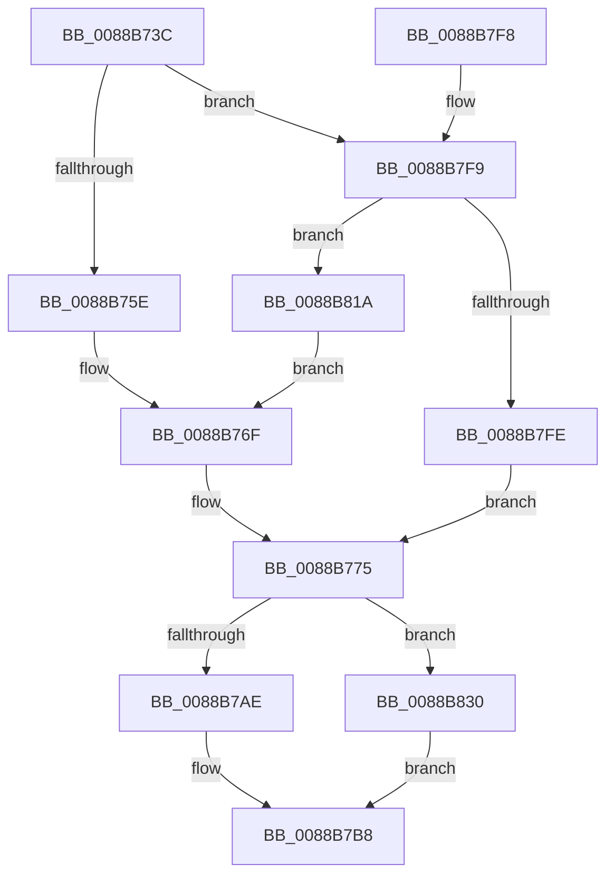

# EtwTraceWakeCounter

- RVA: `0x0088B73C`–`0x0088B837` (길이 `251` bytes)
- VA: `0x000000014088B73C`
- 실행 섹션: `PAGE`
- PDB 이름 있음: `예`; PDB Function 태그: `아니요`
- unwind 정보 RVA: `0x0007D2B4`
- 디코드: `54`개 명령, `251/251` bytes 표시
- 미해석 바이트: `0` (있으면 어셈블리에 `.byte`로 보존)

> 이 문서는 커널 이미지의 기계어와 PDB 기호를 분석해 생성했습니다. 4번과 5번은 함수 원형과 자료형을 바이너리 사용 방식에서 추정한 C 해석이며 원본 소스 복구 결과는 아닙니다.

## 1. Dependencies

- 직접 호출 지점: **2**; 고유 호출 대상: **2**
- 직접 호출자로 확인된 함수: **3**
- RIP 상대 이미지 참조: **1**

### Outgoing calls
- `0x0088B7E1` → [EtwTraceKernelEvent](../../text/23/EtwTraceKernelEvent_function_00235350.md) (function, `0x00235350`)
- `0x0088B7EE` → [_security_check_cookie](../../text/6A/_security_check_cookie_function_006AC640.md) (function, `0x006AC640`)

### Direct callers
- [PspChargeProcessWakeCounter](PspChargeProcessWakeCounter_function_0088D2A0.md) at `0x0088D63F`
- [PspChargeProcessWakeCounter](PspChargeProcessWakeCounter_function_0088D2A0.md) at `0x0088D714`
- [PspChargeJobWakeCounter](../9D/PspChargeJobWakeCounter_function_009D5D20.md) at `0x009D6028`
- [sub_00B2F9D2](../B2/Unknown_function_00B2F9D2.md) at `0x00B2FA01`
- [sub_00B2F9D2](../B2/Unknown_function_00B2F9D2.md) at `0x00B2FA37`

### Static image references
- `0x0088B740` → RVA `0x00E0A740` (`.data`; read)

## 2. Other-region calls and transfers

- 다른 실행 섹션으로 향하는 call: **2**
  - `0x0088B7E1` → [EtwTraceKernelEvent](../../text/23/EtwTraceKernelEvent_function_00235350.md) (`PAGE` → `.text`)
  - `0x0088B7EE` → [_security_check_cookie](../../text/6A/_security_check_cookie_function_006AC640.md) (`PAGE` → `.text`)
- 별도 외부 분기/꼬리 이동을 확인하지 못했습니다.

## 3. Assembly (complete function range)

```asm
0088B73C  48 83 EC 78                     sub rsp, 0x78
0088B740  48 8B 05 F9 EF 57 00            mov rax, qword ptr [rip + 0x57eff9]
0088B747  48 33 C4                        xor rax, rsp
0088B74A  48 89 44 24 60                  mov qword ptr [rsp + 0x60], rax
0088B74F  4D 8B D1                        mov r10, r9
0088B752  41 8B C0                        mov eax, r8d
0088B755  4D 85 C9                        test r9, r9
0088B758  0F 8E 9B 00 00 00               jle 0x14088b7f9
0088B75E  F7 DA                           neg edx
0088B760  66 45 1B C9                     sbb r9w, r9w
0088B764  66 41 83 E1 50                  and r9w, 0x50
0088B769  66 41 81 C1 30 03               add r9w, 0x330
0088B76F  41 B8 00 20 00 80               mov r8d, 0x80002000
0088B775  66 44 03 C8                     add r9w, ax
0088B779  48 89 4C 24 30                  mov qword ptr [rsp + 0x30], rcx
0088B77E  48 8B 84 24 B0 00 00 00         mov rax, qword ptr [rsp + 0xb0]
0088B786  48 89 44 24 38                  mov qword ptr [rsp + 0x38], rax
0088B78B  48 8B 84 24 A0 00 00 00         mov rax, qword ptr [rsp + 0xa0]
0088B793  48 89 44 24 48                  mov qword ptr [rsp + 0x48], rax
0088B798  48 8B 84 24 A8 00 00 00         mov rax, qword ptr [rsp + 0xa8]
0088B7A0  44 89 54 24 44                  mov dword ptr [rsp + 0x44], r10d
0088B7A5  48 85 C0                        test rax, rax
0088B7A8  0F 84 82 00 00 00               je 0x14088b830
0088B7AE  8B 80 D0 01 00 00               mov eax, dword ptr [rax + 0x1d0]
0088B7B4  89 44 24 40                     mov dword ptr [rsp + 0x40], eax
0088B7B8  83 64 24 5C 00                  and dword ptr [rsp + 0x5c], 0
0088B7BD  48 8D 44 24 30                  lea rax, [rsp + 0x30]
0088B7C2  BA 01 00 00 00                  mov edx, 1
0088B7C7  48 89 44 24 50                  mov qword ptr [rsp + 0x50], rax
0088B7CC  48 8D 4C 24 50                  lea rcx, [rsp + 0x50]
0088B7D1  C7 44 24 58 20 00 00 00         mov dword ptr [rsp + 0x58], 0x20
0088B7D9  C7 44 24 20 02 19 60 00         mov dword ptr [rsp + 0x20], 0x601902
0088B7E1  E8 6A 9B 9A FF                  call 0x140235350
0088B7E6  48 8B 4C 24 60                  mov rcx, qword ptr [rsp + 0x60]
0088B7EB  48 33 CC                        xor rcx, rsp
0088B7EE  E8 4D 0E E2 FF                  call 0x1406ac640
0088B7F3  48 83 C4 78                     add rsp, 0x78
0088B7F7  C3                              ret
0088B7F8  CC                              int3
0088B7F9  4D 85 D2                        test r10, r10
0088B7FC  75 1C                           jne 0x14088b81a
0088B7FE  F7 DA                           neg edx
0088B800  41 B8 00 02 00 80               mov r8d, 0x80000200
0088B806  66 45 1B C9                     sbb r9w, r9w
0088B80A  66 41 83 E1 50                  and r9w, 0x50
0088B80F  66 41 81 C1 50 03               add r9w, 0x350
0088B815  E9 5B FF FF FF                  jmp 0x14088b775
0088B81A  F7 DA                           neg edx
0088B81C  66 45 1B C9                     sbb r9w, r9w
0088B820  66 41 83 E1 50                  and r9w, 0x50
0088B825  66 41 81 C1 40 03               add r9w, 0x340
0088B82B  E9 3F FF FF FF                  jmp 0x14088b76f
0088B830  83 4C 24 40 FF                  or dword ptr [rsp + 0x40], 0xffffffff
0088B835  EB 81                           jmp 0x14088b7b8
```

## 4. C-style interpretation (structured pseudocode)

```c
__int64 __fastcall EtwTraceWakeCounter(__int64 a1, int a2, int a3, __int64 a4, __int64 a5, __int64 a6, __int64 a7)
{
    __int64 result;
    __int64 v_rsp;
    unsigned __int64 v_stack_m18;
    unsigned int v_stack_m1C;
    unsigned int v_stack_m20;
    unsigned __int64 v_stack_m28;
    unsigned __int64 v_stack_m30;
    unsigned int v_stack_m34;
    unsigned int v_stack_m38;
    unsigned __int64 v_stack_m40;
    unsigned __int64 v_stack_m48;
    unsigned int v_stack_m58;
    unsigned int v_stack_p40;

    v_rsp = (v_rsp) - (120);
    result = (*(unsigned __int64 *)(v_rip + 5763065)) ^ (v_rsp);
    v_stack_m18 = result;
    if (condition_is_less_or_equal) goto loc_0088B7F9;
    a2 = (unsigned int)(-(a2));
    a4 = (unsigned __int16)((a4) & (80));
    a4 = (unsigned __int16)((a4) + (816));
loc_0088B76F:
loc_0088B775:
    a4 = (unsigned __int16)((a4) + ((unsigned __int16)((unsigned int)(a3))));
    v_stack_m48 = a1;
    v_stack_m40 = a7;
    v_stack_m30 = a5;
    v_stack_m34 = (unsigned int)(a4);
    if (a6 == 0) goto loc_0088B830;
    v_stack_m38 = (unsigned int)((unsigned int)(*(unsigned int *)(a6 + 464)));
loc_0088B7B8:
    v_stack_m28 = v_stack_m48;
    v_stack_m20 = 32;
    v_stack_m58 = 0x601902ULL;
    result = EtwTraceKernelEvent(v_stack_m28, 1, (unsigned int)(0x80002000ULL), a4);
    a1 = (v_stack_m18) ^ (v_rsp);
    result = _security_check_cookie(a1, 1, (unsigned int)(0x80002000ULL), a4);
    v_rsp = (v_rsp) + (120);
    return result;
loc_0088B7F9:
    if (a4 != 0) goto loc_0088B81A;
    a2 = (unsigned int)(-(1));
    a4 = (unsigned __int16)((a4) & (80));
    a4 = (unsigned __int16)((a4) + (848));
    goto loc_0088B775;
loc_0088B81A:
    a2 = (unsigned int)(-(a2));
    a4 = (unsigned __int16)((a4) & (80));
    a4 = (unsigned __int16)((a4) + (832));
    goto loc_0088B76F;
loc_0088B830:
    goto loc_0088B7B8;
}
```

## 5. (Beta) C Style

```c
int64_t EtwTraceWakeCounter(int64_t Arg1, int32_t Arg2, int32_t Arg3, int64_t Arg4, int64_t Arg5, int64_t Arg6, int64_t Arg7)
{
    int64_t result;
    int64_t local_rsp;
    uint64_t v_stack_m18;
    uint32_t v_stack_m1C;
    uint32_t v_stack_m20;
    uint64_t v_stack_m28;
    uint64_t v_stack_m30;
    uint32_t v_stack_m34;
    uint32_t v_stack_m38;
    uint64_t v_stack_m40;
    uint64_t v_stack_m48;
    uint32_t v_stack_m58;
    uint32_t v_stack_p40;

    local_rsp = (local_rsp) - (120);
    result = (*(uint64_t *)(v_rip + 0x57EFF9)) ^ (local_rsp);
    v_stack_m18 = result;
    if (condition_is_less_or_equal) goto loc_0088B7F9;
    Arg2 = (uint32_t)(-(Arg2));
    Arg4 = (uint16_t)((Arg4) & (80));
    Arg4 = (uint16_t)((Arg4) + (816));
loc_0088B76F:
loc_0088B775:
    Arg4 = (uint16_t)((Arg4) + ((uint16_t)((uint32_t)(Arg3))));
    v_stack_m48 = Arg1;
    v_stack_m40 = Arg7;
    v_stack_m30 = Arg5;
    v_stack_m34 = (uint32_t)(Arg4);
    if (Arg6 == 0) goto loc_0088B830;
    v_stack_m38 = (uint32_t)((uint32_t)(*(uint32_t *)(Arg6 + 0x1D0)));
loc_0088B7B8:
    v_stack_m28 = v_stack_m48;
    v_stack_m20 = 32;
    v_stack_m58 = 0x601902ULL;
    result = EtwTraceKernelEvent(v_stack_m28, 1, (uint32_t)(0x80002000ULL), Arg4);
    Arg1 = (v_stack_m18) ^ (local_rsp);
    result = _security_check_cookie(Arg1, 1, (uint32_t)(0x80002000ULL), Arg4);
    local_rsp = (local_rsp) + (120);
    return result;
loc_0088B7F9:
    if (Arg4 != 0) goto loc_0088B81A;
    Arg2 = (uint32_t)(-(1));
    Arg4 = (uint16_t)((Arg4) & (80));
    Arg4 = (uint16_t)((Arg4) + (848));
    goto loc_0088B775;
loc_0088B81A:
    Arg2 = (uint32_t)(-(Arg2));
    Arg4 = (uint16_t)((Arg4) & (80));
    Arg4 = (uint16_t)((Arg4) + (832));
    goto loc_0088B76F;
loc_0088B830:
    goto loc_0088B7B8;
}
```

## 6. Execution-region graph

[열기: 2D/3D 그래프와 함수 탐색 컨트롤 패널](../../../control-panel.html?section=page&rva=0x0088B73C&view=graph)

- 2D 그래프는 위에서 아래로 흐르고, 3D 그래프는 빈 공간을 드래그해 회전합니다. Shift+드래그는 이동, 휠은 확대·축소, 함수 노드 선택은 대상 보고서 이동입니다.

### Static fallback


