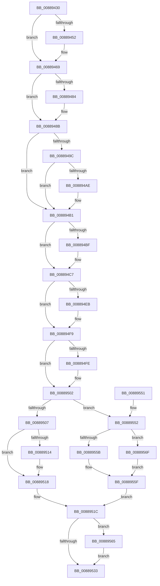

# ExDestroyHandle

- RVA: `0x00889430`–`0x00889575` (길이 `325` bytes)
- VA: `0x0000000140889430`
- 실행 섹션: `PAGE`
- PDB 이름 있음: `예`; PDB Function 태그: `아니요`
- unwind 정보 RVA: `0x0006FAB4`
- 디코드: `96`개 명령, `325/325` bytes 표시
- 미해석 바이트: `0` (있으면 어셈블리에 `.byte`로 보존)

> 이 문서는 커널 이미지의 기계어와 PDB 기호를 분석해 생성했습니다. 4번과 5번은 함수 원형과 자료형을 바이너리 사용 방식에서 추정한 C 해석이며 원본 소스 복구 결과는 아닙니다.

## 1. Dependencies

- 직접 호출 지점: **7**; 고유 호출 대상: **7**
- 직접 호출자로 확인된 함수: **6**
- RIP 상대 이미지 참조: **0**

### Outgoing calls
- `0x00889464` → [ExpUpdateDebugInfo](../86/ExpUpdateDebugInfo_function_0086B174.md) (function, `0x0086B174`)
- `0x00889486` → [ExfUnblockPushLock](../../text/2A/ExfUnblockPushLock_function_002A3FE0.md) (function, `0x002A3FE0`)
- `0x008894A4` → [ExpGetHandleExtraInfo](../86/ExpGetHandleExtraInfo_function_0086B454.md) (function, `0x0086B454`)
- `0x008894DB` → [KeAbPreAcquire](../../text/21/KeAbPreAcquire_function_00210230.md) (function, `0x00210230`)
- `0x008894F4` → [ExfAcquirePushLockExclusiveEx](../../text/20/ExfAcquirePushLockExclusiveEx_function_0020FC90.md) (function, `0x0020FC90`)
- `0x00889536` → [KeAbPostRelease](../../text/2E/KeAbPostRelease_function_002E1600.md) (function, `0x002E1600`)
- `0x00889568` → [ExfTryToWakePushLock](../../text/26/ExfTryToWakePushLock_function_00265DD0.md) (function, `0x00265DD0`)

### Direct callers
- [PspJobDelete](../../text/4B/PspJobDelete_function_004BF8F0.md) at `0x004BFC4E`
- [RtlpFreeHandleForAtom](RtlpFreeHandleForAtom_function_00887F08.md) at `0x00887F52`
- [AlpcpFreeMessageFunction](AlpcpFreeMessageFunction_function_0088A060.md) at `0x0088A0CD`
- [PspProcessDelete](../90/PspProcessDelete_function_00907B90.md) at `0x00907DB9`
- [RtlpInsertStringAtom](../A3/RtlpInsertStringAtom_function_00A3ACAC.md) at `0x00A3AD42`
- [PspThreadDelete](../A7/PspThreadDelete_function_00A79C20.md) at `0x00A79E08`

### Static image references
- 디코드된 RIP-relative 메모리 참조가 없습니다.

## 2. Other-region calls and transfers

- 다른 실행 섹션으로 향하는 call: **5**
  - `0x00889486` → [ExfUnblockPushLock](../../text/2A/ExfUnblockPushLock_function_002A3FE0.md) (`PAGE` → `.text`)
  - `0x008894DB` → [KeAbPreAcquire](../../text/21/KeAbPreAcquire_function_00210230.md) (`PAGE` → `.text`)
  - `0x008894F4` → [ExfAcquirePushLockExclusiveEx](../../text/20/ExfAcquirePushLockExclusiveEx_function_0020FC90.md) (`PAGE` → `.text`)
  - `0x00889536` → [KeAbPostRelease](../../text/2E/KeAbPostRelease_function_002E1600.md) (`PAGE` → `.text`)
  - `0x00889568` → [ExfTryToWakePushLock](../../text/26/ExfTryToWakePushLock_function_00265DD0.md) (`PAGE` → `.text`)
- 별도 외부 분기/꼬리 이동을 확인하지 못했습니다.

## 3. Assembly (complete function range)

```asm
00889430  48 89 5C 24 10                  mov qword ptr [rsp + 0x10], rbx
00889435  48 89 6C 24 18                  mov qword ptr [rsp + 0x18], rbp
0088943A  56                              push rsi
0088943B  57                              push rdi
0088943C  41 56                           push r14
0088943E  48 83 EC 20                     sub rsp, 0x20
00889442  48 83 79 60 00                  cmp qword ptr [rcx + 0x60], 0
00889447  49 8B F0                        mov rsi, r8
0088944A  48 8B EA                        mov rbp, rdx
0088944D  48 8B F9                        mov rdi, rcx
00889450  74 17                           je 0x140889469
00889452  65 48 8B 14 25 88 01 00 00      mov rdx, qword ptr gs:[0x188]
0088945B  41 B9 02 00 00 00               mov r9d, 2
00889461  4C 8B C5                        mov r8, rbp
00889464  E8 0B 1D FE FF                  call 0x14086b174
00889469  8B 06                           mov eax, dword ptr [rsi]
0088946B  48 8D 4F 30                     lea rcx, [rdi + 0x30]
0088946F  48 D1 E8                        shr rax, 1
00889472  33 DB                           xor ebx, ebx
00889474  44 0F B7 F0                     movzx r14d, ax
00889478  48 89 1E                        mov qword ptr [rsi], rbx
0088947B  F0 09 1C 24                     lock or dword ptr [rsp], ebx
0088947F  48 39 19                        cmp qword ptr [rcx], rbx
00889482  74 07                           je 0x14088948b
00889484  33 D2                           xor edx, edx
00889486  E8 55 AB A1 FF                  call 0x1402a3fe0
0088948B  48 89 6C 24 40                  mov qword ptr [rsp + 0x40], rbp
00889490  83 E5 FC                        and ebp, 0xfffffffc
00889493  89 6C 24 40                     mov dword ptr [rsp + 0x40], ebp
00889497  39 5F 04                        cmp dword ptr [rdi + 4], ebx
0088949A  74 15                           je 0x1408894b1
0088949C  48 8B 54 24 40                  mov rdx, qword ptr [rsp + 0x40]
008894A1  48 8B CF                        mov rcx, rdi
008894A4  E8 AB 1F FE FF                  call 0x14086b454
008894A9  48 85 C0                        test rax, rax
008894AC  74 03                           je 0x1408894b1
008894AE  48 89 18                        mov qword ptr [rax], rbx
008894B1  48 89 5E 08                     mov qword ptr [rsi + 8], rbx
008894B5  0F B6 6F 2C                     movzx ebp, byte ptr [rdi + 0x2c]
008894B9  40 80 E5 01                     and bpl, 1
008894BD  75 08                           jne 0x1408894c7
008894BF  65 8B 1C 25 A4 01 00 00         mov ebx, dword ptr gs:[0x1a4]
008894C7  8B DB                           mov ebx, ebx
008894C9  45 33 C0                        xor r8d, r8d
008894CC  48 FF C3                        inc rbx
008894CF  33 D2                           xor edx, edx
008894D1  48 C1 E3 06                     shl rbx, 6
008894D5  48 03 DF                        add rbx, rdi
008894D8  48 8B CB                        mov rcx, rbx
008894DB  E8 50 6D 98 FF                  call 0x140210230
008894E0  F0 48 0F BA 2B 00               lock bts qword ptr [rbx], 0
008894E6  48 8B F8                        mov rdi, rax
008894E9  73 0E                           jae 0x1408894f9
008894EB  4C 8B C3                        mov r8, rbx
008894EE  48 8B D0                        mov rdx, rax
008894F1  48 8B CB                        mov rcx, rbx
008894F4  E8 97 67 98 FF                  call 0x14020fc90
008894F9  48 85 FF                        test rdi, rdi
008894FC  74 04                           je 0x140889502
008894FE  C6 47 0A 01                     mov byte ptr [rdi + 0xa], 1
00889502  40 84 ED                        test bpl, bpl
00889505  75 4B                           jne 0x140889552
00889507  48 8B 43 08                     mov rax, qword ptr [rbx + 8]
0088950B  48 89 46 08                     mov qword ptr [rsi + 8], rax
0088950F  48 85 C0                        test rax, rax
00889512  75 04                           jne 0x140889518
00889514  48 89 73 10                     mov qword ptr [rbx + 0x10], rsi
00889518  48 89 73 08                     mov qword ptr [rbx + 8], rsi
0088951C  FF 4B 18                        dec dword ptr [rbx + 0x18]
0088951F  48 C7 C2 FF FF FF FF            mov rdx, 0xffffffffffffffff
00889526  F0 48 0F C1 13                  lock xadd qword ptr [rbx], rdx
0088952B  80 E2 06                        and dl, 6
0088952E  80 FA 02                        cmp dl, 2
00889531  74 32                           je 0x140889565
00889533  48 8B CB                        mov rcx, rbx
00889536  E8 C5 80 A5 FF                  call 0x1402e1600
0088953B  48 8B 5C 24 48                  mov rbx, qword ptr [rsp + 0x48]
00889540  41 8B C6                        mov eax, r14d
00889543  48 8B 6C 24 50                  mov rbp, qword ptr [rsp + 0x50]
00889548  48 83 C4 20                     add rsp, 0x20
0088954C  41 5E                           pop r14
0088954E  5F                              pop rdi
0088954F  5E                              pop rsi
00889550  C3                              ret
00889551  CC                              int3
00889552  48 8B 43 10                     mov rax, qword ptr [rbx + 0x10]
00889556  48 85 C0                        test rax, rax
00889559  74 14                           je 0x14088956f
0088955B  48 89 70 08                     mov qword ptr [rax + 8], rsi
0088955F  48 89 73 10                     mov qword ptr [rbx + 0x10], rsi
00889563  EB B7                           jmp 0x14088951c
00889565  48 8B CB                        mov rcx, rbx
00889568  E8 63 C8 9D FF                  call 0x140265dd0
0088956D  EB C4                           jmp 0x140889533
0088956F  48 89 73 08                     mov qword ptr [rbx + 8], rsi
00889573  EB EA                           jmp 0x14088955f
```

## 4. C-style interpretation (structured pseudocode)

```c
__int64 __fastcall ExDestroyHandle(__int64 a1, __int64 a2, __int64 a3)
{
    __int64 result;
    __int64 v_rbp;
    __int64 v_rbx;
    __int64 v_rsp;
    unsigned int v_stack_m38;
    unsigned __int64 v_stack_p10;
    unsigned __int64 v_stack_p18;
    unsigned __int64 v_stack_p8;

    v_stack_p10 = v_rbx;
    v_stack_p18 = v_rbp;
    v_rsp = (v_rsp) - (32);
    if ((*(unsigned __int64 *)(a1 + 96)) != 0) {
        a2 = *(unsigned __int64 *)(gs_base + (0 + 392));
        a4 = 2;
        a3 = a2;
        result = ExpUpdateDebugInfo(a1, a2, a3, a4);
    }
    result = ((unsigned int)(*(unsigned int *)(a3))) >> (1);
    v_rbx = 0;
    *(unsigned __int64 *)(a3) = 0;
    if ((*(unsigned __int64 *)(a1 + 48)) != 0) {
        a2 = 0;
        result = ExfUnblockPushLock(a1 + 48, a2, a3, a4);
    }
    v_stack_p8 = 0;
    v_rbp = (unsigned int)((a2) & (0xFFFFFFFCULL));
    v_stack_p8 = (unsigned int)(v_rbp);
    if ((*(unsigned int *)(a1 + 4)) == 0) goto loc_008894B1;
    result = ExpGetHandleExtraInfo(a1, v_stack_p8, a3, a4);
    if (result != 0) {
        *(unsigned __int64 *)(result) = 0;
    }
    *(unsigned __int64 *)(a3 + 8) = 0;
    v_rbp = (unsigned __int8)((*(unsigned __int8 *)(a1 + 44)) & (1));
    if (!(condition_is_not_equal)) {
        v_rbx = *(unsigned int *)(gs_base + (0 + 420));
    }
    a3 = 0;
    v_rbx = ((unsigned int)((unsigned int)(v_rbx))) + 1;
    a2 = 0;
    v_rbx = (v_rbx) << (6);
    v_rbx = (v_rbx) + (a1);
    result = KeAbPreAcquire(v_rbx, a2, a3, a4);
    if (!(condition_is_above_or_equal)) {
        a3 = v_rbx;
        a2 = result;
        a1 = v_rbx;
        result = ExfAcquirePushLockExclusiveEx(a1, a2, a3, a4);
    }
    if (result != 0) {
        *(unsigned __int8 *)(result + 10) = 1;
    }
    if ((unsigned __int8)(v_rbp) != 0) goto loc_00889552;
    *(unsigned __int64 *)(a3 + 8) = *(unsigned __int64 *)(v_rbx + 8);
    if (*(unsigned __int64 *)(v_rbx + 8) == 0) {
        *(unsigned __int64 *)(v_rbx + 16) = a3;
    }
    *(unsigned __int64 *)(v_rbx + 8) = a3;
loc_0088951C:
    a2 = (unsigned __int8)((-1) & (6));
    if (((unsigned __int8)(a2)) == 2) goto loc_00889565;
loc_00889533:
    result = KeAbPostRelease(v_rbx, a2, a3, a4);
    v_rsp = (v_rsp) + (32);
    return (unsigned int)((unsigned int)((unsigned __int16)(result)));
loc_00889552:
    if (*(unsigned __int64 *)(v_stack_p10 + 16) == 0) goto loc_0088956F;
    *(unsigned __int64 *)(*(unsigned __int64 *)(v_stack_p10 + 16) + 8) = a3;
loc_0088955F:
    *(unsigned __int64 *)(v_stack_p10 + 16) = a3;
    goto loc_0088951C;
loc_00889565:
    result = ExfTryToWakePushLock(v_stack_p10, a2, a3, a4);
    goto loc_00889533;
loc_0088956F:
    *(unsigned __int64 *)(v_stack_p10 + 8) = a3;
    goto loc_0088955F;
}
```

## 5. (Beta) C Style

```c
int64_t ExDestroyHandle(void *Arg1, int64_t Arg2, void *Arg3)
{
    uint8_t *arg1 = (uint8_t *)Arg1;
    uint8_t *arg3 = (uint8_t *)Arg3;

    int64_t result;
    int64_t local_rbp;
    int64_t local_rbx;
    int64_t local_rsp;
    uint32_t v_stack_m38;
    uint64_t v_stack_p10;
    uint64_t v_stack_p18;
    uint64_t v_stack_p8;

    v_stack_p10 = local_rbx;
    v_stack_p18 = local_rbp;
    local_rsp = (local_rsp) - (32);
    if ((*(uint64_t *)(arg1 + 0x60)) != 0) {
        Arg2 = *(uint64_t *)(gs_base + (0 + 0x188));
        a4 = 2;
        Arg3 = Arg2;
        result = ExpUpdateDebugInfo(Arg1, Arg2, Arg3, a4);
    }
    result = ((uint32_t)(*(uint32_t *)(arg3))) >> (1);
    local_rbx = 0;
    *(uint64_t *)(arg3) = 0;
    if ((*(uint64_t *)(arg1 + 0x30)) != 0) {
        Arg2 = 0;
        result = ExfUnblockPushLock(Arg1 + 48, Arg2, Arg3, a4);
    }
    v_stack_p8 = 0;
    local_rbp = (uint32_t)((Arg2) & (0xFFFFFFFCULL));
    v_stack_p8 = (uint32_t)(local_rbp);
    if ((*(uint32_t *)(arg1 + 0x4)) == 0) goto loc_008894B1;
    result = ExpGetHandleExtraInfo(Arg1, v_stack_p8, Arg3, a4);
    if (result != 0) {
        *(uint64_t *)(result) = 0;
    }
    *(uint64_t *)(arg3 + 0x8) = 0;
    local_rbp = (uint8_t)((*(uint8_t *)(arg1 + 0x2C)) & (1));
    if (!(condition_is_not_equal)) {
        local_rbx = *(uint32_t *)(gs_base + (0 + 0x1A4));
    }
    Arg3 = 0;
    local_rbx = ((uint32_t)((uint32_t)(local_rbx))) + 1;
    Arg2 = 0;
    local_rbx = (local_rbx) << (6);
    local_rbx = (local_rbx) + (Arg1);
    result = KeAbPreAcquire(local_rbx, Arg2, Arg3, a4);
    if (!(condition_is_above_or_equal)) {
        Arg3 = local_rbx;
        Arg2 = result;
        Arg1 = local_rbx;
        result = ExfAcquirePushLockExclusiveEx(Arg1, Arg2, Arg3, a4);
    }
    if (result != 0) {
        *(uint8_t *)(result + 0xA) = 1;
    }
    if ((uint8_t)(local_rbp) != 0) goto loc_00889552;
    *(uint64_t *)(arg3 + 0x8) = *(uint64_t *)(local_rbx + 0x8);
    if (*(uint64_t *)(local_rbx + 0x8) == 0) {
        *(void **)(local_rbx + 0x10) = Arg3;
    }
    *(void **)(local_rbx + 0x8) = Arg3;
loc_0088951C:
    Arg2 = (uint8_t)((-1) & (6));
    if (((uint8_t)(Arg2)) == 2) goto loc_00889565;
loc_00889533:
    result = KeAbPostRelease(local_rbx, Arg2, Arg3, a4);
    local_rsp = (local_rsp) + (32);
    return (uint32_t)((uint32_t)((uint16_t)(result)));
loc_00889552:
    if (*(uint64_t *)(v_stack_p10 + 0x10) == 0) goto loc_0088956F;
    *(void **)(*(uint64_t *)(v_stack_p10 + 0x10) + 0x8) = Arg3;
loc_0088955F:
    *(void **)(v_stack_p10 + 0x10) = Arg3;
    goto loc_0088951C;
loc_00889565:
    result = ExfTryToWakePushLock(v_stack_p10, Arg2, Arg3, a4);
    goto loc_00889533;
loc_0088956F:
    *(void **)(v_stack_p10 + 0x8) = Arg3;
    goto loc_0088955F;
}
```

### 관측된 메모리 오프셋

구조체 형식이 확인되지 않은 접근은 인자 기준의 오프셋으로만 기록했습니다.

| 기준 인자 | 오프셋 표현 | 폭 (bit) | 접근 |
|---|---:|---:|---|
| `Arg1` | `+ 0x0` | `64` | `R` |
| `Arg1` | `+ 0x4` | `32` | `R` |
| `Arg1` | `+ 0x2C` | `8` | `R` |
| `Arg1` | `+ 0x30` | `64` | `R` |
| `Arg1` | `+ 0x60` | `64` | `R` |
| `Arg3` | `+ 0x0` | `32` | `R` |
| `Arg3` | `+ 0x0` | `64` | `W` |
| `Arg3` | `+ 0x8` | `64` | `W` |

## 6. Execution-region graph

[열기: 2D/3D 그래프와 함수 탐색 컨트롤 패널](../../../control-panel.html?section=page&rva=0x00889430&view=graph)

- 2D 그래프는 위에서 아래로 흐르고, 3D 그래프는 빈 공간을 드래그해 회전합니다. Shift+드래그는 이동, 휠은 확대·축소, 함수 노드 선택은 대상 보고서 이동입니다.

### Static fallback


