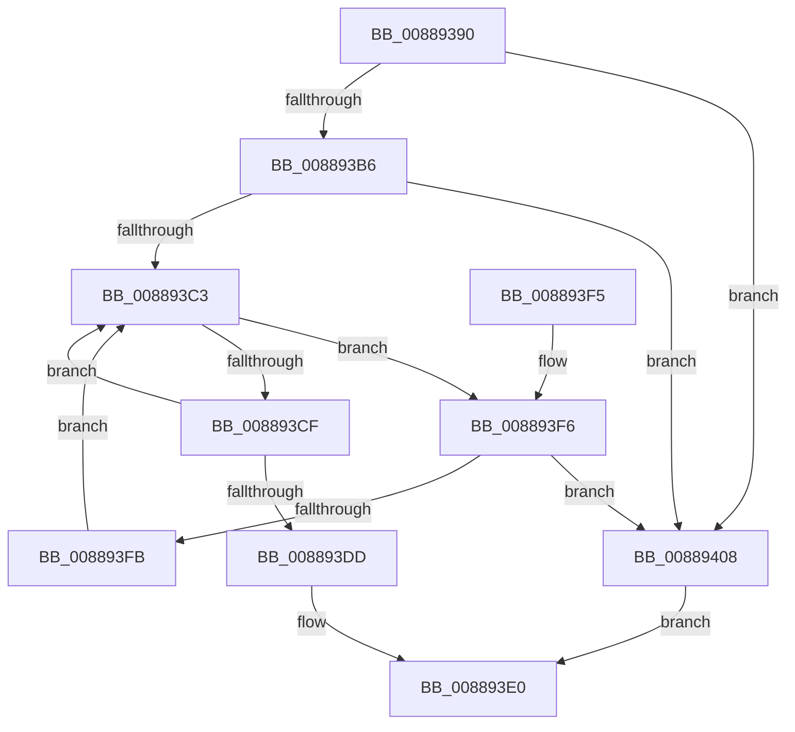

# ExMapHandleToPointerEx

- RVA: `0x00889390`–`0x0088941B` (길이 `139` bytes)
- VA: `0x0000000140889390`
- 실행 섹션: `PAGE`
- PDB 이름 있음: `예`; PDB Function 태그: `아니요`
- unwind 정보 RVA: `0x0007CEFC`
- 디코드: `42`개 명령, `139/139` bytes 표시
- 미해석 바이트: `0` (있으면 어셈블리에 `.byte`로 보존)

> 이 문서는 커널 이미지의 기계어와 PDB 기호를 분석해 생성했습니다. 4번과 5번은 함수 원형과 자료형을 바이너리 사용 방식에서 추정한 C 해석이며 원본 소스 복구 결과는 아닙니다.

## 1. Dependencies

- 직접 호출 지점: **3**; 고유 호출 대상: **3**
- 직접 호출자로 확인된 함수: **1**
- RIP 상대 이미지 참조: **0**

### Outgoing calls
- `0x008893B6` → [ExpLookupHandleTableEntry](../86/ExpLookupHandleTableEntry_function_00869DB0.md) (function, `0x00869DB0`)
- `0x00889401` → [ExpBlockOnLockedHandleEntry](../86/ExpBlockOnLockedHandleEntry_function_00868838.md) (function, `0x00868838`)
- `0x00889412` → [ExHandleLogBadReference](../../text/44/ExHandleLogBadReference_function_00440580.md) (function, `0x00440580`)

### Direct callers
- [AlpcpFreeMessageFunction](AlpcpFreeMessageFunction_function_0088A060.md) at `0x0088A0C0`

### Static image references
- 디코드된 RIP-relative 메모리 참조가 없습니다.

## 2. Other-region calls and transfers

- 다른 실행 섹션으로 향하는 call: **1**
  - `0x00889412` → [ExHandleLogBadReference](../../text/44/ExHandleLogBadReference_function_00440580.md) (`PAGE` → `.text`)
- 별도 외부 분기/꼬리 이동을 확인하지 못했습니다.

## 3. Assembly (complete function range)

```asm
00889390  48 89 5C 24 08                  mov qword ptr [rsp + 8], rbx
00889395  48 89 6C 24 10                  mov qword ptr [rsp + 0x10], rbp
0088939A  48 89 74 24 18                  mov qword ptr [rsp + 0x18], rsi
0088939F  57                              push rdi
008893A0  48 83 EC 20                     sub rsp, 0x20
008893A4  41 0F B6 E8                     movzx ebp, r8b
008893A8  48 8B FA                        mov rdi, rdx
008893AB  48 8B F1                        mov rsi, rcx
008893AE  F7 C2 FC 03 00 00               test edx, 0x3fc
008893B4  74 52                           je 0x140889408
008893B6  E8 F5 09 FE FF                  call 0x140869db0
008893BB  48 8B D8                        mov rbx, rax
008893BE  48 85 C0                        test rax, rax
008893C1  74 45                           je 0x140889408
008893C3  0F 0D 0B                        prefetchw byte ptr [rbx]
008893C6  4C 8B 03                        mov r8, qword ptr [rbx]
008893C9  41 F6 C0 01                     test r8b, 1
008893CD  74 27                           je 0x1408893f6
008893CF  49 8D 48 FF                     lea rcx, [r8 - 1]
008893D3  49 8B C0                        mov rax, r8
008893D6  F0 48 0F B1 0B                  lock cmpxchg qword ptr [rbx], rcx
008893DB  75 E6                           jne 0x1408893c3
008893DD  48 8B C3                        mov rax, rbx
008893E0  48 8B 5C 24 30                  mov rbx, qword ptr [rsp + 0x30]
008893E5  48 8B 6C 24 38                  mov rbp, qword ptr [rsp + 0x38]
008893EA  48 8B 74 24 40                  mov rsi, qword ptr [rsp + 0x40]
008893EF  48 83 C4 20                     add rsp, 0x20
008893F3  5F                              pop rdi
008893F4  C3                              ret
008893F5  CC                              int3
008893F6  4D 85 C0                        test r8, r8
008893F9  74 0D                           je 0x140889408
008893FB  48 8B D3                        mov rdx, rbx
008893FE  48 8B CE                        mov rcx, rsi
00889401  E8 32 F4 FD FF                  call 0x140868838
00889406  EB BB                           jmp 0x1408893c3
00889408  44 0F B6 C5                     movzx r8d, bpl
0088940C  48 8B D7                        mov rdx, rdi
0088940F  48 8B CE                        mov rcx, rsi
00889412  E8 69 71 BB FF                  call 0x140440580
00889417  33 C0                           xor eax, eax
00889419  EB C5                           jmp 0x1408893e0
```

## 4. C-style interpretation (structured pseudocode)

```c
__int64 __fastcall ExMapHandleToPointerEx(__int64 a1, __int64 a2, unsigned __int8 a3)
{
    __int64 result;
    __int64 v_rsp;
    unsigned __int64 v_stack_p10;
    unsigned __int64 v_stack_p18;
    unsigned __int64 v_stack_p8;

    v_stack_p8 = v_rbx;
    v_stack_p10 = v_rbp;
    v_stack_p18 = v_rsi;
    v_rsp = (v_rsp) - (32);
    if ((((unsigned int)(a2)) & (0x3FCULL)) == 0) goto loc_00889408;
    result = ExpLookupHandleTableEntry(a1, a2, a3, a4);
    if (result == 0) goto loc_00889408;
loc_008893C3:
    if ((((unsigned __int8)(*(unsigned __int64 *)(result))) & (1)) == 0) goto loc_008893F6;
    if ((((unsigned __int8)(*(unsigned __int64 *)(result))) & (1)) != 0) goto loc_008893C3;
loc_008893E0:
    v_rsp = (v_rsp) + (32);
    return result;
loc_008893F6:
    if (*(unsigned __int64 *)(result) == 0) goto loc_00889408;
    result = ExpBlockOnLockedHandleEntry(v_stack_p18, v_stack_p8, *(unsigned __int64 *)(result), a4);
    goto loc_008893C3;
loc_00889408:
    result = ExHandleLogBadReference(v_stack_p18, a2, (unsigned __int8)(v_stack_p10), a4);
    result = 0;
    goto loc_008893E0;
}
```

## 5. (Beta) C Style

```c
int64_t ExMapHandleToPointerEx(int64_t Arg1, int64_t Arg2, uint8_t Arg3)
{
    int64_t result;
    int64_t local_rsp;
    uint64_t v_stack_p10;
    uint64_t v_stack_p18;
    uint64_t v_stack_p8;

    v_stack_p8 = local_rbx;
    v_stack_p10 = local_rbp;
    v_stack_p18 = local_rsi;
    local_rsp = (local_rsp) - (32);
    if ((((uint32_t)(Arg2)) & (0x3FCULL)) == 0) goto loc_00889408;
    result = ExpLookupHandleTableEntry(Arg1, Arg2, Arg3, a4);
    if (result == 0) goto loc_00889408;
loc_008893C3:
    if ((((uint8_t)(*(uint64_t *)(result))) & (1)) == 0) goto loc_008893F6;
    if ((((uint8_t)(*(uint64_t *)(result))) & (1)) != 0) goto loc_008893C3;
loc_008893E0:
    local_rsp = (local_rsp) + (32);
    return result;
loc_008893F6:
    if (*(uint64_t *)(result) == 0) goto loc_00889408;
    result = ExpBlockOnLockedHandleEntry(v_stack_p18, v_stack_p8, *(uint64_t *)(result), a4);
    goto loc_008893C3;
loc_00889408:
    result = ExHandleLogBadReference(v_stack_p18, Arg2, (uint8_t)(v_stack_p10), a4);
    result = 0;
    goto loc_008893E0;
}
```

## 6. Execution-region graph

[열기: 2D/3D 그래프와 함수 탐색 컨트롤 패널](../../../control-panel.html?section=page&rva=0x00889390&view=graph)

- 2D 그래프는 위에서 아래로 흐르고, 3D 그래프는 빈 공간을 드래그해 회전합니다. Shift+드래그는 이동, 휠은 확대·축소, 함수 노드 선택은 대상 보고서 이동입니다.

### Static fallback


