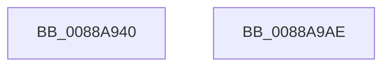

# LpcRequestPort

- RVA: `0x0088A940`–`0x0088A9AF` (길이 `111` bytes)
- VA: `0x000000014088A940`
- 실행 섹션: `PAGE`
- PDB 이름 있음: `예`; PDB Function 태그: `아니요`
- unwind 정보 RVA: `0x0007D148`
- 디코드: `28`개 명령, `111/111` bytes 표시
- 미해석 바이트: `0` (있으면 어셈블리에 `.byte`로 보존)

> 이 문서는 커널 이미지의 기계어와 PDB 기호를 분석해 생성했습니다. 4번과 5번은 함수 원형과 자료형을 바이너리 사용 방식에서 추정한 C 해석이며 원본 소스 복구 결과는 아닙니다.

## 1. Dependencies

- 직접 호출 지점: **3**; 고유 호출 대상: **3**
- 직접 호출자로 확인된 함수: **2**
- RIP 상대 이미지 참조: **0**

### Outgoing calls
- `0x0088A95B` → [memset](../../text/6C/memset_function_006C6C40.md) (function, `0x006C6C40`)
- `0x0088A98C` → [AlpcpSendMessage](AlpcpSendMessage_function_0088BD40.md) (function, `0x0088BD40`)
- `0x0088A99C` → [KeLeaveCriticalRegionThread](../../text/25/KeLeaveCriticalRegionThread_function_0025EFF0.md) (function, `0x0025EFF0`)

### Direct callers
- [PspExitThread](../90/PspExitThread_function_00905F60.md) at `0x009061D3`
- [PspExitThread](../90/PspExitThread_function_00905F60.md) at `0x00906630`
- [NtSetInformationProcess](../AE/NtSetInformationProcess_function_00AE5370.md) at `0x00AE60EB`

### Static image references
- 디코드된 RIP-relative 메모리 참조가 없습니다.

## 2. Other-region calls and transfers

- 다른 실행 섹션으로 향하는 call: **2**
  - `0x0088A95B` → [memset](../../text/6C/memset_function_006C6C40.md) (`PAGE` → `.text`)
  - `0x0088A99C` → [KeLeaveCriticalRegionThread](../../text/25/KeLeaveCriticalRegionThread_function_0025EFF0.md) (`PAGE` → `.text`)
- 별도 외부 분기/꼬리 이동을 확인하지 못했습니다.

## 3. Assembly (complete function range)

```asm
0088A940  48 89 5C 24 08                  mov qword ptr [rsp + 8], rbx
0088A945  57                              push rdi
0088A946  48 83 EC 60                     sub rsp, 0x60
0088A94A  48 8B FA                        mov rdi, rdx
0088A94D  48 8B D9                        mov rbx, rcx
0088A950  33 D2                           xor edx, edx
0088A952  48 8D 4C 24 20                  lea rcx, [rsp + 0x20]
0088A957  44 8D 42 40                     lea r8d, [rdx + 0x40]
0088A95B  E8 E0 C2 E3 FF                  call 0x1406c6c40
0088A960  65 48 8B 04 25 88 01 00 00      mov rax, qword ptr gs:[0x188]
0088A969  48 8D 4C 24 20                  lea rcx, [rsp + 0x20]
0088A96E  45 33 C9                        xor r9d, r9d
0088A971  45 33 C0                        xor r8d, r8d
0088A974  48 8B D7                        mov rdx, rdi
0088A977  66 FF 88 E4 01 00 00            dec word ptr [rax + 0x1e4]
0088A97E  90                              nop
0088A97F  48 89 5C 24 20                  mov qword ptr [rsp + 0x20], rbx
0088A984  C7 44 24 50 02 00 01 00         mov dword ptr [rsp + 0x50], 0x10002
0088A98C  E8 AF 13 00 00                  call 0x14088bd40
0088A991  65 48 8B 0C 25 88 01 00 00      mov rcx, qword ptr gs:[0x188]
0088A99A  8B D8                           mov ebx, eax
0088A99C  E8 4F 46 9D FF                  call 0x14025eff0
0088A9A1  8B C3                           mov eax, ebx
0088A9A3  48 8B 5C 24 70                  mov rbx, qword ptr [rsp + 0x70]
0088A9A8  48 83 C4 60                     add rsp, 0x60
0088A9AC  5F                              pop rdi
0088A9AD  C3                              ret
0088A9AE  CC                              int3
```

## 4. C-style interpretation (structured pseudocode)

```c
__int64 __fastcall LpcRequestPort(__int64 a1, __int64 a2, __int64 a3, int a4)
{
    __int64 result;
    __int64 v_rsp;
    unsigned int v_stack_m18;
    unsigned __int64 v_stack_m48;
    unsigned __int64 v_stack_p8;

    v_stack_p8 = v_rbx;
    v_rsp = (v_rsp) - (96);
    a2 = 0;
    result = memset(v_stack_m48, a2, a2 + 64, a4);
    a4 = 0;
    a3 = 0;
    v_stack_m48 = a1;
    v_stack_m18 = 0x10002ULL;
    result = AlpcpSendMessage(v_stack_m48, 0, a3, a4);
    result = KeLeaveCriticalRegionThread(*(unsigned __int64 *)(gs_base + (0 + 392)), 0, a3, a4);
    v_rsp = (v_rsp) + (96);
    return (unsigned int)((unsigned int)((unsigned int)((unsigned int)(result))));
}
```

## 5. (Beta) C Style

```c
int64_t LpcRequestPort(int64_t Arg1, int64_t Arg2, int64_t Arg3, int32_t Arg4)
{
    int64_t result;
    int64_t local_rsp;
    uint32_t v_stack_m18;
    uint64_t v_stack_m48;
    uint64_t v_stack_p8;

    v_stack_p8 = local_rbx;
    local_rsp = (local_rsp) - (96);
    Arg2 = 0;
    result = memset(v_stack_m48, Arg2, Arg2 + 64, Arg4);
    Arg4 = 0;
    Arg3 = 0;
    v_stack_m48 = Arg1;
    v_stack_m18 = 0x10002ULL;
    result = AlpcpSendMessage(v_stack_m48, 0, Arg3, Arg4);
    result = KeLeaveCriticalRegionThread(*(uint64_t *)(gs_base + (0 + 0x188)), 0, Arg3, Arg4);
    local_rsp = (local_rsp) + (96);
    return (uint32_t)((uint32_t)((uint32_t)((uint32_t)(result))));
}
```

## 6. Execution-region graph

[열기: 2D/3D 그래프와 함수 탐색 컨트롤 패널](../../../control-panel.html?section=page&rva=0x0088A940&view=graph)

- 2D 그래프는 위에서 아래로 흐르고, 3D 그래프는 빈 공간을 드래그해 회전합니다. Shift+드래그는 이동, 휠은 확대·축소, 함수 노드 선택은 대상 보고서 이동입니다.

### Static fallback


