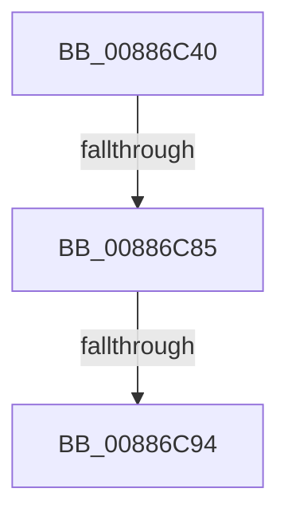

# MiAdvanceVadHint

- RVA: `0x00886C40`–`0x00886C97` (길이 `87` bytes)
- VA: `0x0000000140886C40`
- 실행 섹션: `PAGE`
- PDB 이름 있음: `예`; PDB Function 태그: `아니요`
- unwind 정보 RVA: `0x0007CB3C`
- 디코드: `20`개 명령, `87/87` bytes 표시
- 미해석 바이트: `0` (있으면 어셈블리에 `.byte`로 보존)

> 이 문서는 커널 이미지의 기계어와 PDB 기호를 분석해 생성했습니다. 4번과 5번은 함수 원형과 자료형을 바이너리 사용 방식에서 추정한 C 해석이며 원본 소스 복구 결과는 아닙니다.

## 1. Dependencies

- 직접 호출 지점: **0**; 고유 호출 대상: **0**
- 직접 호출자로 확인된 함수: **7**
- RIP 상대 이미지 참조: **1**

### Outgoing calls
- 직접 디코드된 call 명령이 없습니다.

### Direct callers
- [MiAllocateEnclaveVad](../80/MiAllocateEnclaveVad_function_008080A4.md) at `0x00808398`
- [MiReserveUserMemory](MiReserveUserMemory_function_00884498.md) at `0x008847B4`
- [sub_00884EE1](Unknown_function_00884EE1.md) at `0x008852A9`
- [MiMapViewOfImageSection](../97/MiMapViewOfImageSection_function_0097E92C.md) at `0x0097F0CB`
- [MiMapViewOfPhysicalSection](../97/MiMapViewOfPhysicalSection_function_0097F984.md) at `0x0097FBE0`
- [MiMapLockedPagesInUserSpace](../97/MiMapLockedPagesInUserSpace_function_0097FE04.md) at `0x009800D6`
- [MiAllocateNewSubAllocatedRegion](../98/MiAllocateNewSubAllocatedRegion_function_00981EC0.md) at `0x009821AD`

### Static image references
- `0x00886C58` → RVA `0x00E2F388` (`.data`; read)

## 2. Other-region calls and transfers

- 다른 실행 섹션으로 향하는 call: **0**
- call이 아닌 외부 분기/꼬리 이동: **2**
  - `0x00886C7F` → [sub_00886D2A](Unknown_function_00886D2A.md) (`tail-transfer`)
  - `0x00886C8E` → [sub_00886D2A](Unknown_function_00886D2A.md) (`tail-transfer`)

## 3. Assembly (complete function range)

```asm
00886C40  48 83 EC 08                     sub rsp, 8
00886C44  48 B8 FF FF FF FF FF FF 00 00   movabs rax, 0xffffffffffff
00886C4E  48 C1 EA 04                     shr rdx, 4
00886C52  48 23 D0                        and rdx, rax
00886C55  4C 8B D1                        mov r10, rcx
00886C58  48 69 0D 25 87 5A 00 00 00 F8 FF  imul rcx, qword ptr [rip + 0x5a8725], -0x80000
00886C63  49 C1 EA 04                     shr r10, 4
00886C67  4D 8B D8                        mov r11, r8
00886C6A  4C 23 D0                        and r10, rax
00886C6D  49 8B 40 08                     mov rax, qword ptr [r8 + 8]
00886C71  48 C1 E0 13                     shl rax, 0x13
00886C75  48 03 C1                        add rax, rcx
00886C78  48 C1 E8 10                     shr rax, 0x10
00886C7C  48 3B D0                        cmp rdx, rax
00886C7F  0F 82 A5 00 00 00               jb 0x140886d2a
00886C85  4D 8B 00                        mov r8, qword ptr [r8]
00886C88  4C 03 C0                        add r8, rax
00886C8B  4D 3B D0                        cmp r10, r8
00886C8E  0F 83 96 00 00 00               jae 0x140886d2a
00886C94  4C 3B D0                        cmp r10, rax
```

## 4. C-style interpretation (structured pseudocode)

```c
__int64 __fastcall MiAdvanceVadHint(__int64 a1, __int64 a2, __int64 a3)
{
    __int64 result;
    __int64 v_r10;
    __int64 v_rsp;

    v_rsp = (v_rsp) - (8);
    a2 = (a2) >> (4);
    a2 = (a2) & (result);
    a1 = (a1) * (*(unsigned __int64 *)(v_rip + 5932837));
    v_r10 = (a1) >> (4);
    v_r10 = (v_r10) & (result);
    result = (*(unsigned __int64 *)(a3 + 8)) << (19);
    result = (result) + (a1);
    result = (result) >> (16);
    a3 = (*(unsigned __int64 *)(a3)) + (result);
    return result;
}
```

## 5. (Beta) C Style

```c
int64_t MiAdvanceVadHint(int64_t Arg1, int64_t Arg2, void *Arg3)
{
    uint8_t *arg3 = (uint8_t *)Arg3;

    int64_t result;
    int64_t local_r10;
    int64_t local_rsp;

    local_rsp = (local_rsp) - (8);
    Arg2 = (Arg2) >> (4);
    Arg2 = (Arg2) & (result);
    Arg1 = (Arg1) * (*(uint64_t *)(v_rip + 0x5A8725));
    local_r10 = (Arg1) >> (4);
    local_r10 = (local_r10) & (result);
    result = (*(uint64_t *)(arg3 + 0x8)) << (19);
    result = (result) + (Arg1);
    result = (result) >> (16);
    Arg3 = (*(uint64_t *)(arg3)) + (result);
    return result;
}
```

### 관측된 메모리 오프셋

구조체 형식이 확인되지 않은 접근은 인자 기준의 오프셋으로만 기록했습니다.

| 기준 인자 | 오프셋 표현 | 폭 (bit) | 접근 |
|---|---:|---:|---|
| `Arg3` | `+ 0x0` | `64` | `R` |
| `Arg3` | `+ 0x8` | `64` | `R` |

## 6. Execution-region graph

[열기: 2D/3D 그래프와 함수 탐색 컨트롤 패널](../../../control-panel.html?section=page&rva=0x00886C40&view=graph)

- 2D 그래프는 위에서 아래로 흐르고, 3D 그래프는 빈 공간을 드래그해 회전합니다. Shift+드래그는 이동, 휠은 확대·축소, 함수 노드 선택은 대상 보고서 이동입니다.

### Static fallback


