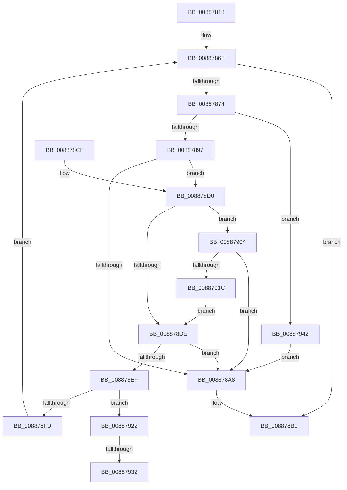

# MiAllocateSplitVads

- RVA: `0x00887818`–`0x0088794C` (길이 `308` bytes)
- VA: `0x0000000140887818`
- 실행 섹션: `PAGE`
- PDB 이름 있음: `예`; PDB Function 태그: `예`
- unwind 정보 RVA: `0x0007CCC4`
- 디코드: `86`개 명령, `308/308` bytes 표시
- 미해석 바이트: `0` (있으면 어셈블리에 `.byte`로 보존)

> 이 문서는 커널 이미지의 기계어와 PDB 기호를 분석해 생성했습니다. 4번과 5번은 함수 원형과 자료형을 바이너리 사용 방식에서 추정한 C 해석이며 원본 소스 복구 결과는 아닙니다.

## 1. Dependencies

- 직접 호출 지점: **6**; 고유 호출 대상: **6**
- 직접 호출자로 확인된 함수: **1**
- RIP 상대 이미지 참조: **0**

### Outgoing calls
- `0x00887886` → [MiAllocatePool](../../text/35/MiAllocatePool_function_0035B540.md) (function, `0x0035B540`)
- `0x0088789D` → [MiInitializePartialVad](MiInitializePartialVad_function_00887954.md) (function, `0x00887954`)
- `0x008878AB` → [MiDeleteNewlyCreatedPartialVads](../81/MiDeleteNewlyCreatedPartialVads_function_00810374.md) (function, `0x00810374`)
- `0x008878E4` → [MiInsertVadCharges](MiInsertVadCharges_function_00886AA8.md) (function, `0x00886AA8`)
- `0x00887911` → [MiInsertSharedCommitNode](MiInsertSharedCommitNode_function_00887210.md) (function, `0x00887210`)
- `0x00887937` → [ObfReferenceObjectWithTag](../../text/21/ObfReferenceObjectWithTag_function_00210710.md) (function, `0x00210710`)

### Direct callers
- [MiDeletePartialVad](../../text/2A/MiDeletePartialVad_function_002A7A30.md) at `0x002A7A9A`

### Static image references
- 디코드된 RIP-relative 메모리 참조가 없습니다.

## 2. Other-region calls and transfers

- 다른 실행 섹션으로 향하는 call: **2**
  - `0x00887886` → [MiAllocatePool](../../text/35/MiAllocatePool_function_0035B540.md) (`PAGE` → `.text`)
  - `0x00887937` → [ObfReferenceObjectWithTag](../../text/21/ObfReferenceObjectWithTag_function_00210710.md) (`PAGE` → `.text`)
- call이 아닌 외부 분기/꼬리 이동: **2**
  - `0x0088792C` → [sub_00B19076](../B1/Unknown_function_00B19076.md) (`tail-transfer`)
  - `0x0088793D` → [sub_00B19076](../B1/Unknown_function_00B19076.md) (`tail-transfer`)

## 3. Assembly (complete function range)

```asm
00887818  48 89 5C 24 08                  mov qword ptr [rsp + 8], rbx
0088781D  48 89 6C 24 10                  mov qword ptr [rsp + 0x10], rbp
00887822  48 89 74 24 18                  mov qword ptr [rsp + 0x18], rsi
00887827  57                              push rdi
00887828  41 54                           push r12
0088782A  41 55                           push r13
0088782C  41 56                           push r14
0088782E  41 57                           push r15
00887830  48 83 EC 20                     sub rsp, 0x20
00887834  65 48 8B 04 25 88 01 00 00      mov rax, qword ptr gs:[0x188]
0088783D  45 33 E4                        xor r12d, r12d
00887840  83 79 10 03                     cmp dword ptr [rcx + 0x10], 3
00887844  48 8B F9                        mov rdi, rcx
00887847  4C 8B 71 08                     mov r14, qword ptr [rcx + 8]
0088784B  41 0F 94 C4                     sete r12b
0088784F  33 DB                           xor ebx, ebx
00887851  4C 8B A8 B8 00 00 00            mov r13, qword ptr [rax + 0xb8]
00887858  41 FF C4                        inc r12d
0088785B  41 8B 46 30                     mov eax, dword ptr [r14 + 0x30]
0088785F  25 00 00 20 00                  and eax, 0x200000
00887864  F7 D8                           neg eax
00887866  4D 1B FF                        sbb r15, r15
00887869  49 83 E7 B8                     and r15, 0xffffffffffffffb8
0088786D  33 ED                           xor ebp, ebp
0088786F  41 3B EC                        cmp ebp, r12d
00887872  73 3C                           jae 0x1408878b0
00887874  41 B8 56 61 64 46               mov r8d, 0x46646156
0088787A  49 8D 97 88 00 00 00            lea rdx, [r15 + 0x88]
00887881  B9 40 00 00 00                  mov ecx, 0x40
00887886  E8 B5 3C AD FF                  call 0x14035b540
0088788B  48 8B F0                        mov rsi, rax
0088788E  48 85 C0                        test rax, rax
00887891  0F 84 AB 00 00 00               je 0x140887942
00887897  48 8B D7                        mov rdx, rdi
0088789A  48 8B C8                        mov rcx, rax
0088789D  E8 B2 00 00 00                  call 0x140887954
008878A2  8B D8                           mov ebx, eax
008878A4  85 C0                           test eax, eax
008878A6  79 28                           jns 0x1408878d0
008878A8  48 8B CF                        mov rcx, rdi
008878AB  E8 C4 8A F8 FF                  call 0x140810374
008878B0  48 8B 6C 24 58                  mov rbp, qword ptr [rsp + 0x58]
008878B5  8B C3                           mov eax, ebx
008878B7  48 8B 5C 24 50                  mov rbx, qword ptr [rsp + 0x50]
008878BC  48 8B 74 24 60                  mov rsi, qword ptr [rsp + 0x60]
008878C1  48 83 C4 20                     add rsp, 0x20
008878C5  41 5F                           pop r15
008878C7  41 5E                           pop r14
008878C9  41 5D                           pop r13
008878CB  41 5C                           pop r12
008878CD  5F                              pop rdi
008878CE  C3                              ret
008878CF  CC                              int3
008878D0  83 67 28 00                     and dword ptr [rdi + 0x28], 0
008878D4  41 F7 46 30 00 00 20 00         test dword ptr [r14 + 0x30], 0x200000
008878DC  74 26                           je 0x140887904
008878DE  49 8B D5                        mov rdx, r13
008878E1  48 8B CE                        mov rcx, rsi
008878E4  E8 BF F1 FF FF                  call 0x140886aa8
008878E9  8B D8                           mov ebx, eax
008878EB  85 C0                           test eax, eax
008878ED  78 B9                           js 0x1408878a8
008878EF  83 4F 28 02                     or dword ptr [rdi + 0x28], 2
008878F3  41 F7 46 30 00 00 20 00         test dword ptr [r14 + 0x30], 0x200000
008878FB  74 25                           je 0x140887922
008878FD  FF C5                           inc ebp
008878FF  E9 6B FF FF FF                  jmp 0x14088786f
00887904  49 8B 46 48                     mov rax, qword ptr [r14 + 0x48]
00887908  45 33 C0                        xor r8d, r8d
0088790B  49 8B D5                        mov rdx, r13
0088790E  48 8B 08                        mov rcx, qword ptr [rax]
00887911  E8 FA F8 FF FF                  call 0x140887210
00887916  8B D8                           mov ebx, eax
00887918  85 C0                           test eax, eax
0088791A  78 8C                           js 0x1408878a8
0088791C  83 4F 28 01                     or dword ptr [rdi + 0x28], 1
00887920  EB BC                           jmp 0x1408878de
00887922  48 8B 8E 80 00 00 00            mov rcx, qword ptr [rsi + 0x80]
00887929  48 85 C9                        test rcx, rcx
0088792C  0F 84 44 17 29 00               je 0x140b19076
00887932  BA 4D 6D 53 63                  mov edx, 0x63536d4d
00887937  E8 D4 8D 98 FF                  call 0x140210710
0088793C  90                              nop
0088793D  E9 34 17 29 00                  jmp 0x140b19076
00887942  BB 9A 00 00 C0                  mov ebx, 0xc000009a
00887947  E9 5C FF FF FF                  jmp 0x1408878a8
```

## 4. C-style interpretation (structured pseudocode)

```c
__int64 __fastcall MiAllocateSplitVads(__int64 a1)
{
    __int64 result;
    __int64 v_r12;
    __int64 v_r15;
    __int64 v_rbp;
    __int64 v_rbx;
    __int64 v_rsp;
    unsigned __int64 v_stack_p10;
    unsigned __int64 v_stack_p18;
    unsigned __int64 v_stack_p8;

    v_stack_p8 = v_rbx;
    v_stack_p10 = v_rbp;
    v_stack_p18 = v_rsi;
    v_rsp = (v_rsp) - (32);
    v_r12 = 0;
    v_r12 = ((*(unsigned int *)(a1 + 16)) == 3) ? 1 : 0;
    v_rbx = 0;
    v_r12 = (unsigned int)((v_r12) + 1);
    result = (unsigned int)(((unsigned int)(*(unsigned int *)(*(unsigned __int64 *)(a1 + 8) + 48))) & (0x200000ULL));
    result = (unsigned int)(-(result));
    v_r15 = (v_r15) & (-72);
    v_rbp = 0;
loc_0088786F:
    if (0 >= ((unsigned int)(v_r12))) goto loc_008878B0;
    result = MiAllocatePool(64, v_r15 + 136, (unsigned int)(0x46646156ULL), a4);
    if (result == 0) goto loc_00887942;
    result = MiInitializePartialVad(result, a1, (unsigned int)(0x46646156ULL), a4);
    if (!sign_flag) goto loc_008878D0;
loc_008878A8:
    result = MiDeleteNewlyCreatedPartialVads(a1, a1, (unsigned int)(0x46646156ULL), a4);
loc_008878B0:
    v_rsp = (v_rsp) + (32);
    return (unsigned int)((unsigned int)((unsigned int)((unsigned int)(result))));
loc_008878D0:
    if (((*(unsigned int *)(*(unsigned __int64 *)(a1 + 8) + 48)) & (0x200000ULL)) == 0) goto loc_00887904;
loc_008878DE:
    result = MiInsertVadCharges(v_stack_p18, *(unsigned __int64 *)(*(unsigned __int64 *)(gs_base + (0 + 392)) + 184), (unsigned int)(0x46646156ULL), a4);
    if (sign_flag) goto loc_008878A8;
    if (((*(unsigned int *)(*(unsigned __int64 *)(a1 + 8) + 48)) & (0x200000ULL)) == 0) goto loc_00887922;
    v_rbp = (unsigned int)((v_stack_p10) + 1);
    goto loc_0088786F;
loc_00887904:
    a3 = 0;
    result = MiInsertSharedCommitNode(*(unsigned __int64 *)(*(unsigned __int64 *)(*(unsigned __int64 *)(a1 + 8) + 72)), *(unsigned __int64 *)(*(unsigned __int64 *)(gs_base + (0 + 392)) + 184), a3, a4);
    if (sign_flag) goto loc_008878A8;
    goto loc_008878DE;
loc_00887922:
    result = ObfReferenceObjectWithTag(*(unsigned __int64 *)(v_stack_p18 + 128), (unsigned int)(0x63536D4DULL), a3, a4);
loc_00887942:
    goto loc_008878A8;
}
```

## 5. (Beta) C Style

```c
int64_t MiAllocateSplitVads(void *Arg1)
{
    uint8_t *arg1 = (uint8_t *)Arg1;

    int64_t result;
    int64_t local_r12;
    int64_t local_r15;
    int64_t local_rbp;
    int64_t local_rbx;
    int64_t local_rsp;
    uint64_t v_stack_p10;
    uint64_t v_stack_p18;
    uint64_t v_stack_p8;

    v_stack_p8 = local_rbx;
    v_stack_p10 = local_rbp;
    v_stack_p18 = local_rsi;
    local_rsp = (local_rsp) - (32);
    local_r12 = 0;
    local_r12 = ((*(uint32_t *)(arg1 + 0x10)) == 3) ? 1 : 0;
    local_rbx = 0;
    local_r12 = (uint32_t)((local_r12) + 1);
    result = (uint32_t)(((uint32_t)(*(uint32_t *)(*(uint64_t *)(arg1 + 0x8) + 0x30))) & (0x200000ULL));
    result = (uint32_t)(-(result));
    local_r15 = (local_r15) & (-72);
    local_rbp = 0;
loc_0088786F:
    if (0 >= ((uint32_t)(local_r12))) goto loc_008878B0;
    result = MiAllocatePool(64, local_r15 + 136, (uint32_t)(0x46646156ULL), a4);
    if (result == 0) goto loc_00887942;
    result = MiInitializePartialVad(result, Arg1, (uint32_t)(0x46646156ULL), a4);
    if (!sign_flag) goto loc_008878D0;
loc_008878A8:
    result = MiDeleteNewlyCreatedPartialVads(Arg1, Arg1, (uint32_t)(0x46646156ULL), a4);
loc_008878B0:
    local_rsp = (local_rsp) + (32);
    return (uint32_t)((uint32_t)((uint32_t)((uint32_t)(result))));
loc_008878D0:
    if (((*(uint32_t *)(*(uint64_t *)(arg1 + 0x8) + 0x30)) & (0x200000ULL)) == 0) goto loc_00887904;
loc_008878DE:
    result = MiInsertVadCharges(v_stack_p18, *(uint64_t *)(*(uint64_t *)(gs_base + (0 + 0x188)) + 0xB8), (uint32_t)(0x46646156ULL), a4);
    if (sign_flag) goto loc_008878A8;
    if (((*(uint32_t *)(*(uint64_t *)(arg1 + 0x8) + 0x30)) & (0x200000ULL)) == 0) goto loc_00887922;
    local_rbp = (uint32_t)((v_stack_p10) + 1);
    goto loc_0088786F;
loc_00887904:
    a3 = 0;
    result = MiInsertSharedCommitNode(*(uint64_t *)(*(uint64_t *)(*(uint64_t *)(arg1 + 0x8) + 0x48)), *(uint64_t *)(*(uint64_t *)(gs_base + (0 + 0x188)) + 0xB8), a3, a4);
    if (sign_flag) goto loc_008878A8;
    goto loc_008878DE;
loc_00887922:
    result = ObfReferenceObjectWithTag(*(uint64_t *)(v_stack_p18 + 0x80), (uint32_t)(0x63536D4DULL), a3, a4);
loc_00887942:
    goto loc_008878A8;
}
```

### 관측된 메모리 오프셋

구조체 형식이 확인되지 않은 접근은 인자 기준의 오프셋으로만 기록했습니다.

| 기준 인자 | 오프셋 표현 | 폭 (bit) | 접근 |
|---|---:|---:|---|
| `Arg1` | `+ 0x8` | `64` | `R` |
| `Arg1` | `+ 0x10` | `32` | `R` |
| `Arg1` | `+ 0x28` | `32` | `R/W` |

## 6. Execution-region graph

[열기: 2D/3D 그래프와 함수 탐색 컨트롤 패널](../../../control-panel.html?section=page&rva=0x00887818&view=graph)

- 2D 그래프는 위에서 아래로 흐르고, 3D 그래프는 빈 공간을 드래그해 회전합니다. Shift+드래그는 이동, 휠은 확대·축소, 함수 노드 선택은 대상 보고서 이동입니다.

### Static fallback


