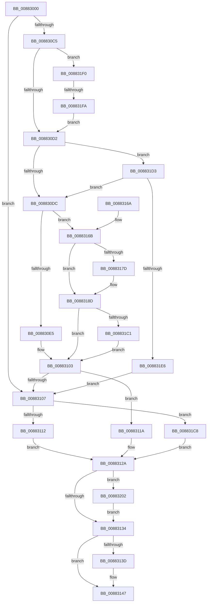

# MiAllocateVirtualMemoryCommon

- RVA: `0x00883000`–`0x0088320F` (길이 `527` bytes)
- VA: `0x0000000140883000`
- 실행 섹션: `PAGE`
- PDB 이름 있음: `예`; PDB Function 태그: `예`
- unwind 정보 RVA: `0x0007C7C0`
- 디코드: `130`개 명령, `527/527` bytes 표시
- 미해석 바이트: `0` (있으면 어셈블리에 `.byte`로 보존)

> 이 문서는 커널 이미지의 기계어와 PDB 기호를 분석해 생성했습니다. 4번과 5번은 함수 원형과 자료형을 바이너리 사용 방식에서 추정한 C 해석이며 원본 소스 복구 결과는 아닙니다.

## 1. Dependencies

- 직접 호출 지점: **5**; 고유 호출 대상: **4**
- 직접 호출자로 확인된 함수: **1**
- RIP 상대 이미지 참조: **2**

### Outgoing calls
- `0x008830BA` → [MiAllocateVirtualMemoryPrepare](MiAllocateVirtualMemoryPrepare_function_00883220.md) (function, `0x00883220`)
- `0x008830FC` → [MiAllocateVirtualMemory](MiAllocateVirtualMemory_function_00883B40.md) (function, `0x00883B40`)
- `0x00883142` → [ObfDereferenceObjectWithTag](../../text/2F/ObfDereferenceObjectWithTag_function_002F78E0.md) (function, `0x002F78E0`)
- `0x008831A3` → [MiAllocateVirtualMemory](MiAllocateVirtualMemory_function_00883B40.md) (function, `0x00883B40`)
- `0x00883205` → [PsDereferencePartition](../../text/34/PsDereferencePartition_function_00342E70.md) (function, `0x00342E70`)

### Direct callers
- [MmAllocateVirtualMemory](../9A/MmAllocateVirtualMemory_function_009A1A40.md) at `0x009A1B8D`

### Static image references
- `0x00883112` → RVA `0x00E302B4` (`.data`; read/write)
- `0x008831C8` → RVA `0x00E302B0` (`.data`; read/write)

## 2. Other-region calls and transfers

- 다른 실행 섹션으로 향하는 call: **2**
  - `0x00883142` → [ObfDereferenceObjectWithTag](../../text/2F/ObfDereferenceObjectWithTag_function_002F78E0.md) (`PAGE` → `.text`)
  - `0x00883205` → [PsDereferencePartition](../../text/34/PsDereferencePartition_function_00342E70.md) (`PAGE` → `.text`)
- call이 아닌 외부 분기/꼬리 이동: **1**
  - `0x008831F4` → [sub_00B18DCC](../B1/Unknown_function_00B18DCC.md) (`tail-transfer`)

## 3. Assembly (complete function range)

```asm
00883000  48 89 5C 24 08                  mov qword ptr [rsp + 8], rbx
00883005  48 89 74 24 10                  mov qword ptr [rsp + 0x10], rsi
0088300A  48 89 7C 24 18                  mov qword ptr [rsp + 0x18], rdi
0088300F  55                              push rbp
00883010  41 54                           push r12
00883012  41 55                           push r13
00883014  41 56                           push r14
00883016  41 57                           push r15
00883018  48 8D 6C 24 F0                  lea rbp, [rsp - 0x10]
0088301D  48 81 EC 10 01 00 00            sub rsp, 0x110
00883024  44 8B B5 80 00 00 00            mov r14d, dword ptr [rbp + 0x80]
0088302B  33 C0                           xor eax, eax
0088302D  44 0F B6 6D 78                  movzx r13d, byte ptr [rbp + 0x78]
00883032  0F 57 C0                        xorps xmm0, xmm0
00883035  48 8B 75 70                     mov rsi, qword ptr [rbp + 0x70]
00883039  8B F8                           mov edi, eax
0088303B  48 89 44 24 78                  mov qword ptr [rsp + 0x78], rax
00883040  4D 8B F9                        mov r15, r9
00883043  4D 8B 09                        mov r9, qword ptr [r9]
00883046  4C 8B E2                        mov r12, rdx
00883049  48 8B 12                        mov rdx, qword ptr [rdx]
0088304C  48 89 45 80                     mov qword ptr [rbp - 0x80], rax
00883050  48 89 44 24 70                  mov qword ptr [rsp + 0x70], rax
00883055  48 8D 45 80                     lea rax, [rbp - 0x80]
00883059  48 89 44 24 60                  mov qword ptr [rsp + 0x60], rax
0088305E  48 8D 45 90                     lea rax, [rbp - 0x70]
00883062  48 89 44 24 58                  mov qword ptr [rsp + 0x58], rax
00883067  48 8B 85 90 00 00 00            mov rax, qword ptr [rbp + 0x90]
0088306E  48 89 44 24 50                  mov qword ptr [rsp + 0x50], rax
00883073  8B 85 88 00 00 00               mov eax, dword ptr [rbp + 0x88]
00883079  89 44 24 48                     mov dword ptr [rsp + 0x48], eax
0088307D  8B 45 68                        mov eax, dword ptr [rbp + 0x68]
00883080  44 89 74 24 40                  mov dword ptr [rsp + 0x40], r14d
00883085  44 88 6C 24 38                  mov byte ptr [rsp + 0x38], r13b
0088308A  48 89 74 24 30                  mov qword ptr [rsp + 0x30], rsi
0088308F  89 44 24 28                     mov dword ptr [rsp + 0x28], eax
00883093  8B 45 60                        mov eax, dword ptr [rbp + 0x60]
00883096  89 44 24 20                     mov dword ptr [rsp + 0x20], eax
0088309A  0F 11 45 90                     movups xmmword ptr [rbp - 0x70], xmm0
0088309E  0F 11 45 A0                     movups xmmword ptr [rbp - 0x60], xmm0
008830A2  0F 11 45 B0                     movups xmmword ptr [rbp - 0x50], xmm0
008830A6  0F 11 45 C0                     movups xmmword ptr [rbp - 0x40], xmm0
008830AA  0F 11 45 D0                     movups xmmword ptr [rbp - 0x30], xmm0
008830AE  0F 11 45 E0                     movups xmmword ptr [rbp - 0x20], xmm0
008830B2  0F 11 45 F0                     movups xmmword ptr [rbp - 0x10], xmm0
008830B6  0F 11 45 00                     movups xmmword ptr [rbp], xmm0
008830BA  E8 61 01 00 00                  call 0x140883220
008830BF  8B D8                           mov ebx, eax
008830C1  85 C0                           test eax, eax
008830C3  78 42                           js 0x140883107
008830C5  48 8B 4E 18                     mov rcx, qword ptr [rsi + 0x18]
008830C9  48 85 C9                        test rcx, rcx
008830CC  0F 85 1E 01 00 00               jne 0x1408831f0
008830D2  80 7E 30 00                     cmp byte ptr [rsi + 0x30], 0
008830D6  0F 85 F7 00 00 00               jne 0x1408831d3
008830DC  45 85 F6                        test r14d, r14d
008830DF  0F 88 86 00 00 00               js 0x14088316b
008830E5  48 8D 44 24 78                  lea rax, [rsp + 0x78]
008830EA  45 33 C9                        xor r9d, r9d
008830ED  45 33 C0                        xor r8d, r8d
008830F0  48 89 44 24 20                  mov qword ptr [rsp + 0x20], rax
008830F5  48 8B D7                        mov rdx, rdi
008830F8  48 8D 4D 90                     lea rcx, [rbp - 0x70]
008830FC  E8 3F 0A 00 00                  call 0x140883b40
00883101  8B D8                           mov ebx, eax
00883103  85 DB                           test ebx, ebx
00883105  79 13                           jns 0x14088311a
00883107  48 83 7D 90 00                  cmp qword ptr [rbp - 0x70], 0
0088310C  0F 84 B6 00 00 00               je 0x1408831c8
00883112  FF 05 9C D1 5A 00               inc dword ptr [rip + 0x5ad19c]
00883118  EB 10                           jmp 0x14088312a
0088311A  48 8B 44 24 78                  mov rax, qword ptr [rsp + 0x78]
0088311F  49 89 04 24                     mov qword ptr [r12], rax
00883123  48 8B 45 A8                     mov rax, qword ptr [rbp - 0x58]
00883127  49 89 07                        mov qword ptr [r15], rax
0088312A  48 83 FF 02                     cmp rdi, 2
0088312E  0F 83 CE 00 00 00               jae 0x140883202
00883134  48 8B 4D 80                     mov rcx, qword ptr [rbp - 0x80]
00883138  48 85 C9                        test rcx, rcx
0088313B  74 0A                           je 0x140883147
0088313D  BA 4D 6D 56 6D                  mov edx, 0x6d566d4d
00883142  E8 99 47 A7 FF                  call 0x1402f78e0
00883147  4C 8D 9C 24 10 01 00 00         lea r11, [rsp + 0x110]
0088314F  8B C3                           mov eax, ebx
00883151  49 8B 5B 30                     mov rbx, qword ptr [r11 + 0x30]
00883155  49 8B 73 38                     mov rsi, qword ptr [r11 + 0x38]
00883159  49 8B 7B 40                     mov rdi, qword ptr [r11 + 0x40]
0088315D  49 8B E3                        mov rsp, r11
00883160  41 5F                           pop r15
00883162  41 5E                           pop r14
00883164  41 5D                           pop r13
00883166  41 5C                           pop r12
00883168  5D                              pop rbp
00883169  C3                              ret
0088316A  CC                              int3
0088316B  F7 45 D0 00 00 00 40            test dword ptr [rbp - 0x30], 0x40000000
00883172  48 C7 44 24 70 00 00 00 00      mov qword ptr [rsp + 0x70], 0
0088317B  74 10                           je 0x14088318d
0088317D  48 8D 44 24 70                  lea rax, [rsp + 0x70]
00883182  C7 45 D4 01 00 00 20            mov dword ptr [rbp - 0x2c], 0x20000001
00883189  48 89 45 D8                     mov qword ptr [rbp - 0x28], rax
0088318D  48 8D 44 24 78                  lea rax, [rsp + 0x78]
00883192  45 33 C9                        xor r9d, r9d
00883195  45 33 C0                        xor r8d, r8d
00883198  48 89 44 24 20                  mov qword ptr [rsp + 0x20], rax
0088319D  33 D2                           xor edx, edx
0088319F  48 8D 4D 90                     lea rcx, [rbp - 0x70]
008831A3  E8 98 09 00 00                  call 0x140883b40
008831A8  48 C7 45 D8 00 00 00 00         mov qword ptr [rbp - 0x28], 0
008831B0  8B D8                           mov ebx, eax
008831B2  C7 45 D4 00 00 00 00            mov dword ptr [rbp - 0x2c], 0
008831B9  85 C0                           test eax, eax
008831BB  0F 88 42 FF FF FF               js 0x140883103
008831C1  33 DB                           xor ebx, ebx
008831C3  E9 3B FF FF FF                  jmp 0x140883103
008831C8  FF 05 E2 D0 5A 00               inc dword ptr [rip + 0x5ad0e2]
008831CE  E9 57 FF FF FF                  jmp 0x14088312a
008831D3  8B 45 60                        mov eax, dword ptr [rbp + 0x60]
008831D6  25 00 00 40 20                  and eax, 0x20400000
008831DB  3D 00 00 40 00                  cmp eax, 0x400000
008831E0  0F 84 F6 FE FF FF               je 0x1408830dc
008831E6  BB 0D 00 00 C0                  mov ebx, 0xc000000d
008831EB  E9 17 FF FF FF                  jmp 0x140883107
008831F0  48 83 F9 FD                     cmp rcx, -3
008831F4  0F 85 D2 5B 29 00               jne 0x140b18dcc
008831FA  8D 79 04                        lea edi, [rcx + 4]
008831FD  E9 D0 FE FF FF                  jmp 0x1408830d2
00883202  48 8B CF                        mov rcx, rdi
00883205  E8 66 FC AB FF                  call 0x140342e70
0088320A  E9 25 FF FF FF                  jmp 0x140883134
```

## 4. C-style interpretation (structured pseudocode)

```c
__int64 __fastcall MiAllocateVirtualMemoryCommon(__int64 a1, __int64 a2, int a3, __int64 a4, unsigned int a5, unsigned int a6, __int64 a7, unsigned __int8 a8, unsigned int a9, unsigned int a10, __int64 a11)
{
    __int64 result;
    __int64 v_rbx;
    __int64 v_rsp;
    unsigned __int8 v_stack_m100;
    unsigned __int64 v_stack_m108;
    unsigned int v_stack_m110;
    unsigned int v_stack_m118;
    unsigned __int64 v_stack_m28;
    unsigned __int64 v_stack_m38;
    unsigned __int64 v_stack_m48;
    unsigned __int64 v_stack_m58;
    unsigned __int64 v_stack_m60;
    unsigned int v_stack_m64;
    unsigned __int64 v_stack_m68;
    unsigned __int64 v_stack_m78;
    unsigned __int64 v_stack_m88;
    unsigned __int64 v_stack_m90;
    unsigned __int64 v_stack_m98;
    unsigned __int64 v_stack_mA0;
    unsigned __int64 v_stack_mA8;
    unsigned __int64 v_stack_mB8;
    unsigned __int64 v_stack_mC0;
    unsigned __int64 v_stack_mC8;
    unsigned __int64 v_stack_mD8;
    unsigned __int64 v_stack_mE0;
    unsigned __int64 v_stack_mE8;
    unsigned int v_stack_mF0;
    unsigned int v_stack_mF8;
    unsigned __int64 v_stack_p10;
    unsigned __int64 v_stack_p18;
    unsigned __int64 v_stack_p8;

    v_stack_p8 = v_rbx;
    v_stack_p10 = v_rsi;
    v_stack_p18 = v_rdi;
    v_rsp = (v_rsp) - (272);
    result = 0;
    v_stack_mC0 = 0;
    v_stack_mB8 = 0;
    v_stack_mC8 = 0;
    v_stack_mD8 = v_stack_mB8;
    v_stack_mE0 = v_stack_mA8;
    v_stack_mE8 = a11;
    v_stack_mF0 = (unsigned int)((unsigned int)(a10));
    v_stack_mF8 = (unsigned int)((unsigned int)(a9));
    v_stack_m100 = a8;
    v_stack_m108 = a7;
    v_stack_m110 = (unsigned int)((unsigned int)(a6));
    v_stack_m118 = (unsigned int)((unsigned int)(a5));
    v_stack_mA8 = v_xmm0;
    v_stack_m98 = v_xmm0;
    v_stack_m88 = v_xmm0;
    v_stack_m78 = v_xmm0;
    v_stack_m68 = v_xmm0;
    v_stack_m58 = v_xmm0;
    v_stack_m48 = v_xmm0;
    v_stack_m38 = v_xmm0;
    result = MiAllocateVirtualMemoryPrepare(a1, *(unsigned __int64 *)(a2), a3, *(unsigned __int64 *)(a4));
    if (sign_flag) goto loc_00883107;
    if (*(unsigned __int64 *)(a7 + 24) != 0) goto loc_008831F0;
loc_008830D2:
    if ((*(unsigned __int8 *)(a7 + 48)) != 0) goto loc_008831D3;
loc_008830DC:
    if (sign_flag) goto loc_0088316B;
    a4 = 0;
    a3 = 0;
    v_stack_m118 = v_stack_mC0;
    result = MiAllocateVirtualMemory(v_stack_mA8, 0, a3, a4);
loc_00883103:
    if (!sign_flag) goto loc_0088311A;
loc_00883107:
    if (v_stack_mA8 == 0) goto loc_008831C8;
    goto loc_0088312A;
loc_0088311A:
    *(unsigned __int64 *)(a2) = v_stack_mC0;
    *(unsigned __int64 *)(a4) = v_stack_m90;
loc_0088312A:
    if (0 >= 2) goto loc_00883202;
loc_00883134:
    result = v_stack_m90;
    if (v_stack_mB8 != 0) {
        a2 = 0x6D566D4DULL;
        result = ObfDereferenceObjectWithTag(v_stack_mB8, a2, a3, a4);
    }
    return (unsigned int)((unsigned int)((unsigned int)((unsigned int)(result))));
loc_0088316B:
    v_stack_mA0 = 0;
    result = (unsigned int)((unsigned int)((unsigned int)((unsigned int)(result))));
    if (((v_stack_m68) & (0x40000000ULL)) != 0) {
        result = v_stack_mA0;
        v_stack_m64 = 0x20000001ULL;
        v_stack_m60 = result;
    }
    a4 = 0;
    a3 = 0;
    v_stack_mF0 = v_stack_m98;
    a2 = 0;
    result = MiAllocateVirtualMemory(v_stack_mA8, a2, a3, a4);
    v_stack_m60 = 0;
    v_stack_m64 = 0;
    if (sign_flag) goto loc_00883103;
    v_rbx = 0;
    goto loc_00883103;
loc_008831C8:
    goto loc_0088312A;
loc_008831D3:
    result = (unsigned int)(((unsigned int)(a5)) & (0x20400000ULL));
    if (((unsigned int)(result)) == 0x400000ULL) goto loc_008830DC;
    goto loc_00883107;
loc_008831F0:
    goto loc_008830D2;
loc_00883202:
    result = PsDereferencePartition(v_stack_mA8 + 4, a2, a3, a4);
    goto loc_00883134;
}
```

## 5. (Beta) C Style

```c
int64_t MiAllocateVirtualMemoryCommon(int64_t Arg1, void *Arg2, int32_t Arg3, void *Arg4, uint32_t Arg5, uint32_t Arg6, void *Arg7, uint8_t Arg8, uint32_t Arg9, uint32_t Arg10, int64_t Arg11)
{
    uint8_t *arg2 = (uint8_t *)Arg2;
    uint8_t *arg4 = (uint8_t *)Arg4;
    uint8_t *arg7 = (uint8_t *)Arg7;

    int64_t result;
    int64_t local_rbx;
    int64_t local_rsp;
    uint8_t v_stack_m100;
    uint64_t v_stack_m108;
    uint32_t v_stack_m110;
    uint32_t v_stack_m118;
    uint64_t v_stack_m28;
    uint64_t v_stack_m38;
    uint64_t v_stack_m48;
    uint64_t v_stack_m58;
    uint64_t v_stack_m60;
    uint32_t v_stack_m64;
    uint64_t v_stack_m68;
    uint64_t v_stack_m78;
    uint64_t v_stack_m88;
    uint64_t v_stack_m90;
    uint64_t v_stack_m98;
    uint64_t v_stack_mA0;
    uint64_t v_stack_mA8;
    uint64_t v_stack_mB8;
    uint64_t v_stack_mC0;
    uint64_t v_stack_mC8;
    uint64_t v_stack_mD8;
    uint64_t v_stack_mE0;
    uint64_t v_stack_mE8;
    uint32_t v_stack_mF0;
    uint32_t v_stack_mF8;
    uint64_t v_stack_p10;
    uint64_t v_stack_p18;
    uint64_t v_stack_p8;

    v_stack_p8 = local_rbx;
    v_stack_p10 = local_rsi;
    v_stack_p18 = local_rdi;
    local_rsp = (local_rsp) - (272);
    result = 0;
    v_stack_mC0 = 0;
    v_stack_mB8 = 0;
    v_stack_mC8 = 0;
    v_stack_mD8 = v_stack_mB8;
    v_stack_mE0 = v_stack_mA8;
    v_stack_mE8 = Arg11;
    v_stack_mF0 = (uint32_t)((uint32_t)(Arg10));
    v_stack_mF8 = (uint32_t)((uint32_t)(Arg9));
    v_stack_m100 = Arg8;
    v_stack_m108 = Arg7;
    v_stack_m110 = (uint32_t)((uint32_t)(Arg6));
    v_stack_m118 = (uint32_t)((uint32_t)(Arg5));
    v_stack_mA8 = v_xmm0;
    v_stack_m98 = v_xmm0;
    v_stack_m88 = v_xmm0;
    v_stack_m78 = v_xmm0;
    v_stack_m68 = v_xmm0;
    v_stack_m58 = v_xmm0;
    v_stack_m48 = v_xmm0;
    v_stack_m38 = v_xmm0;
    result = MiAllocateVirtualMemoryPrepare(Arg1, *(uint64_t *)(arg2), Arg3, *(uint64_t *)(arg4));
    if (sign_flag) goto loc_00883107;
    if (*(uint64_t *)(arg7 + 0x18) != 0) goto loc_008831F0;
loc_008830D2:
    if ((*(uint8_t *)(arg7 + 0x30)) != 0) goto loc_008831D3;
loc_008830DC:
    if (sign_flag) goto loc_0088316B;
    Arg4 = 0;
    Arg3 = 0;
    v_stack_m118 = v_stack_mC0;
    result = MiAllocateVirtualMemory(v_stack_mA8, 0, Arg3, Arg4);
loc_00883103:
    if (!sign_flag) goto loc_0088311A;
loc_00883107:
    if (v_stack_mA8 == 0) goto loc_008831C8;
    goto loc_0088312A;
loc_0088311A:
    *(uint64_t *)(arg2) = v_stack_mC0;
    *(uint64_t *)(arg4) = v_stack_m90;
loc_0088312A:
    if (0 >= 2) goto loc_00883202;
loc_00883134:
    result = v_stack_m90;
    if (v_stack_mB8 != 0) {
        Arg2 = 0x6D566D4DULL;
        result = ObfDereferenceObjectWithTag(v_stack_mB8, Arg2, Arg3, Arg4);
    }
    return (uint32_t)((uint32_t)((uint32_t)((uint32_t)(result))));
loc_0088316B:
    v_stack_mA0 = 0;
    result = (uint32_t)((uint32_t)((uint32_t)((uint32_t)(result))));
    if (((v_stack_m68) & (0x40000000ULL)) != 0) {
        result = v_stack_mA0;
        v_stack_m64 = 0x20000001ULL;
        v_stack_m60 = result;
    }
    Arg4 = 0;
    Arg3 = 0;
    v_stack_mF0 = v_stack_m98;
    Arg2 = 0;
    result = MiAllocateVirtualMemory(v_stack_mA8, Arg2, Arg3, Arg4);
    v_stack_m60 = 0;
    v_stack_m64 = 0;
    if (sign_flag) goto loc_00883103;
    local_rbx = 0;
    goto loc_00883103;
loc_008831C8:
    goto loc_0088312A;
loc_008831D3:
    result = (uint32_t)(((uint32_t)(Arg5)) & (0x20400000ULL));
    if (((uint32_t)(result)) == 0x400000ULL) goto loc_008830DC;
    goto loc_00883107;
loc_008831F0:
    goto loc_008830D2;
loc_00883202:
    result = PsDereferencePartition(v_stack_mA8 + 4, Arg2, Arg3, Arg4);
    goto loc_00883134;
}
```

### 관측된 메모리 오프셋

구조체 형식이 확인되지 않은 접근은 인자 기준의 오프셋으로만 기록했습니다.

| 기준 인자 | 오프셋 표현 | 폭 (bit) | 접근 |
|---|---:|---:|---|
| `Arg2` | `+ 0x0` | `64` | `R` |
| `Arg2` | `+ 0x0` | `64` | `W` |
| `Arg4` | `+ 0x0` | `64` | `R` |
| `Arg4` | `+ 0x0` | `64` | `W` |
| `Arg7` | `+ 0x18` | `64` | `R` |
| `Arg7` | `+ 0x30` | `8` | `R` |

## 6. Execution-region graph

[열기: 2D/3D 그래프와 함수 탐색 컨트롤 패널](../../../control-panel.html?section=page&rva=0x00883000&view=graph)

- 2D 그래프는 위에서 아래로 흐르고, 3D 그래프는 빈 공간을 드래그해 회전합니다. Shift+드래그는 이동, 휠은 확대·축소, 함수 노드 선택은 대상 보고서 이동입니다.

### Static fallback


