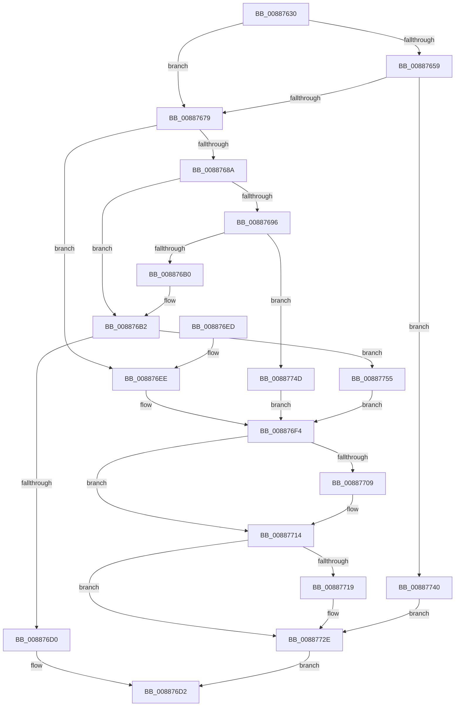

# MiChargeFullProcessCommitment

- RVA: `0x00887630`–`0x0088775D` (길이 `301` bytes)
- VA: `0x0000000140887630`
- 실행 섹션: `PAGE`
- PDB 이름 있음: `예`; PDB Function 태그: `아니요`
- unwind 정보 RVA: `0x0007CC98`
- 디코드: `83`개 명령, `301/301` bytes 표시
- 미해석 바이트: `0` (있으면 어셈블리에 `.byte`로 보존)

> 이 문서는 커널 이미지의 기계어와 PDB 기호를 분석해 생성했습니다. 4번과 5번은 함수 원형과 자료형을 바이너리 사용 방식에서 추정한 C 해석이며 원본 소스 복구 결과는 아닙니다.

## 1. Dependencies

- 직접 호출 지점: **9**; 고유 호출 대상: **8**
- 직접 호출자로 확인된 함수: **13**
- RIP 상대 이미지 참조: **1**

### Outgoing calls
- `0x0088766C` → [PspChargeQuota](../../text/39/PspChargeQuota_function_00390330.md) (function, `0x00390330`)
- `0x00887681` → [MiChargeProcessCommitment](../../text/43/MiChargeProcessCommitment_function_004384C0.md) (function, `0x004384C0`)
- `0x008876A3` → [PspChangeJobMemoryUsageByProcess](../87/PspChangeJobMemoryUsageByProcess_function_0087F030.md) (function, `0x0087F030`)
- `0x008876B5` → [MiGetProcessPartition](../../text/44/MiGetProcessPartition_function_00443B10.md) (function, `0x00443B10`)
- `0x008876C3` → [MiChargeCommit](../../text/28/MiChargeCommit_function_00286EB0.md) (function, `0x00286EB0`)
- `0x008876FF` → [PsReturnProcessPageFileQuota](../9E/PsReturnProcessPageFileQuota_function_009EC280.md) (function, `0x009EC280`)
- `0x0088770F` → [MiReturnProcessCommitment](../../text/45/MiReturnProcessCommitment_function_0045CED4.md) (function, `0x0045CED4`)
- `0x00887729` → [PspChangeJobMemoryUsageByProcess](../87/PspChangeJobMemoryUsageByProcess_function_0087F030.md) (function, `0x0087F030`)
- `0x00887737` → [MiCommitRequestFailed](../AC/MiCommitRequestFailed_function_00AC41E0.md) (function, `0x00AC41E0`)

### Direct callers
- [MiProbeAndLockPrepare](../../text/23/MiProbeAndLockPrepare_function_0023BB40.md) at `0x0023BDCD`
- [MiMakeHyperRangeAccessible](../../text/27/MiMakeHyperRangeAccessible_function_0027CE10.md) at `0x0027D05D`
- [MiSplitPrivatePage](../../text/2A/MiSplitPrivatePage_function_002A6210.md) at `0x002A629B`
- [sub_002C3A7C](../../text/2C/Unknown_function_002C3A7C.md) at `0x002C3AB0`
- [sub_002C3A7C](../../text/2C/Unknown_function_002C3A7C.md) at `0x002C42BD`
- [MiProtectPrivateMemory](../../text/2C/MiProtectPrivateMemory_function_002C45B0.md) at `0x002C50AD`
- [MiCommitExistingVad](../../text/32/MiCommitExistingVad_function_0032A860.md) at `0x0032AADB`
- [MiCommitExistingVad](../../text/32/MiCommitExistingVad_function_0032A860.md) at `0x0032B58D`
- [MiCommitExistingVad](../../text/32/MiCommitExistingVad_function_0032A860.md) at `0x0032B5A8`
- [MiCopyToUserVa](../../text/3D/MiCopyToUserVa_function_003D1E68.md) at `0x003D20F5`
- [MiSplitReducedCommitClonePage](../../text/4F/MiSplitReducedCommitClonePage_function_004FA808.md) at `0x004FA884`
- [MiCommitHotPatchTable](../../text/68/MiCommitHotPatchTable_function_00683420.md) at `0x00683458`
- [MiPrepareImagePagesForHotPatch](../../text/68/MiPrepareImagePagesForHotPatch_function_00683800.md) at `0x006838BF`
- [MiCommitPageTablesForVad](MiCommitPageTablesForVad_function_00886D50.md) at `0x00887000`
- [MiCommitPageTablesForVad](MiCommitPageTablesForVad_function_00886D50.md) at `0x0088704B`
- [MiComputeProcessUserVa](../8C/MiComputeProcessUserVa_function_008CFB8C.md) at `0x008CFCA4`
- [MiCreateLargePageVad](../A9/MiCreateLargePageVad_function_00A99B50.md) at `0x00A99C4F`

### Static image references
- `0x0088764A` → RVA `0x00FC6AB0` (`ALMOSTRO`; read)

## 2. Other-region calls and transfers

- 다른 실행 섹션으로 향하는 call: **5**
  - `0x0088766C` → [PspChargeQuota](../../text/39/PspChargeQuota_function_00390330.md) (`PAGE` → `.text`)
  - `0x00887681` → [MiChargeProcessCommitment](../../text/43/MiChargeProcessCommitment_function_004384C0.md) (`PAGE` → `.text`)
  - `0x008876B5` → [MiGetProcessPartition](../../text/44/MiGetProcessPartition_function_00443B10.md) (`PAGE` → `.text`)
  - `0x008876C3` → [MiChargeCommit](../../text/28/MiChargeCommit_function_00286EB0.md) (`PAGE` → `.text`)
  - `0x0088770F` → [MiReturnProcessCommitment](../../text/45/MiReturnProcessCommitment_function_0045CED4.md) (`PAGE` → `.text`)
- 별도 외부 분기/꼬리 이동을 확인하지 못했습니다.

## 3. Assembly (complete function range)

```asm
00887630  48 89 5C 24 08                  mov qword ptr [rsp + 8], rbx
00887635  48 89 6C 24 10                  mov qword ptr [rsp + 0x10], rbp
0088763A  48 89 74 24 18                  mov qword ptr [rsp + 0x18], rsi
0088763F  48 89 7C 24 20                  mov qword ptr [rsp + 0x20], rdi
00887644  41 56                           push r14
00887646  48 83 EC 20                     sub rsp, 0x20
0088764A  48 3B 0D 5F F4 73 00            cmp rcx, qword ptr [rip + 0x73f45f]
00887651  48 8B F2                        mov rsi, rdx
00887654  48 8B F9                        mov rdi, rcx
00887657  74 20                           je 0x140887679
00887659  48 8B 89 F8 02 00 00            mov rcx, qword ptr [rcx + 0x2f8]
00887660  4C 8B CA                        mov r9, rdx
00887663  48 8B D7                        mov rdx, rdi
00887666  41 B8 02 00 00 00               mov r8d, 2
0088766C  E8 BF 8C B0 FF                  call 0x140390330
00887671  85 C0                           test eax, eax
00887673  0F 88 C7 00 00 00               js 0x140887740
00887679  48 8B D6                        mov rdx, rsi
0088767C  48 8B CF                        mov rcx, rdi
0088767F  B3 01                           mov bl, 1
00887681  E8 3A 0E BB FF                  call 0x1404384c0
00887686  85 C0                           test eax, eax
00887688  74 64                           je 0x1408876ee
0088768A  8B 87 F0 01 00 00               mov eax, dword ptr [rdi + 0x1f0]
00887690  B3 03                           mov bl, 3
00887692  A8 10                           test al, 0x10
00887694  74 1C                           je 0x1408876b2
00887696  45 33 C9                        xor r9d, r9d
00887699  4C 8B C7                        mov r8, rdi
0088769C  48 8B D6                        mov rdx, rsi
0088769F  41 8D 49 02                     lea ecx, [r9 + 2]
008876A3  E8 88 79 FF FF                  call 0x14087f030
008876A8  84 C0                           test al, al
008876AA  0F 84 9D 00 00 00               je 0x14088774d
008876B0  B3 07                           mov bl, 7
008876B2  48 8B CF                        mov rcx, rdi
008876B5  E8 56 C4 BB FF                  call 0x140443b10
008876BA  48 8B D6                        mov rdx, rsi
008876BD  48 8B C8                        mov rcx, rax
008876C0  45 33 C0                        xor r8d, r8d
008876C3  E8 E8 F7 9F FF                  call 0x140286eb0
008876C8  85 C0                           test eax, eax
008876CA  0F 84 85 00 00 00               je 0x140887755
008876D0  33 C0                           xor eax, eax
008876D2  48 8B 5C 24 30                  mov rbx, qword ptr [rsp + 0x30]
008876D7  48 8B 6C 24 38                  mov rbp, qword ptr [rsp + 0x38]
008876DC  48 8B 74 24 40                  mov rsi, qword ptr [rsp + 0x40]
008876E1  48 8B 7C 24 48                  mov rdi, qword ptr [rsp + 0x48]
008876E6  48 83 C4 20                     add rsp, 0x20
008876EA  41 5E                           pop r14
008876EC  C3                              ret
008876ED  CC                              int3
008876EE  41 BE 02 00 00 00               mov r14d, 2
008876F4  48 8B D6                        mov rdx, rsi
008876F7  48 8B CF                        mov rcx, rdi
008876FA  BD 2D 01 00 C0                  mov ebp, 0xc000012d
008876FF  E8 7C 4B 16 00                  call 0x1409ec280
00887704  F6 C3 02                        test bl, 2
00887707  74 0B                           je 0x140887714
00887709  48 8B D6                        mov rdx, rsi
0088770C  48 8B CF                        mov rcx, rdi
0088770F  E8 C0 57 BD FF                  call 0x14045ced4
00887714  80 FB 04                        cmp bl, 4
00887717  72 15                           jb 0x14088772e
00887719  45 33 C9                        xor r9d, r9d
0088771C  48 8B D6                        mov rdx, rsi
0088771F  48 F7 DA                        neg rdx
00887722  4C 8B C7                        mov r8, rdi
00887725  41 8D 49 02                     lea ecx, [r9 + 2]
00887729  E8 02 79 FF FF                  call 0x14087f030
0088772E  45 8B CE                        mov r9d, r14d
00887731  4C 8B C6                        mov r8, rsi
00887734  48 8B CF                        mov rcx, rdi
00887737  E8 A4 CA 23 00                  call 0x140ac41e0
0088773C  8B C5                           mov eax, ebp
0088773E  EB 92                           jmp 0x1408876d2
00887740  BD 2C 01 00 C0                  mov ebp, 0xc000012c
00887745  41 BE 01 00 00 00               mov r14d, 1
0088774B  EB E1                           jmp 0x14088772e
0088774D  41 BE 03 00 00 00               mov r14d, 3
00887753  EB 9F                           jmp 0x1408876f4
00887755  41 BE 04 00 00 00               mov r14d, 4
0088775B  EB 97                           jmp 0x1408876f4
```

## 4. C-style interpretation (structured pseudocode)

```c
__int64 __fastcall MiChargeFullProcessCommitment(__int64 a1, __int64 a2)
{
    __int64 result;
    __int64 v_rsp;
    unsigned __int64 v_stack_p10;
    unsigned __int64 v_stack_p18;
    unsigned __int64 v_stack_p20;
    unsigned __int64 v_stack_p8;

    v_stack_p8 = v_rbx;
    v_stack_p10 = v_rbp;
    v_stack_p18 = v_rsi;
    v_stack_p20 = v_rdi;
    v_rsp = (v_rsp) - (32);
    if (a1 == (*(unsigned __int64 *)(v_rip + 7599199))) goto loc_00887679;
    result = PspChargeQuota(*(unsigned __int64 *)(a1 + 760), a1, 2, a2);
    if (sign_flag) goto loc_00887740;
loc_00887679:
    result = MiChargeProcessCommitment(a1, a2, 2, a2);
    if ((unsigned int)(result) == 0) goto loc_008876EE;
    if ((((unsigned __int8)((unsigned int)(*(unsigned int *)(a1 + 496)))) & (16)) == 0) goto loc_008876B2;
    a4 = 0;
    result = PspChangeJobMemoryUsageByProcess(a4 + 2, a2, a1, a4);
    if ((unsigned __int8)(result) == 0) goto loc_0088774D;
loc_008876B2:
    result = MiGetProcessPartition(a1, a2, a1, a4);
    a3 = 0;
    result = MiChargeCommit(result, a2, a3, a4);
    if ((unsigned int)(result) == 0) goto loc_00887755;
    result = 0;
loc_008876D2:
    v_rsp = (v_rsp) + (32);
    return result;
loc_008876EE:
loc_008876F4:
    result = PsReturnProcessPageFileQuota(v_stack_p20, v_stack_p18, a3, a4);
    if ((((unsigned __int8)(v_stack_p8)) & (2)) != 0) {
        a2 = v_stack_p18;
        a1 = v_stack_p20;
        result = MiReturnProcessCommitment(a1, a2, a3, a4);
    }
    if (((unsigned __int8)(v_stack_p8)) >= 4) {
        a4 = 0;
        a2 = v_stack_p18;
        a2 = -(a2);
        a3 = v_stack_p20;
        a1 = a4 + 2;
        result = PspChangeJobMemoryUsageByProcess(a1, a2, a3, a4);
    }
    result = MiCommitRequestFailed(v_stack_p20, a2, v_stack_p18, 2);
    goto loc_008876D2;
loc_00887740:
    goto loc_0088772E;
loc_0088774D:
    goto loc_008876F4;
loc_00887755:
    goto loc_008876F4;
}
```

## 5. (Beta) C Style

```c
int64_t MiChargeFullProcessCommitment(int64_t Arg1, int64_t Arg2)
{
    int64_t result;
    int64_t local_rsp;
    uint64_t v_stack_p10;
    uint64_t v_stack_p18;
    uint64_t v_stack_p20;
    uint64_t v_stack_p8;

    v_stack_p8 = local_rbx;
    v_stack_p10 = local_rbp;
    v_stack_p18 = local_rsi;
    v_stack_p20 = local_rdi;
    local_rsp = (local_rsp) - (32);
    if (Arg1 == (*(uint64_t *)(v_rip + 0x73F45F))) goto loc_00887679;
    result = PspChargeQuota(*(uint64_t *)(Arg1 + 0x2F8), Arg1, 2, Arg2);
    if (sign_flag) goto loc_00887740;
loc_00887679:
    result = MiChargeProcessCommitment(Arg1, Arg2, 2, Arg2);
    if ((uint32_t)(result) == 0) goto loc_008876EE;
    if ((((uint8_t)((uint32_t)(*(uint32_t *)(Arg1 + 0x1F0)))) & (16)) == 0) goto loc_008876B2;
    a4 = 0;
    result = PspChangeJobMemoryUsageByProcess(a4 + 2, Arg2, Arg1, a4);
    if ((uint8_t)(result) == 0) goto loc_0088774D;
loc_008876B2:
    result = MiGetProcessPartition(Arg1, Arg2, Arg1, a4);
    a3 = 0;
    result = MiChargeCommit(result, Arg2, a3, a4);
    if ((uint32_t)(result) == 0) goto loc_00887755;
    result = 0;
loc_008876D2:
    local_rsp = (local_rsp) + (32);
    return result;
loc_008876EE:
loc_008876F4:
    result = PsReturnProcessPageFileQuota(v_stack_p20, v_stack_p18, a3, a4);
    if ((((uint8_t)(v_stack_p8)) & (2)) != 0) {
        Arg2 = v_stack_p18;
        Arg1 = v_stack_p20;
        result = MiReturnProcessCommitment(Arg1, Arg2, a3, a4);
    }
    if (((uint8_t)(v_stack_p8)) >= 4) {
        a4 = 0;
        Arg2 = v_stack_p18;
        Arg2 = -(Arg2);
        a3 = v_stack_p20;
        Arg1 = a4 + 2;
        result = PspChangeJobMemoryUsageByProcess(Arg1, Arg2, a3, a4);
    }
    result = MiCommitRequestFailed(v_stack_p20, Arg2, v_stack_p18, 2);
    goto loc_008876D2;
loc_00887740:
    goto loc_0088772E;
loc_0088774D:
    goto loc_008876F4;
loc_00887755:
    goto loc_008876F4;
}
```

## 6. Execution-region graph

[열기: 2D/3D 그래프와 함수 탐색 컨트롤 패널](../../../control-panel.html?section=page&rva=0x00887630&view=graph)

- 2D 그래프는 위에서 아래로 흐르고, 3D 그래프는 빈 공간을 드래그해 회전합니다. Shift+드래그는 이동, 휠은 확대·축소, 함수 노드 선택은 대상 보고서 이동입니다.

### Static fallback


